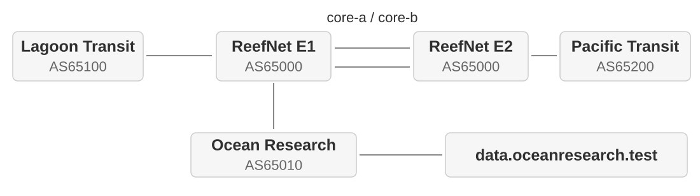

# Network Management and Monitoring

Lecture slides and practical exercises for AI5049 at Hochschule Fulda.

The exercises use ReefNet, a small dual-stack ISP with two upstream providers and one customer, Bora Bora Ocean Research.

<picture>
  <source media="(prefers-color-scheme: dark)" srcset="assets/topology-dark.svg">
  
</picture>

## Slides

[PDF](slides/exports/nmm.pdf) | [HTML](slides/exports/nmm.html) | [PowerPoint](slides/exports/nmm.pptx) | [Source](slides/nmm.md)

<details>
<summary>Editing slides</summary>

With Node.js 18+, npm and Chromium installed, build from the repository root:

```bash
npm --prefix slides ci
make slides
```

- Exports: lecture HTML, PDF and PPTX in `slides/exports/`. PowerPoint contains slide images. Edit lecture content in the Marp source.
- Install Liberation fonts. Set `CHROME_PATH` if Chromium is not at `/usr/bin/chromium`.
- For VS Code preview, use the Marp extension and enable `markdown.marp.enableHtml`.
- Lecture theme: `slides/theme/ai5049.css`.
- [Diagram sources](slides/assets/README.md) and [teaching data](slides/assets/data/README.md) describe regeneration. Python 3 is needed for the generators.
- `npm --prefix slides run sampling` regenerates the synthetic timing-model data.

</details>

## Setup

The lab PCs have [WSL-Containerlab](https://github.com/srl-labs/WSL-Containerlab) preinstalled. Clone the repository and run `make setup`.

On Windows, open the installed WSL environment from PowerShell:

```powershell
wsl -d Containerlab
```

Inside WSL (or your own Linux environment), clone into your Linux home directory. Avoid `/mnt/c` and OneDrive.

```bash
cd ~
git clone https://github.com/Stinktopf/network-management-and-monitoring.git
cd network-management-and-monitoring
make setup
```

Wait for `READY FOR CLASS`. Setup checks all four scenarios, then stops the containers.

<details>
<summary>Setup on your own computer</summary>

- **Windows:** use [WSL-Containerlab](https://github.com/srl-labs/WSL-Containerlab#quick-start).
- **Linux:** install [Containerlab](https://containerlab.dev/install/) and Docker Engine locally.
- **macOS:** use [a Linux VM](https://containerlab.dev/macos/) with Docker Engine, Containerlab and this repository inside it. Run all lab commands there. Docker Desktop alone is insufficient.

Tested on x86-64 WSL. Native Linux and Mac VMs are untested, including image compatibility on Apple Silicon. Run `make setup` to check your environment.

- Docker must be running on the same Linux host as the repository. Install Docker Compose, Containerlab, Git, Make, curl, Bash 4+, GNU coreutils (`timeout`) and iproute2 (`ss`).
- Leave 15 GiB of disk space for the lab and its images. Setup needs Internet access.
- Recommended: 12 GiB RAM and four CPU threads, allocated to the VM when using one.

### Troubleshooting

Start with `make doctor` and the failed phase in `.state/setup-*.log`. `make diagnostics` collects more detail.

Check disk space, Docker access and occupied ports (8000, 3000, 9090, 3100, 12345).

Fix the cause and rerun `make setup`.

</details>

## Exercises

Work at your own pace after the demo. Keep notes, no submission is required. To continue at home, set up the lab and repeat the investigation using your notes.

Run `make` commands in the repository. “WSL” in the guides also means your Linux or VM terminal. Start one scenario at a time:

| Start | Task | In class |
|---|---|---|
| `make networking` | Follow a request to `data.oceanresearch.test`. Explain DNS, routing and the reply path. | 60 min |
| `make operations` | Diagnose the Lagoon service failure, repair it and verify recovery. | 45 min |
| `make automation` | Investigate the same fault using NetBox and gNMI, then apply and verify an API change. | 60 min |
| `make monitoring` | Compare congestion, a link outage, a routing fault and a short traffic burst. | 75 min |

Times exclude demos. Networking includes 30 minutes of setup and 30 minutes of exercises.

| Help | Purpose |
|---|---|
| `make task` | Task and starting point |
| `make hint` | Investigation commands and clues |
| `make solution` | Commands and expected results |

Select a step with `STEP=2`, for example `make hint STEP=2`.

`make down` discards router changes. Restarting a scenario recreates its initial state.

## Lab services

| Service | Start here | Login |
|---|---|---|
| [NetBox](http://localhost:8000) | Inventory: **Devices**, then `edge01.bob1.reefnet.test` | `admin` / `admin` |
| [Prometheus](http://localhost:9090) | Metrics: query `up` to check collection | No login |
| [Grafana](http://localhost:3000) | Dashboards: **ReefNet / BOB1 → Network Overview** | Anonymous administration |

Use a trusted network: these services expose lab access without secure credentials. For a VM, use its IP address or forward the ports.

For router access, follow the hints' `make enter NODE=...` commands. SSH from `operations01.bob1.reefnet.test` uses `admin` / `NokiaSrl1!`. Leave Linux with `exit`, router CLIs with `quit`.

## Traffic

- Customer handoff: **100 Mbit/s**
- Lagoon Transit handoff: **50 Mbit/s**
- Pacific Transit handoff: **50 Mbit/s**

| Command | Load |
|---|---|
| `make traffic-10mbit` | Baseline, restore after measuring |
| `make traffic-40mbit` | Below transit capacity |
| `make traffic-60mbit` or `make traffic-75mbit` | Above transit capacity |
| `make traffic-stop` | Stop traffic |

Choose one load at a time.

## Housekeeping

| Command | Action |
|---|---|
| `make down` | Stop runtime, keep NetBox data |
| `make reset` | Rebuild the current scenario |
| `make clean` | **Delete lab state and NetBox data**, keep downloaded images |
| `make status` | Show runtime status |
| `make test` | Ping the customer over IPv4/IPv6 from both probes |
| `make course-check` | Restart and test all four scenarios, then stop |
| `make check` | Check source, documentation and network model without Docker |
| `make healthy` | Clear faults, stop traffic and restore link capacities |
| `make help` | List commands |

After `make clean`, run `make setup` again.
