<!-- _class: title core -->
<!-- _footer: "AI5049, Hochschule Fulda" -->

<!-- _paginate: false -->

# Network Management and Monitoring

## AI5049, Winter Semester 2026/27

12 October 2026

Lucas Immanuel Nickel

---
<!-- _class: content core -->
<!-- _footer: "AI5049, Hochschule Fulda" -->

# About me

Lucas Immanuel Nickel

- Network Operations Engineer at DE-CIX
- Research Associate at Fulda University of Applied Sciences
- M.Sc. Applied Computer Science, research stay at the University of Toronto

---
<!-- _class: content core -->
<!-- _footer: "AI5049, Hochschule Fulda" -->

# What is this course about?

Find faults. Make safe changes. Measure the service.

Use that experience to investigate one network-management question.

---
<!-- _class: content core -->
<!-- _footer: "AI5049, Hochschule Fulda" -->

# Our lens: large IP networks

ISP backbones, transit, peering and IXPs.

We study how operators keep these networks working.

---
<!-- _class: content core -->
<!-- _footer: "AI5049, Hochschule Fulda" -->

# The technical block

| Date | Time | Topic |
|---|---|---|
| 12 October 2026 | 13:45–17:00 | Networking 101 |
| 13 October 2026 | 08:45–15:15 | Operations + Automation + Incidents |
| 14 October 2026 | 08:45–15:15 | Monitoring / Observability |

Short demos, then time to try it yourself.
Use the university lab PCs with Containerlab preinstalled.

---
<!-- _class: visual core -->
<!-- _footer: "AI5049, Hochschule Fulda" -->

# ReefNet, from four sides

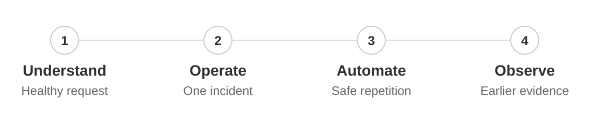

---
<!-- _class: content schedule core -->
<!-- _footer: "AI5049, Hochschule Fulda" -->

# The project workshops

Friday sessions: **13:45–18:45**

| Date | Focus |
|---|---|
| 30 October 2026 | Research questions and sources |
| 13 November 2026 | Experimental design |
| 27 November 2026 | Analysis and scientific argument |
| 11 December 2026 | Forecasts, control loops and agents |
| 22 January 2027 | In-class peer review and revision |
| 5 February 2027 | Presentations and reproducibility |

---
<!-- _class: content core -->
<!-- _footer: "AI5049, Hochschule Fulda" -->

# Fridays: work on your project

Short input together, then project work and individual support.

Bring your code, data, draft and current blocker.

---
<!-- _class: content core -->
<!-- _footer: "<span class=\"footer-context\">AI5049, Hochschule Fulda</span><span class=\"footer-refs\"><a href=\"https://conferences.ieeeauthorcenter.ieee.org/write-your-paper/authoring-tools-and-templates/\">IEEE paper templates</a></span>" -->

# Your project

**One question. Teams of 3–4. A meaningful comparison.**

| Submit | Requirement |
|---|---|
| Paper | English, IEEE two-column, six pages including references |
| Artifact | Reproducible evidence |
| Declaration | Contributions, outside the page limit |

Group choice: **12 Oct, 13:45 → 27 Nov, 23:59**.
Nominate one contact person.

---
<!-- _class: content core -->
<!-- _footer: "AI5049, Hochschule Fulda" -->

# What counts towards your grade?

The **paper and artifact** are assessed together. Normally one group grade.
Substantial, documented contribution differences may lead to individual grades.

| Paper area | Weight |
|---|---:|
| Introduction & related work | 20% |
| Approach & methodology | 25% |
| Evaluation & results | 30% |
| Discussion & conclusion | 15% |
| Abstract, writing & reproducibility | 10% |

---
<!-- _class: content core -->
<!-- _footer: "AI5049, Hochschule Fulda" -->

# Who did what?

Record individual and joint work in [DECLARATION.md](https://github.com/Stinktopf/network-management-and-monitoring/blob/main/slides/resources/templates/DECLARATION.md).

| Record | Make it concrete |
|---|---|
| Paper | Sections, figures and revisions |
| Artifact | Code, configuration and experiments |
| Joint work | Shared task and each person’s contribution |

---
<!-- _class: content core -->
<!-- _footer: "AI5049, Hochschule Fulda" -->

# What goes with the paper?

The paper makes the argument. The **artifact** lets me check it.

- Code and configurations
- Data and software versions
- Reproduction steps
- Seeds, failed runs and exclusions

Public repository: optional. Access for the examiner: required.

---
<!-- _class: content core -->
<!-- _footer: "AI5049, Hochschule Fulda" -->

# Scientific integrity

Follow the [IEEE publishing ethics requirements](https://journals.ieeeauthorcenter.ieee.org/become-an-ieee-journal-author/publishing-ethics/ethical-requirements/).

- Cite ideas, methods, data and figures
- Check references against the original
- Report what you actually measured
- Keep counter-evidence
- State limitations and uncertainty

A result against your hypothesis is still a result.

---
<!-- _class: content core -->
<!-- _footer: "AI5049, Hochschule Fulda" -->

# AI use and disclosure

Follow the [IEEE policy on AI-generated content](https://conferences.ieeeauthorcenter.ieee.org/author-ethics/guidelines-and-policies/submission-policies/).

- Spelling and grammar fixes only: disclosure optional
- Generated or substantially rewritten text: disclose
- Generated figures or code: disclose
- Name the system, affected parts and extent in the **Acknowledgments**

You are responsible for the references, code and technical claims.

---
<!-- _class: content core -->
<!-- _footer: "AI5049, Hochschule Fulda" -->

# Dates and deadlines

| Date | Deliverable / session |
|---|---|
| 27 November 2026, 23:59 | Group selection → Moodle |
| 11 January 2027, 23:59 | Full draft + supporting material → Moodle |
| 22 January 2027, in class | Read, write and hand in the paper review |
| 5 February 2027 | Presentations in class (ungraded) |
| 12 February 2027, 23:59 | Paper, artifact, declaration → Moodle |

---
<!-- _class: content core -->
<!-- _footer: "AI5049, Hochschule Fulda" -->

# Optional peer-review bonus

**22 January 2027, in class. No make-up date.**

One qualifying review improves the individual grade by **one step**, e.g. 2.3 → 2.0.
Best possible grade: **1.0**. Failing grades remain unchanged.

One page, legibly handwritten, German or English.
Work independently. **No AI or other aids.**

For recognized accommodations, contact the lecturer early.

---
<!-- _class: content core -->
<!-- _footer: "AI5049, Hochschule Fulda" -->

# What makes a qualifying review?

A qualifying review covers four things:

- **Summary:** question and main result
- **Method:** assess a methodological choice
- **Judgment:** strength and limitation with reasons
- **Revision:** propose a feasible improvement

I record the four criteria and my reasons.

---
<!-- _class: day core -->
<!-- _footer: "AI5049, Hochschule Fulda" -->

# 12 October 2026

## Networking 101

One network carries the technical block.

---
<!-- _class: content core -->
<!-- _footer: "AI5049, Hochschule Fulda" -->

# Meet ReefNet at BOB1

ReefNet connects **Ocean Research** through two upstreams.

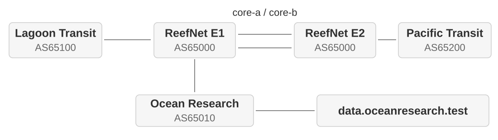

---
<!-- _class: content core -->
<!-- _footer: "AI5049, Hochschule Fulda" -->

# Four views. Four questions.

| View | Question |
|---|---|
| NetBox | What should exist? |
| Router | What exists now? |
| Grafana | What changed over time? |
| External probe | Does the service work? |

---
<!-- _class: chapter core -->
<!-- _footer: "AI5049, Hochschule Fulda" -->

# Follow one service request.

How does this network actually work?

---
<!-- _class: visual core -->
<!-- _footer: "AI5049, Hochschule Fulda" -->

# Follow one service request.

In ReefNet: a Lagoon probe requests `data.oceanresearch.test`.

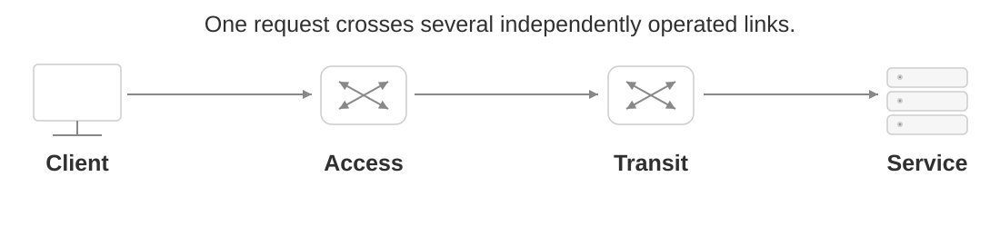

What must work before the application can return a response?

<nav class="progress" aria-label="Module progress"><span class="active">APPLICATION</span><span class="arrow"> → </span><span class="">TRANSPORT</span><span class="arrow"> → </span><span class="">IP</span><span class="arrow"> → </span><span class="">ROUTING</span><span class="arrow"> → </span><span class="">LINK</span><span class="arrow"> → </span><span class="">PATH</span></nav>

---
<!-- _class: visual core -->
<!-- _footer: "AI5049, Hochschule Fulda" -->

# The TCP/IP stack

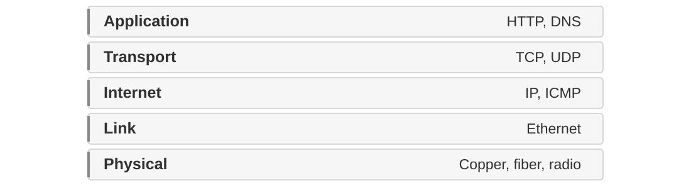

<nav class="progress" aria-label="Module progress"><span class="active">APPLICATION</span><span class="arrow"> → </span><span class="">TRANSPORT</span><span class="arrow"> → </span><span class="">IP</span><span class="arrow"> → </span><span class="">ROUTING</span><span class="arrow"> → </span><span class="">LINK</span><span class="arrow"> → </span><span class="">PATH</span></nav>

---
<!-- _class: visual core -->
<!-- _footer: "<span class=\"footer-context\">AI5049, Hochschule Fulda</span><span class=\"footer-refs\"><a href=\"https://www.rfc-editor.org/rfc/rfc1034.html\">DNS: RFC 1034</a></span>" -->

# A name needs an address.

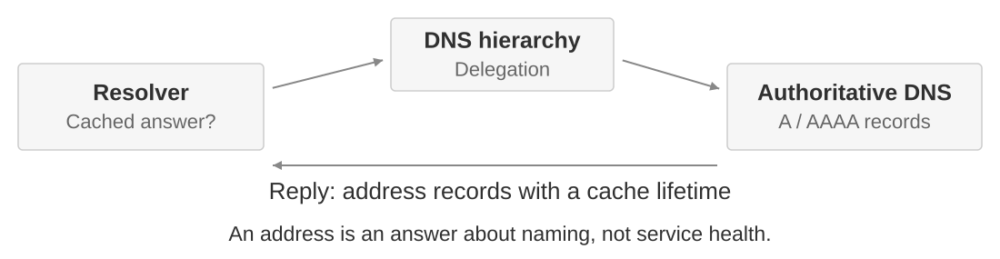

**A** → IPv4
**AAAA** → IPv6

<nav class="progress" aria-label="Module progress"><span class="active">APPLICATION</span><span class="arrow"> → </span><span class="">TRANSPORT</span><span class="arrow"> → </span><span class="">IP</span><span class="arrow"> → </span><span class="">ROUTING</span><span class="arrow"> → </span><span class="">LINK</span><span class="arrow"> → </span><span class="">PATH</span></nav>

---
<!-- _class: visual core -->
<!-- _footer: "AI5049, Hochschule Fulda" -->

# A DNS query becomes transport data

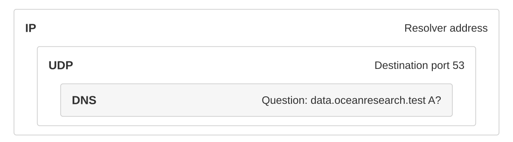

<nav class="progress" aria-label="Module progress"><span class="">APPLICATION</span><span class="arrow"> → </span><span class="active">TRANSPORT</span><span class="arrow"> → </span><span class="">IP</span><span class="arrow"> → </span><span class="">ROUTING</span><span class="arrow"> → </span><span class="">LINK</span><span class="arrow"> → </span><span class="">PATH</span></nav>

---
<!-- _class: content core -->
<!-- _footer: "<span class=\"footer-context\">AI5049, Hochschule Fulda</span><span class=\"footer-refs\"><a href=\"https://www.rfc-editor.org/rfc/rfc9293.html\">TCP: RFC 9293</a><a href=\"https://www.rfc-editor.org/rfc/rfc768.html\">UDP: RFC 768</a></span>" -->

# TCP and UDP

| | TCP | UDP |
|---|---|---|
| Data | Ordered byte stream | Individual datagrams |
| Connection | Required | None |
| Retransmission | Built in | Application decides |

An IP address + port identifies the transport endpoint.

<nav class="progress" aria-label="Module progress"><span class="">APPLICATION</span><span class="arrow"> → </span><span class="active">TRANSPORT</span><span class="arrow"> → </span><span class="">IP</span><span class="arrow"> → </span><span class="">ROUTING</span><span class="arrow"> → </span><span class="">LINK</span><span class="arrow"> → </span><span class="">PATH</span></nav>

---
<!-- _class: content core -->
<!-- _footer: "AI5049, Hochschule Fulda" -->

# TCP gets the conversation started.

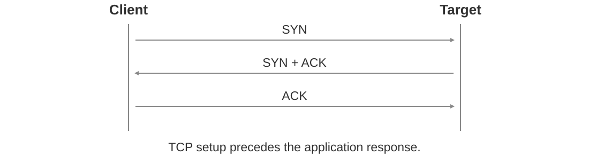

TCP orders bytes, retransmits loss and controls congestion.

<nav class="progress" aria-label="Module progress"><span class="">APPLICATION</span><span class="arrow"> → </span><span class="active">TRANSPORT</span><span class="arrow"> → </span><span class="">IP</span><span class="arrow"> → </span><span class="">ROUTING</span><span class="arrow"> → </span><span class="">LINK</span><span class="arrow"> → </span><span class="">PATH</span></nav>

---
<!-- _class: visual core -->
<!-- _footer: "<span class=\"footer-context\">AI5049, Hochschule Fulda</span><span class=\"footer-refs\"><a href=\"https://www.rfc-editor.org/rfc/rfc791.html\">IPv4: RFC 791</a><a href=\"https://www.rfc-editor.org/rfc/rfc8200.html\">IPv6: RFC 8200</a></span>" -->

# IP gives the packet a destination.

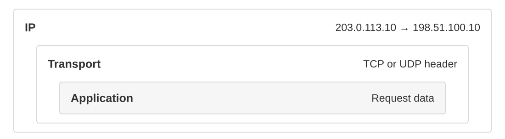

Routers use the **destination address** to look up where to forward the packet.

<nav class="progress" aria-label="Module progress"><span class="">APPLICATION</span><span class="arrow"> → </span><span class="">TRANSPORT</span><span class="arrow"> → </span><span class="active">IP</span><span class="arrow"> → </span><span class="">ROUTING</span><span class="arrow"> → </span><span class="">LINK</span><span class="arrow"> → </span><span class="">PATH</span></nav>

---
<!-- _class: visual core -->
<!-- _footer: "AI5049, Hochschule Fulda" -->

# On-link or through a router?

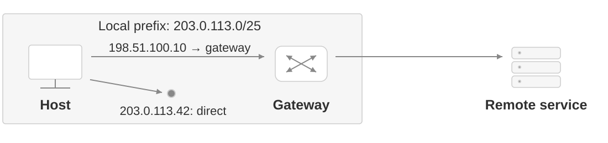

Send directly to an **on-link destination**, otherwise via a **gateway**.

<nav class="progress" aria-label="Module progress"><span class="">APPLICATION</span><span class="arrow"> → </span><span class="">TRANSPORT</span><span class="arrow"> → </span><span class="active">IP</span><span class="arrow"> → </span><span class="">ROUTING</span><span class="arrow"> → </span><span class="">LINK</span><span class="arrow"> → </span><span class="">PATH</span></nav>

---
<!-- _class: content core -->
<!-- _footer: "<span class=\"footer-context\">AI5049, Hochschule Fulda</span><span class=\"footer-refs\"><a href=\"https://www.rfc-editor.org/rfc/rfc1812.html#section-5.2.4.3\">Longest prefix match: RFC 1812</a></span>" -->

# Use the longest matching prefix

Destination: **198.51.100.200**. Example Forwarding Information Base (FIB):

| Prefix | Next hop |
|---|---|
| `0.0.0.0/0` | `192.0.2.1` |
| `198.51.100.0/24` | `192.0.2.2` |
| **`198.51.100.128/25`** | **`192.0.2.3`** |

The most specific match wins.

<nav class="progress" aria-label="Module progress"><span class="">APPLICATION</span><span class="arrow"> → </span><span class="">TRANSPORT</span><span class="arrow"> → </span><span class="">IP</span><span class="arrow"> → </span><span class="active">ROUTING</span><span class="arrow"> → </span><span class="">LINK</span><span class="arrow"> → </span><span class="">PATH</span></nav>

---
<!-- _class: visual core -->
<!-- _footer: "AI5049, Hochschule Fulda" -->

# Ethernet carries frames across one link

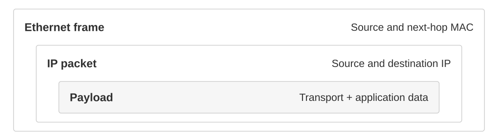

**MAC addresses** change per link. The IP packet names the final destination.

<nav class="progress" aria-label="Module progress"><span class="">APPLICATION</span><span class="arrow"> → </span><span class="">TRANSPORT</span><span class="arrow"> → </span><span class="">IP</span><span class="arrow"> → </span><span class="">ROUTING</span><span class="arrow"> → </span><span class="active">LINK</span><span class="arrow"> → </span><span class="">PATH</span></nav>

---
<!-- _class: visual core -->
<!-- _footer: "<span class=\"footer-context\">AI5049, Hochschule Fulda</span><span class=\"footer-refs\"><a href=\"https://www.rfc-editor.org/rfc/rfc826.html\">ARP: RFC 826</a><a href=\"https://www.rfc-editor.org/rfc/rfc4861.html\">ND: RFC 4861</a></span>" -->

# Find the next-hop MAC

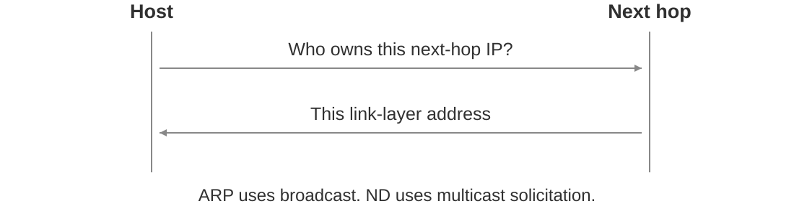

<div class="paired-notes">
<div><h2>IPv4: ARP</h2><p>Resolve the selected next hop’s IPv4 address to its MAC address.</p></div>
<div><h2>IPv6: Neighbor Discovery</h2><p>Resolve the selected next hop’s IPv6 address using ICMPv6.</p></div>
</div>

<nav class="progress" aria-label="Module progress"><span class="">APPLICATION</span><span class="arrow"> → </span><span class="">TRANSPORT</span><span class="arrow"> → </span><span class="">IP</span><span class="arrow"> → </span><span class="">ROUTING</span><span class="arrow"> → </span><span class="active">LINK</span><span class="arrow"> → </span><span class="">PATH</span></nav>

---
<!-- _class: visual core -->
<!-- _footer: "AI5049, Hochschule Fulda" -->

# Switches learn MAC addresses and forward frames

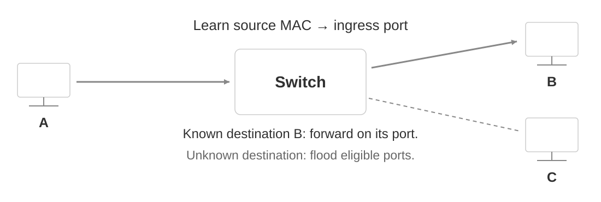

<nav class="progress" aria-label="Module progress"><span class="">APPLICATION</span><span class="arrow"> → </span><span class="">TRANSPORT</span><span class="arrow"> → </span><span class="">IP</span><span class="arrow"> → </span><span class="">ROUTING</span><span class="arrow"> → </span><span class="active">LINK</span><span class="arrow"> → </span><span class="">PATH</span></nav>

---
<!-- _class: visual core -->
<!-- _footer: "AI5049, Hochschule Fulda" -->

# Routers repeat the process hop by hop

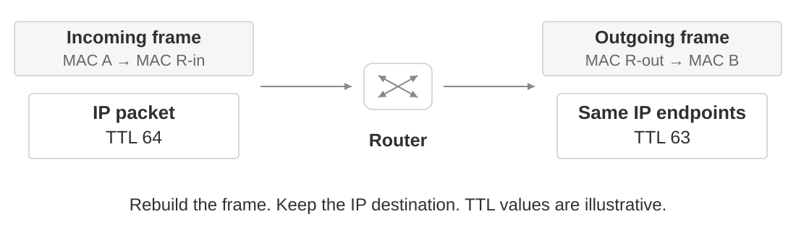

The packet keeps its **destination IP**. The link-layer MAC addresses change.

<nav class="progress" aria-label="Module progress"><span class="">APPLICATION</span><span class="arrow"> → </span><span class="">TRANSPORT</span><span class="arrow"> → </span><span class="">IP</span><span class="arrow"> → </span><span class="">ROUTING</span><span class="arrow"> → </span><span class="">LINK</span><span class="arrow"> → </span><span class="active">PATH</span></nav>

---
<!-- _class: content core -->
<!-- _footer: "AI5049, Hochschule Fulda" -->

# Where do routes come from?

Use the running Networking lab. Leave a Linux node with `exit`, a router with `quit`.

| Route source | Origin |
|---|---|
| Connected | Addressed interface |
| Static | Operator configuration |
| Dynamic | Routing protocol |

<div class="terminal">
<div class="terminal-entry"><strong>WSL</strong><code>make enter NODE=edge01.bob1.reefnet.test</code></div>
<div class="terminal-label">Router CLI</div>
<pre><code>show network-instance default route-table ipv4-unicast summary</code></pre>
</div>

<nav class="progress" aria-label="Module progress"><span class="">APPLICATION</span><span class="arrow"> → </span><span class="">TRANSPORT</span><span class="arrow"> → </span><span class="">IP</span><span class="arrow"> → </span><span class="active">ROUTING</span><span class="arrow"> → </span><span class="">LINK</span><span class="arrow"> → </span><span class="">PATH</span></nav>

---
<!-- _class: visual core -->
<!-- _footer: "AI5049, Hochschule Fulda" -->

# An AS is an administrative routing domain

An **autonomous system (AS)** presents one routing policy externally.
An **Interior Gateway Protocol (IGP)** finds routes inside it.

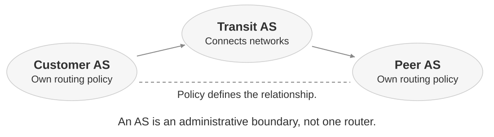

<nav class="progress" aria-label="Module progress"><span class="">APPLICATION</span><span class="arrow"> → </span><span class="">TRANSPORT</span><span class="arrow"> → </span><span class="">IP</span><span class="arrow"> → </span><span class="active">ROUTING</span><span class="arrow"> → </span><span class="">LINK</span><span class="arrow"> → </span><span class="">PATH</span></nav>

---
<!-- _class: visual core -->
<!-- _footer: "<span class=\"footer-context\">AI5049, Hochschule Fulda</span><span class=\"footer-refs\"><a href=\"https://www.rfc-editor.org/rfc/rfc2453.html\">RIP: RFC 2453</a><a href=\"https://www.rfc-editor.org/rfc/rfc2328.html\">OSPF: RFC 2328</a></span>" -->

# Two ways to learn an internal route

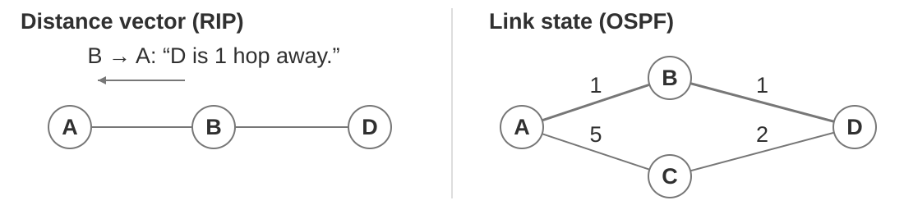

<div class="paired-notes">
<div><p><strong>Share distances to destinations.</strong><br>A adds 1 hop: D via B, 2 hops.<br>A advertises its own distance onward.</p></div>
<div><p><strong>Share your own links and their costs.</strong><br>Relay across the area → shared map.<br>Each router calculates its own paths.</p></div>
</div>

<nav class="progress" aria-label="Module progress"><span class="">APPLICATION</span><span class="arrow"> → </span><span class="">TRANSPORT</span><span class="arrow"> → </span><span class="">IP</span><span class="arrow"> → </span><span class="active">ROUTING</span><span class="arrow"> → </span><span class="">LINK</span><span class="arrow"> → </span><span class="">PATH</span></nav>

---
<!-- _class: content core -->
<!-- _footer: "<span class=\"footer-context\">AI5049, Hochschule Fulda</span><span class=\"footer-refs\"><a href=\"https://www.rfc-editor.org/rfc/rfc2328.html\">OSPFv2: RFC 2328</a><a href=\"https://www.rfc-editor.org/rfc/rfc5340.html\">OSPFv3: RFC 5340</a></span>" -->

# OSPF: each router calculates its own paths

<div class="figure-explanation">
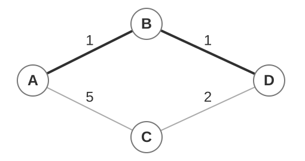
<div>
<p>Example costs:<br>Via B: <strong>1 + 1 = 2</strong>. Via C: 5 + 2 = 7.</p>
<p>ReefNet uses OSPFv2 for IPv4 and OSPFv3 for IPv6.</p><p>Both provide paths to the iBGP loopbacks over either core link.</p>
</div>
</div>

<div class="terminal">
<div class="terminal-entry"><strong>WSL</strong><code>make enter NODE=edge01.bob1.reefnet.test</code></div>
<div class="terminal-label">Router CLI</div>
<pre><code>show network-instance default protocols ospf neighbor</code></pre>
</div>

<nav class="progress" aria-label="Module progress"><span class="">APPLICATION</span><span class="arrow"> → </span><span class="">TRANSPORT</span><span class="arrow"> → </span><span class="">IP</span><span class="arrow"> → </span><span class="active">ROUTING</span><span class="arrow"> → </span><span class="">LINK</span><span class="arrow"> → </span><span class="">PATH</span></nav>

---
<!-- _class: content core -->
<!-- _footer: "<span class=\"footer-context\">AI5049, Hochschule Fulda</span><span class=\"footer-refs\"><a href=\"https://www.rfc-editor.org/rfc/rfc4271.html\">BGP: RFC 4271</a></span>" -->

# BGP exchanges reachability.

**Path vector:** prefixes, AS paths and other attributes.

<div class="paired-notes">
<div><h2>eBGP</h2><p>Routes between ASes.</p></div>
<div><h2>iBGP</h2><p>Routes within an AS.<br>The IGP is still needed.</p></div>
</div>

<div class="terminal">
<div class="terminal-entry"><strong>WSL</strong><code>make enter NODE=edge01.bob1.reefnet.test</code></div>
<div class="terminal-label">Router CLI</div>
<pre><code>show network-instance default protocols bgp neighbor</code></pre>
<pre><code>show network-instance default protocols bgp routes ipv4 summary</code></pre>
</div>

<nav class="progress" aria-label="Module progress"><span class="">APPLICATION</span><span class="arrow"> → </span><span class="">TRANSPORT</span><span class="arrow"> → </span><span class="">IP</span><span class="arrow"> → </span><span class="active">ROUTING</span><span class="arrow"> → </span><span class="">LINK</span><span class="arrow"> → </span><span class="">PATH</span></nav>

---
<!-- _class: content core -->
<!-- _footer: "<span class=\"footer-context\">AI5049, Hochschule Fulda</span><span class=\"footer-refs\"><a href=\"https://www.rfc-editor.org/rfc/rfc4760.html\">Multiprotocol BGP: RFC 4760</a></span>" -->

# BGP separates route families

**AFI** (Address Family Identifier): IPv4 or IPv6.<br>
**SAFI** (Subsequent Address Family Identifier): e.g. unicast.

| In ReefNet | Routes to destinations such as |
|---|---|
| `ipv4-unicast` | `198.51.100.0/24` |
| `ipv6-unicast` | `2001:db8:100::/48` |

**Established** confirms the session is up. Check which families exchange routes.

<nav class="progress" aria-label="Module progress"><span class="">APPLICATION</span><span class="arrow"> → </span><span class="">TRANSPORT</span><span class="arrow"> → </span><span class="">IP</span><span class="arrow"> → </span><span class="active">ROUTING</span><span class="arrow"> → </span><span class="">LINK</span><span class="arrow"> → </span><span class="">PATH</span></nav>

---
<!-- _class: content deep-dive -->
<!-- _footer: "AI5049, Hochschule Fulda" -->

# BGP is policy first.

For comparable routes:

1. Apply local policy.
2. Prefer higher local preference.
3. Compare AS_PATH and further tie-breakers.

<div class="terminal">
<div class="terminal-entry"><strong>WSL</strong><code>make enter NODE=edge01.bob1.reefnet.test</code></div>
<div class="terminal-label">Router CLI</div>
<pre><code>show network-instance default protocols bgp routes ipv4 prefix 198.51.100.0/24</code></pre>
</div>

A longer path can be selected on purpose.

<nav class="progress" aria-label="Module progress"><span class="">APPLICATION</span><span class="arrow"> → </span><span class="">TRANSPORT</span><span class="arrow"> → </span><span class="">IP</span><span class="arrow"> → </span><span class="active">ROUTING</span><span class="arrow"> → </span><span class="">LINK</span><span class="arrow"> → </span><span class="">PATH</span></nav>

---
<!-- _class: content deep-dive -->
<!-- _footer: "AI5049, Hochschule Fulda" -->

# Transit and peering

| | Transit | Peering |
|---|---|---|
| Reachability | Provider supplies broader reachability | Networks exchange selected routes |
| Commercial relation | Customer pays provider | Often settlement-free |

An **IXP** provides shared infrastructure for peering.

<nav class="progress" aria-label="Module progress"><span class="">APPLICATION</span><span class="arrow"> → </span><span class="">TRANSPORT</span><span class="arrow"> → </span><span class="">IP</span><span class="arrow"> → </span><span class="active">ROUTING</span><span class="arrow"> → </span><span class="">LINK</span><span class="arrow"> → </span><span class="">PATH</span></nav>

---
<!-- _class: content deep-dive -->
<!-- _footer: "AI5049, Hochschule Fulda" -->

# Who assigns the prefixes we route?

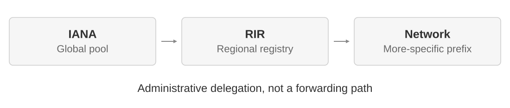

BOB1 uses documentation prefixes.

<nav class="progress" aria-label="Module progress"><span class="">APPLICATION</span><span class="arrow"> → </span><span class="">TRANSPORT</span><span class="arrow"> → </span><span class="">IP</span><span class="arrow"> → </span><span class="">ROUTING</span><span class="arrow"> → </span><span class="">LINK</span><span class="arrow"> → </span><span class="active">PATH</span></nav>

---
<!-- _class: content core -->
<!-- _footer: "AI5049, Hochschule Fulda" -->

# The response needs its own route.

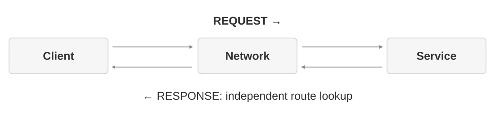

Reachability needs both directions. Paths may be asymmetric.

<nav class="progress" aria-label="Module progress"><span class="">APPLICATION</span><span class="arrow"> → </span><span class="">TRANSPORT</span><span class="arrow"> → </span><span class="">IP</span><span class="arrow"> → </span><span class="">ROUTING</span><span class="arrow"> → </span><span class="">LINK</span><span class="arrow"> → </span><span class="active">PATH</span></nav>

---
<!-- _class: content core -->
<!-- _footer: "<span class=\"footer-context\">AI5049, Hochschule Fulda</span><span class=\"footer-refs\"><a href=\"https://www.rfc-editor.org/rfc/rfc792.html\">ICMP: RFC 792</a><a href=\"https://www.rfc-editor.org/rfc/rfc4443.html\">ICMPv6: RFC 4443</a></span>" -->

# ICMP: errors and diagnostics

| Message | Meaning |
|---|---|
| Echo Request / Reply | Ping |
| Destination Unreachable | Cannot deliver |
| Time Exceeded | TTL / Hop Limit expired |
| Packet Too Big (IPv6) | Exceeds link MTU |

A ping reply proves IP reachability, not application health.

<nav class="progress" aria-label="Module progress"><span class="">APPLICATION</span><span class="arrow"> → </span><span class="">TRANSPORT</span><span class="arrow"> → </span><span class="">IP</span><span class="arrow"> → </span><span class="">ROUTING</span><span class="arrow"> → </span><span class="">LINK</span><span class="arrow"> → </span><span class="active">PATH</span></nav>

---
<!-- _class: visual deep-dive -->
<!-- _footer: "AI5049, Hochschule Fulda" -->

# Traceroute expires TTL / Hop Limit.

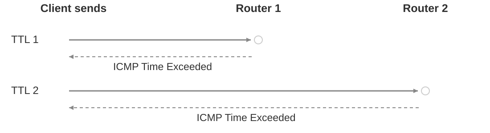

A missing reply does not identify the failed forwarding hop.

<nav class="progress" aria-label="Module progress"><span class="">APPLICATION</span><span class="arrow"> → </span><span class="">TRANSPORT</span><span class="arrow"> → </span><span class="">IP</span><span class="arrow"> → </span><span class="">ROUTING</span><span class="arrow"> → </span><span class="">LINK</span><span class="arrow"> → </span><span class="active">PATH</span></nav>

---
<!-- _class: content deep-dive -->
<!-- _footer: "AI5049, Hochschule Fulda" -->

# Even a correct path needs healthy links

| Medium | Signal | Fault evidence |
|---|---|---|
| Copper | Electrical | Link loss, FCS errors |
| Fiber | Light | Low receive power, FCS errors |

Rising **FCS errors** can be evidence even while the link stays up.

<nav class="progress" aria-label="Module progress"><span class="">APPLICATION</span><span class="arrow"> → </span><span class="">TRANSPORT</span><span class="arrow"> → </span><span class="">IP</span><span class="arrow"> → </span><span class="">ROUTING</span><span class="arrow"> → </span><span class="active">LINK</span><span class="arrow"> → </span><span class="">PATH</span></nav>

---
<!-- _class: content task -->
<!-- _footer: "AI5049, Hochschule Fulda" -->

# Follow the request

How does a request from Lagoon reach `data.oceanresearch.test`,
and how does the reply get back?

**60 minutes:** 30 for setup, then 30 to explore. In WSL on the lab PC:
```bash
cd ~;
git clone https://github.com/Stinktopf/network-management-and-monitoring.git;
cd network-management-and-monitoring;
make setup;
make networking;
make task;
```

`make setup` ends with READY FOR CLASS. Check addresses, DNS and HTTP. Sketch the path.
Then try Pacific and IPv6.

[Exercise overview](https://github.com/Stinktopf/network-management-and-monitoring#exercises)

---
<!-- _class: content core -->
<!-- _footer: "AI5049, Hochschule Fulda" -->

# What did your checks tell you?

- Which address came from DNS?
- Which address was your next hop?
- How did you check the return path?
- What did HTTP tell you that ping could not?

Bring one result you can explain and one question that is still open.

---
<!-- _class: day core -->
<!-- _footer: "AI5049, Hochschule Fulda" -->

# 13 October 2026

## Operations + Automation + Incidents

Yesterday we followed a healthy request through ReefNet.

Today Lagoon Transit loses our customer prefix `198.51.100.0/24`.
We repair it in the router CLI, then a second time through gNMI.

At the end of today: **Who Broke the Internet?**

---
<!-- _class: chapter core -->
<!-- _footer: "AI5049, Hochschule Fulda" -->

# Network Operations

A customer behind Lagoon Transit cannot reach the Ocean Research service.

---
<!-- _class: content core -->
<!-- _footer: "AI5049, Hochschule Fulda" -->

# One incident, from report to recovery

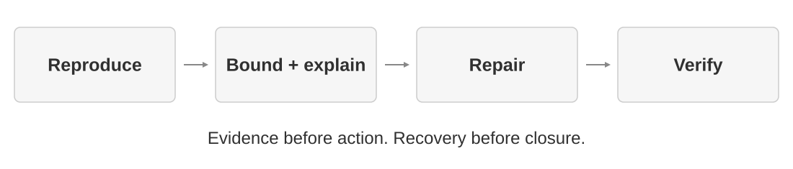

<nav class="progress" aria-label="Module progress"><span class="active">REPRODUCE</span><span class="arrow"> → </span><span class="">BOUND</span><span class="arrow"> → </span><span class="">OBSERVE</span><span class="arrow"> → </span><span class="">HYPOTHESIZE</span><span class="arrow"> → </span><span class="">REPAIR</span><span class="arrow"> → </span><span class="">VERIFY</span></nav>

---
<!-- _class: visual core -->
<!-- _footer: "AI5049, Hochschule Fulda" -->

# A customer reports partial reachability

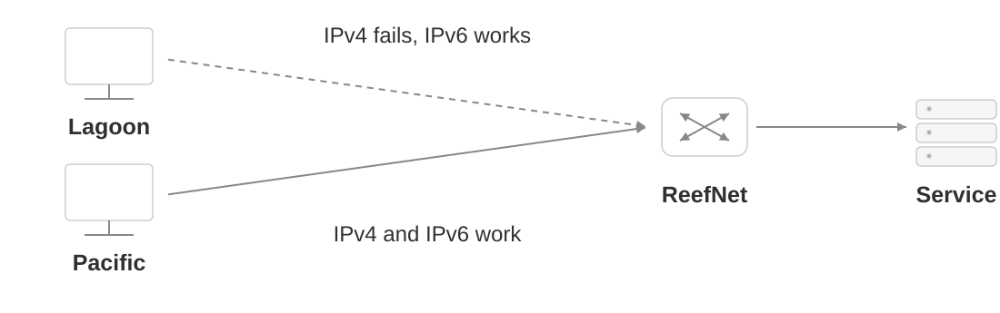

<nav class="progress" aria-label="Module progress"><span class="active">REPRODUCE</span><span class="arrow"> → </span><span class="">BOUND</span><span class="arrow"> → </span><span class="">OBSERVE</span><span class="arrow"> → </span><span class="">HYPOTHESIZE</span><span class="arrow"> → </span><span class="">REPAIR</span><span class="arrow"> → </span><span class="">VERIFY</span></nav>

---
<!-- _class: content core -->
<!-- _footer: "AI5049, Hochschule Fulda" -->

# Who cannot reach the service?

<div class="terminal">
<div class="terminal-entry"><strong>WSL</strong><code>make enter NODE=probe01.bob1.lagoontransit.test</code></div>
<div class="terminal-label">Inside the Lagoon probe</div>
<pre><code>ping -4 -c 3 -W 1 198.51.100.10;
ping -6 -c 3 -W 1 2001:db8:100::10;</code></pre>
</div>

Use `exit`, then in WSL:

```bash
make enter NODE=probe01.bob1.pacifictransit.test;
```

Repeat both tests. Which path and address family fail?

---
<!-- _class: visual core -->
<!-- _footer: "AI5049, Hochschule Fulda" -->

# Bound the incident

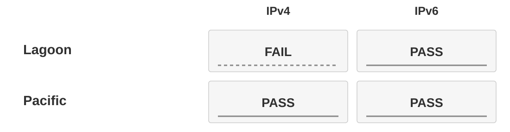

<nav class="progress" aria-label="Module progress"><span class="">REPRODUCE</span><span class="arrow"> → </span><span class="active">BOUND</span><span class="arrow"> → </span><span class="">OBSERVE</span><span class="arrow"> → </span><span class="">HYPOTHESIZE</span><span class="arrow"> → </span><span class="">REPAIR</span><span class="arrow"> → </span><span class="">VERIFY</span></nav>

---
<!-- _class: visual core -->
<!-- _footer: "AI5049, Hochschule Fulda" -->

# Separate state from service

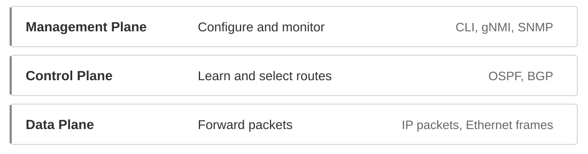

<nav class="progress" aria-label="Module progress"><span class="">REPRODUCE</span><span class="arrow"> → </span><span class="">BOUND</span><span class="arrow"> → </span><span class="active">OBSERVE</span><span class="arrow"> → </span><span class="">HYPOTHESIZE</span><span class="arrow"> → </span><span class="">REPAIR</span><span class="arrow"> → </span><span class="">VERIFY</span></nav>

---
<!-- _class: content core -->
<!-- _footer: "AI5049, Hochschule Fulda" -->

# Are the BGP sessions established?

<div class="terminal">
<div class="terminal-entry"><strong>WSL</strong><code>make enter NODE=edge01.bob1.reefnet.test</code></div>
<div class="terminal-label">Router CLI</div>
<pre><code>show network-instance default protocols bgp neighbor</code></pre>
</div>

| IPv4 neighbor | Role |
|---|---|
| `192.0.2.0` | Ocean Research |
| `192.0.2.2` | Lagoon Transit |
| `2001:db8:0:a::` | Lagoon Transit IPv6 |
| `10.255.0.2` | ReefNet edge02 iBGP |

<nav class="progress" aria-label="Module progress"><span class="">REPRODUCE</span><span class="arrow"> → </span><span class="">BOUND</span><span class="arrow"> → </span><span class="active">OBSERVE</span><span class="arrow"> → </span><span class="">HYPOTHESIZE</span><span class="arrow"> → </span><span class="">REPAIR</span><span class="arrow"> → </span><span class="">VERIFY</span></nav>

---
<!-- _class: content core -->
<!-- _footer: "AI5049, Hochschule Fulda" -->

# Did the customer route arrive?

Compare the customer prefix in both address families.

<div class="terminal">
<div class="terminal-entry"><strong>WSL</strong><code>make enter NODE=edge01.bob1.reefnet.test</code></div>
<div class="terminal-label">Router CLI</div>
<pre><code>show network-instance default protocols bgp routes ipv4 prefix 198.51.100.0/24</code></pre>
<pre><code>show network-instance default protocols bgp routes ipv6 prefix 2001:db8:100::/48</code></pre>
</div>

A route in BGP is not yet proof of forwarding.

<nav class="progress" aria-label="Module progress"><span class="">REPRODUCE</span><span class="arrow"> → </span><span class="">BOUND</span><span class="arrow"> → </span><span class="active">OBSERVE</span><span class="arrow"> → </span><span class="">HYPOTHESIZE</span><span class="arrow"> → </span><span class="">REPAIR</span><span class="arrow"> → </span><span class="">VERIFY</span></nav>

---
<!-- _class: content core -->
<!-- _footer: "AI5049, Hochschule Fulda" -->

# Is IPv4 installed for forwarding?

<div class="terminal">
<div class="terminal-entry"><strong>WSL</strong><code>make enter NODE=edge01.bob1.reefnet.test</code></div>
<div class="terminal-label">Router CLI</div>
<pre><code>show network-instance default route-table ipv4-unicast prefix 198.51.100.0/24</code></pre>
</div>

**Active route → resolved next hop → outgoing interface**

<nav class="progress" aria-label="Module progress"><span class="">REPRODUCE</span><span class="arrow"> → </span><span class="">BOUND</span><span class="arrow"> → </span><span class="active">OBSERVE</span><span class="arrow"> → </span><span class="">HYPOTHESIZE</span><span class="arrow"> → </span><span class="">REPAIR</span><span class="arrow"> → </span><span class="">VERIFY</span></nav>

---
<!-- _class: content core -->
<!-- _footer: "AI5049, Hochschule Fulda" -->

# Compare the advertisements

<div class="terminal">
<div class="terminal-entry"><strong>WSL</strong><code>make enter NODE=edge01.bob1.reefnet.test</code></div>
<div class="terminal-label">Router CLI: toward Lagoon</div>
<pre><code>show network-instance default protocols bgp neighbor 192.0.2.2 advertised-routes ipv4</code></pre>
</div>

Use `quit` before entering the other router.

<div class="terminal">
<div class="terminal-entry"><strong>WSL</strong><code>make enter NODE=edge02.bob1.reefnet.test</code></div>
<div class="terminal-label">Router CLI: toward Pacific</div>
<pre><code>show network-instance default protocols bgp neighbor 192.0.2.5 advertised-routes ipv4</code></pre>
</div>

Find `198.51.100.0/24`.

<nav class="progress" aria-label="Module progress"><span class="">REPRODUCE</span><span class="arrow"> → </span><span class="">BOUND</span><span class="arrow"> → </span><span class="active">OBSERVE</span><span class="arrow"> → </span><span class="">HYPOTHESIZE</span><span class="arrow"> → </span><span class="">REPAIR</span><span class="arrow"> → </span><span class="">VERIFY</span></nav>

---
<!-- _class: content task -->
<!-- _footer: "AI5049, Hochschule Fulda" -->

# Exercise: find and repair the fault

Users behind Lagoon Transit cannot reach `data.oceanresearch.test`.

In WSL:
```bash
cd ~/network-management-and-monitoring && git pull;
make operations;
make task;
```

**60 minutes:** steps 1–5. Find the fault, repair it with the CLI and verify recovery.
Keep your commands and evidence. We compare diagnoses after step 5.

[Exercise overview](https://github.com/Stinktopf/network-management-and-monitoring#exercises)

---
<!-- _class: content core -->
<!-- _footer: "AI5049, Hochschule Fulda" -->

# Which policy does this neighbor use?

<div class="terminal">
<div class="terminal-entry"><strong>WSL</strong><code>make enter NODE=edge01.bob1.reefnet.test</code></div>
<div class="terminal-label">Router CLI</div>
<pre><code>info from running network-instance default protocols bgp group lagoon-v4</code></pre>
<pre><code>info from running network-instance default protocols bgp group lagoon-v6</code></pre>
</div>

What is attached only to IPv4?

<nav class="progress" aria-label="Module progress"><span class="">REPRODUCE</span><span class="arrow"> → </span><span class="">BOUND</span><span class="arrow"> → </span><span class="">OBSERVE</span><span class="arrow"> → </span><span class="active">HYPOTHESIZE</span><span class="arrow"> → </span><span class="">REPAIR</span><span class="arrow"> → </span><span class="">VERIFY</span></nav>

---
<!-- _class: content core -->
<!-- _footer: "<span class=\"footer-context\">AI5049, Hochschule Fulda</span><span class=\"footer-refs\"><a href=\"https://documentation.nokia.com/srlinux/25-7/books/system-mgmt/cli-interface.html\">SR Linux CLI guide</a></span>" -->

# Search the whole running config

<div class="terminal">
<div class="terminal-entry"><strong>WSL</strong><code>make enter NODE=edge01.bob1.reefnet.test</code></div>
<div class="terminal-label">Router CLI: <code>flat</code> prints one full path per line, <code>grep</code> filters</div>
<pre><code>info flat from running | grep export-policy</code></pre>
</div>

```text
set / network-instance default protocols bgp export-policy [ EXPORT-BGP ]
set / network-instance default protocols bgp group lagoon-v4 export-policy [ BLOCK-CUSTOMER-V4 ]
```

<nav class="progress" aria-label="Module progress"><span class="">REPRODUCE</span><span class="arrow"> → </span><span class="">BOUND</span><span class="arrow"> → </span><span class="">OBSERVE</span><span class="arrow"> → </span><span class="active">HYPOTHESIZE</span><span class="arrow"> → </span><span class="">REPAIR</span><span class="arrow"> → </span><span class="">VERIFY</span></nav>

---
<!-- _class: content core -->
<!-- _footer: "AI5049, Hochschule Fulda" -->

# Follow the policy in the running config

Inside edge01, shortened output:

```text
info from running network-instance default protocols bgp group lagoon-v4
    export-policy [ BLOCK-CUSTOMER-V4 ]
info from running routing-policy policy BLOCK-CUSTOMER-V4
    statement 10: prefix-set CUSTOMER-V4 → policy-result reject
    statement 20: protocol bgp → policy-result accept
info from running routing-policy prefix-set CUSTOMER-V4
    prefix 198.51.100.0/24 mask-length-range exact
```

Group → policy → prefix-set: the customer prefix is rejected toward Lagoon.

<nav class="progress" aria-label="Module progress"><span class="">REPRODUCE</span><span class="arrow"> → </span><span class="">BOUND</span><span class="arrow"> → </span><span class="">OBSERVE</span><span class="arrow"> → </span><span class="active">HYPOTHESIZE</span><span class="arrow"> → </span><span class="">REPAIR</span><span class="arrow"> → </span><span class="">VERIFY</span></nav>

---
<!-- _class: content core -->
<!-- _footer: "<span class=\"footer-context\">AI5049, Hochschule Fulda</span><span class=\"footer-refs\"><a href=\"https://documentation.nokia.com/srlinux/25-7/books/system-mgmt/cli-interface.html\">SR Linux CLI guide</a></span>" -->

# Remove the override, then check the service

<div class="terminal">
<div class="terminal-entry"><strong>WSL</strong><code>make enter NODE=edge01.bob1.reefnet.test</code></div>
<div class="terminal-label">Router CLI</div>
<pre><code>enter candidate</code></pre>
<pre><code>delete / network-instance default protocols bgp group lagoon-v4 export-policy</code></pre>
<pre><code>diff</code></pre>
<pre><code>commit now</code></pre>
</div>

`lagoon-v4` then inherits `EXPORT-BGP`. Do not edit the policies, leave `lagoon-v6` alone.

<nav class="progress" aria-label="Module progress"><span class="">REPRODUCE</span><span class="arrow"> → </span><span class="">BOUND</span><span class="arrow"> → </span><span class="">OBSERVE</span><span class="arrow"> → </span><span class="">HYPOTHESIZE</span><span class="arrow"> → </span><span class="active">REPAIR</span><span class="arrow"> → </span><span class="">VERIFY</span></nav>

---
<!-- _class: content core -->
<!-- _footer: "<span class=\"footer-context\">AI5049, Hochschule Fulda</span><span class=\"footer-refs\"><a href=\"https://curl.se/docs/manpage.html#--fail\">curl: HTTP checks</a></span>" -->

# Verify from both probes

Leave the router with `quit`.

<div class="terminal">
<div class="terminal-entry"><strong>WSL</strong><code>make enter NODE=probe01.bob1.lagoontransit.test</code></div>
<div class="terminal-label">Inside the Lagoon probe</div>
<pre><code>curl --fail --max-time 5 -4 http://198.51.100.10/;
curl --fail --max-time 5 -g -6 &#x27;http://[2001:db8:100::10]/&#x27;;</code></pre>
</div>

Use `exit`, then in WSL:

```bash
make enter NODE=probe01.bob1.pacifictransit.test;
```

Repeat both HTTP checks. Return with `exit`, then run `make test`.

<nav class="progress" aria-label="Module progress"><span class="">REPRODUCE</span><span class="arrow"> → </span><span class="">BOUND</span><span class="arrow"> → </span><span class="">OBSERVE</span><span class="arrow"> → </span><span class="">HYPOTHESIZE</span><span class="arrow"> → </span><span class="">REPAIR</span><span class="arrow"> → </span><span class="active">VERIFY</span></nav>

---
<!-- _class: content core -->
<!-- _footer: "<span class=\"footer-context\">AI5049, Hochschule Fulda</span><span class=\"footer-refs\"><a href=\"https://www.rfc-editor.org/rfc/rfc7908.html\">Route leaks: RFC 7908</a></span>" -->

# Important: our lab leaks a route

edge01 advertises to Lagoon Transit (`192.0.2.2`):

| Prefix | AS path | Learned from | Gao–Rexford |
|---|---|---|---|
| `198.51.100.0/24` | 65000 65010 | customer Ocean Research | send to everyone |
| `203.0.113.128/25` | 65000 65200 | provider Pacific Transit | **customers only** |

During the fault, the leaked route was the **only** route Lagoon received.
Cause: `EXPORT-BGP` accepts every BGP route (`match protocol bgp`).
On a real network, ReefNet would carry transit between its two providers.

---
<!-- _class: content core -->
<!-- _footer: "AI5049, Hochschule Fulda" -->

# Record impact, evidence and recovery

A useful update states:

**impact → evidence → action → verification**

For example:

> IPv4 through Lagoon Transit was missing because the customer route was filtered on export. The policy attachment was removed and reachability now succeeds from both external probes. IPv6 was unaffected.

<nav class="progress" aria-label="Module progress"><span class="">REPRODUCE</span><span class="arrow"> → </span><span class="">BOUND</span><span class="arrow"> → </span><span class="">OBSERVE</span><span class="arrow"> → </span><span class="">HYPOTHESIZE</span><span class="arrow"> → </span><span class="">REPAIR</span><span class="arrow"> → </span><span class="active">VERIFY</span></nav>

---
<!-- _class: content core -->
<!-- _footer: "AI5049, Hochschule Fulda" -->

# RCA: ask why until you can prevent it

**RCA = Root Cause Analysis**

| Why? | ReefNet incident |
|---|---|
| Lagoon IPv4 unreachable | `198.51.100.0/24` not exported to `192.0.2.2` |
| Not exported | Group override `BLOCK-CUSTOMER-V4` on `lagoon-v4` |
| Override present | A configuration change attached it |
| **Root cause:** change not caught | No export check per upstream and address family |

<nav class="progress" aria-label="Module progress"><span class="">REPRODUCE</span><span class="arrow"> → </span><span class="">BOUND</span><span class="arrow"> → </span><span class="">OBSERVE</span><span class="arrow"> → </span><span class="">HYPOTHESIZE</span><span class="arrow"> → </span><span class="">REPAIR</span><span class="arrow"> → </span><span class="active">VERIFY</span></nav>

---
<!-- _class: content core -->
<!-- _footer: "AI5049, Hochschule Fulda" -->

# Write an RFO after the incident

**RFO = Reason for Outage**

| Record | ReefNet incident |
|---|---|
| Impact | Lagoon IPv4 unreachable |
| Cause | Group override `BLOCK-CUSTOMER-V4` on `lagoon-v4` |
| Recovery | Override removed, HTTP verified |
| Prevention | Test IPv4 and IPv6 exports |

<nav class="progress" aria-label="Module progress"><span class="">REPRODUCE</span><span class="arrow"> → </span><span class="">BOUND</span><span class="arrow"> → </span><span class="">OBSERVE</span><span class="arrow"> → </span><span class="">HYPOTHESIZE</span><span class="arrow"> → </span><span class="">REPAIR</span><span class="arrow"> → </span><span class="active">VERIFY</span></nav>

---
<!-- _class: content core -->
<!-- _footer: "AI5049, Hochschule Fulda" -->

# FCAPS: five management areas

- **Fault**: detect, isolate and recover
- **Configuration**: control intended state
- **Accounting**: attribute resource use
- **Performance**: measure service and capacity
- **Security**: control access and change

Today: a **Fault** (Lagoon IPv4 lost) caused by a **Configuration** change (group override).

<nav class="progress" aria-label="Module progress"><span class="">REPRODUCE</span><span class="arrow"> → </span><span class="">BOUND</span><span class="arrow"> → </span><span class="">OBSERVE</span><span class="arrow"> → </span><span class="">HYPOTHESIZE</span><span class="arrow"> → </span><span class="">REPAIR</span><span class="arrow"> → </span><span class="active">VERIFY</span></nav>

---
<!-- _class: content core -->
<!-- _footer: "AI5049, Hochschule Fulda" -->

# Same incident, now through an API

This morning we repaired a router through its CLI.
Now we will use NetBox and gNMI.

---
<!-- _class: content core -->
<!-- _footer: "AI5049, Hochschule Fulda" -->

# The safe change loop

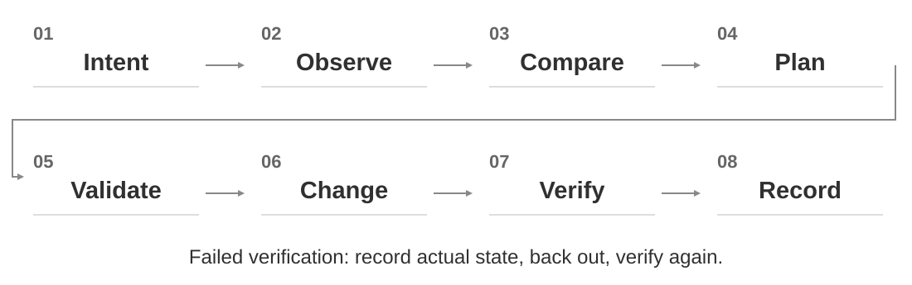

Step 7 runs this loop: `gnmic get`, `set --dry-run`, `set`, `get`.

<nav class="progress" aria-label="Module progress"><span class="active">INTENT</span><span class="arrow"> → </span><span class="">OBSERVE</span><span class="arrow"> → </span><span class="">PLAN</span><span class="arrow"> → </span><span class="">CHANGE</span><span class="arrow"> → </span><span class="">VERIFY</span><span class="arrow"> → </span><span class="">RECORD</span></nav>

---
<!-- _class: visual core -->
<!-- _footer: "AI5049, Hochschule Fulda" -->

# Inventory gives the target context

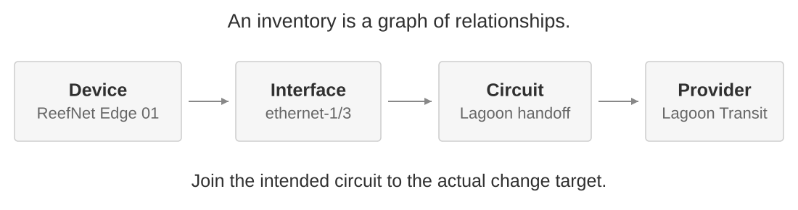

<nav class="progress" aria-label="Module progress"><span class="">INTENT</span><span class="arrow"> → </span><span class="active">OBSERVE</span><span class="arrow"> → </span><span class="">PLAN</span><span class="arrow"> → </span><span class="">CHANGE</span><span class="arrow"> → </span><span class="">VERIFY</span><span class="arrow"> → </span><span class="">RECORD</span></nav>

---
<!-- _class: content core -->
<!-- _footer: "<span class=\"footer-context\">AI5049, Hochschule Fulda</span><span class=\"footer-refs\"><a href=\"https://netbox.readthedocs.io/en/stable/integrations/rest-api/\">NetBox REST API</a></span>" -->

# Read the device inventory

<div class="terminal">
<div class="terminal-entry"><strong>WSL</strong><code>make enter NODE=operations01.bob1.reefnet.test</code></div>
<div class="terminal-label">Inside operations01</div>
<pre><code>AUTH=&quot;Authorization: Bearer $(cat /state/netbox-token)&quot;;
API=http://netbox.bob1.reefnet.test:8080/api;
curl -fsS -H &quot;$AUTH&quot; &quot;$API/dcim/devices/?name=edge01.bob1.reefnet.test&quot; &gt; device.json;
jq &#x27;{count, devices: [.results[] | {name, primary_ip4}]}&#x27; device.json;</code></pre>
</div>

Expect one device with `primary_ip4` `172.20.20.11/24`. Keep the token private.

<nav class="progress" aria-label="Module progress"><span class="">INTENT</span><span class="arrow"> → </span><span class="active">OBSERVE</span><span class="arrow"> → </span><span class="">PLAN</span><span class="arrow"> → </span><span class="">CHANGE</span><span class="arrow"> → </span><span class="">VERIFY</span><span class="arrow"> → </span><span class="">RECORD</span></nav>

---
<!-- _class: content core -->
<!-- _footer: "<span class=\"footer-context\">AI5049, Hochschule Fulda</span><span class=\"footer-refs\"><a href=\"https://netbox.readthedocs.io/en/stable/integrations/rest-api/\">NetBox REST API</a></span>" -->

# Read the circuit intent too

<div class="terminal">
<div class="terminal-entry"><strong>WSL</strong><code>make enter NODE=operations01.bob1.reefnet.test</code></div>
<div class="terminal-label">Inside operations01</div>
<pre><code>AUTH=&quot;Authorization: Bearer $(cat /state/netbox-token)&quot;;
API=http://netbox.bob1.reefnet.test:8080/api;
curl -fsS -H &quot;$AUTH&quot; &quot;$API/circuits/circuits/?cid=BOB1-LAGOON-001&quot; &gt; circuit.json;
jq &#x27;.results[] | {cid, provider: .provider.name, status: .status.label}&#x27; circuit.json;</code></pre>
</div>

NetBox: `BOB1-LAGOON-001` is active.

The router: session to `192.0.2.2` up, `198.51.100.0/24` not exported.

<nav class="progress" aria-label="Module progress"><span class="">INTENT</span><span class="arrow"> → </span><span class="active">OBSERVE</span><span class="arrow"> → </span><span class="">PLAN</span><span class="arrow"> → </span><span class="">CHANGE</span><span class="arrow"> → </span><span class="">VERIFY</span><span class="arrow"> → </span><span class="">RECORD</span></nav>

---
<!-- _class: content core -->
<!-- _footer: "AI5049, Hochschule Fulda" -->

# Follow the inventory to the change

Each NetBox query returns a record. We keep one fact and use it for the next query.

| `GET /api/…` | We keep |
|---|---|
| `dcim/devices/?name=edge01.bob1.reefnet.test` | Management IP `172.20.20.11` on `mgmt0` |
| `dcim/interfaces/?device=edge01.bob1.reefnet.test` | `ethernet-1/3` is cabled to Lagoon Transit |
| `ipam/asns/?asn=65100` | AS 65100 is Lagoon Transit, the BGP peer on that port |
| `ipam/prefixes/?prefix=198.51.100.0/24` | Ocean Research service prefix |

Change input: on `edge01`, peer AS 65100 must receive `198.51.100.0/24`.

<nav class="progress" aria-label="Module progress"><span class="">INTENT</span><span class="arrow"> → </span><span class="active">OBSERVE</span><span class="arrow"> → </span><span class="">PLAN</span><span class="arrow"> → </span><span class="">CHANGE</span><span class="arrow"> → </span><span class="">VERIFY</span><span class="arrow"> → </span><span class="">RECORD</span></nav>

---
<!-- _class: content core -->
<!-- _footer: "AI5049, Hochschule Fulda" -->

# Choose the automation mechanism

| Layer | Examples | On the BOB1 routers |
|---|---|---|
| CLI automation | Netmiko | SSH to the SR Linux CLI |
| Data models | YANG: native, OpenConfig | `srl_nokia-*` and OpenConfig models |
| Model-driven protocols | NETCONF, RESTCONF, gNMI | gNMI on port 57400, NETCONF on 830, no RESTCONF |

---
<!-- _class: content core -->
<!-- _footer: "<span class=\"footer-context\">AI5049, Hochschule Fulda</span><span class=\"footer-refs\"><a href=\"https://github.com/ktbyers/netmiko\">Netmiko documentation</a></span>" -->

# Netmiko: automate the CLI you already know

Illustrative SSH read on SR Linux:

```python
from netmiko import ConnectHandler

with ConnectHandler(**device) as conn:
    output = conn.send_command(
        "show network-instance default protocols bgp neighbor 192.0.2.2 advertised-routes ipv4")
    assert "198.51.100.0/24" in output
```

Netmiko handles the session. You still parse text.

<nav class="progress" aria-label="Module progress"><span class="">INTENT</span><span class="arrow"> → </span><span class="">OBSERVE</span><span class="arrow"> → </span><span class="active">PLAN</span><span class="arrow"> → </span><span class="">CHANGE</span><span class="arrow"> → </span><span class="">VERIFY</span><span class="arrow"> → </span><span class="">RECORD</span></nav>

---
<!-- _class: visual core -->
<!-- _footer: "<span class=\"footer-context\">AI5049, Hochschule Fulda</span><span class=\"footer-refs\"><a href=\"https://www.rfc-editor.org/rfc/rfc7950.html\">YANG: RFC 7950</a></span>" -->

# YANG describes management data

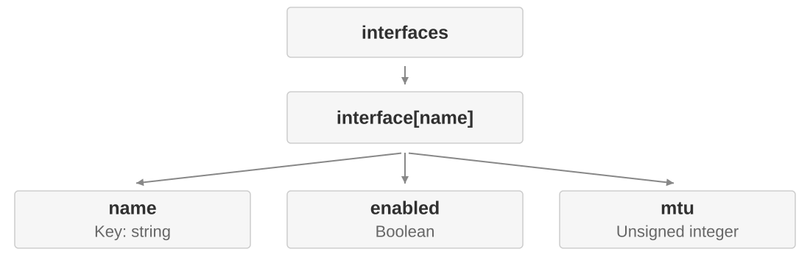

<nav class="progress" aria-label="Module progress"><span class="">INTENT</span><span class="arrow"> → </span><span class="">OBSERVE</span><span class="arrow"> → </span><span class="active">PLAN</span><span class="arrow"> → </span><span class="">CHANGE</span><span class="arrow"> → </span><span class="">VERIFY</span><span class="arrow"> → </span><span class="">RECORD</span></nav>

---
<!-- _class: content deep-dive -->
<!-- _footer: "AI5049, Hochschule Fulda" -->

# YANG for our BGP group

From `srl_nokia-bgp.yang` on edge01, shortened:

```yang
list group {
  key "group-name";
  leaf group-name { ... }
  leaf peer-as { ... }
  leaf-list export-policy {
    ordered-by user;
    max-elements 14;
    type leafref { path "/routing-policy/policy/name"; }
  }
}
```

The key makes the path `group[group-name=lagoon-v4]`.
The leafref rejects a policy that does not exist: try `NO-SUCH-POLICY`.

<nav class="progress" aria-label="Module progress"><span class="">INTENT</span><span class="arrow"> → </span><span class="">OBSERVE</span><span class="arrow"> → </span><span class="active">PLAN</span><span class="arrow"> → </span><span class="">CHANGE</span><span class="arrow"> → </span><span class="">VERIFY</span><span class="arrow"> → </span><span class="">RECORD</span></nav>

---
<!-- _class: content core -->
<!-- _footer: "<span class=\"footer-context\">AI5049, Hochschule Fulda</span><span class=\"footer-refs\"><a href=\"https://openconfig.net/projects/models/\">OpenConfig models</a></span>" -->

# OpenConfig: one model for many vendors

Six OpenConfig models loaded on edge01:

| Model | Covers |
|---|---|
| `openconfig-interfaces` | Admin and oper state, counters |
| `openconfig-network-instance` | VRFs, BGP, OSPF, static routes |
| `openconfig-routing-policy` | Prefix sets and policies |
| `openconfig-platform` | Chassis, line cards, transceivers |
| `openconfig-lldp` | Neighbor discovery |
| `openconfig-system` | Hostname, AAA, NTP, logging |

<nav class="progress" aria-label="Module progress"><span class="">INTENT</span><span class="arrow"> → </span><span class="">OBSERVE</span><span class="arrow"> → </span><span class="active">PLAN</span><span class="arrow"> → </span><span class="">CHANGE</span><span class="arrow"> → </span><span class="">VERIFY</span><span class="arrow"> → </span><span class="">RECORD</span></nav>

---
<!-- _class: content core -->
<!-- _footer: "<span class=\"footer-context\">AI5049, Hochschule Fulda</span><span class=\"footer-refs\"><a href=\"https://openconfig.net/projects/models/\">OpenConfig models</a></span>" -->

# Same router, two models

gNMI reads on edge01:

| Data | Native SR Linux | OpenConfig |
|---|---|---|
| ethernet-1/3 state | `…/oper-state`: `up` | `…/state/oper-status`: `UP` |
| BGP group lagoon-v4 | full configuration | empty |

Paths: `/interface[name=ethernet-1/3]/oper-state` and
`/interfaces/interface[name=ethernet-1/3]/state/oper-status`.

<nav class="progress" aria-label="Module progress"><span class="">INTENT</span><span class="arrow"> → </span><span class="">OBSERVE</span><span class="arrow"> → </span><span class="active">PLAN</span><span class="arrow"> → </span><span class="">CHANGE</span><span class="arrow"> → </span><span class="">VERIFY</span><span class="arrow"> → </span><span class="">RECORD</span></nav>

---
<!-- _class: content core -->
<!-- _footer: "<span class=\"footer-context\">AI5049, Hochschule Fulda</span><span class=\"footer-refs\"><a href=\"https://www.rfc-editor.org/rfc/rfc6241.html\">NETCONF: RFC 6241</a></span>" -->

# NETCONF and RESTCONF are siblings

| | NETCONF | RESTCONF |
|---|---|---|
| Standard | RFC 6241 (2011) | RFC 8040 (2017) |
| Transport | SSH, port 830 | HTTPS |
| Encoding | XML | JSON or XML |
| Operations | `get-config`, `edit-config`, `lock`, `commit` | `GET`, `POST`, `PUT`, `PATCH`, `DELETE` |
| Datastores | running, candidate, startup | one view, no commit step |
| BOB1 routers | enabled | not offered |

<nav class="progress" aria-label="Module progress"><span class="">INTENT</span><span class="arrow"> → </span><span class="">OBSERVE</span><span class="arrow"> → </span><span class="active">PLAN</span><span class="arrow"> → </span><span class="">CHANGE</span><span class="arrow"> → </span><span class="">VERIFY</span><span class="arrow"> → </span><span class="">RECORD</span></nav>

---
<!-- _class: content core -->
<!-- _footer: "<span class=\"footer-context\">AI5049, Hochschule Fulda</span><span class=\"footer-refs\"><a href=\"https://www.rfc-editor.org/rfc/rfc6241.html\">NETCONF: RFC 6241</a></span>" -->

# NETCONF edits a datastore

Our repair over SSH port 830, tested on edge01:

```xml
<edit-config>
  <target><candidate/></target>
  <config>
    <network-instance xmlns="urn:nokia.com:srlinux:net-inst:network-instance">
      <name>default</name>
      <protocols><bgp xmlns="urn:nokia.com:srlinux:bgp:bgp"><group>
        <group-name>lagoon-v4</group-name>
        <export-policy nc:operation="delete">BLOCK-CUSTOMER-V4</export-policy>
      </group></bgp></protocols>
    </network-instance>
  </config>
</edit-config>
```

`lock` → `edit-config` → `commit` → `unlock`, each answered with `<ok/>`. Then verify the service.

<nav class="progress" aria-label="Module progress"><span class="">INTENT</span><span class="arrow"> → </span><span class="">OBSERVE</span><span class="arrow"> → </span><span class="active">PLAN</span><span class="arrow"> → </span><span class="">CHANGE</span><span class="arrow"> → </span><span class="">VERIFY</span><span class="arrow"> → </span><span class="">RECORD</span></nav>

---
<!-- _class: visual deep-dive -->
<!-- _footer: "<span class=\"footer-context\">AI5049, Hochschule Fulda</span><span class=\"footer-refs\"><a href=\"https://www.rfc-editor.org/rfc/rfc6241.html#section-8.4\">Confirmed commit: RFC 6241</a></span>" -->

# Confirmed commit

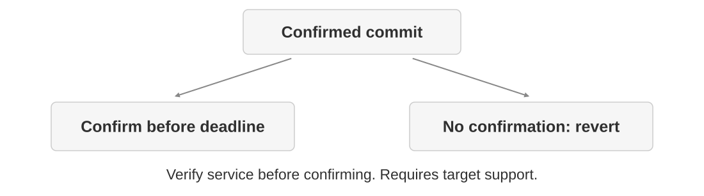

No confirmation before the timeout: the router reverts. Test that revert.

<nav class="progress" aria-label="Module progress"><span class="">INTENT</span><span class="arrow"> → </span><span class="">OBSERVE</span><span class="arrow"> → </span><span class="active">PLAN</span><span class="arrow"> → </span><span class="">CHANGE</span><span class="arrow"> → </span><span class="">VERIFY</span><span class="arrow"> → </span><span class="">RECORD</span></nav>

---
<!-- _class: visual core -->
<!-- _footer: "<span class=\"footer-context\">AI5049, Hochschule Fulda</span><span class=\"footer-refs\"><a href=\"https://github.com/openconfig/reference/blob/master/rpc/gnmi/gnmi-specification.md\">gNMI specification</a></span>" -->

# gNMI defines four RPCs

**RPC = remote procedure call**

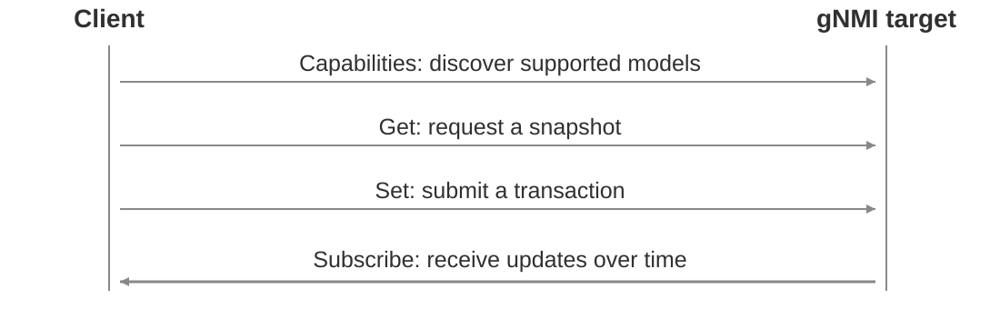

<nav class="progress" aria-label="Module progress"><span class="">INTENT</span><span class="arrow"> → </span><span class="">OBSERVE</span><span class="arrow"> → </span><span class="active">PLAN</span><span class="arrow"> → </span><span class="">CHANGE</span><span class="arrow"> → </span><span class="">VERIFY</span><span class="arrow"> → </span><span class="">RECORD</span></nav>

---
<!-- _class: content core -->
<!-- _footer: "AI5049, Hochschule Fulda" -->

# Read a gNMI path

Our repair path on edge01:

```text
/network-instance[name=default]/protocols/bgp/group[group-name=lagoon-v4]/export-policy
```

- `[name=default]` selects one network instance.
- `[group-name=lagoon-v4]` selects one BGP group, by its YANG key.
- `export-policy` is the leaf-list we read or delete.
- The **target** `edge01.bob1.reefnet.test:57400` selects the router.

<nav class="progress" aria-label="Module progress"><span class="">INTENT</span><span class="arrow"> → </span><span class="">OBSERVE</span><span class="arrow"> → </span><span class="active">PLAN</span><span class="arrow"> → </span><span class="">CHANGE</span><span class="arrow"> → </span><span class="">VERIFY</span><span class="arrow"> → </span><span class="">RECORD</span></nav>

---
<!-- _class: content core -->
<!-- _footer: "<span class=\"footer-context\">AI5049, Hochschule Fulda</span><span class=\"footer-refs\"><a href=\"https://github.com/openconfig/reference/blob/master/rpc/gnmi/gnmi-specification.md#34-set\">gNMI Set specification</a></span>" -->

# gNMI Set

One request, one target, one transaction.

| Result | Target behavior |
|---|---|
| Success | Apply all requested changes |
| Failure | Restore the pre-request state |
| Timeout | Outcome unknown to the client |

Read back after a timeout. On SR Linux, Set applies immediately: no commit step.

<nav class="progress" aria-label="Module progress"><span class="">INTENT</span><span class="arrow"> → </span><span class="">OBSERVE</span><span class="arrow"> → </span><span class="active">PLAN</span><span class="arrow"> → </span><span class="">CHANGE</span><span class="arrow"> → </span><span class="">VERIFY</span><span class="arrow"> → </span><span class="">RECORD</span></nav>

---
<!-- _class: visual deep-dive -->
<!-- _footer: "AI5049, Hochschule Fulda" -->

# Prevent a lost update

Two operators read `lagoon-v4`, then both write. The later write silently undoes the earlier one.

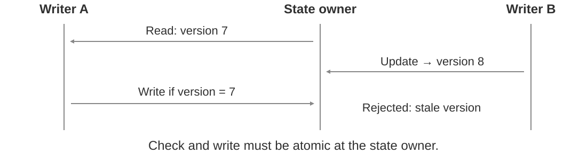

Fix: block the second writer, or write only if your read is still current.

<nav class="progress" aria-label="Module progress"><span class="">INTENT</span><span class="arrow"> → </span><span class="">OBSERVE</span><span class="arrow"> → </span><span class="active">PLAN</span><span class="arrow"> → </span><span class="">CHANGE</span><span class="arrow"> → </span><span class="">VERIFY</span><span class="arrow"> → </span><span class="">RECORD</span></nav>

---
<!-- _class: content deep-dive -->
<!-- _footer: "AI5049, Hochschule Fulda" -->

# Block the second writer

| Interface | Protection | Tested on edge01 |
|---|---|---|
| CLI | `enter candidate exclusive` | Second CLI session refused |
| NETCONF | `lock` → read → `edit-config` → `commit` → `unlock` | Second lock: `lock-denied` |
| gNMI Set | none | Set went through while NETCONF held the lock |

Keep one writer per router and read back after every write.

<nav class="progress" aria-label="Module progress"><span class="">INTENT</span><span class="arrow"> → </span><span class="">OBSERVE</span><span class="arrow"> → </span><span class="active">PLAN</span><span class="arrow"> → </span><span class="">CHANGE</span><span class="arrow"> → </span><span class="">VERIFY</span><span class="arrow"> → </span><span class="">RECORD</span></nav>

---
<!-- _class: visual core -->
<!-- _footer: "AI5049, Hochschule Fulda" -->

# Plan the maintenance window

**Method of Procedure (MOP):** steps, checks and recovery ownership.

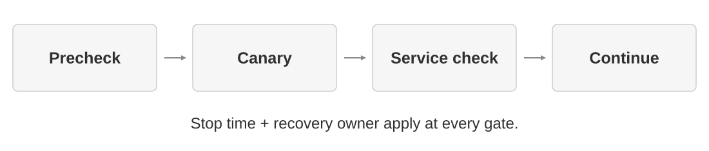

<nav class="progress" aria-label="Module progress"><span class="">INTENT</span><span class="arrow"> → </span><span class="">OBSERVE</span><span class="arrow"> → </span><span class="active">PLAN</span><span class="arrow"> → </span><span class="">CHANGE</span><span class="arrow"> → </span><span class="">VERIFY</span><span class="arrow"> → </span><span class="">RECORD</span></nav>

---
<!-- _class: content core -->
<!-- _footer: "AI5049, Hochschule Fulda" -->

# Plan the repair verification

| Check | Expected |
|---|---|
| Lagoon: `198.51.100.0/24` | Export restored |
| Lagoon: `2001:db8:100::/48` | Still exported |
| Pacific IPv4 path | Still healthy |
| Both probes, both families | Service responds |

<nav class="progress" aria-label="Module progress"><span class="">INTENT</span><span class="arrow"> → </span><span class="">OBSERVE</span><span class="arrow"> → </span><span class="active">PLAN</span><span class="arrow"> → </span><span class="">CHANGE</span><span class="arrow"> → </span><span class="">VERIFY</span><span class="arrow"> → </span><span class="">RECORD</span></nav>

---
<!-- _class: content task -->
<!-- _footer: "<span class=\"footer-context\">AI5049, Hochschule Fulda</span><span class=\"footer-refs\"><a href=\"https://gnmic.openconfig.net/\">gNMIc documentation</a></span>" -->

# Exercise: repair it through gNMI

Find ReefNet Edge 01 in NetBox. Read its configuration and justify a change.

In WSL:
```bash
make fault-routing;
make task STEP=6;
```
Lab not running? `make operations` starts it with the fault already in place.

**60 minutes:** steps 6–8. Repair through gNMI and verify the service from both probes.
Use `make hint` for investigation commands.

[Exercise overview](https://github.com/Stinktopf/network-management-and-monitoring#exercises)

---
<!-- _class: content core -->
<!-- _footer: "<span class=\"footer-context\">AI5049, Hochschule Fulda</span><span class=\"footer-refs\"><a href=\"https://gnmic.openconfig.net/cmd/set/\">gNMIc Set documentation</a></span>" -->

# Apply the repair through gNMI

<div class="terminal">
<div class="terminal-entry"><strong>WSL</strong><code>make enter NODE=operations01.bob1.reefnet.test</code></div>
<div class="terminal-label">Inside operations01, after <code>get</code> confirmed <code>BLOCK-CUSTOMER-V4</code></div>
<pre><code>export GNMIC_ADDRESS=edge01.bob1.reefnet.test:57400;
export GNMIC_USERNAME=admin GNMIC_PASSWORD=&#x27;NokiaSrl1!&#x27;;
export GNMIC_SKIP_VERIFY=true GNMIC_ENCODING=json_ietf GNMIC_TIMEOUT=10s;
GROUP=&#x27;/network-instance[name=default]/protocols/bgp/group[group-name=lagoon-v4]&#x27;;
gnmic set --delete &quot;$GROUP/export-policy&quot;;</code></pre>
</div>

Read back the group. Check Lagoon’s route and HTTP from both probes.

---
<!-- _class: chapter core -->
<!-- _footer: "AI5049, Hochschule Fulda" -->

# Beyond one router: execute and recover

What changes when one change targets many routers?

---
<!-- _class: content core -->
<!-- _footer: "AI5049, Hochschule Fulda" -->

# Bound the rollout

1. Re-read live preconditions.
2. Change one representative canary.
3. Verify the service before expanding.

Set a stop time. Keep the backout path reachable.

<nav class="progress" aria-label="Module progress"><span class="">INTENT</span><span class="arrow"> → </span><span class="">OBSERVE</span><span class="arrow"> → </span><span class="">PLAN</span><span class="arrow"> → </span><span class="active">CHANGE</span><span class="arrow"> → </span><span class="">VERIFY</span><span class="arrow"> → </span><span class="">RECORD</span></nav>

---
<!-- _class: content core -->
<!-- _footer: "AI5049, Hochschule Fulda" -->

# Give automation a bounded identity

| Identity | Read | Write |
|---|---|---|
| Collector | Required state | No |
| Change service | Prechecks + verification | Approved scope |
| Reviewer | Evidence | No |

In the lab, `gnmic` logs in as `admin`, with full write access. A collector should not.

<nav class="progress" aria-label="Module progress"><span class="">INTENT</span><span class="arrow"> → </span><span class="">OBSERVE</span><span class="arrow"> → </span><span class="">PLAN</span><span class="arrow"> → </span><span class="active">CHANGE</span><span class="arrow"> → </span><span class="">VERIFY</span><span class="arrow"> → </span><span class="">RECORD</span></nav>

---
<!-- _class: visual core -->
<!-- _footer: "AI5049, Hochschule Fulda" -->

# A fleet changes the failure model

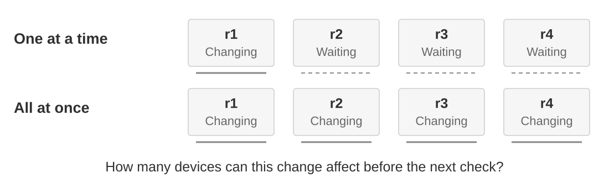

<nav class="progress" aria-label="Module progress"><span class="">INTENT</span><span class="arrow"> → </span><span class="">OBSERVE</span><span class="arrow"> → </span><span class="">PLAN</span><span class="arrow"> → </span><span class="active">CHANGE</span><span class="arrow"> → </span><span class="">VERIFY</span><span class="arrow"> → </span><span class="">RECORD</span></nav>

---
<!-- _class: content core -->
<!-- _footer: "AI5049, Hochschule Fulda" -->

# Run it twice. What changes?

**Idempotence**, for a fixed operation F and state s:

$$F(F(s))=F(s)$$

Deleting the `lagoon-v4` export-policy twice leaves the same state: no override.

<nav class="progress" aria-label="Module progress"><span class="">INTENT</span><span class="arrow"> → </span><span class="">OBSERVE</span><span class="arrow"> → </span><span class="">PLAN</span><span class="arrow"> → </span><span class="active">CHANGE</span><span class="arrow"> → </span><span class="">VERIFY</span><span class="arrow"> → </span><span class="">RECORD</span></nav>

---
<!-- _class: visual deep-dive -->
<!-- _footer: "AI5049, Hochschule Fulda" -->

# One router timed out after the write

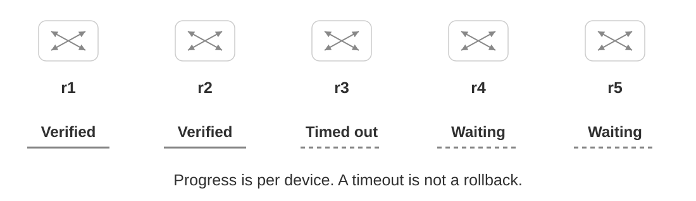

Which device needs a fresh read before any retry?

<nav class="progress" aria-label="Module progress"><span class="">INTENT</span><span class="arrow"> → </span><span class="">OBSERVE</span><span class="arrow"> → </span><span class="">PLAN</span><span class="arrow"> → </span><span class="active">CHANGE</span><span class="arrow"> → </span><span class="">VERIFY</span><span class="arrow"> → </span><span class="">RECORD</span></nav>

---
<!-- _class: content core -->
<!-- _footer: "AI5049, Hochschule Fulda" -->

# Which state are we restoring?

“Restore last Tuesday” is not a precise instruction.

| Golden configuration | Backup |
|---|---|
| Approved baseline | Captured device state |

Keep identity, time, version and checksum outside the device.

<nav class="progress" aria-label="Module progress"><span class="">INTENT</span><span class="arrow"> → </span><span class="">OBSERVE</span><span class="arrow"> → </span><span class="">PLAN</span><span class="arrow"> → </span><span class="">CHANGE</span><span class="arrow"> → </span><span class="">VERIFY</span><span class="arrow"> → </span><span class="active">RECORD</span></nav>

---
<!-- _class: content core -->
<!-- _footer: "AI5049, Hochschule Fulda" -->

# Keep an audit trail

```json
{
  "actor": "course-automation",
  "target": "edge01.bob1.reefnet.test",
  "change_id": "CHG-017",
  "deleted_override": "BLOCK-CUSTOMER-V4",
  "inherited_policy": "EXPORT-BGP",
  "lagoon_ipv4_probe_passed": true
}
```

<nav class="progress" aria-label="Module progress"><span class="">INTENT</span><span class="arrow"> → </span><span class="">OBSERVE</span><span class="arrow"> → </span><span class="">PLAN</span><span class="arrow"> → </span><span class="">CHANGE</span><span class="arrow"> → </span><span class="">VERIFY</span><span class="arrow"> → </span><span class="active">RECORD</span></nav>

---
<!-- _class: visual core -->
<!-- _footer: "<span class=\"footer-context\">AI5049, Hochschule Fulda</span><span class=\"footer-refs\"><a href=\"https://opengitops.dev/\">OpenGitOps principles</a></span>" -->

# GitOps gives us a reviewed desired state

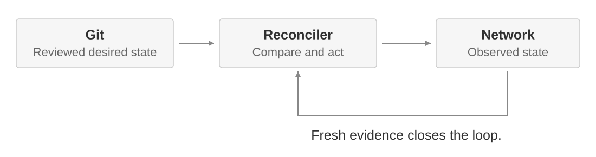

<nav class="progress" aria-label="Module progress"><span class="">INTENT</span><span class="arrow"> → </span><span class="">OBSERVE</span><span class="arrow"> → </span><span class="">PLAN</span><span class="arrow"> → </span><span class="">CHANGE</span><span class="arrow"> → </span><span class="">VERIFY</span><span class="arrow"> → </span><span class="active">RECORD</span></nav>

---
<!-- _class: chapter deep-dive -->
<!-- _footer: "AI5049, Hochschule Fulda" -->

# Who Broke the Internet?

**Everything is redundant until the shared dependency breaks.**

Which safeguard would have changed the outcome?

---
<!-- _class: content deep-dive -->
<!-- _footer: "<span class=\"footer-context\">AI5049, Hochschule Fulda</span><span class=\"footer-refs\"><a href=\"https://engineering.fb.com/2021/10/05/networking-traffic/outage-details/\">Meta outage report (2021)</a> <a href=\"https://blog.cloudflare.com/october-2021-facebook-outage/\">Observed impact</a></span>" -->

# Facebook: the backbone took DNS with it

**4 October 2021**

1. An audit-tool bug allowed a maintenance command to disconnect the backbone.
2. DNS sites lost data-center reachability and withdrew BGP routes.
3. Running DNS servers became unreachable.

**Facebook, Instagram and WhatsApp went offline.**

---
<!-- _class: visual deep-dive -->
<!-- _footer: "<span class=\"footer-context\">AI5049, Hochschule Fulda</span><span class=\"footer-refs\"><a href=\"https://engineering.fb.com/2021/10/05/networking-traffic/outage-details/\">Meta report</a><a href=\"https://www.rfc-editor.org/rfc/rfc1958.html#section-3.11\">RFC 1958 §3.11</a></span>" -->

# Facebook: recovery lost its own tools

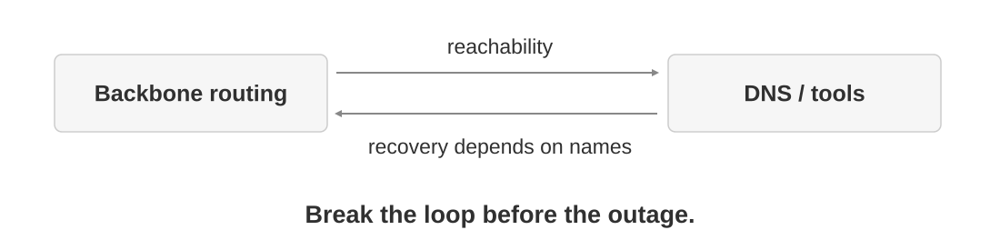

Normal and out-of-band access failed. Engineers had to go onsite.

They restored the backbone, then brought services back under controlled load.

---
<!-- _class: content deep-dive -->
<!-- _footer: "AI5049, Hochschule Fulda" -->

# Can you still reach the router?

| Management path | Uses |
|---|---|
| In-band | Production network |
| Out-of-band | Separate device or console access |

Check shared dependencies: **power, fiber, DNS and authentication**.

---
<!-- _class: visual deep-dive -->
<!-- _footer: "AI5049, Hochschule Fulda" -->

# Production recovery example: a console path

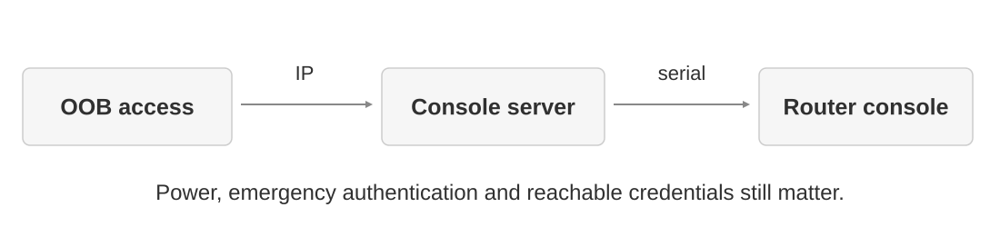

Test login and repair while the production path is unavailable.

---
<!-- _class: visual deep-dive -->
<!-- _footer: "AI5049, Hochschule Fulda" -->

# Task: the console is reachable, login fails

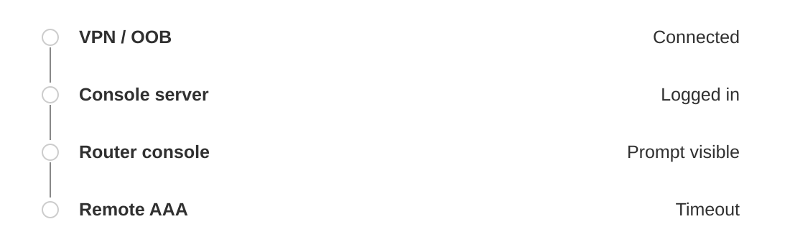

AAA uses the failed backbone. Which fallback must exist?

---
<!-- _class: content deep-dive -->
<!-- _footer: "AI5049, Hochschule Fulda" -->

# Recovery only works if it was prepared

| Dependency | Prepare |
|---|---|
| Transit | Circuit and provider contact |
| Console | Server, port and serial settings |
| Login | Tested emergency credentials |
| DNS / secrets | Reachable during the outage |
| Power | Backup along the recovery path |

Test that the emergency account can make the repair.

---
<!-- _class: content deep-dive -->
<!-- _footer: "AI5049, Hochschule Fulda" -->

# Who do we call, and when?

An **escalation matrix** fixes contacts and triggers before the incident. Illustrative for ReefNet:

| Level | Who | Escalate when |
|---|---|---|
| 1 | NOC on shift | Alert or customer report |
| 2 | Network engineer on call | No diagnosis after 15 minutes |
| 3 | Vendor support | Suspected software or hardware fault |
| Provider | Lagoon Transit NOC | Fault on circuit `BOB1-LAGOON-001` |
| Management | Duty manager | SLA breach likely |

---
<!-- _class: content deep-dive -->
<!-- _footer: "<span class=\"footer-context\">AI5049, Hochschule Fulda</span><span class=\"footer-refs\"><a href=\"https://docs.equinix.com/smart-hands/\">Equinix Smart Hands</a></span>" -->

# Remote hands need an exact job

If remote recovery is blocked, onsite staff become your eyes and hands.

```text
Location:   BOB1, rack BOB1-R01
Equipment:  edge01.bob1.reefnet.test, ethernet-1/3
Task:       verify label and photograph LEDs
Scope:      inspect only, no disconnect
Return:     timestamp, photos, label mismatch
```

For vendor escalation, add version, symptoms and logs.

---
<!-- _class: content deep-dive -->
<!-- _footer: "<span class=\"footer-context\">AI5049, Hochschule Fulda</span><span class=\"footer-refs\"><a href=\"https://status.cloud.google.com/incidents/J5ia5t9p3g9Q5Wi7r8Ev\">Google Cloud report (Sep 2026)</a></span>" -->

# Google Cloud: incompatible optics

**1 September 2026, us-central1**

New router optics were incompatible with the fabric side.
The work crossed redundant routers before connectivity was checked.

**Affected VMs lost connectivity** in parts of us-central1-b and us-central1-f.

---
<!-- _class: visual deep-dive -->
<!-- _footer: "<span class=\"footer-context\">AI5049, Hochschule Fulda</span><span class=\"footer-refs\"><a href=\"https://status.cloud.google.com/incidents/J5ia5t9p3g9Q5Wi7r8Ev\">Google Cloud report (Sep 2026)</a></span>" -->

# Google Cloud: one worklist defeated redundancy

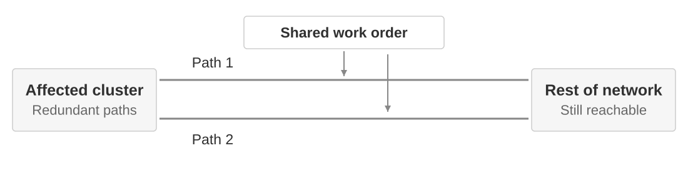

All affected paths were unplugged within **13 minutes**.
The worklist omitted router-by-router sequencing and verification.

Recovery: divert traffic, reinstall the original optics, verify links.

---
<!-- _class: visual deep-dive -->
<!-- _footer: "<span class=\"footer-context\">AI5049, Hochschule Fulda</span><span class=\"footer-refs\"><a href=\"https://labs.ripe.net/author/emileaben/a-deep-dive-into-the-baltic-sea-cable-cuts/\">RIPE Labs: Baltic Sea (2024)</a></span>" -->

# Baltic Sea: paths after the cuts

RIPE Atlas, 17–18 November 2024: Germany–Finland paths after the C-Lion1 cut.

Of 2,141 probe pairs, 21.5% kept identical IP paths.
5.2% of those still got 3 ms or more slower.

No extra packet loss: the networks rerouted, partly below IP.

---
<!-- _class: visual deep-dive -->
<!-- _footer: "<span class=\"footer-context\">AI5049, Hochschule Fulda</span><span class=\"footer-refs\"><a href=\"https://labs.ripe.net/author/emileaben/a-deep-dive-into-the-baltic-sea-cable-cuts/\">RIPE Labs: Baltic Sea (2024)</a></span>" -->

# The IP path can look unchanged

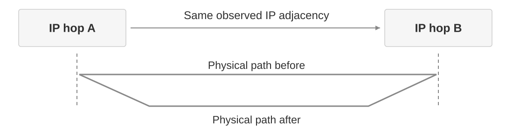

Traceroute alone cannot identify a damaged cable.
Tomorrow you measure RTT from fixed probes, the same method RIPE Atlas uses.

---
<!-- _class: day core -->
<!-- _footer: "AI5049, Hochschule Fulda" -->

# 14 October 2026

## Monitoring / Observability

In Operations, the customer had to tell us something was wrong.

**How could the network have told us first?**

---
<!-- _class: content core -->
<!-- _footer: "AI5049, Hochschule Fulda" -->

# What do we want to know?

| | Service | Network | Device |
|---|---|---|---|
| Question | Does the exchange work? | Do packets get through? | Is the box healthy? |
| Examples | Availability, latency | Loss, routing state | Discards, resources |
| In BOB1 | `reefnet_probe_success` | BGP, OSPF, link rates | Interface state, discards |

<nav class="progress" aria-label="Module progress"><span class="active">QUESTION</span><span class="arrow"> → </span><span class="">SIGNAL</span><span class="arrow"> → </span><span class="">COLLECT</span><span class="arrow"> → </span><span class="">INTERPRET</span><span class="arrow"> → </span><span class="">ALERT</span><span class="arrow"> → </span><span class="">RESPOND</span></nav>

---
<!-- _class: content core -->
<!-- _footer: "AI5049, Hochschule Fulda" -->

# Different signals answer different questions

| Signal | Question |
|---|---|
| Metric | How much or how fast? |
| Event / log | What changed? |
| Flow record | Which traffic? |
| Packet capture | What was on the wire? |
| Active probe | Does this exchange work? |

<nav class="progress" aria-label="Module progress"><span class="active">QUESTION</span><span class="arrow"> → </span><span class="">SIGNAL</span><span class="arrow"> → </span><span class="">COLLECT</span><span class="arrow"> → </span><span class="">INTERPRET</span><span class="arrow"> → </span><span class="">ALERT</span><span class="arrow"> → </span><span class="">RESPOND</span></nav>

---
<!-- _class: content deep-dive -->
<!-- _footer: "AI5049, Hochschule Fulda" -->

# The monitoring brief

What should the BOB1 probes guarantee?

- Detect a Lagoon IPv4 interruption of **5 seconds or longer**.
- Stay within **20 HTTP requests/s** toward the customer.
- Mark stale data **unknown within 10 seconds**.

We check these three requirements against the lab today.

<nav class="progress" aria-label="Module progress"><span class="active">QUESTION</span><span class="arrow"> → </span><span class="">SIGNAL</span><span class="arrow"> → </span><span class="">COLLECT</span><span class="arrow"> → </span><span class="">INTERPRET</span><span class="arrow"> → </span><span class="">ALERT</span><span class="arrow"> → </span><span class="">RESPOND</span></nav>

---
<!-- _class: visual core -->
<!-- _footer: "AI5049, Hochschule Fulda" -->

# Delay and loss need endpoints

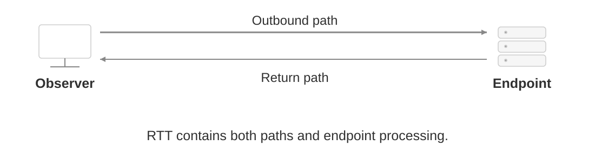

<nav class="progress" aria-label="Module progress"><span class="active">QUESTION</span><span class="arrow"> → </span><span class="">SIGNAL</span><span class="arrow"> → </span><span class="">COLLECT</span><span class="arrow"> → </span><span class="">INTERPRET</span><span class="arrow"> → </span><span class="">ALERT</span><span class="arrow"> → </span><span class="">RESPOND</span></nav>

---
<!-- _class: content core -->
<!-- _footer: "AI5049, Hochschule Fulda" -->

# Choose the probe from the question

| Probe | Tells us |
|---|---|
| ICMP echo | IP reachability to a responding endpoint |
| TCP connect | transport handshake |
| HTTP request | application transaction |
| traceroute | responding hops along a path |

<nav class="progress" aria-label="Module progress"><span class="active">QUESTION</span><span class="arrow"> → </span><span class="">SIGNAL</span><span class="arrow"> → </span><span class="">COLLECT</span><span class="arrow"> → </span><span class="">INTERPRET</span><span class="arrow"> → </span><span class="">ALERT</span><span class="arrow"> → </span><span class="">RESPOND</span></nav>

---
<!-- _class: content core -->
<!-- _footer: "AI5049, Hochschule Fulda" -->

# Define the probe before you run it

One BOB1 probe is:

```text
source:          probe01.bob1.lagoontransit.test
target:          198.51.100.10
address family:  IPv4
protocol:        ICMP echo
reply wait:      1 s
success:         ping exits successfully
```

<nav class="progress" aria-label="Module progress"><span class="active">QUESTION</span><span class="arrow"> → </span><span class="">SIGNAL</span><span class="arrow"> → </span><span class="">COLLECT</span><span class="arrow"> → </span><span class="">INTERPRET</span><span class="arrow"> → </span><span class="">ALERT</span><span class="arrow"> → </span><span class="">RESPOND</span></nav>

---
<!-- _class: content deep-dive -->
<!-- _footer: "AI5049, Hochschule Fulda" -->

# Budget the ReefNet probe round

For the smaller BOB1 probe set:

**2 sources × 2 families × 3 probe types = 12 checks**

All checks of a probe run in parallel. Each check gives up after 1 s.
Then the exporter pauses 1 s: about one round per second, about **4 HTTP requests/s**.
A failing round takes about 2 s. That stays well within the 10 s UNKNOWN threshold.

<nav class="progress" aria-label="Module progress"><span class="">QUESTION</span><span class="arrow"> → </span><span class="active">SIGNAL</span><span class="arrow"> → </span><span class="">COLLECT</span><span class="arrow"> → </span><span class="">INTERPRET</span><span class="arrow"> → </span><span class="">ALERT</span><span class="arrow"> → </span><span class="">RESPOND</span></nav>

---
<!-- _class: content core -->
<!-- _footer: "<span class=\"footer-context\">AI5049, Hochschule Fulda</span><span class=\"footer-refs\"><a href=\"https://www.rfc-editor.org/rfc/rfc3411.html\">SNMP: RFC 3411</a></span>" -->

# SNMP: what does the device report?

A manager queries an agent.

**OID:** object identifier.
**MIB:** Management Information Base, defining object meaning.

Keep the device, OID, row, value and poll time.
Short events can fall between polls.

Not provisioned in BOB1.

<nav class="progress" aria-label="Module progress"><span class="">QUESTION</span><span class="arrow"> → </span><span class="">SIGNAL</span><span class="arrow"> → </span><span class="active">COLLECT</span><span class="arrow"> → </span><span class="">INTERPRET</span><span class="arrow"> → </span><span class="">ALERT</span><span class="arrow"> → </span><span class="">RESPOND</span></nav>

---
<!-- _class: content core -->
<!-- _footer: "<span class=\"footer-context\">AI5049, Hochschule Fulda</span><span class=\"footer-refs\"><a href=\"https://www.rfc-editor.org/rfc/rfc5424.html\">Syslog: RFC 5424</a></span>" -->

# Syslog: what changed?

| | |
|---|---|
| Observation | Time, host, severity, app and message |
| Limit | Missing logs do not prove health |
| ReefNet | SR Linux → Alloy → Loki → Grafana |

From `make fault-link`, in Devices & Interfaces:
`OSPF instance default: Interface ethernet-1/4.0, moved to state DOWN due to event IF_DOWN`

<nav class="progress" aria-label="Module progress"><span class="">QUESTION</span><span class="arrow"> → </span><span class="">SIGNAL</span><span class="arrow"> → </span><span class="active">COLLECT</span><span class="arrow"> → </span><span class="">INTERPRET</span><span class="arrow"> → </span><span class="">ALERT</span><span class="arrow"> → </span><span class="">RESPOND</span></nav>

---
<!-- _class: content core -->
<!-- _footer: "<span class=\"footer-context\">AI5049, Hochschule Fulda</span><span class=\"footer-refs\"><a href=\"https://www.rfc-editor.org/rfc/rfc7011.html\">IPFIX: RFC 7011</a></span>" -->

# IPFIX: which traffic crossed here?

| | |
|---|---|
| Observation | Flow keys, counts and time interval |
| Limit | Typical records omit payload. Sampling affects counts |
| ReefNet | Not provisioned in BOB1 |

<nav class="progress" aria-label="Module progress"><span class="">QUESTION</span><span class="arrow"> → </span><span class="">SIGNAL</span><span class="arrow"> → </span><span class="active">COLLECT</span><span class="arrow"> → </span><span class="">INTERPRET</span><span class="arrow"> → </span><span class="">ALERT</span><span class="arrow"> → </span><span class="">RESPOND</span></nav>

---
<!-- _class: content core -->
<!-- _footer: "AI5049, Hochschule Fulda" -->

# Streaming state: what changed?

| | |
|---|---|
| Observation | Target, keyed path, timestamp, update/deletion |
| Limit | Reconnect cannot restore every missed event |
| ReefNet | gNMIc SAMPLE: interfaces every 1 s, BGP and OSPF every 2 s |

<nav class="progress" aria-label="Module progress"><span class="">QUESTION</span><span class="arrow"> → </span><span class="">SIGNAL</span><span class="arrow"> → </span><span class="active">COLLECT</span><span class="arrow"> → </span><span class="">INTERPRET</span><span class="arrow"> → </span><span class="">ALERT</span><span class="arrow"> → </span><span class="">RESPOND</span></nav>

---
<!-- _class: visual core -->
<!-- _footer: "<span class=\"footer-context\">AI5049, Hochschule Fulda</span><span class=\"footer-refs\"><a href=\"https://github.com/openconfig/reference/blob/master/rpc/gnmi/gnmi-specification.md#35-subscribing-to-telemetry-updates\">gNMI Subscribe specification</a></span>" -->

# Choose the subscription semantics

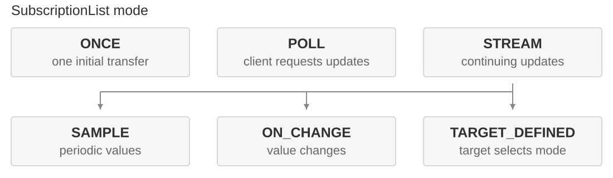

<nav class="progress" aria-label="Module progress"><span class="">QUESTION</span><span class="arrow"> → </span><span class="">SIGNAL</span><span class="arrow"> → </span><span class="active">COLLECT</span><span class="arrow"> → </span><span class="">INTERPRET</span><span class="arrow"> → </span><span class="">ALERT</span><span class="arrow"> → </span><span class="">RESPOND</span></nav>

---
<!-- _class: content core -->
<!-- _footer: "<span class=\"footer-context\">AI5049, Hochschule Fulda</span><span class=\"footer-refs\"><a href=\"https://gnmic.openconfig.net/user_guide/subscriptions/\">gNMIc subscriptions</a></span>" -->

# Watch counters arrive through gNMI

<div class="terminal">
<div class="terminal-entry"><strong>WSL</strong><code>make enter NODE=operations01.bob1.reefnet.test</code></div>
<div class="terminal-label">Inside operations01</div>
<pre><code>export GNMIC_ADDRESS=edge01.bob1.reefnet.test:57400;
export GNMIC_USERNAME=admin GNMIC_PASSWORD=&#x27;NokiaSrl1!&#x27;;
export GNMIC_SKIP_VERIFY=true GNMIC_ENCODING=json_ietf GNMIC_TIMEOUT=10s;
IF=&#x27;/interface[name=ethernet-1/3]/statistics&#x27;;
gnmic subscribe --path &quot;$IF&quot; --stream-mode sample --sample-interval 5s;</code></pre>
</div>

**Ctrl+C** stops the subscription.

<nav class="progress" aria-label="Module progress"><span class="">QUESTION</span><span class="arrow"> → </span><span class="">SIGNAL</span><span class="arrow"> → </span><span class="active">COLLECT</span><span class="arrow"> → </span><span class="">INTERPRET</span><span class="arrow"> → </span><span class="">ALERT</span><span class="arrow"> → </span><span class="">RESPOND</span></nav>

---
<!-- _class: visual core -->
<!-- _footer: "AI5049, Hochschule Fulda" -->

# Zero, missing or deleted

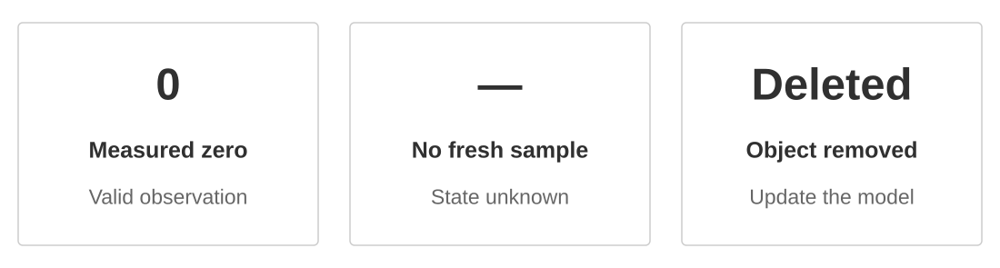

<nav class="progress" aria-label="Module progress"><span class="">QUESTION</span><span class="arrow"> → </span><span class="">SIGNAL</span><span class="arrow"> → </span><span class="active">COLLECT</span><span class="arrow"> → </span><span class="">INTERPRET</span><span class="arrow"> → </span><span class="">ALERT</span><span class="arrow"> → </span><span class="">RESPOND</span></nav>

---
<!-- _class: visual core -->
<!-- _footer: "AI5049, Hochschule Fulda" -->

# Reconnect cannot restore lost history

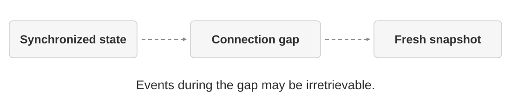

<nav class="progress" aria-label="Module progress"><span class="">QUESTION</span><span class="arrow"> → </span><span class="">SIGNAL</span><span class="arrow"> → </span><span class="active">COLLECT</span><span class="arrow"> → </span><span class="">INTERPRET</span><span class="arrow"> → </span><span class="">ALERT</span><span class="arrow"> → </span><span class="">RESPOND</span></nav>

---
<!-- _class: visual core -->
<!-- _footer: "AI5049, Hochschule Fulda" -->

# Metrics and logs in ReefNet

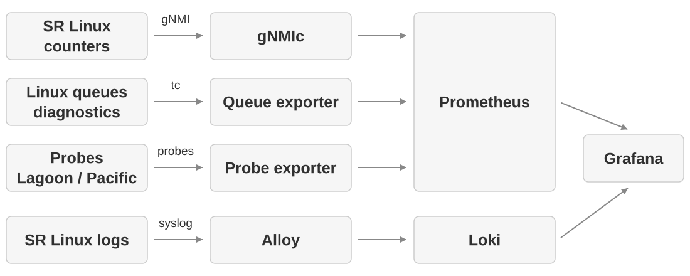

<nav class="progress" aria-label="Module progress"><span class="">QUESTION</span><span class="arrow"> → </span><span class="">SIGNAL</span><span class="arrow"> → </span><span class="active">COLLECT</span><span class="arrow"> → </span><span class="">INTERPRET</span><span class="arrow"> → </span><span class="">ALERT</span><span class="arrow"> → </span><span class="">RESPOND</span></nav>

---
<!-- _class: content core -->
<!-- _footer: "<span class=\"footer-context\">AI5049, Hochschule Fulda</span><span class=\"footer-refs\"><a href=\"https://prometheus.io/docs/introduction/overview/\">Prometheus overview</a></span>" -->

# Prometheus stores time series

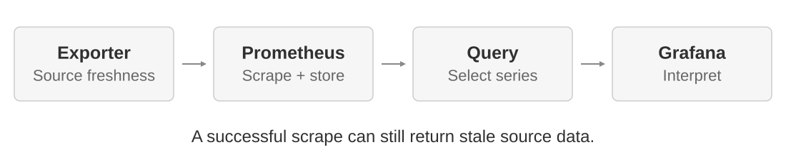

Try PromQL at `http://localhost:9090`.

<nav class="progress" aria-label="Module progress"><span class="">QUESTION</span><span class="arrow"> → </span><span class="">SIGNAL</span><span class="arrow"> → </span><span class="active">COLLECT</span><span class="arrow"> → </span><span class="">INTERPRET</span><span class="arrow"> → </span><span class="">ALERT</span><span class="arrow"> → </span><span class="">RESPOND</span></nav>

---
<!-- _class: visual core -->
<!-- _footer: "AI5049, Hochschule Fulda" -->

# Cardinality: count ReefNet’s series

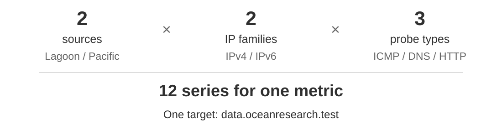

`count(reefnet_probe_success)` → **12**
Success, duration and timestamp together → **36 series**.

<nav class="progress" aria-label="Module progress"><span class="">QUESTION</span><span class="arrow"> → </span><span class="">SIGNAL</span><span class="arrow"> → </span><span class="active">COLLECT</span><span class="arrow"> → </span><span class="">INTERPRET</span><span class="arrow"> → </span><span class="">ALERT</span><span class="arrow"> → </span><span class="">RESPOND</span></nav>

---
<!-- _class: task core -->
<!-- _footer: "<span class=\"footer-context\">AI5049, Hochschule Fulda</span><span class=\"footer-refs\"><a href=\"https://prometheus.io/docs/practices/naming/#labels\">Prometheus: metric labels</a></span>" -->

# Would you add a request ID?

A proposed change to ReefNet's probe metric:

```text
source="probe01.bob1.lagoontransit.test"
probe="icmp"
af="ipv4"
target="data.oceanresearch.test"
request_id="a-new-value-for-every-run"
```

What does `request_id` do to cardinality? Where should it go?

<nav class="progress" aria-label="Module progress"><span class="">QUESTION</span><span class="arrow"> → </span><span class="">SIGNAL</span><span class="arrow"> → </span><span class="active">COLLECT</span><span class="arrow"> → </span><span class="">INTERPRET</span><span class="arrow"> → </span><span class="">ALERT</span><span class="arrow"> → </span><span class="">RESPOND</span></nav>

---
<!-- _class: visual core -->
<!-- _footer: "AI5049, Hochschule Fulda" -->

# One ReefNet interface, one series

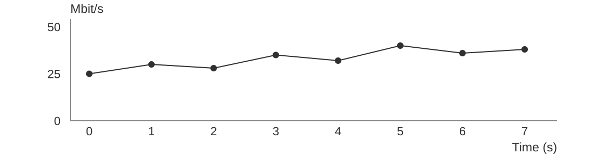

`reefnet_interface_in_octets_total{source="edge01.bob1.reefnet.test", interface_name="ethernet-1/3"}`

<nav class="progress" aria-label="Module progress"><span class="">QUESTION</span><span class="arrow"> → </span><span class="">SIGNAL</span><span class="arrow"> → </span><span class="">COLLECT</span><span class="arrow"> → </span><span class="active">INTERPRET</span><span class="arrow"> → </span><span class="">ALERT</span><span class="arrow"> → </span><span class="">RESPOND</span></nav>

---
<!-- _class: visual core -->
<!-- _footer: "AI5049, Hochschule Fulda" -->

# Counter or gauge?

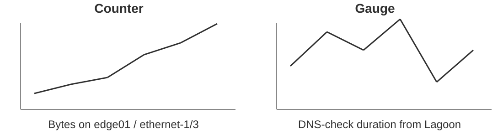

<nav class="progress" aria-label="Module progress"><span class="">QUESTION</span><span class="arrow"> → </span><span class="">SIGNAL</span><span class="arrow"> → </span><span class="">COLLECT</span><span class="arrow"> → </span><span class="active">INTERPRET</span><span class="arrow"> → </span><span class="">ALERT</span><span class="arrow"> → </span><span class="">RESPOND</span></nav>

---
<!-- _class: visual core -->
<!-- _footer: "AI5049, Hochschule Fulda" -->

# Timestamps in the pipeline

One event, several clocks.

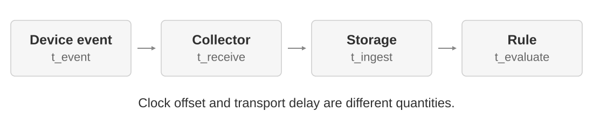

<nav class="progress" aria-label="Module progress"><span class="">QUESTION</span><span class="arrow"> → </span><span class="">SIGNAL</span><span class="arrow"> → </span><span class="">COLLECT</span><span class="arrow"> → </span><span class="active">INTERPRET</span><span class="arrow"> → </span><span class="">ALERT</span><span class="arrow"> → </span><span class="">RESPOND</span></nav>

---
<!-- _class: content core -->
<!-- _footer: "AI5049, Hochschule Fulda" -->

# Before subtracting counters

Check identity, timestamps and discontinuities.
A negative delta may mean **reset, wrap or bad data**. Prometheus `rate()` treats any decrease as a reset.
Invalid evidence becomes **unknown**, never a fabricated rate.

<nav class="progress" aria-label="Module progress"><span class="">QUESTION</span><span class="arrow"> → </span><span class="">SIGNAL</span><span class="arrow"> → </span><span class="">COLLECT</span><span class="arrow"> → </span><span class="active">INTERPRET</span><span class="arrow"> → </span><span class="">ALERT</span><span class="arrow"> → </span><span class="">RESPOND</span></nav>

---
<!-- _class: content core -->
<!-- _footer: "AI5049, Hochschule Fulda" -->

# Turn ReefNet byte counters into bit/s

Use `in-octets` on `edge01.bob1.reefnet.test`, interface `ethernet-1/3`.

$$rate = \frac{8(C_2-C_1)}{t_2-t_1}$$

BOB1: `reefnet_interface_in_bps = rate(reefnet_interface_in_octets_total[10s]) * 8`

<nav class="progress" aria-label="Module progress"><span class="">QUESTION</span><span class="arrow"> → </span><span class="">SIGNAL</span><span class="arrow"> → </span><span class="">COLLECT</span><span class="arrow"> → </span><span class="active">INTERPRET</span><span class="arrow"> → </span><span class="">ALERT</span><span class="arrow"> → </span><span class="">RESPOND</span></nav>

---
<!-- _class: content core -->
<!-- _footer: "AI5049, Hochschule Fulda" -->

# Calculate the Lagoon ingress rate

Example `in-octets` on `edge01.bob1.reefnet.test`, interface `ethernet-1/3`, at the 25 Mbit/s baseline.

| Time | Byte counter | Reset? |
|---|---:|---|
| 10:00:00 | 1,000,000 | Initial sample |
| 10:00:10 | 32,250,000 | No |
| 10:00:20 | 20,000 | Yes |
| 10:00:32 | 37,520,000 | No |

Four minutes: calculate valid rates. Compare them with the 50 Mbit/s handoff.

<nav class="progress" aria-label="Module progress"><span class="">QUESTION</span><span class="arrow"> → </span><span class="">SIGNAL</span><span class="arrow"> → </span><span class="">COLLECT</span><span class="arrow"> → </span><span class="active">INTERPRET</span><span class="arrow"> → </span><span class="">ALERT</span><span class="arrow"> → </span><span class="">RESPOND</span></nav>

---
<!-- _class: content core -->
<!-- _footer: "AI5049, Hochschule Fulda" -->

# 25 Mbit/s on a 50 Mbit/s handoff

| Interval | Rate |
|---|---|
| 00–10 s | 8 × 31,250,000 / 10 = **25 Mbit/s** |
| 10–20 s | Reset: **exclude** |
| 20–32 s | 8 × 37,500,000 / 12 = **25 Mbit/s** |

Both valid intervals use **50%** of handoff capacity.

<nav class="progress" aria-label="Module progress"><span class="">QUESTION</span><span class="arrow"> → </span><span class="">SIGNAL</span><span class="arrow"> → </span><span class="">COLLECT</span><span class="arrow"> → </span><span class="active">INTERPRET</span><span class="arrow"> → </span><span class="">ALERT</span><span class="arrow"> → </span><span class="">RESPOND</span></nav>

---
<!-- _class: visual core -->
<!-- _footer: "AI5049, Hochschule Fulda" -->

# What Lagoon sees when it probes DNS

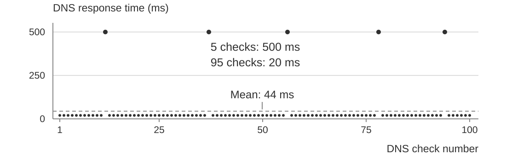

Would the **44 ms mean** explain the five long waits?

<nav class="progress" aria-label="Module progress"><span class="">QUESTION</span><span class="arrow"> → </span><span class="">SIGNAL</span><span class="arrow"> → </span><span class="">COLLECT</span><span class="arrow"> → </span><span class="active">INTERPRET</span><span class="arrow"> → </span><span class="">ALERT</span><span class="arrow"> → </span><span class="">RESPOND</span></nav>

---
<!-- _class: content core -->
<!-- _footer: "<span class=\"footer-context\">AI5049, Hochschule Fulda</span><span class=\"footer-refs\"><a href=\"https://prometheus.io/docs/practices/histograms/\">Prometheus: histograms</a></span>" -->

# Read the distribution

| View | What it tells us |
|---|---|
| Median | Middle observation |
| p95 | Threshold covering at least 95% |
| Histogram | Counts within ranges |
| Cumulative distribution | Fraction at or below each value |

p95 in BOB1, without histograms:
`quantile_over_time(0.95, reefnet_probe_duration_seconds{probe="dns"}[5m])`

<nav class="progress" aria-label="Module progress"><span class="">QUESTION</span><span class="arrow"> → </span><span class="">SIGNAL</span><span class="arrow"> → </span><span class="">COLLECT</span><span class="arrow"> → </span><span class="active">INTERPRET</span><span class="arrow"> → </span><span class="">ALERT</span><span class="arrow"> → </span><span class="">RESPOND</span></nav>

---
<!-- _class: content core -->
<!-- _footer: "AI5049, Hochschule Fulda" -->

# Percentiles do not average

A separate DNS example for `data.oceanresearch.test`. Nearest-rank p95:

| Source | Checks | Duration of each check |
|---|---:|---:|
| Lagoon | 100 | 20 ms |
| Pacific | 1 | 1,000 ms |

Average of the two p95s: **510 ms**.
Combined observations: **p95 = 20 ms**.

<nav class="progress" aria-label="Module progress"><span class="">QUESTION</span><span class="arrow"> → </span><span class="">SIGNAL</span><span class="arrow"> → </span><span class="">COLLECT</span><span class="arrow"> → </span><span class="active">INTERPRET</span><span class="arrow"> → </span><span class="">ALERT</span><span class="arrow"> → </span><span class="">RESPOND</span></nav>

---
<!-- _class: visual core -->
<!-- _footer: "AI5049, Hochschule Fulda" -->

# Four seconds can disappear

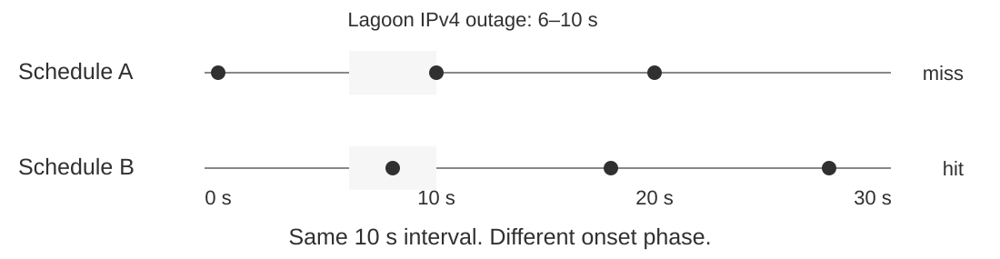

With a 10 s interval, a 4 s outage can fall between samples. BOB1 probes about every second and would see it.

<nav class="progress" aria-label="Module progress"><span class="">QUESTION</span><span class="arrow"> → </span><span class="">SIGNAL</span><span class="arrow"> → </span><span class="">COLLECT</span><span class="arrow"> → </span><span class="active">INTERPRET</span><span class="arrow"> → </span><span class="">ALERT</span><span class="arrow"> → </span><span class="">RESPOND</span></nav>

---
<!-- _class: visual core -->
<!-- _footer: "AI5049, Hochschule Fulda" -->

# Watch the sample age


<nav class="progress" aria-label="Module progress"><span class="">QUESTION</span><span class="arrow"> → </span><span class="">SIGNAL</span><span class="arrow"> → </span><span class="">COLLECT</span><span class="arrow"> → </span><span class="active">INTERPRET</span><span class="arrow"> → </span><span class="">ALERT</span><span class="arrow"> → </span><span class="">RESPOND</span></nav>

---
<!-- _class: visual core -->
<!-- _footer: "AI5049, Hochschule Fulda" -->

# Missing data on a dashboard


<nav class="progress" aria-label="Module progress"><span class="">QUESTION</span><span class="arrow"> → </span><span class="">SIGNAL</span><span class="arrow"> → </span><span class="">COLLECT</span><span class="arrow"> → </span><span class="active">INTERPRET</span><span class="arrow"> → </span><span class="">ALERT</span><span class="arrow"> → </span><span class="">RESPOND</span></nav>

---
<!-- _class: content core -->
<!-- _footer: "AI5049, Hochschule Fulda" -->

# Monitor the monitoring

| Component | BOB1 check |
|---|---|
| Scrape targets | 8 targets: gNMIc, 2 probe and 5 queue exporters, all `up` = 1 |
| Probe freshness | Telemetry Health → Oldest probe sample |
| Router sources | Telemetry Health → Router sources / 5 expected |
| Queue collection | Telemetry Health → Queue collection |

```promql
up{job=~"gnmic|reefnet-service-probes|reefnet-qdisc"}
```

<nav class="progress" aria-label="Module progress"><span class="">QUESTION</span><span class="arrow"> → </span><span class="">SIGNAL</span><span class="arrow"> → </span><span class="">COLLECT</span><span class="arrow"> → </span><span class="active">INTERPRET</span><span class="arrow"> → </span><span class="">ALERT</span><span class="arrow"> → </span><span class="">RESPOND</span></nav>

---
<!-- _class: content core -->
<!-- _footer: "AI5049, Hochschule Fulda" -->

# Choose a dashboard

| Question | BOB1 dashboard |
|---|---|
| Network status and topology | Network Overview |
| Reachability and response time | Service Health |
| Sessions, routes and updates | BGP |
| Core adjacencies and SPF activity | OSPF |
| Port state, discards and device events | Devices & Interfaces |
| Rates and utilization | Traffic & Capacity |
| Collection and freshness | Telemetry Health |

<nav class="progress" aria-label="Module progress"><span class="">QUESTION</span><span class="arrow"> → </span><span class="">SIGNAL</span><span class="arrow"> → </span><span class="">COLLECT</span><span class="arrow"> → </span><span class="active">INTERPRET</span><span class="arrow"> → </span><span class="">ALERT</span><span class="arrow"> → </span><span class="">RESPOND</span></nav>

---
<!-- _class: content core -->
<!-- _footer: "AI5049, Hochschule Fulda" -->

# What is Grafana telling us?

At **25 Mbit/s IPv4 traffic**, open `http://localhost:3000`.
Choose **ReefNet / BOB1 → Network Overview**.

- What is measured, and where?
- Which units and time window?
- How fresh is it?

Predict what changes when we send more traffic.

---
<!-- _class: content core -->
<!-- _footer: "AI5049, Hochschule Fulda" -->

# Same symptom, different causes

Lagoon IPv4 fails in both cases.

| Evidence | Export rejected | Session down |
|---|---|---|
| BGP session to `192.0.2.2` | Established | Not established |
| `198.51.100.0/24` in edge01's route table | Yes | Yes |
| Lagoon IPv6 | Works | Depends on the IPv6 session |

<nav class="progress" aria-label="Module progress"><span class="">QUESTION</span><span class="arrow"> → </span><span class="">SIGNAL</span><span class="arrow"> → </span><span class="">COLLECT</span><span class="arrow"> → </span><span class="active">INTERPRET</span><span class="arrow"> → </span><span class="">ALERT</span><span class="arrow"> → </span><span class="">RESPOND</span></nav>

---
<!-- _class: visual deep-dive -->
<!-- _footer: "<span class=\"footer-context\">AI5049, Hochschule Fulda</span><span class=\"footer-refs\"><a href=\"https://paris-traceroute.net/\">Paris Traceroute paper</a></span>" -->

# Traceroute: read replies carefully


<nav class="progress" aria-label="Module progress"><span class="">QUESTION</span><span class="arrow"> → </span><span class="">SIGNAL</span><span class="arrow"> → </span><span class="">COLLECT</span><span class="arrow"> → </span><span class="active">INTERPRET</span><span class="arrow"> → </span><span class="">ALERT</span><span class="arrow"> → </span><span class="">RESPOND</span></nav>

---
<!-- _class: content core -->
<!-- _footer: "AI5049, Hochschule Fulda" -->

# Admin state and oper state
`make fault-link` disables `ethernet-1/4` on ReefNet Edge 01:

```text
/interface[name=ethernet-1/4]/admin-state   "disable"
/interface[name=ethernet-1/4]/oper-state    "down"
```

**Admin:** configured intent. **Oper:** observed behavior.

<nav class="progress" aria-label="Module progress"><span class="">QUESTION</span><span class="arrow"> → </span><span class="">SIGNAL</span><span class="arrow"> → </span><span class="">COLLECT</span><span class="arrow"> → </span><span class="active">INTERPRET</span><span class="arrow"> → </span><span class="">ALERT</span><span class="arrow"> → </span><span class="">RESPOND</span></nav>

---
<!-- _class: visual core -->
<!-- _footer: "AI5049, Hochschule Fulda" -->

# 60 Mbit/s offered, 50 Mbit/s delivered


The customer handoff has 100 Mbit/s, Lagoon only 50 Mbit/s. At 60 Mbit/s the receiver loses about one sixth.

<nav class="progress" aria-label="Module progress"><span class="">QUESTION</span><span class="arrow"> → </span><span class="">SIGNAL</span><span class="arrow"> → </span><span class="">COLLECT</span><span class="arrow"> → </span><span class="active">INTERPRET</span><span class="arrow"> → </span><span class="">ALERT</span><span class="arrow"> → </span><span class="">RESPOND</span></nav>

---
<!-- _class: visual deep-dive -->
<!-- _footer: "<span class=\"footer-context\">AI5049, Hochschule Fulda</span><span class=\"footer-refs\"><a href=\"https://www.cisco.com/c/en/us/support/docs/switches/catalyst-9600-series-switches/220491-understand-output-drops-on-high-speed-in.html\">Cisco: bursts and output drops</a></span>" -->

# A short burst inside a long average


Check discards, not only rates.

<nav class="progress" aria-label="Module progress"><span class="">QUESTION</span><span class="arrow"> → </span><span class="">SIGNAL</span><span class="arrow"> → </span><span class="">COLLECT</span><span class="arrow"> → </span><span class="active">INTERPRET</span><span class="arrow"> → </span><span class="">ALERT</span><span class="arrow"> → </span><span class="">RESPOND</span></nav>

---
<!-- _class: content task -->
<!-- _footer: "AI5049, Hochschule Fulda" -->

# Where do the packets go?

What happens when offered traffic exceeds the **50 Mbit/s** handoff?

In WSL:
```bash
cd ~/network-management-and-monitoring && git pull;
make monitoring;
make task;
```

**75 minutes:** compare load, received traffic and new discards.
Then try link and routing faults and a short burst.

[Exercise overview](https://github.com/Stinktopf/network-management-and-monitoring#exercises)


---
<!-- _class: content core -->
<!-- _footer: "AI5049, Hochschule Fulda" -->

# How much traffic reached the customer?

<div class="terminal">
<div class="terminal-entry"><strong>WSL</strong><code>make enter NODE=edge01.bob1.lagoontransit.test</code></div>
<div class="terminal-label">Router CLI: physical interface counters</div>
<pre><code>info from state interface ethernet-1/1 statistics</code></pre>
</div>

<div class="terminal">
<div class="terminal-entry"><strong>WSL after quit</strong><code>make enter NODE=service01.bob1.oceanresearch.test</code></div>
<div class="terminal-label">Inside the receiver: Mbit/s and loss</div>
<pre><code>tail -n 15 /tmp/iperf-server.log;</code></pre>
</div>

Compare new egress discards with receiver loss.
Then in WSL: `make traffic-10mbit;`


---
<!-- _class: content deep-dive -->
<!-- _footer: "AI5049, Hochschule Fulda" -->

# Keep the simulator out of the result

75 Mbit/s, 1,200-byte UDP datagrams:

**≈ 7,800 packets/s**, below the 10,000 packets/s that `traffic.sh` allows

The **50 Mbit/s handoff** should limit first.

<nav class="progress" aria-label="Module progress"><span class="">QUESTION</span><span class="arrow"> → </span><span class="">SIGNAL</span><span class="arrow"> → </span><span class="">COLLECT</span><span class="arrow"> → </span><span class="active">INTERPRET</span><span class="arrow"> → </span><span class="">ALERT</span><span class="arrow"> → </span><span class="">RESPOND</span></nav>

---
<!-- _class: visual core -->
<!-- _footer: "AI5049, Hochschule Fulda" -->

# Several signals, one incident


<nav class="progress" aria-label="Module progress"><span class="">QUESTION</span><span class="arrow"> → </span><span class="">SIGNAL</span><span class="arrow"> → </span><span class="">COLLECT</span><span class="arrow"> → </span><span class="active">INTERPRET</span><span class="arrow"> → </span><span class="">ALERT</span><span class="arrow"> → </span><span class="">RESPOND</span></nav>

---
<!-- _class: visual core -->
<!-- _footer: "AI5049, Hochschule Fulda" -->

# Rule, routing, notification


BOB1 has no Alertmanager: a rule can fire, but nobody is paged.

<nav class="progress" aria-label="Module progress"><span class="">QUESTION</span><span class="arrow"> → </span><span class="">SIGNAL</span><span class="arrow"> → </span><span class="">COLLECT</span><span class="arrow"> → </span><span class="">INTERPRET</span><span class="arrow"> → </span><span class="active">ALERT</span><span class="arrow"> → </span><span class="">RESPOND</span></nav>

---
<!-- _class: content core -->
<!-- _footer: "<span class=\"footer-context\">AI5049, Hochschule Fulda</span><span class=\"footer-refs\"><a href=\"https://prometheus.io/docs/prometheus/latest/configuration/alerting_rules/\">Prometheus: alerting rules</a></span>" -->

# An alert rule from the lab metric

A rule on the real BOB1 metric, checked with `promtool`:

```yaml
- alert: LagoonIPv4ProbeFailed
  expr: |
    reefnet_probe_success{
      source="probe01.bob1.lagoontransit.test",
      probe="icmp", af="ipv4"
    } == 0
  for: 30s
```

This sustained-failure rule does **not** meet our 5-second detection brief.

<nav class="progress" aria-label="Module progress"><span class="">QUESTION</span><span class="arrow"> → </span><span class="">SIGNAL</span><span class="arrow"> → </span><span class="">COLLECT</span><span class="arrow"> → </span><span class="">INTERPRET</span><span class="arrow"> → </span><span class="active">ALERT</span><span class="arrow"> → </span><span class="">RESPOND</span></nav>

---
<!-- _class: content core -->
<!-- _footer: "<span class=\"footer-context\">AI5049, Hochschule Fulda</span><span class=\"footer-refs\"><a href=\"https://prometheus.io/docs/prometheus/latest/querying/basics/#staleness\">Prometheus: staleness</a></span>" -->

# Alert on stale observations

```promql
time() - reefnet_probe_last_run_timestamp_seconds > 10
```
This detects old exported results, matching the 10 s UNKNOWN rule in Grafana.
Missing results need their own rules:
```promql
count(reefnet_probe_success) < 12
up{job="reefnet-service-probes"} == 0
```

<nav class="progress" aria-label="Module progress"><span class="">QUESTION</span><span class="arrow"> → </span><span class="">SIGNAL</span><span class="arrow"> → </span><span class="">COLLECT</span><span class="arrow"> → </span><span class="">INTERPRET</span><span class="arrow"> → </span><span class="active">ALERT</span><span class="arrow"> → </span><span class="">RESPOND</span></nav>

---
<!-- _class: content core -->
<!-- _footer: "<span class=\"footer-context\">AI5049, Hochschule Fulda</span><span class=\"footer-refs\"><a href=\"https://sre.google/sre-book/service-level-objectives/\">Google SRE: service objectives</a></span>" -->

# SLI and SLO

**Service Level Indicator (SLI):** measured service behavior

**Service Level Objective (SLO):** target over a defined window

$$SLI=\frac{successful\ requests}{eligible\ requests}$$

BOB1, one hour:
`avg_over_time(reefnet_probe_success{source="probe01.bob1.lagoontransit.test",probe="icmp",af="ipv4"}[1h])`

<nav class="progress" aria-label="Module progress"><span class="">QUESTION</span><span class="arrow"> → </span><span class="">SIGNAL</span><span class="arrow"> → </span><span class="">COLLECT</span><span class="arrow"> → </span><span class="">INTERPRET</span><span class="arrow"> → </span><span class="active">ALERT</span><span class="arrow"> → </span><span class="">RESPOND</span></nav>

---
<!-- _class: content core -->
<!-- _footer: "AI5049, Hochschule Fulda" -->

# SLA: the SLO in a contract

**Service Level Agreement (SLA):** promise to a customer, with consequences.
The internal SLO stays stricter.

| | Ocean Research, illustrative |
|---|---|
| Service | `data.oceanresearch.test` over IPv4 and IPv6 |
| Measured by | ReefNet probes from Lagoon and Pacific |
| Availability | 99.9% per month: about 43 minutes of downtime |
| Exclusions | Announced maintenance windows |
| Breach | Service credit |

<nav class="progress" aria-label="Module progress"><span class="">QUESTION</span><span class="arrow"> → </span><span class="">SIGNAL</span><span class="arrow"> → </span><span class="">COLLECT</span><span class="arrow"> → </span><span class="">INTERPRET</span><span class="arrow"> → </span><span class="active">ALERT</span><span class="arrow"> → </span><span class="">RESPOND</span></nav>

---
<!-- _class: content core -->
<!-- _footer: "AI5049, Hochschule Fulda" -->

# An error budget for the Lagoon probe

IPv4 ICMP from Lagoon to Ocean Research:
**99.9% SLO across 10,000 completed checks**.

$$10000\times(1-0.999)=10\text{ allowed failures}$$

Six failures leave **four**. Report missing checks separately.

<nav class="progress" aria-label="Module progress"><span class="">QUESTION</span><span class="arrow"> → </span><span class="">SIGNAL</span><span class="arrow"> → </span><span class="">COLLECT</span><span class="arrow"> → </span><span class="">INTERPRET</span><span class="arrow"> → </span><span class="active">ALERT</span><span class="arrow"> → </span><span class="">RESPOND</span></nav>

---
<!-- _class: visual core -->
<!-- _footer: "AI5049, Hochschule Fulda" -->

# Detection and recovery are different clocks


<nav class="progress" aria-label="Module progress"><span class="">QUESTION</span><span class="arrow"> → </span><span class="">SIGNAL</span><span class="arrow"> → </span><span class="">COLLECT</span><span class="arrow"> → </span><span class="">INTERPRET</span><span class="arrow"> → </span><span class="active">ALERT</span><span class="arrow"> → </span><span class="">RESPOND</span></nav>

---
<!-- _class: task core -->
<!-- _footer: "AI5049, Hochschule Fulda" -->

# Rehearse a response

Five-minute tabletop during a change:

| Vantage point | Service result |
|---|---|
| Lagoon, IPv4 | Fails |
| Pacific, IPv4 | Works |
| Lagoon, IPv6 | Works |

Name the first observation, incident owner and backout trigger.

<nav class="progress" aria-label="Module progress"><span class="">QUESTION</span><span class="arrow"> → </span><span class="">SIGNAL</span><span class="arrow"> → </span><span class="">COLLECT</span><span class="arrow"> → </span><span class="">INTERPRET</span><span class="arrow"> → </span><span class="">ALERT</span><span class="arrow"> → </span><span class="active">RESPOND</span></nav>

---
<!-- _class: task core -->
<!-- _footer: "AI5049, Hochschule Fulda" -->

# Test the monitoring brief

| Requirement | Test |
|---|---|
| Detect 5 s interruptions | Vary onset phase |
| ≤ 20 requests/s | Count requests and retries |
| Unknown within 10 s | Stop a probe exporter, watch Service Health |
| Useful diagnosis | Compare route loss and drops |

<nav class="progress" aria-label="Module progress"><span class="">QUESTION</span><span class="arrow"> → </span><span class="">SIGNAL</span><span class="arrow"> → </span><span class="">COLLECT</span><span class="arrow"> → </span><span class="">INTERPRET</span><span class="arrow"> → </span><span class="">ALERT</span><span class="arrow"> → </span><span class="active">RESPOND</span></nav>

---
<!-- _class: content core -->
<!-- _footer: "AI5049, Hochschule Fulda" -->

# What would you tell the customer?

Was it congestion, a missing route or missing data?
Choose the measurements that explain your answer.

Note your observations, then stop the lab:
```bash
make traffic-stop;
make down;
```

Use `make monitoring` to start a fresh experiment on a configured lab machine.


---
<!-- _class: day research -->
<!-- _footer: "AI5049, Hochschule Fulda" -->

# 30 October 2026

## Research questions and sources

BOB1 runs its 12 probe checks about every second.
With 200 targets and the same 20 requests/s, each target gets a check every 10 s.

A 5-second outage can then fall between two checks. Which schedule finds more?

---
<!-- _class: content research -->
<!-- _footer: "AI5049, Hochschule Fulda" -->

# Leave with a testable research brief

1. State a question that a comparison can answer.
2. Find prior work and evidence that fit the question.
3. Choose a baseline and expose the biggest feasibility risk.

Our running example: **short outages missed between probes**.

---
<!-- _class: content core -->
<!-- _footer: "AI5049, Hochschule Fulda" -->

# Some project ideas

| Area | Possible comparison |
|---|---|
| Monitoring | Polling vs streaming for short failures |
| Digital twins | Emulation vs modeling before deployment |
| Automation | Automated vs manual emergency repair |
| AI for networking | LLM troubleshooting vs a runbook |


---
<!-- _class: content research -->
<!-- _footer: "AI5049, Hochschule Fulda" -->

# From a problem to a research question

**At equal cost, which schedule catches short outages better?**

| Compare | Periodic vs randomized |
|---|---|
| Keep equal | Probe budget, workload, endpoint |
| Measure | Detection fraction and delay |
| Bound the claim | Tested fault durations and conditions |

---
<!-- _class: visual research -->
<!-- _footer: "AI5049, Hochschule Fulda" -->

# What makes a scientific argument?


---
<!-- _class: content research -->
<!-- _footer: "AI5049, Hochschule Fulda" -->

# What kind of paper will you write?

| Approach | Contribution |
|---|---|
| Measurement | Describe behavior |
| Comparison | Evaluate methods fairly |
| Reproduction + extension | Check and extend a result |
| System study | Build or investigate a system |


---
<!-- _class: task research -->
<!-- _footer: "AI5049, Hochschule Fulda" -->

# Task: challenge the claim

> "Randomized polling detects outages faster."

Two minutes:

1. Name a result that would contradict this.
2. Specify outage durations, baseline and measured outcome.
3. Choose a success criterion that allows the method to lose.

---
<!-- _class: content research -->
<!-- _footer: "AI5049, Hochschule Fulda" -->

# Plan the measurement from the claim

| Claim | Metric | Evidence |
|---|---|---|
| faster detection | detection delay | repeated known faults |
| lower load | bytes/s or requests/s | collector + target |
| fewer misses | detection rate | known injected events |


---
<!-- _class: content research -->
<!-- _footer: "AI5049, Hochschule Fulda" -->

# Observation or intervention?

| Observational study | Controlled experiment |
|---|---|
| polling gaps coincide with missed events | deliberately vary the polling schedule |
| shows association | tests an intervention |

A **confounder** changes both condition and outcome.


---
<!-- _class: content research -->
<!-- _footer: "AI5049, Hochschule Fulda" -->

# Find the closest comparison

Search by **problem, mechanism and method**. Follow citations.

Compare assumptions, baselines and evidence.
Record your queries and selection criteria.

“Nobody has done this before” is not a literature review.

---
<!-- _class: content core -->
<!-- _footer: "AI5049, Hochschule Fulda" -->

# Research venues close to this course

| Venue | Typical contribution |
|---|---|
| [IEEE/IFIP NOMS](https://www.comsoc.org/conferences-events/ieeeifip-network-operations-and-management-symposium-2026) | operating, managing and automating networks |
| [CNSM](https://www.cnsm-conf.org/2026/about.html) | management systems, telemetry and orchestration |
| [ACM IMC](https://conferences.sigcomm.org/imc/2026/cfp/) | measuring and understanding Internet behavior |


---
<!-- _class: content core -->
<!-- _footer: "AI5049, Hochschule Fulda" -->

# Who develops Internet technology?

**[IETF](https://www.ietf.org/about/introduction/)**\
Working Groups engineer interoperable Internet protocols and standards.

**[IRTF](https://www.irtf.org/)**\
Research Groups study long-term questions about Internet technology.


---
<!-- _class: content core -->
<!-- _footer: "AI5049, Hochschule Fulda" -->

# Where do operators compare notes?

**[RIPE Meetings](https://www.ripe.net/community/)**\
Routing, addressing, measurement and Internet coordination

**[DENOG](https://www.denog.de/) and [NANOG](https://nanog.org/)**\
Backbone operations, routing, peering and incidents

**[NAF and AutoCon](https://networkautomation.forum/)**\
Network automation, orchestration and operational tooling


---
<!-- _class: content research -->
<!-- _footer: "<span class=\"footer-context\">AI5049, Hochschule Fulda</span><span class=\"footer-refs\"><a href=\"https://svr-sk818-web.cl.cam.ac.uk/keshav/papers/07/paper-reading.pdf\">Keshav: How to Read a Paper</a></span>" -->

# Read in three passes

| Pass | Look for |
|---|---|
| Relevance | Question and main result |
| Method | Signal, baseline and experimental unit |
| Challenge | Missing evidence and transfer limits |


---
<!-- _class: content research -->
<!-- _footer: "AI5049, Hochschule Fulda" -->

# Read the claim before the graph

[Trinocular](https://ant.isi.edu/~johnh/PAPERS/Quan13c.pdf) probes **IPv4 /24 blocks**, not applications.

| Check | Ask |
|---|---|
| Scope | Which blocks and vantage points? |
| Method | Which outage definition and budget? |
| Validation | Which independent evidence? |


---
<!-- _class: content research -->
<!-- _footer: "AI5049, Hochschule Fulda" -->

# Match the source to the claim

| Claim | Evidence source |
|---|---|
| Required protocol behavior | Specification and exact section |
| Implemented feature | Versioned code or official documentation |
| Measured improvement | Paper and evaluation data |
| Production failure | Attributed operator report |

For RFCs: check status, updates, errata and normative language.

---
<!-- _class: visual research -->
<!-- _footer: "AI5049, Hochschule Fulda" -->

# Does the citation support the sentence?


---
<!-- _class: content research -->
<!-- _footer: "AI5049, Hochschule Fulda" -->

# Paraphrase the idea, not the word order

| Approach | Assessment |
|---|---|
| Replace a few words | Still follows the original |
| Explain from your notes | Paraphrase, with attribution |
| Copy exact wording | Quote, with location |

A citation alone does not mark a quotation.

---
<!-- _class: content research -->
<!-- _footer: "AI5049, Hochschule Fulda" -->

# Make evidence traceable

| Artifact | Record |
|---|---|
| Software | Version or commit and repository |
| Dataset | Release, identifier, access conditions |
| Documentation | Exact page, version and section |
| Figure | Data and units, or source and adaptation |


---
<!-- _class: visual research -->
<!-- _footer: "<span class=\"footer-context\">AI5049, Hochschule Fulda</span><span class=\"footer-refs\"><a href=\"https://atlas.ripe.net/\">RIPE Atlas</a><a href=\"https://stat.ripe.net/\">RIPEstat</a></span>" -->

# Public data gives us another vantage point


**RIPE Atlas:** active probes. **RIS:** public BGP observations.


---
<!-- _class: content research -->
<!-- _footer: "<span class=\"footer-context\">AI5049, Hochschule Fulda</span><span class=\"footer-refs\"><a href=\"https://stat.ripe.net/docs/data-api/api-endpoints/routing-history\">RIPEstat: routing history</a></span>" -->

# Read one public routing record

**NETHINKS (AS8319), Fulda.** In a shell with curl and jq, such as operations01:

```bash
URL=https://stat.ripe.net/data/routing-history/data.json;
Q='resource=AS8319&starttime=2025-09-05T00:00:00&endtime=2025-09-07T00:00:00';
curl -fsS -o as8319.json "$URL?$Q&include_first_hop=true&min_peers=10";
jq '.data.by_origin[0].origin' as8319.json;
jq '.data.by_origin[0].prefixes[0] | {prefix, interval: .timelines[0]}' as8319.json;
```


---
<!-- _class: task research -->
<!-- _footer: "<span class=\"footer-context\">AI5049, Hochschule Fulda</span><span class=\"footer-refs\"><a href=\"https://stat.ripe.net/docs/data-api/api-endpoints/routing-history\">RIPEstat: routing history</a></span>" -->

# What did the collector actually see?

AS8319 example, checked 4 October 2026:

```text
origin + first hop: 6939 8319
prefix:            149.218.0.0/17
interval, UTC:     5 Sep 00:00 to 7 Sep 07:59:59, 2025
full_peers_seeing: 11
```

**Route visibility is not service availability.**

---
<!-- _class: content research -->
<!-- _footer: "AI5049, Hochschule Fulda" -->

# Make the public measurement reproducible

Keep the details another person needs to repeat it:

- UTC time window
- unaffected comparison
- query or measurement IDs
- filters and thresholds

Save them with the conclusion.

---
<!-- _class: content research -->
<!-- _footer: "<span class=\"footer-context\">AI5049, Hochschule Fulda</span><span class=\"footer-refs\"><a href=\"https://atlas.ripe.net/assets/legal/RIPEAtlasServiceTermsandConditionsV3.4.pdf\">RIPE Atlas: measurement terms</a></span>" -->

# Plan responsible measurement

Prefer public data or your own lab.

For active probes, agree on **target, authorization, rate and stop condition**.

For collected data, define **access, retention and deletion**.
Collect only what the question needs.

---
<!-- _class: content research -->
<!-- _footer: "AI5049, Hochschule Fulda" -->

# Your question, your next step

Write your **Research Brief**: question, closest prior work, baseline,
available evidence and biggest feasibility risk.

Use today’s project time to check that you can access the evidence.

**Choose your group by 27 November, 23:59.**

**13 November:** turn the question into a controlled experiment.


---
<!-- _class: day research -->
<!-- _footer: "AI5049, Hochschule Fulda" -->

# 13 November 2026

## Experimental design

Now the sampling question becomes a controlled comparison.

---
<!-- _class: content research -->
<!-- _footer: "AI5049, Hochschule Fulda" -->

# Assign treatments to runs

**Treatment:** the sampling policy.
**Outcome:** detection and delay.
**Experimental unit:** one reset run assigned a treatment.

Keep fault workload, probe budget and reset conditions equal.

Ten samples from one run are not ten independent experiments.

---
<!-- _class: content research -->
<!-- _footer: "AI5049, Hochschule Fulda" -->

# Fix the comparison before running it

600-second runs with **60 probes per method**.

| Method | One probe in each 10 s slot |
|---|---|
| Periodic | At the start |
| Randomized | Uniform random times with a recorded seed |

Use the same fault schedule for each pair.

---
<!-- _class: content research -->
<!-- _footer: "AI5049, Hochschule Fulda" -->

# Specify the experiment boundary

Use the smallest setting that can test the claim.

Record nodes and versions, link capacity and delay,
addresses and policy, probe locations and control path.

Keep control reachable when the workload fails.
Document any dependencies shared by control and experiment.


---
<!-- _class: content research -->
<!-- _footer: "AI5049, Hochschule Fulda" -->

# Virtual experiments have limits

Virtual networks let us control conditions.

They do not reproduce hardware timing, optics or carrier scale by default.

**Which part of your conclusion depends on the simulator?**

---
<!-- _class: content research -->
<!-- _footer: "AI5049, Hochschule Fulda" -->

# Measure an independent reference

| Evidence | Tells us |
|---|---|
| Controller | Fault requested |
| Reference probe | Traffic affected |
| Evaluated detector | Fault reported |

A **100 ms reference interval** limits onset-time resolution.

---
<!-- _class: visual research -->
<!-- _footer: "AI5049, Hochschule Fulda" -->

# Control experiment: the endpoint fails


---
<!-- _class: content research -->
<!-- _footer: "AI5049, Hochschule Fulda" -->

# Pair conditions, randomize order

Replay each fault schedule for both methods at equal probe cost.
Reset between runs. Randomize which method runs first.

For jointly detected events: **difference = delay A − delay B**.
Report misses separately.

Block by host or workload and record contention.
Pairing does not remove clock error or unequal host load.

---
<!-- _class: content research -->
<!-- _footer: "AI5049, Hochschule Fulda" -->

# Startup or steady state?

| Research question | Treatment of startup |
|---|---|
| How long until service recovers? | Startup is part of the outcome |
| What is steady-state overhead? | Apply a stated warm-up rule |
| Does cache warming help? | Compare defined cache conditions |


---
<!-- _class: content research -->
<!-- _footer: "AI5049, Hochschule Fulda" -->

# Decide how a run can fail

| Outcome | Store |
|---|---|
| Detected | Flag + delay |
| Missed | False flag, no invented delay |
| Probe failed | Instrumentation failure |
| Reset failed | Invalid run + reason |

Choose categories **before** comparing methods.

---
<!-- _class: visual research -->
<!-- _footer: "AI5049, Hochschule Fulda" -->

# Turn the lab into an experiment


Config-change time is not traffic-failure time.

---
<!-- _class: visual research -->
<!-- _footer: "AI5049, Hochschule Fulda" -->

# Define one experimental run

For the sampling comparison, repeat the same controlled sequence.


A failed reset invalidates the comparison. Record it as a failed run.

---
<!-- _class: visual research -->
<!-- _footer: "AI5049, Hochschule Fulda" -->

# Same budget, different gaps


Timing model, not the 10 s study: **5 s mean spacing**, 120 fault phases.

---
<!-- _class: content research -->
<!-- _footer: "AI5049, Hochschule Fulda" -->

# Compare detection and delay

Synthetic timing model: **120 phases, 5 s faults**.

| Spacing | Detected | Missed | Median delay* |
|---|---:|---:|---:|
| 5 s | 120 | 0 | 2.50 s |
| 4 s / 6 s | 108 | 12 | 2.25 s |

*Among detections. The lower median ignores 12 misses.*

---
<!-- _class: task research -->
<!-- _footer: "AI5049, Hochschule Fulda" -->

# Task: compare detection delays

Five synthetic pairs. Delays in **milliseconds**.

| Pair | 1 | 2 | 3 | 4 | 5 |
|---|---:|---:|---:|---:|---:|
| A | 11 | 12 | 10 | 13 | 54 |
| B | 17 | 18 | 16 | 17 | 18 |

**Four minutes:** which is usually faster, which more predictable?
Choose a summary and state its limit.

---
<!-- _class: content research -->
<!-- _footer: "AI5049, Hochschule Fulda" -->

# One outlier changes the mean

| Statistic | A | B |
|---|---:|---:|
| Mean | 20.0 ms | 17.2 ms |
| Median | 12 ms | 17 ms |
| Range | 10-54 ms | 16-18 ms |

A is earlier in 4/5 pairs. Its fifth run reverses the mean.


---
<!-- _class: content research -->
<!-- _footer: "AI5049, Hochschule Fulda" -->

# Four types of validity

| Type | Example failure |
|---|---|
| Construct | DNS used as HTTP health |
| Internal | Only one method runs under host load |
| External | One topology stands for all networks |
| Statistical | Correlated samples counted as independent |

---
<!-- _class: task research -->
<!-- _footer: "AI5049, Hochschule Fulda" -->

# Task: review the experiment

| Method | Host | Time |
|---|---|---|
| A | Idle | Morning |
| B | Shared and busy | Afternoon |

**Four minutes:** identify the mixed effects.
Decide what to hold constant, randomize and record.

---
<!-- _class: day research -->
<!-- _footer: "AI5049, Hochschule Fulda" -->

# 27 November 2026

## Analysis and scientific argument

From paired runs to a defensible comparison.

The graph is not the result. Check the evidence behind it.

---
<!-- _class: visual research -->
<!-- _footer: "AI5049, Hochschule Fulda" -->

# Follow one result back to its inputs


---
<!-- _class: content research -->
<!-- _footer: "AI5049, Hochschule Fulda" -->

# Keep one row per run

Illustrative paired runs. Delays in **milliseconds**.

| Pair | Method | Detected | Delay |
|---|---|---|---:|
| 17 | Periodic | Yes | 820 |
| 17 | Randomized | No | — |
| 18 | Periodic | Yes | 240 |
| 18 | Randomized | Yes | 510 |

A miss stays in the detection denominator.

---
<!-- _class: content research -->
<!-- _footer: "AI5049, Hochschule Fulda" -->

# Missing, missed and timed out are different

| Outcome | Meaning |
|---|---|
| timeout after 2 s | no completion observed by deadline |
| probe never ran | service outcome unknown |
| event not detected | miss for this detector |
| run excluded | rule + reason recorded |


---
<!-- _class: visual research -->
<!-- _footer: "AI5049, Hochschule Fulda" -->

# A fast median can hide missed faults

First compare coverage. This separate example has **20 faults**.


---
<!-- _class: content research -->
<!-- _footer: "AI5049, Hochschule Fulda" -->

# Compare within each pair


Return to the five synthetic pairs from **13 November**, methods A and B.

---
<!-- _class: content research -->
<!-- _footer: "AI5049, Hochschule Fulda" -->

# Work with paired differences

| Pair | A − B, ms |
|---|---:|
| 1 | −6 |
| 2 | −6 |
| 3 | −6 |
| 4 | −4 |
| 5 | +36 |

**Mean +2.8 ms. Median −6 ms.** A is earlier in four pairs.

---
<!-- _class: content research -->
<!-- _footer: "<span class=\"footer-context\">AI5049, Hochschule Fulda</span><span class=\"footer-refs\"><a href=\"https://www.itl.nist.gov/div898/handbook/eda/section3/eda352.htm\">NIST: confidence limits</a></span>" -->

# What are we estimating?

| Term | Meaning in our study |
|---|---|
| Population | Runs under the stated conditions |
| Sample | Runs actually performed |
| Parameter | Population mean delay difference |
| Estimator | Observed mean paired difference |

Compare delays only where **both methods detected the event**.

---
<!-- _class: content research -->
<!-- _footer: "AI5049, Hochschule Fulda" -->

# What does 95% coverage mean?

A 95% confidence-interval procedure covers the parameter in 95%
of repeated datasets **when its assumptions hold**.

**Bootstrap:** repeatedly resample whole runs or matched pairs.
State the estimator, interval method and independence assumptions.

This is a property of the procedure, not a score for one interval.

---
<!-- _class: visual research -->
<!-- _footer: "AI5049, Hochschule Fulda" -->

# Task: assess a causal claim


Which observation or intervention could distinguish these explanations?

---
<!-- _class: content research -->
<!-- _footer: "AI5049, Hochschule Fulda" -->

# Is the effect useful?

**1,000 ms → 990 ms: 10 ms saved, a 1% reduction.**

Does it change a 30-second paging decision?
Could it matter to a sub-second control loop?

Report units, direction, uncertainty and failure rate.
A delay reduction is not a measured throughput gain.

---
<!-- _class: content research -->
<!-- _footer: "AI5049, Hochschule Fulda" -->

# Write from an evidence table

| Question | Evidence | Observation | Limit |
|---|---|---|---|
| RQ1 | Figure 2 | Lower median delay | Virtual lab |
| RQ2 | Table I | More target load | One NOS |


---
<!-- _class: content research -->
<!-- _footer: "AI5049, Hochschule Fulda" -->

# Practice reviewing before January

25 minutes, fictional study.

1. Your own review: 8 min
2. Compare in pairs: 7 min
3. Review together: 10 min

Use the same four criteria as the bonus review:

summary, method, strength/limitation, feasible revision.

---
<!-- _class: content research -->
<!-- _footer: "AI5049, Hochschule Fulda" -->

# A study for review

Fictional claim: **“Randomization halves delay.”**

| | Periodic | Randomized |
|---|---|---|
| Host | Idle, morning | Loaded, afternoon |
| Budget | Equal | Equal |
| Detected | 18 / 20 | 4 / 20 |
| Median delay* | 1.0 s | 0.5 s |

*Among detections. What is confounded or omitted?*

---
<!-- _class: content research -->
<!-- _footer: "AI5049, Hochschule Fulda" -->

# Review example

| Review | Finding |
|---|---|
| Strength | Equal probe budget and reported misses |
| Problem | Host load changes with the method |
| Problem | Delays compare different detected subsets |
| Revision | Match conditions and report coverage beside delay |


---
<!-- _class: task research -->
<!-- _footer: "AI5049, Hochschule Fulda" -->

# How is the course working for you?

Three minutes. Anonymous notes.

- What has helped your project?
- Where are you stuck?
- Pace: too slow / about right / too fast?
- One change that would help next time?

We discuss what I can still adjust.

---
<!-- _class: day research -->
<!-- _footer: "AI5049, Hochschule Fulda" -->

# 11 December 2026

## Forecasts, control loops and agents

We have compared detectors. Now test a forecast before it drives a controller.

What evidence would justify acting on the prediction?

---
<!-- _class: content research -->
<!-- _footer: "AI5049, Hochschule Fulda" -->

# Can we warn before saturation?

Forecast synthetic traffic **one second ahead**.

| Baseline | Challenger |
|---|---|
| Latest load value (persistence) | Ridge regression on past samples and periodic features |

Which model warns usefully?

---
<!-- _class: visual research -->
<!-- _footer: "AI5049, Hochschule Fulda" -->

# Keep the future out of training


---
<!-- _class: content research -->
<!-- _footer: "AI5049, Hochschule Fulda" -->

# Traffic patterns change

**Drift** means the data or the predictive relationship changes.

Network examples:

- route change moves traffic onto the link
- capacity upgrade changes utilization behavior

Watch prediction error.

Decide when to retrain, fall back, or stop automated action.

---
<!-- _class: figure research -->
<!-- _footer: "AI5049, Hochschule Fulda" -->

# Forecasts miss the workload shift


Synthetic, 1 s ahead. **110 of 120 slots evaluated.** Shaded gaps excluded.

---
<!-- _class: content research -->
<!-- _footer: "AI5049, Hochschule Fulda" -->

# Score prediction and warning separately

**110 test slots. Warning threshold: 125 Mbit/s.**

| Predictor | MAE, Mbit/s | False alarms | Missed high-load slots |
|---|---:|---:|---:|
| Persistence | 4.74 | 3 | 3 |
| Ridge | 17.71 | 0 | 25 |

**MAE = mean absolute error.** No false alarms, but 25 misses.

---
<!-- _class: content research -->
<!-- _footer: "AI5049, Hochschule Fulda" -->

# A controller cannot create capacity

Illustrative ReefNet load:

| Transit | Capacity | Offered |
|---|---:|---:|
| Lagoon | 50 Mbit/s | 60 Mbit/s |
| Pacific | 50 Mbit/s | 30 Mbit/s |

Move 10 Mbit/s: **50 / 40 Mbit/s**. Lagoon still has no headroom.

---
<!-- _class: visual research -->
<!-- _footer: "AI5049, Hochschule Fulda" -->

# Delayed feedback


---
<!-- _class: content research -->
<!-- _footer: "AI5049, Hochschule Fulda" -->

# Put limits around the controller

Illustrative guardrails for the ReefNet controller:

```text
allowed targets:  Lagoon, Pacific
maximum move:     10 Mbit/s per step
wait time:        30 s of fresh observations
stop if:          service degrades or data is stale
recovery:         previous allocation or manual handover
```


---
<!-- _class: content research -->
<!-- _footer: "AI5049, Hochschule Fulda" -->

# Can an agent troubleshoot the network?

Give it a known fault, observations and bounded tools.

Compare with a deterministic runbook on the **same faults**.
Score the network state, not the explanation.

Enforce permissions and verification outside the planner.

---
<!-- _class: visual research -->
<!-- _footer: "AI5049, Hochschule Fulda" -->

# The write boundary

The tool enforces authorization and execution.


Where do we enforce the one-device limit?

---
<!-- _class: content research -->
<!-- _footer: "AI5049, Hochschule Fulda" -->

# Limit what the agent can do

Example request for the BOB1 export-policy repair:

```json
{
  "device": "edge01.bob1.reefnet.test",
  "bgp_group": "lagoon-v4",
  "expected_override": "BLOCK-CUSTOMER-V4",
  "action": "delete group export-policy",
  "dry_run": true
}
```

What should happen if the agent supplies another device or group?

---
<!-- _class: task research -->
<!-- _footer: "AI5049, Hochschule Fulda" -->

# Task: check the claimed repair

Fictional trace after write approval:

| Step | Result |
|---|---|
| Read | `BLOCK-CUSTOMER-V4` attached |
| Delete | Command completed |
| External probe | Timeout |
| Agent reply | “The service is restored.” |

**One minute:** how should the evaluator score this?

---
<!-- _class: content research -->
<!-- _footer: "AI5049, Hochschule Fulda" -->

# Define safe success before scoring

A repair succeeds only when:

1. the permitted target has the intended state
2. an independent service check passes
3. unrelated state is unchanged

Record refusal, failure, attempts, duration and cost.
Test stale state, uncertain writes and incorrect ticket assumptions.

---
<!-- _class: content research -->
<!-- _footer: "AI5049, Hochschule Fulda" -->

# A benchmark needs known ground truth

[NIKA](https://arxiv.org/abs/2512.16381) supplies reproducible troubleshooting scenarios and a tool interface.

Separate **detection**, **localization** and **root-cause identification**.
These are different tasks and need separate scores.

Read the paper's fault set and evaluation conditions before comparing agents.
A benchmark result is bounded by those conditions.


---
<!-- _class: visual research -->
<!-- _footer: "AI5049, Hochschule Fulda" -->

# Task: assess the benchmark


Separate fictional repair benchmark: 20 attempts. Is 80% success justified?
What must we know about overlap and unintended changes?

---
<!-- _class: day research -->
<!-- _footer: "AI5049, Hochschule Fulda" -->

# 22 January 2027

## In-class peer review

Read in class. Write **legibly by hand**.
German or English accepted.

Optional bonus review: **today only, no make-up date**.
Work independently, without AI or other aids.
Hand in today. The reviewed team receives a copy during this session.

---
<!-- _class: visual research -->
<!-- _footer: "AI5049, Hochschule Fulda" -->

# Receive, read, write, return


Write your name and identify the reviewed paper.

The instructor keeps the original and makes a copy.
The reviewed team receives its copy **during this session**.

---
<!-- _class: content research -->
<!-- _footer: "AI5049, Hochschule Fulda" -->

# Review criteria: calibrate your judgment

| Criterion | Enough | Not enough |
|---|---|---|
| Summary | Question and result | Topic only |
| Method | Choice assessed with evidence | "Unclear" |
| Judgment | Reasoned strength and limitation | Praise only |
| Revision | Feasible fix | "More experiments" |


---
<!-- _class: task research -->
<!-- _footer: "AI5049, Hochschule Fulda" -->

# Task: write a review comment

Two minutes. Fictional methods section

> We repeated each experiment several times and removed outliers.

Name the missing information and ask for a concrete correction.


---
<!-- _class: task research -->
<!-- _footer: "AI5049, Hochschule Fulda" -->

# Task: rewrite the claim

> "Our method improves network reliability by 40%."

Evidence: mean detection delay for **one fault family**
in **one emulated topology**.

Draft a bounded claim. Mark the missing comparator and numbers.
Do not carry over **40%** without supporting results.

Name one experiment needed for a broader claim.


---
<!-- _class: content research -->
<!-- _footer: "AI5049, Hochschule Fulda" -->

# Now review the assigned paper

Work **independently**, without AI or other aids.
One page, legibly handwritten, in German or English.

- Summarize the question and result.
- Assess one methodological choice.
- Justify a strength and a limitation.
- Propose a feasible revision.

---
<!-- _class: content research -->
<!-- _footer: "AI5049, Hochschule Fulda" -->

# Use the review to revise your paper

For each comment: **clarify, add evidence, fix analysis or narrow the claim**.

> We reran both methods at equal budget, added Figure 3
> and narrowed the conclusion.

If you disagree, explain why and point to the result.

---
<!-- _class: day core -->
<!-- _footer: "AI5049, Hochschule Fulda" -->

# 5 February 2027

## Presentation and reproducibility

Show the result. Defend the choices. Let someone else reproduce the evidence.

---
<!-- _class: content core -->
<!-- _footer: "AI5049, Hochschule Fulda" -->

# Presentation and reproduction

**8 minutes presentation + 7 minutes questions**

Present the problem, comparison, main result and limitation.

Then trace one result back to its data and regenerate it.

The presentation itself has no grade weight. Use it as the last technical check.

---
<!-- _class: content core -->
<!-- _footer: "AI5049, Hochschule Fulda" -->

# Test the artifact handover

Another team opens the repository.

Can they find:

- exact version used in the paper
- required inputs and access
- command for the main figure
- expected output
- known limits

"Works on my laptop" means the laptop is still an undocumented dependency.

---
<!-- _class: task core -->
<!-- _footer: "AI5049, Hochschule Fulda" -->

# Task: complete the instructions

Two minutes. Incomplete README

> Install the dependencies. Start the network.
> Run the experiment. Plot the results.

Choose three missing details that would stop another team.

Give concrete replacements, including how they would recognize success.

---
<!-- _class: content core -->
<!-- _footer: "AI5049, Hochschule Fulda" -->

# Publication-quality figures

Check the figure at its **final paper size**.

- Readable labels, explicit units
- Traceable data, consistent terms
- Distinguishable in grayscale
- No decoration without meaning

Export the plot itself, not a dashboard screenshot.

---
<!-- _class: content core -->
<!-- _footer: "AI5049, Hochschule Fulda" -->

# Before submitting

- Claims match evidence and references.
- Figures trace back to data.
- Failures and limitations remain visible.
- Required AI use is disclosed.
- Every author has read the paper.

**Paper and artifact describe the same study.**

---
<!-- _class: content core -->
<!-- _footer: "AI5049, Hochschule Fulda" -->

# Submission package

- **PDF:** opens correctly, six pages including references, declaration excluded, correct authors
- **Artifact:** accessible to the examiner, tagged version matches the paper
- **Declaration:** individual contributions are complete
- **AI use:** required disclosure is in the Acknowledgments

---
<!-- _class: content core -->
<!-- _footer: "AI5049, Hochschule Fulda" -->

# AI disclosure

**OpenAI Codex and Anthropic Claude (Claude Code) assisted with this course.**

Assistance covered the slides, diagrams, teaching examples and lab scripts,
and checks of formatting, rendered output and lab commands.

I reviewed the content and am responsible for it.

---
<!-- _class: content core -->
<!-- _footer: "AI5049, Hochschule Fulda" -->

# Thanks

## Network Management and Monitoring

Questions, results or a packet capture worth discussing?
