<!-- _class: title core -->
<!-- _footer: "AI5049, Hochschule Fulda" -->

<!-- _paginate: false -->

# Network Management and Monitoring

## AI5049, Winter Semester 2026/27

12 October 2026

Lucas Immanuel Nickel

---
<!-- _class: content core -->
<!-- _footer: "AI5049, Hochschule Fulda" -->

# About me

Lucas Immanuel Nickel

- Network Operations Engineer at DE-CIX
- Research Associate at Fulda University of Applied Sciences
- M.Sc. Applied Computer Science, research stay at the University of Toronto

---
<!-- _class: content core -->
<!-- _footer: "AI5049, Hochschule Fulda" -->

# What is this course about?

Find faults. Make safe changes. Measure the service.

Use that experience to investigate one network-management question.

---
<!-- _class: content core -->
<!-- _footer: "AI5049, Hochschule Fulda" -->

# Our lens: large IP networks

ISP backbones, transit, peering and IXPs.

We study how operators keep these networks working.

---
<!-- _class: content core -->
<!-- _footer: "AI5049, Hochschule Fulda" -->

# The technical block

| Date | Time | Topic |
|---|---|---|
| 12 October 2026 | 13:45–17:00 | Networking 101 |
| 13 October 2026 | 08:45–15:15 | Operations + Automation + Incidents |
| 14 October 2026 | 08:45–15:15 | Monitoring / Observability |

Short demos, then time to try it yourself.
Use the university lab PCs with Containerlab preinstalled.

---
<!-- _class: visual core -->
<!-- _footer: "AI5049, Hochschule Fulda" -->

# ReefNet, from four sides

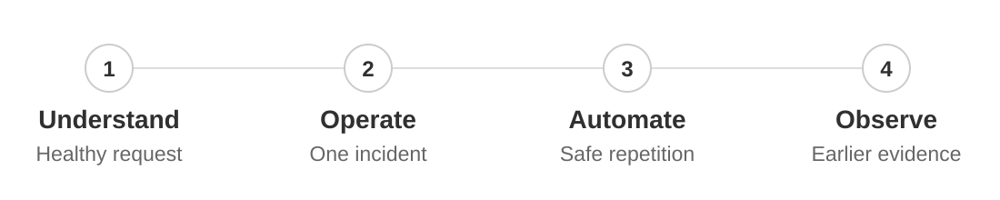

---
<!-- _class: content schedule core -->
<!-- _footer: "AI5049, Hochschule Fulda" -->

# The project workshops

Friday sessions: **13:45–18:45**

| Date | Focus |
|---|---|
| 30 October 2026 | Research questions and sources |
| 13 November 2026 | Experimental design |
| 27 November 2026 | Analysis and scientific argument |
| 11 December 2026 | Evaluation and preparation of the full draft |
| 22 January 2027 | In-class peer review and revision |
| 5 February 2027 | Presentations and reproducibility |

---
<!-- _class: content core -->
<!-- _footer: "AI5049, Hochschule Fulda" -->

# Fridays: independent project work

| Your group | The lecturer |
|---|---|
| Research, choose and justify a topic | Define the course scope and give feedback |
| Prepare proposals and test your ideas | Discuss specific methodological problems |
| Decide and carry out the next step | Coordinate the workshop and consultations |

Bring your current work, what you have tried and one concrete question.


---
<!-- _class: content core -->
<!-- _footer: "<span class=\"footer-context\">AI5049, Hochschule Fulda</span><span class=\"footer-refs\"><a href=\"https://conferences.ieeeauthorcenter.ieee.org/write-your-paper/authoring-tools-and-templates/\">IEEE paper templates</a></span>" -->

# Your project

**One question. Teams of 3–4. A meaningful comparison.**

| Submit | Requirement |
|---|---|
| Paper | English, IEEE two-column, six pages including references |
| Artifact | Reproducible evidence |
| Declaration | Contributions, outside the page limit |

Group choice: **12 Oct, 13:45 → 27 Nov, 23:59**.
Nominate one contact person.

---
<!-- _class: content core -->
<!-- _footer: "AI5049, Hochschule Fulda" -->

# What counts towards your grade?

The **paper and artifact** are assessed together. Normally one group grade.
Substantial, documented contribution differences may lead to individual grades.

| Paper area | Weight |
|---|---:|
| Introduction & related work | 20% |
| Approach & methodology | 25% |
| Evaluation & results | 30% |
| Discussion & conclusion | 15% |
| Abstract, writing & reproducibility | 10% |

---
<!-- _class: content core -->
<!-- _footer: "AI5049, Hochschule Fulda" -->

# Who did what?

Record individual and joint work in [DECLARATION.md](https://github.com/Stinktopf/network-management-and-monitoring/blob/main/slides/resources/templates/DECLARATION.md).

| Record | Make it concrete |
|---|---|
| Paper | Sections, figures and revisions |
| Artifact | Code, configuration and experiments |
| Joint work | Shared task and each person’s contribution |

---
<!-- _class: content core -->
<!-- _footer: "AI5049, Hochschule Fulda" -->

# What goes with the paper?

The paper makes the argument. The **artifact** lets me check it.

- Code and configurations
- Data and software versions
- Reproduction steps
- Seeds, failed runs and exclusions

Public repository: optional. Access for the examiner: required.

---
<!-- _class: content core -->
<!-- _footer: "AI5049, Hochschule Fulda" -->

# Scientific integrity

Follow the [IEEE publishing ethics requirements](https://journals.ieeeauthorcenter.ieee.org/become-an-ieee-journal-author/publishing-ethics/ethical-requirements/).

- Cite ideas, methods, data and figures
- Check references against the original
- Report what you actually measured
- Keep counter-evidence
- State limitations and uncertainty

A result against your hypothesis is still a result.

---
<!-- _class: content core -->
<!-- _footer: "AI5049, Hochschule Fulda" -->

# AI use and disclosure

Follow the [IEEE policy on AI-generated content](https://conferences.ieeeauthorcenter.ieee.org/author-ethics/guidelines-and-policies/submission-policies/).

- Spelling and grammar fixes only: disclosure optional
- Generated or substantially rewritten text: disclose
- Generated figures or code: disclose
- Name the system, affected parts and extent in the **Acknowledgments**

You are responsible for the references, code and technical claims.

---
<!-- _class: content core -->
<!-- _footer: "AI5049, Hochschule Fulda" -->

# Dates and deadlines

| Date | Deliverable / session |
|---|---|
| 27 November 2026, 23:59 | Group selection → Moodle |
| 11 January 2027, 23:59 | Full draft + supporting material → Moodle |
| 22 January 2027, in class | Read, write and hand in the paper review |
| 5 February 2027 | Presentations in class (ungraded) |
| 12 February 2027, 23:59 | Paper, artifact, declaration → Moodle |

---
<!-- _class: content core -->
<!-- _footer: "AI5049, Hochschule Fulda" -->

# Optional peer-review bonus

**22 January 2027, in class. No make-up date.**

One qualifying review improves the individual grade by **one step**, e.g. 2.3 → 2.0.
Best possible grade: **1.0**. Failing grades remain unchanged.

One page, legibly handwritten, German or English.
Work independently. **No AI or other aids.**

For recognized accommodations, contact the lecturer early.

---
<!-- _class: content core -->
<!-- _footer: "AI5049, Hochschule Fulda" -->

# What makes a qualifying review?

A qualifying review covers four things:

- **Summary:** question and main result
- **Method:** assess a methodological choice
- **Judgment:** strength and limitation with reasons
- **Revision:** propose a feasible improvement

I record the four criteria and my reasons.

---
<!-- _class: day core -->
<!-- _footer: "AI5049, Hochschule Fulda" -->

# 12 October 2026

## Networking 101

One network carries the technical block.

---
<!-- _class: content core -->
<!-- _footer: "AI5049, Hochschule Fulda" -->

# Meet ReefNet at BOB1

ReefNet connects **Ocean Research** through two upstreams.

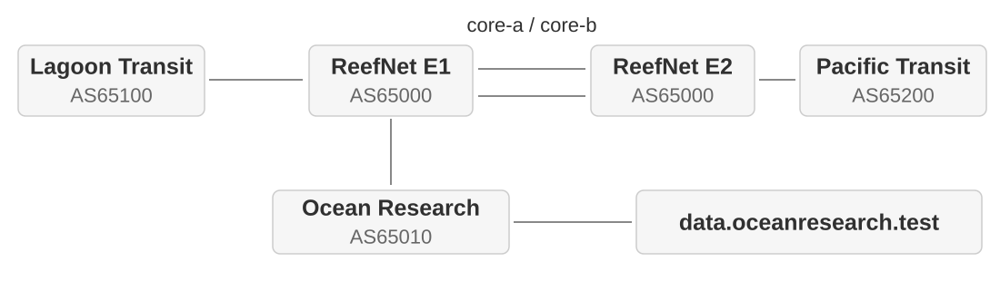

---
<!-- _class: content core -->
<!-- _footer: "AI5049, Hochschule Fulda" -->

# Four views. Four questions.

| View | Question |
|---|---|
| NetBox | What should exist? |
| Router | What exists now? |
| Grafana | What changed over time? |
| External probe | Does the service work? |

---
<!-- _class: chapter core -->
<!-- _footer: "AI5049, Hochschule Fulda" -->

# Follow one service request.

How does this network actually work?

---
<!-- _class: visual core -->
<!-- _footer: "AI5049, Hochschule Fulda" -->

# Follow one service request.

In ReefNet: a Lagoon probe requests `data.oceanresearch.test`.

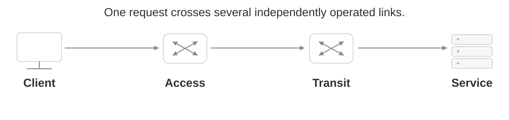

What must work before the application can return a response?

<nav class="progress" aria-label="Module progress"><span class="active">APPLICATION</span><span class="arrow"> → </span><span class="">TRANSPORT</span><span class="arrow"> → </span><span class="">IP</span><span class="arrow"> → </span><span class="">ROUTING</span><span class="arrow"> → </span><span class="">LINK</span><span class="arrow"> → </span><span class="">PATH</span></nav>

---
<!-- _class: visual core -->
<!-- _footer: "AI5049, Hochschule Fulda" -->

# The TCP/IP stack

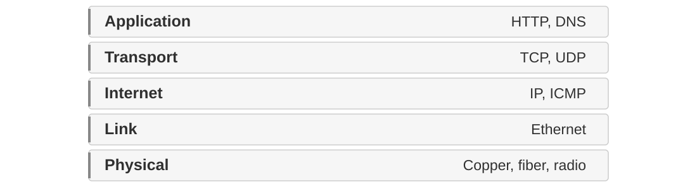

<nav class="progress" aria-label="Module progress"><span class="active">APPLICATION</span><span class="arrow"> → </span><span class="">TRANSPORT</span><span class="arrow"> → </span><span class="">IP</span><span class="arrow"> → </span><span class="">ROUTING</span><span class="arrow"> → </span><span class="">LINK</span><span class="arrow"> → </span><span class="">PATH</span></nav>

---
<!-- _class: visual core -->
<!-- _footer: "<span class=\"footer-context\">AI5049, Hochschule Fulda</span><span class=\"footer-refs\"><a href=\"https://www.rfc-editor.org/rfc/rfc1034.html\">DNS: RFC 1034</a></span>" -->

# A name needs an address.

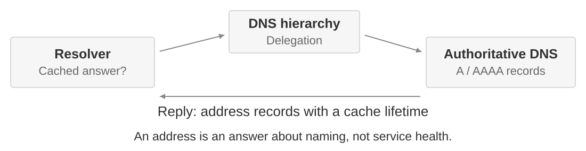

**A** → IPv4
**AAAA** → IPv6

<nav class="progress" aria-label="Module progress"><span class="active">APPLICATION</span><span class="arrow"> → </span><span class="">TRANSPORT</span><span class="arrow"> → </span><span class="">IP</span><span class="arrow"> → </span><span class="">ROUTING</span><span class="arrow"> → </span><span class="">LINK</span><span class="arrow"> → </span><span class="">PATH</span></nav>

---
<!-- _class: visual core -->
<!-- _footer: "AI5049, Hochschule Fulda" -->

# A DNS query becomes transport data

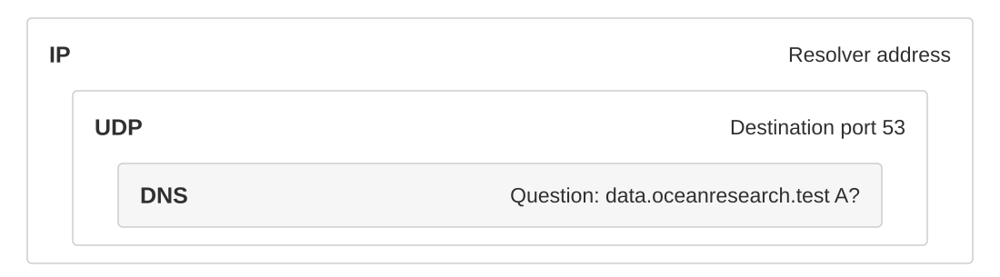

<nav class="progress" aria-label="Module progress"><span class="">APPLICATION</span><span class="arrow"> → </span><span class="active">TRANSPORT</span><span class="arrow"> → </span><span class="">IP</span><span class="arrow"> → </span><span class="">ROUTING</span><span class="arrow"> → </span><span class="">LINK</span><span class="arrow"> → </span><span class="">PATH</span></nav>

---
<!-- _class: content core -->
<!-- _footer: "<span class=\"footer-context\">AI5049, Hochschule Fulda</span><span class=\"footer-refs\"><a href=\"https://www.rfc-editor.org/rfc/rfc9293.html\">TCP: RFC 9293</a><a href=\"https://www.rfc-editor.org/rfc/rfc768.html\">UDP: RFC 768</a></span>" -->

# TCP and UDP

| | TCP | UDP |
|---|---|---|
| Data | Ordered byte stream | Individual datagrams |
| Connection | Required | None |
| Retransmission | Built in | Application decides |

An IP address + port identifies the transport endpoint.

<nav class="progress" aria-label="Module progress"><span class="">APPLICATION</span><span class="arrow"> → </span><span class="active">TRANSPORT</span><span class="arrow"> → </span><span class="">IP</span><span class="arrow"> → </span><span class="">ROUTING</span><span class="arrow"> → </span><span class="">LINK</span><span class="arrow"> → </span><span class="">PATH</span></nav>

---
<!-- _class: content core -->
<!-- _footer: "AI5049, Hochschule Fulda" -->

# TCP gets the conversation started.

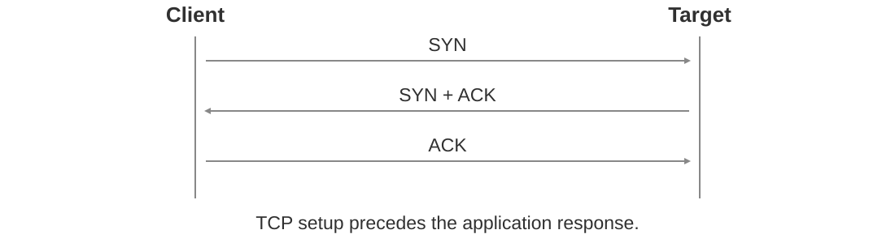

TCP orders bytes, retransmits loss and controls congestion.

<nav class="progress" aria-label="Module progress"><span class="">APPLICATION</span><span class="arrow"> → </span><span class="active">TRANSPORT</span><span class="arrow"> → </span><span class="">IP</span><span class="arrow"> → </span><span class="">ROUTING</span><span class="arrow"> → </span><span class="">LINK</span><span class="arrow"> → </span><span class="">PATH</span></nav>

---
<!-- _class: content core -->
<!-- _footer: "<span class=\"footer-context\">AI5049, Hochschule Fulda</span><span class=\"footer-refs\"><a href=\"https://www.rfc-editor.org/rfc/rfc7011.html\">Flow keys: RFC 7011</a></span>" -->

# A flow: five values name a conversation

HTTP check from the Lagoon probe to Ocean Research:

| Field | Value |
|---|---|
| Source address | `203.0.113.10` |
| Destination address | `198.51.100.10` |
| Protocol | TCP |
| Source port | Chosen by the client, such as `51514` |
| Destination port | `80`, HTTP |

Packets with the same **5-tuple** belong to one flow. The next check uses a new source port.

<nav class="progress" aria-label="Module progress"><span class="">APPLICATION</span><span class="arrow"> → </span><span class="active">TRANSPORT</span><span class="arrow"> → </span><span class="">IP</span><span class="arrow"> → </span><span class="">ROUTING</span><span class="arrow"> → </span><span class="">LINK</span><span class="arrow"> → </span><span class="">PATH</span></nav>

---
<!-- _class: visual core -->
<!-- _footer: "<span class=\"footer-context\">AI5049, Hochschule Fulda</span><span class=\"footer-refs\"><a href=\"https://www.rfc-editor.org/rfc/rfc791.html\">IPv4: RFC 791</a><a href=\"https://www.rfc-editor.org/rfc/rfc8200.html\">IPv6: RFC 8200</a></span>" -->

# IP gives the packet a destination.

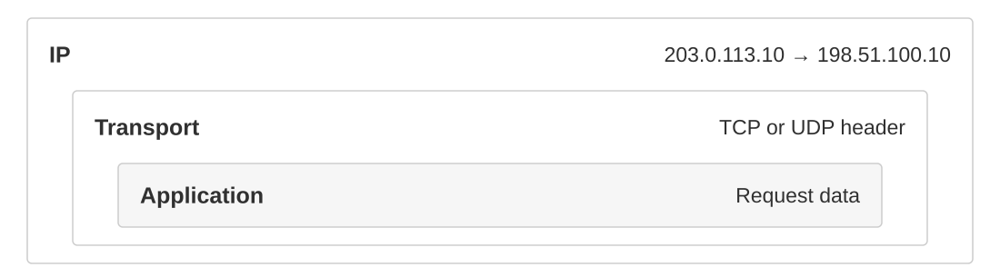

Routers use the **destination address** to look up where to forward the packet.

<nav class="progress" aria-label="Module progress"><span class="">APPLICATION</span><span class="arrow"> → </span><span class="">TRANSPORT</span><span class="arrow"> → </span><span class="active">IP</span><span class="arrow"> → </span><span class="">ROUTING</span><span class="arrow"> → </span><span class="">LINK</span><span class="arrow"> → </span><span class="">PATH</span></nav>

---
<!-- _class: visual core -->
<!-- _footer: "AI5049, Hochschule Fulda" -->

# On-link or through a router?

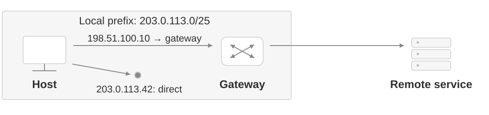

Send directly to an **on-link destination**, otherwise via a **gateway**.

<nav class="progress" aria-label="Module progress"><span class="">APPLICATION</span><span class="arrow"> → </span><span class="">TRANSPORT</span><span class="arrow"> → </span><span class="active">IP</span><span class="arrow"> → </span><span class="">ROUTING</span><span class="arrow"> → </span><span class="">LINK</span><span class="arrow"> → </span><span class="">PATH</span></nav>

---
<!-- _class: content core -->
<!-- _footer: "<span class=\"footer-context\">AI5049, Hochschule Fulda</span><span class=\"footer-refs\"><a href=\"https://www.rfc-editor.org/rfc/rfc1812.html#section-5.2.4.3\">Longest prefix match: RFC 1812</a></span>" -->

# Use the longest matching prefix

Destination: **198.51.100.200**. Example Forwarding Information Base (FIB):

| Prefix | Next hop |
|---|---|
| `0.0.0.0/0` | `10.0.0.1` |
| `198.51.100.0/24` | `10.0.0.2` |
| **`198.51.100.128/25`** | **`10.0.0.3`** |

The most specific match wins.

<nav class="progress" aria-label="Module progress"><span class="">APPLICATION</span><span class="arrow"> → </span><span class="">TRANSPORT</span><span class="arrow"> → </span><span class="">IP</span><span class="arrow"> → </span><span class="active">ROUTING</span><span class="arrow"> → </span><span class="">LINK</span><span class="arrow"> → </span><span class="">PATH</span></nav>

---
<!-- _class: visual core -->
<!-- _footer: "AI5049, Hochschule Fulda" -->

# Ethernet carries frames across one link

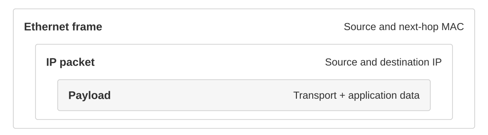

**MAC addresses** change per link. The IP packet names the final destination.

<nav class="progress" aria-label="Module progress"><span class="">APPLICATION</span><span class="arrow"> → </span><span class="">TRANSPORT</span><span class="arrow"> → </span><span class="">IP</span><span class="arrow"> → </span><span class="">ROUTING</span><span class="arrow"> → </span><span class="active">LINK</span><span class="arrow"> → </span><span class="">PATH</span></nav>

---
<!-- _class: visual core -->
<!-- _footer: "<span class=\"footer-context\">AI5049, Hochschule Fulda</span><span class=\"footer-refs\"><a href=\"https://www.rfc-editor.org/rfc/rfc826.html\">ARP: RFC 826</a><a href=\"https://www.rfc-editor.org/rfc/rfc4861.html\">ND: RFC 4861</a></span>" -->

# Find the next-hop MAC

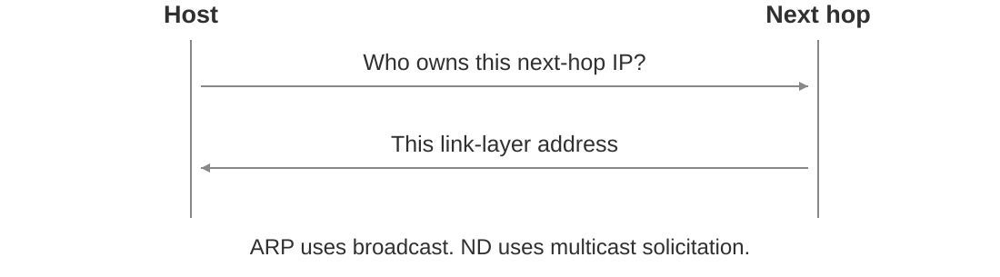

<div class="paired-notes">
<div><h2>IPv4: ARP</h2><p>Resolve the selected next hop’s IPv4 address to its MAC address.</p></div>
<div><h2>IPv6: Neighbor Discovery</h2><p>Resolve the selected next hop’s IPv6 address using ICMPv6.</p></div>
</div>

<nav class="progress" aria-label="Module progress"><span class="">APPLICATION</span><span class="arrow"> → </span><span class="">TRANSPORT</span><span class="arrow"> → </span><span class="">IP</span><span class="arrow"> → </span><span class="">ROUTING</span><span class="arrow"> → </span><span class="active">LINK</span><span class="arrow"> → </span><span class="">PATH</span></nav>

---
<!-- _class: visual core -->
<!-- _footer: "AI5049, Hochschule Fulda" -->

# Switches learn MAC addresses and forward frames

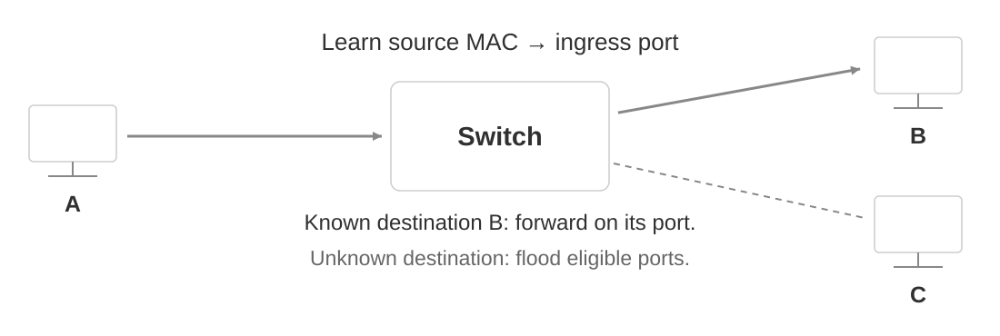

<nav class="progress" aria-label="Module progress"><span class="">APPLICATION</span><span class="arrow"> → </span><span class="">TRANSPORT</span><span class="arrow"> → </span><span class="">IP</span><span class="arrow"> → </span><span class="">ROUTING</span><span class="arrow"> → </span><span class="active">LINK</span><span class="arrow"> → </span><span class="">PATH</span></nav>

---
<!-- _class: visual core -->
<!-- _footer: "AI5049, Hochschule Fulda" -->

# Routers repeat the process hop by hop

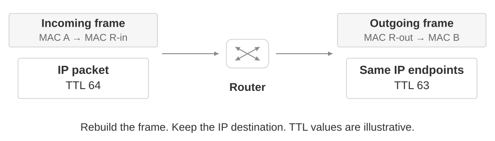

The packet keeps its **destination IP**. The link-layer MAC addresses change.

<nav class="progress" aria-label="Module progress"><span class="">APPLICATION</span><span class="arrow"> → </span><span class="">TRANSPORT</span><span class="arrow"> → </span><span class="">IP</span><span class="arrow"> → </span><span class="">ROUTING</span><span class="arrow"> → </span><span class="">LINK</span><span class="arrow"> → </span><span class="active">PATH</span></nav>

---
<!-- _class: content core -->
<!-- _footer: "AI5049, Hochschule Fulda" -->

# Where do routes come from?

Try this once the Networking lab runs. Leave a Linux node with `exit`, a router with `quit`.

| Route source | Origin |
|---|---|
| Connected | Addressed interface |
| Static | Operator configuration |
| Dynamic | Routing protocol |

<div class="terminal">
<div class="terminal-entry"><strong>WSL</strong><code>make enter NODE=edge01.bob1.reefnet.test</code></div>
<div class="terminal-label">Router CLI</div>
<pre><code>show network-instance default route-table ipv4-unicast summary</code></pre>
</div>

<nav class="progress" aria-label="Module progress"><span class="">APPLICATION</span><span class="arrow"> → </span><span class="">TRANSPORT</span><span class="arrow"> → </span><span class="">IP</span><span class="arrow"> → </span><span class="active">ROUTING</span><span class="arrow"> → </span><span class="">LINK</span><span class="arrow"> → </span><span class="">PATH</span></nav>

---
<!-- _class: visual core -->
<!-- _footer: "AI5049, Hochschule Fulda" -->

# An AS is an administrative routing domain

An **autonomous system (AS)** presents one routing policy externally.
An **Interior Gateway Protocol (IGP)** finds routes inside it.

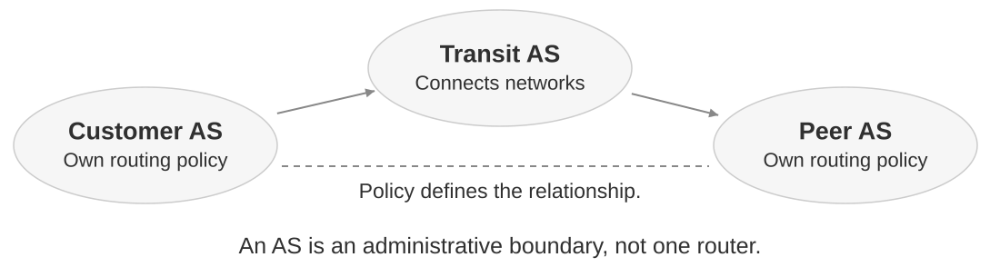

<nav class="progress" aria-label="Module progress"><span class="">APPLICATION</span><span class="arrow"> → </span><span class="">TRANSPORT</span><span class="arrow"> → </span><span class="">IP</span><span class="arrow"> → </span><span class="active">ROUTING</span><span class="arrow"> → </span><span class="">LINK</span><span class="arrow"> → </span><span class="">PATH</span></nav>

---
<!-- _class: visual core -->
<!-- _footer: "<span class=\"footer-context\">AI5049, Hochschule Fulda</span><span class=\"footer-refs\"><a href=\"https://www.rfc-editor.org/rfc/rfc2453.html\">RIP: RFC 2453</a><a href=\"https://www.rfc-editor.org/rfc/rfc2328.html\">OSPF: RFC 2328</a></span>" -->

# Two ways to learn an internal route

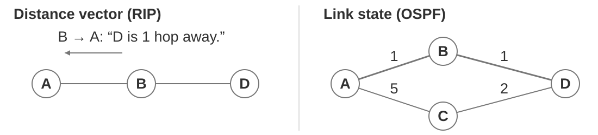

<div class="paired-notes">
<div><p><strong>Share distances to destinations.</strong><br>A adds 1 hop: D via B, 2 hops.<br>A advertises its own distance onward.</p></div>
<div><p><strong>Share your own links and their costs.</strong><br>Relay across the area → shared map.<br>Each router calculates its own paths.</p></div>
</div>

<nav class="progress" aria-label="Module progress"><span class="">APPLICATION</span><span class="arrow"> → </span><span class="">TRANSPORT</span><span class="arrow"> → </span><span class="">IP</span><span class="arrow"> → </span><span class="active">ROUTING</span><span class="arrow"> → </span><span class="">LINK</span><span class="arrow"> → </span><span class="">PATH</span></nav>

---
<!-- _class: content core -->
<!-- _footer: "<span class=\"footer-context\">AI5049, Hochschule Fulda</span><span class=\"footer-refs\"><a href=\"https://www.rfc-editor.org/rfc/rfc2328.html\">OSPFv2: RFC 2328</a><a href=\"https://www.rfc-editor.org/rfc/rfc5340.html\">OSPFv3: RFC 5340</a></span>" -->

# OSPF: each router calculates its own paths

<div class="figure-explanation">
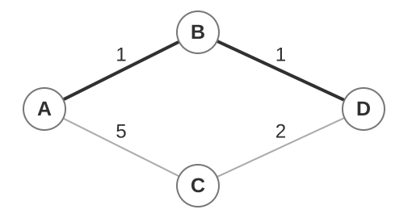
<div>
<p>Via B: <strong>1 + 1 = 2</strong><br>Via C: 5 + 2 = 7</p>
<p>ReefNet uses OSPFv2 for IPv4 and OSPFv3 for IPv6. Both reach the iBGP loopbacks via either core link.</p>
</div>
</div>

<div class="terminal">
<div class="terminal-entry"><strong>WSL</strong><code>make enter NODE=edge01.bob1.reefnet.test</code></div>
<div class="terminal-label">Router CLI</div>
<pre><code>show network-instance default protocols ospf neighbor</code></pre>
</div>

<nav class="progress" aria-label="Module progress"><span class="">APPLICATION</span><span class="arrow"> → </span><span class="">TRANSPORT</span><span class="arrow"> → </span><span class="">IP</span><span class="arrow"> → </span><span class="active">ROUTING</span><span class="arrow"> → </span><span class="">LINK</span><span class="arrow"> → </span><span class="">PATH</span></nav>

---
<!-- _class: content core -->
<!-- _footer: "<span class=\"footer-context\">AI5049, Hochschule Fulda</span><span class=\"footer-refs\"><a href=\"https://www.rfc-editor.org/rfc/rfc4271.html\">BGP: RFC 4271</a></span>" -->

# BGP exchanges reachability.

**Path vector:** prefixes, AS paths and other attributes.

<div class="paired-notes">
<div><h2>eBGP</h2><p>Routes between ASes.</p></div>
<div><h2>iBGP</h2><p>Routes within an AS.<br>The IGP is still needed.</p></div>
</div>

<div class="terminal">
<div class="terminal-entry"><strong>WSL</strong><code>make enter NODE=edge01.bob1.reefnet.test</code></div>
<div class="terminal-label">Router CLI</div>
<pre><code>show network-instance default protocols bgp neighbor</code></pre>
<pre><code>show network-instance default protocols bgp routes ipv4 summary</code></pre>
</div>

<nav class="progress" aria-label="Module progress"><span class="">APPLICATION</span><span class="arrow"> → </span><span class="">TRANSPORT</span><span class="arrow"> → </span><span class="">IP</span><span class="arrow"> → </span><span class="active">ROUTING</span><span class="arrow"> → </span><span class="">LINK</span><span class="arrow"> → </span><span class="">PATH</span></nav>

---
<!-- _class: content core -->
<!-- _footer: "<span class=\"footer-context\">AI5049, Hochschule Fulda</span><span class=\"footer-refs\"><a href=\"https://www.rfc-editor.org/rfc/rfc4760.html\">Multiprotocol BGP: RFC 4760</a></span>" -->

# BGP separates route families

**AFI** (Address Family Identifier): IPv4 or IPv6.<br>
**SAFI** (Subsequent Address Family Identifier): e.g. unicast.

| In ReefNet | Routes to destinations such as |
|---|---|
| `ipv4-unicast` | `198.51.100.0/24` |
| `ipv6-unicast` | `2001:db8:100::/48` |

**Established** confirms the session is up. Check which families exchange routes.

<nav class="progress" aria-label="Module progress"><span class="">APPLICATION</span><span class="arrow"> → </span><span class="">TRANSPORT</span><span class="arrow"> → </span><span class="">IP</span><span class="arrow"> → </span><span class="active">ROUTING</span><span class="arrow"> → </span><span class="">LINK</span><span class="arrow"> → </span><span class="">PATH</span></nav>

---
<!-- _class: content deep-dive -->
<!-- _footer: "AI5049, Hochschule Fulda" -->

# BGP is policy first.

For comparable routes:

1. Apply local policy.
2. Prefer higher local preference.
3. Compare AS_PATH and further tie-breakers.

<div class="terminal">
<div class="terminal-entry"><strong>WSL</strong><code>make enter NODE=edge01.bob1.reefnet.test</code></div>
<div class="terminal-label">Router CLI</div>
<pre><code>show network-instance default protocols bgp routes ipv4 prefix 198.51.100.0/24</code></pre>
</div>

A longer path can be selected on purpose.

<nav class="progress" aria-label="Module progress"><span class="">APPLICATION</span><span class="arrow"> → </span><span class="">TRANSPORT</span><span class="arrow"> → </span><span class="">IP</span><span class="arrow"> → </span><span class="active">ROUTING</span><span class="arrow"> → </span><span class="">LINK</span><span class="arrow"> → </span><span class="">PATH</span></nav>

---
<!-- _class: content deep-dive -->
<!-- _footer: "AI5049, Hochschule Fulda" -->

# Transit and peering

| | Transit | Peering |
|---|---|---|
| Reachability | Provider supplies broader reachability | Networks exchange selected routes |
| Commercial relation | Customer pays provider | Often settlement-free |

An **IXP** provides shared infrastructure for peering.

<nav class="progress" aria-label="Module progress"><span class="">APPLICATION</span><span class="arrow"> → </span><span class="">TRANSPORT</span><span class="arrow"> → </span><span class="">IP</span><span class="arrow"> → </span><span class="active">ROUTING</span><span class="arrow"> → </span><span class="">LINK</span><span class="arrow"> → </span><span class="">PATH</span></nav>

---
<!-- _class: content deep-dive -->
<!-- _footer: "AI5049, Hochschule Fulda" -->

# Who assigns the prefixes we route?

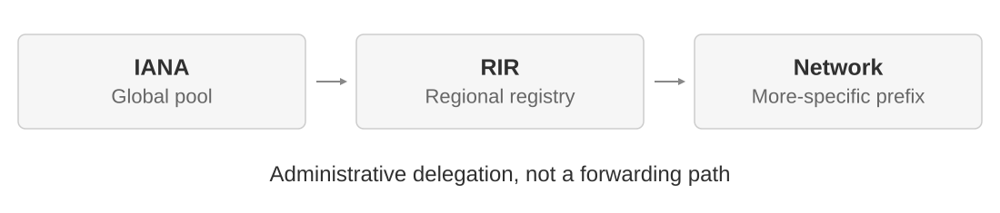

BOB1's public addresses are documentation prefixes.

<nav class="progress" aria-label="Module progress"><span class="">APPLICATION</span><span class="arrow"> → </span><span class="">TRANSPORT</span><span class="arrow"> → </span><span class="">IP</span><span class="arrow"> → </span><span class="">ROUTING</span><span class="arrow"> → </span><span class="">LINK</span><span class="arrow"> → </span><span class="active">PATH</span></nav>

---
<!-- _class: content core -->
<!-- _footer: "AI5049, Hochschule Fulda" -->

# The response needs its own route.

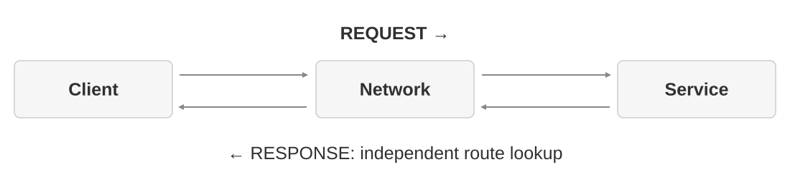

Reachability needs both directions. Paths may be asymmetric.

<nav class="progress" aria-label="Module progress"><span class="">APPLICATION</span><span class="arrow"> → </span><span class="">TRANSPORT</span><span class="arrow"> → </span><span class="">IP</span><span class="arrow"> → </span><span class="">ROUTING</span><span class="arrow"> → </span><span class="">LINK</span><span class="arrow"> → </span><span class="active">PATH</span></nav>

---
<!-- _class: content core -->
<!-- _footer: "<span class=\"footer-context\">AI5049, Hochschule Fulda</span><span class=\"footer-refs\"><a href=\"https://www.rfc-editor.org/rfc/rfc792.html\">ICMP: RFC 792</a><a href=\"https://www.rfc-editor.org/rfc/rfc4443.html\">ICMPv6: RFC 4443</a></span>" -->

# ICMP: errors and diagnostics

| Message | Meaning |
|---|---|
| Echo Request / Reply | Ping |
| Destination Unreachable | Cannot deliver |
| Time Exceeded | TTL / Hop Limit expired |
| Packet Too Big (IPv6) | Exceeds link MTU |

A ping reply proves IP reachability, not application health.

<nav class="progress" aria-label="Module progress"><span class="">APPLICATION</span><span class="arrow"> → </span><span class="">TRANSPORT</span><span class="arrow"> → </span><span class="">IP</span><span class="arrow"> → </span><span class="">ROUTING</span><span class="arrow"> → </span><span class="">LINK</span><span class="arrow"> → </span><span class="active">PATH</span></nav>

---
<!-- _class: visual core -->
<!-- _footer: "<span class=\"footer-context\">AI5049, Hochschule Fulda</span><span class=\"footer-refs\"><a href=\"https://www.rfc-editor.org/rfc/rfc8200.html\">IPv6: RFC 8200</a><a href=\"https://www.rfc-editor.org/rfc/rfc8201.html\">PMTUD: RFC 8201</a></span>" -->

# IPv6 routers do not fragment

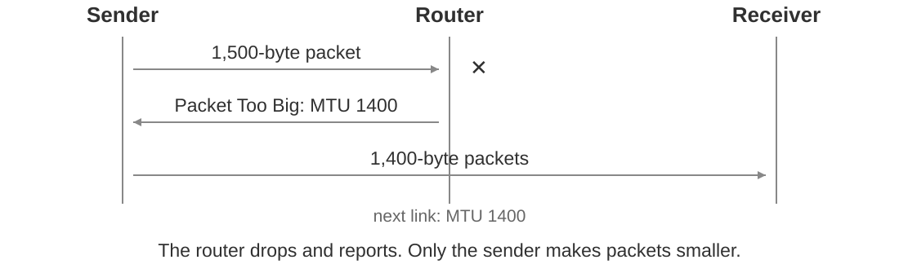

Every IPv6 link carries at least **1,280 bytes**.

<nav class="progress" aria-label="Module progress"><span class="">APPLICATION</span><span class="arrow"> → </span><span class="">TRANSPORT</span><span class="arrow"> → </span><span class="">IP</span><span class="arrow"> → </span><span class="">ROUTING</span><span class="arrow"> → </span><span class="">LINK</span><span class="arrow"> → </span><span class="active">PATH</span></nav>

---
<!-- _class: content core -->
<!-- _footer: "<span class=\"footer-context\">AI5049, Hochschule Fulda</span><span class=\"footer-refs\"><a href=\"https://www.rfc-editor.org/rfc/rfc2923.html\">PMTUD black holes: RFC 2923</a><a href=\"https://www.rfc-editor.org/rfc/rfc4890.html\">ICMPv6 filtering: RFC 4890</a></span>" -->

# A filtered Packet Too Big hangs the connection

| Step | Packet size | Result |
|---|---|---|
| TCP handshake, SSH login | Small | Works |
| Large response, file transfer | 1,500 bytes | Dropped. Packet Too Big filtered: **hangs** |

**Fix:** let ICMPv6 Packet Too Big through.
**MSS clamping** on the router helps TCP, not UDP or QUIC.

<nav class="progress" aria-label="Module progress"><span class="">APPLICATION</span><span class="arrow"> → </span><span class="">TRANSPORT</span><span class="arrow"> → </span><span class="">IP</span><span class="arrow"> → </span><span class="">ROUTING</span><span class="arrow"> → </span><span class="">LINK</span><span class="arrow"> → </span><span class="active">PATH</span></nav>

---
<!-- _class: visual deep-dive -->
<!-- _footer: "AI5049, Hochschule Fulda" -->

# Traceroute expires TTL / Hop Limit.

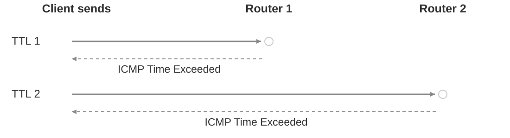

A missing reply does not identify the failed forwarding hop.

<nav class="progress" aria-label="Module progress"><span class="">APPLICATION</span><span class="arrow"> → </span><span class="">TRANSPORT</span><span class="arrow"> → </span><span class="">IP</span><span class="arrow"> → </span><span class="">ROUTING</span><span class="arrow"> → </span><span class="">LINK</span><span class="arrow"> → </span><span class="active">PATH</span></nav>

---
<!-- _class: content deep-dive -->
<!-- _footer: "AI5049, Hochschule Fulda" -->

# Even a correct path needs healthy links

| Medium | Signal | Fault evidence |
|---|---|---|
| Copper | Electrical | Link loss, FCS errors |
| Fiber | Light | Low receive power, FCS errors |

Rising **FCS errors** can be evidence even while the link stays up.

<nav class="progress" aria-label="Module progress"><span class="">APPLICATION</span><span class="arrow"> → </span><span class="">TRANSPORT</span><span class="arrow"> → </span><span class="">IP</span><span class="arrow"> → </span><span class="">ROUTING</span><span class="arrow"> → </span><span class="active">LINK</span><span class="arrow"> → </span><span class="">PATH</span></nav>

---
<!-- _class: content task -->
<!-- _footer: "AI5049, Hochschule Fulda" -->

# Follow the request

How does a request from Lagoon reach `data.oceanresearch.test` and back?

**60 minutes:** 30 for setup, then 30 to explore. In WSL on the lab PC:
```bash
cd ~;
git clone https://github.com/Stinktopf/network-management-and-monitoring.git;
cd network-management-and-monitoring;
make setup;
make networking;
make task;
```

`make setup` ends with READY FOR CLASS. Then check addresses, DNS and HTTP.
Sketch the path. Then try Pacific and IPv6. [Exercise overview](https://github.com/Stinktopf/network-management-and-monitoring#exercises)

---
<!-- _class: content core -->
<!-- _footer: "AI5049, Hochschule Fulda" -->

# What did your checks tell you?

- Which address came from DNS?
- Which address was your next hop?
- How did you check the return path?
- What did HTTP tell you that ping could not?

Bring one result you can explain and one question that is still open.

---
<!-- _class: day core -->
<!-- _footer: "AI5049, Hochschule Fulda" -->

# 13 October 2026

## Operations + Automation + Incidents

Yesterday we followed a healthy request through ReefNet.

Today Lagoon Transit loses our customer prefix `198.51.100.0/24`.
We repair it in the router CLI, then a second time through gNMI.

At the end of today: **Who Broke the Internet?**

---
<!-- _class: chapter core -->
<!-- _footer: "AI5049, Hochschule Fulda" -->

# Network Operations

A customer behind Lagoon Transit cannot reach the Ocean Research service.

---
<!-- _class: content core -->
<!-- _footer: "AI5049, Hochschule Fulda" -->

# One incident, from report to recovery

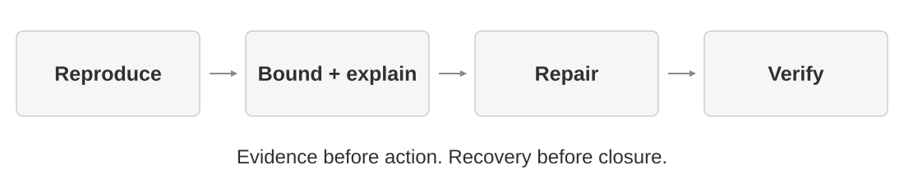

<nav class="progress" aria-label="Module progress"><span class="active">REPRODUCE</span><span class="arrow"> → </span><span class="">BOUND</span><span class="arrow"> → </span><span class="">OBSERVE</span><span class="arrow"> → </span><span class="">HYPOTHESIZE</span><span class="arrow"> → </span><span class="">REPAIR</span><span class="arrow"> → </span><span class="">VERIFY</span></nav>

---
<!-- _class: visual core -->
<!-- _footer: "AI5049, Hochschule Fulda" -->

# A customer reports partial reachability

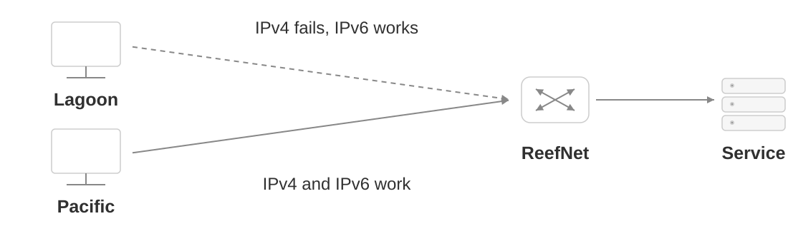

<nav class="progress" aria-label="Module progress"><span class="active">REPRODUCE</span><span class="arrow"> → </span><span class="">BOUND</span><span class="arrow"> → </span><span class="">OBSERVE</span><span class="arrow"> → </span><span class="">HYPOTHESIZE</span><span class="arrow"> → </span><span class="">REPAIR</span><span class="arrow"> → </span><span class="">VERIFY</span></nav>

---
<!-- _class: content core -->
<!-- _footer: "AI5049, Hochschule Fulda" -->

# Who cannot reach the service?

<div class="terminal">
<div class="terminal-entry"><strong>WSL</strong><code>make enter NODE=probe01.bob1.lagoontransit.test</code></div>
<div class="terminal-label">Inside the Lagoon probe</div>
<pre><code>ping -4 -c 3 -W 1 198.51.100.10;
ping -6 -c 3 -W 1 2001:db8:100::10;</code></pre>
</div>

Use `exit`, then in WSL:

```bash
make enter NODE=probe01.bob1.pacifictransit.test;
```

Repeat both tests. Which path and address family fail?

<nav class="progress" aria-label="Module progress"><span class="active">REPRODUCE</span><span class="arrow"> → </span><span class="">BOUND</span><span class="arrow"> → </span><span class="">OBSERVE</span><span class="arrow"> → </span><span class="">HYPOTHESIZE</span><span class="arrow"> → </span><span class="">REPAIR</span><span class="arrow"> → </span><span class="">VERIFY</span></nav>

---
<!-- _class: visual core -->
<!-- _footer: "AI5049, Hochschule Fulda" -->

# Bound the incident

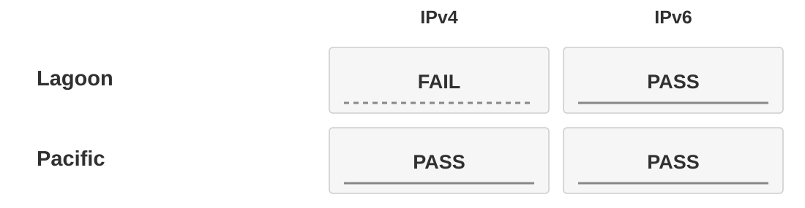

<nav class="progress" aria-label="Module progress"><span class="">REPRODUCE</span><span class="arrow"> → </span><span class="active">BOUND</span><span class="arrow"> → </span><span class="">OBSERVE</span><span class="arrow"> → </span><span class="">HYPOTHESIZE</span><span class="arrow"> → </span><span class="">REPAIR</span><span class="arrow"> → </span><span class="">VERIFY</span></nav>

---
<!-- _class: visual core -->
<!-- _footer: "AI5049, Hochschule Fulda" -->

# Separate state from service

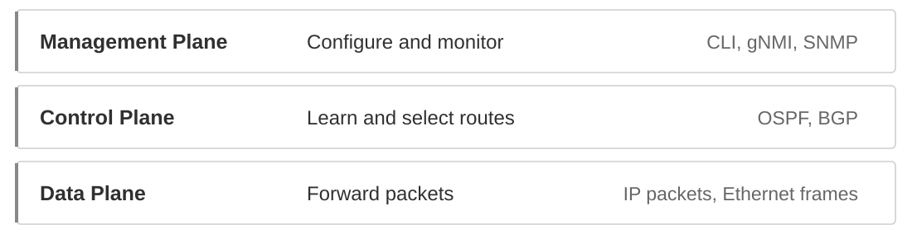

<nav class="progress" aria-label="Module progress"><span class="">REPRODUCE</span><span class="arrow"> → </span><span class="">BOUND</span><span class="arrow"> → </span><span class="active">OBSERVE</span><span class="arrow"> → </span><span class="">HYPOTHESIZE</span><span class="arrow"> → </span><span class="">REPAIR</span><span class="arrow"> → </span><span class="">VERIFY</span></nav>

---
<!-- _class: content core -->
<!-- _footer: "AI5049, Hochschule Fulda" -->

# Are the BGP sessions established?

<div class="terminal">
<div class="terminal-entry"><strong>WSL</strong><code>make enter NODE=edge01.bob1.reefnet.test</code></div>
<div class="terminal-label">Router CLI</div>
<pre><code>show network-instance default protocols bgp neighbor</code></pre>
</div>

| Neighbor | Role |
|---|---|
| `192.0.2.0` | Ocean Research |
| `192.0.2.2` | Lagoon Transit |
| `2001:db8:0:a::` | Lagoon Transit IPv6 |
| `10.255.0.2` | ReefNet edge02 iBGP |

<nav class="progress" aria-label="Module progress"><span class="">REPRODUCE</span><span class="arrow"> → </span><span class="">BOUND</span><span class="arrow"> → </span><span class="active">OBSERVE</span><span class="arrow"> → </span><span class="">HYPOTHESIZE</span><span class="arrow"> → </span><span class="">REPAIR</span><span class="arrow"> → </span><span class="">VERIFY</span></nav>

---
<!-- _class: content core -->
<!-- _footer: "AI5049, Hochschule Fulda" -->

# Did the customer route arrive?

Compare the customer prefix in both address families.

<div class="terminal">
<div class="terminal-entry"><strong>WSL</strong><code>make enter NODE=edge01.bob1.reefnet.test</code></div>
<div class="terminal-label">Router CLI</div>
<pre><code>show network-instance default protocols bgp routes ipv4 prefix 198.51.100.0/24</code></pre>
<pre><code>show network-instance default protocols bgp routes ipv6 prefix 2001:db8:100::/48</code></pre>
</div>

A route in BGP is not yet proof of forwarding.

<nav class="progress" aria-label="Module progress"><span class="">REPRODUCE</span><span class="arrow"> → </span><span class="">BOUND</span><span class="arrow"> → </span><span class="active">OBSERVE</span><span class="arrow"> → </span><span class="">HYPOTHESIZE</span><span class="arrow"> → </span><span class="">REPAIR</span><span class="arrow"> → </span><span class="">VERIFY</span></nav>

---
<!-- _class: content core -->
<!-- _footer: "AI5049, Hochschule Fulda" -->

# Is IPv4 installed for forwarding?

<div class="terminal">
<div class="terminal-entry"><strong>WSL</strong><code>make enter NODE=edge01.bob1.reefnet.test</code></div>
<div class="terminal-label">Router CLI</div>
<pre><code>show network-instance default route-table ipv4-unicast prefix 198.51.100.0/24</code></pre>
</div>

**Active route → resolved next hop → outgoing interface**

<nav class="progress" aria-label="Module progress"><span class="">REPRODUCE</span><span class="arrow"> → </span><span class="">BOUND</span><span class="arrow"> → </span><span class="active">OBSERVE</span><span class="arrow"> → </span><span class="">HYPOTHESIZE</span><span class="arrow"> → </span><span class="">REPAIR</span><span class="arrow"> → </span><span class="">VERIFY</span></nav>

---
<!-- _class: content core -->
<!-- _footer: "AI5049, Hochschule Fulda" -->

# Compare the advertisements

<div class="terminal">
<div class="terminal-entry"><strong>WSL</strong><code>make enter NODE=edge01.bob1.reefnet.test</code></div>
<div class="terminal-label">Router CLI: toward Lagoon</div>
<pre><code>show network-instance default protocols bgp neighbor 192.0.2.2 advertised-routes ipv4</code></pre>
</div>

<div class="terminal">
<div class="terminal-entry"><strong>WSL after quit</strong><code>make enter NODE=edge02.bob1.reefnet.test</code></div>
<div class="terminal-label">Router CLI: toward Pacific</div>
<pre><code>show network-instance default protocols bgp neighbor 192.0.2.5 advertised-routes ipv4</code></pre>
</div>

Find `198.51.100.0/24`.

<nav class="progress" aria-label="Module progress"><span class="">REPRODUCE</span><span class="arrow"> → </span><span class="">BOUND</span><span class="arrow"> → </span><span class="active">OBSERVE</span><span class="arrow"> → </span><span class="">HYPOTHESIZE</span><span class="arrow"> → </span><span class="">REPAIR</span><span class="arrow"> → </span><span class="">VERIFY</span></nav>

---
<!-- _class: content task -->
<!-- _footer: "AI5049, Hochschule Fulda" -->

# Exercise: find and repair the fault

Users behind Lagoon Transit cannot reach `data.oceanresearch.test`.

In WSL:
```bash
cd ~/network-management-and-monitoring && git pull;
make operations;
make task;
```

**60 minutes:** steps 1–5. Find the fault, repair it with the CLI and verify recovery.
Keep your commands and evidence. We compare diagnoses after step 5.

[Exercise overview](https://github.com/Stinktopf/network-management-and-monitoring#exercises)

---
<!-- _class: content core -->
<!-- _footer: "AI5049, Hochschule Fulda" -->

# Which policy does this neighbor use?

<div class="terminal">
<div class="terminal-entry"><strong>WSL</strong><code>make enter NODE=edge01.bob1.reefnet.test</code></div>
<div class="terminal-label">Router CLI</div>
<pre><code>info from running network-instance default protocols bgp group lagoon-v4</code></pre>
<pre><code>info from running network-instance default protocols bgp group lagoon-v6</code></pre>
</div>

What is attached only to IPv4?

<nav class="progress" aria-label="Module progress"><span class="">REPRODUCE</span><span class="arrow"> → </span><span class="">BOUND</span><span class="arrow"> → </span><span class="">OBSERVE</span><span class="arrow"> → </span><span class="active">HYPOTHESIZE</span><span class="arrow"> → </span><span class="">REPAIR</span><span class="arrow"> → </span><span class="">VERIFY</span></nav>

---
<!-- _class: content core -->
<!-- _footer: "<span class=\"footer-context\">AI5049, Hochschule Fulda</span><span class=\"footer-refs\"><a href=\"https://documentation.nokia.com/srlinux/25-7/books/system-mgmt/cli-interface.html\">SR Linux CLI guide</a></span>" -->

# Search the whole running config

<div class="terminal">
<div class="terminal-entry"><strong>WSL</strong><code>make enter NODE=edge01.bob1.reefnet.test</code></div>
<div class="terminal-label">Router CLI: <code>flat</code> prints one full path per line, <code>grep</code> filters</div>
<pre><code>info flat from running | grep export-policy</code></pre>
</div>

```text
set / network-instance default protocols bgp export-policy [ EXPORT-BGP ]
set / network-instance default protocols bgp group lagoon-v4 export-policy [ BLOCK-CUSTOMER-V4 ]
```

<nav class="progress" aria-label="Module progress"><span class="">REPRODUCE</span><span class="arrow"> → </span><span class="">BOUND</span><span class="arrow"> → </span><span class="">OBSERVE</span><span class="arrow"> → </span><span class="active">HYPOTHESIZE</span><span class="arrow"> → </span><span class="">REPAIR</span><span class="arrow"> → </span><span class="">VERIFY</span></nav>

---
<!-- _class: content core -->
<!-- _footer: "AI5049, Hochschule Fulda" -->

# Follow the policy in the running config

Inside edge01, shortened output:

```text
info from running network-instance default protocols bgp group lagoon-v4
    export-policy [ BLOCK-CUSTOMER-V4 ]
info from running routing-policy policy BLOCK-CUSTOMER-V4
    statement 10: prefix-set CUSTOMER-V4 → policy-result reject
    statement 20: protocol bgp → policy-result accept
info from running routing-policy prefix-set CUSTOMER-V4
    prefix 198.51.100.0/24 mask-length-range exact
```

Group → policy → prefix-set: the customer prefix is rejected toward Lagoon.

<nav class="progress" aria-label="Module progress"><span class="">REPRODUCE</span><span class="arrow"> → </span><span class="">BOUND</span><span class="arrow"> → </span><span class="">OBSERVE</span><span class="arrow"> → </span><span class="active">HYPOTHESIZE</span><span class="arrow"> → </span><span class="">REPAIR</span><span class="arrow"> → </span><span class="">VERIFY</span></nav>

---
<!-- _class: content core -->
<!-- _footer: "<span class=\"footer-context\">AI5049, Hochschule Fulda</span><span class=\"footer-refs\"><a href=\"https://documentation.nokia.com/srlinux/25-7/books/system-mgmt/cli-interface.html\">SR Linux CLI guide</a></span>" -->

# Remove the override, then check the service

<div class="terminal">
<div class="terminal-entry"><strong>WSL</strong><code>make enter NODE=edge01.bob1.reefnet.test</code></div>
<div class="terminal-label">Router CLI</div>
<pre><code>enter candidate</code></pre>
<pre><code>delete / network-instance default protocols bgp group lagoon-v4 export-policy</code></pre>
<pre><code>diff</code></pre>
<pre><code>commit now</code></pre>
</div>

`lagoon-v4` then inherits `EXPORT-BGP`. Do not edit the policies, leave `lagoon-v6` alone.

<nav class="progress" aria-label="Module progress"><span class="">REPRODUCE</span><span class="arrow"> → </span><span class="">BOUND</span><span class="arrow"> → </span><span class="">OBSERVE</span><span class="arrow"> → </span><span class="">HYPOTHESIZE</span><span class="arrow"> → </span><span class="active">REPAIR</span><span class="arrow"> → </span><span class="">VERIFY</span></nav>

---
<!-- _class: content core -->
<!-- _footer: "<span class=\"footer-context\">AI5049, Hochschule Fulda</span><span class=\"footer-refs\"><a href=\"https://curl.se/docs/manpage.html#--fail\">curl: HTTP checks</a></span>" -->

# Verify from both probes

<div class="terminal">
<div class="terminal-entry"><strong>WSL after quit</strong><code>make enter NODE=probe01.bob1.lagoontransit.test</code></div>
<div class="terminal-label">Inside the Lagoon probe</div>
<pre><code>curl --fail --max-time 5 -4 http://198.51.100.10/;
curl --fail --max-time 5 -g -6 &#x27;http://[2001:db8:100::10]/&#x27;;</code></pre>
</div>

<div class="terminal">
<div class="terminal-entry"><strong>WSL after exit</strong><code>make enter NODE=probe01.bob1.pacifictransit.test</code></div>
<div class="terminal-label">Inside the Pacific probe: repeat both HTTP checks</div>
</div>

Return with `exit`, then run `make test`.

<nav class="progress" aria-label="Module progress"><span class="">REPRODUCE</span><span class="arrow"> → </span><span class="">BOUND</span><span class="arrow"> → </span><span class="">OBSERVE</span><span class="arrow"> → </span><span class="">HYPOTHESIZE</span><span class="arrow"> → </span><span class="">REPAIR</span><span class="arrow"> → </span><span class="active">VERIFY</span></nav>

---
<!-- _class: content core -->
<!-- _footer: "<span class=\"footer-context\">AI5049, Hochschule Fulda</span><span class=\"footer-refs\"><a href=\"https://www.rfc-editor.org/rfc/rfc7908.html\">Route leaks: RFC 7908</a></span>" -->

# Important: our lab leaks a route

edge01 advertises to Lagoon Transit (`192.0.2.2`):

| Prefix | AS path | Learned from | Gao–Rexford |
|---|---|---|---|
| `198.51.100.0/24` | 65000 65010 | customer Ocean Research | send to everyone |
| `203.0.113.128/25` | 65000 65200 | provider Pacific Transit | **customers only** |

During the fault, the leaked route was the **only** route Lagoon received.
Cause: `EXPORT-BGP` accepts every BGP route (`match protocol bgp`).
On a real network, ReefNet would carry transit between its two providers.

---
<!-- _class: content core -->
<!-- _footer: "AI5049, Hochschule Fulda" -->

# Record impact, evidence and recovery

A useful update states:

**impact → evidence → action → verification**

For example:

> IPv4 through Lagoon Transit was missing because the customer route was filtered on export. The policy attachment was removed and reachability now succeeds from both external probes. IPv6 was unaffected.

<nav class="progress" aria-label="Module progress"><span class="">REPRODUCE</span><span class="arrow"> → </span><span class="">BOUND</span><span class="arrow"> → </span><span class="">OBSERVE</span><span class="arrow"> → </span><span class="">HYPOTHESIZE</span><span class="arrow"> → </span><span class="">REPAIR</span><span class="arrow"> → </span><span class="active">VERIFY</span></nav>

---
<!-- _class: content core -->
<!-- _footer: "AI5049, Hochschule Fulda" -->

# RCA: ask why until you can prevent it

**RCA = Root Cause Analysis**

| Why? | ReefNet incident |
|---|---|
| Lagoon IPv4 unreachable | `198.51.100.0/24` not exported to `192.0.2.2` |
| Not exported | Group override `BLOCK-CUSTOMER-V4` on `lagoon-v4` |
| Override present | A configuration change attached it |
| **Root cause:** change not caught | No export check per upstream and address family |

<nav class="progress" aria-label="Module progress"><span class="">REPRODUCE</span><span class="arrow"> → </span><span class="">BOUND</span><span class="arrow"> → </span><span class="">OBSERVE</span><span class="arrow"> → </span><span class="">HYPOTHESIZE</span><span class="arrow"> → </span><span class="">REPAIR</span><span class="arrow"> → </span><span class="active">VERIFY</span></nav>

---
<!-- _class: content core -->
<!-- _footer: "AI5049, Hochschule Fulda" -->

# Write an RFO after the incident

**RFO = Reason for Outage**

| Record | ReefNet incident |
|---|---|
| Impact | Lagoon IPv4 unreachable |
| Cause | Group override `BLOCK-CUSTOMER-V4` on `lagoon-v4` |
| Recovery | Override removed, HTTP verified |
| Prevention | Test IPv4 and IPv6 exports |

<nav class="progress" aria-label="Module progress"><span class="">REPRODUCE</span><span class="arrow"> → </span><span class="">BOUND</span><span class="arrow"> → </span><span class="">OBSERVE</span><span class="arrow"> → </span><span class="">HYPOTHESIZE</span><span class="arrow"> → </span><span class="">REPAIR</span><span class="arrow"> → </span><span class="active">VERIFY</span></nav>

---
<!-- _class: content core -->
<!-- _footer: "AI5049, Hochschule Fulda" -->

# FCAPS: five management areas

- **Fault**: detect, isolate and recover
- **Configuration**: control intended state
- **Accounting**: attribute resource use
- **Performance**: measure service and capacity
- **Security**: control access and change

Today: a **Fault** (Lagoon IPv4 lost) caused by a **Configuration** change (group override).

<nav class="progress" aria-label="Module progress"><span class="">REPRODUCE</span><span class="arrow"> → </span><span class="">BOUND</span><span class="arrow"> → </span><span class="">OBSERVE</span><span class="arrow"> → </span><span class="">HYPOTHESIZE</span><span class="arrow"> → </span><span class="">REPAIR</span><span class="arrow"> → </span><span class="active">VERIFY</span></nav>

---
<!-- _class: content core -->
<!-- _footer: "AI5049, Hochschule Fulda" -->

# Same incident, now through an API

This morning we repaired a router through its CLI.
Now we will use NetBox and gNMI.

---
<!-- _class: content core -->
<!-- _footer: "AI5049, Hochschule Fulda" -->

# The safe change loop

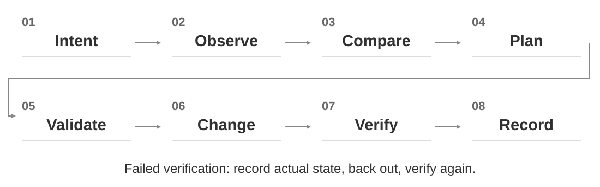

The gNMI repair later follows this loop: `gnmic get`, `set --dry-run`, `set`, `get`.

<nav class="progress" aria-label="Module progress"><span class="active">INTENT</span><span class="arrow"> → </span><span class="">OBSERVE</span><span class="arrow"> → </span><span class="">PLAN</span><span class="arrow"> → </span><span class="">CHANGE</span><span class="arrow"> → </span><span class="">VERIFY</span><span class="arrow"> → </span><span class="">RECORD</span></nav>

---
<!-- _class: visual core -->
<!-- _footer: "AI5049, Hochschule Fulda" -->

# Inventory gives the target context

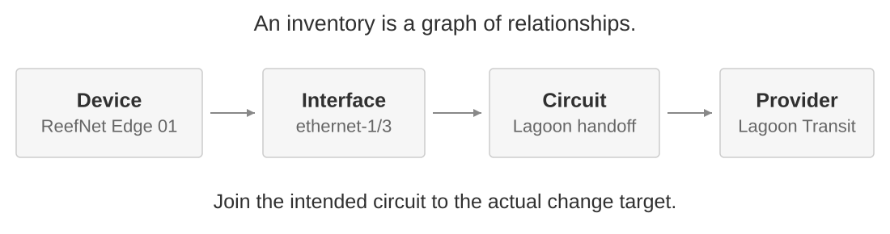

<nav class="progress" aria-label="Module progress"><span class="">INTENT</span><span class="arrow"> → </span><span class="active">OBSERVE</span><span class="arrow"> → </span><span class="">PLAN</span><span class="arrow"> → </span><span class="">CHANGE</span><span class="arrow"> → </span><span class="">VERIFY</span><span class="arrow"> → </span><span class="">RECORD</span></nav>

---
<!-- _class: content core -->
<!-- _footer: "<span class=\"footer-context\">AI5049, Hochschule Fulda</span><span class=\"footer-refs\"><a href=\"https://netbox.readthedocs.io/en/stable/integrations/rest-api/\">NetBox REST API</a></span>" -->

# Read the device inventory

<div class="terminal">
<div class="terminal-entry"><strong>WSL</strong><code>make enter NODE=operations01.bob1.reefnet.test</code></div>
<div class="terminal-label">Inside operations01</div>
<pre><code>AUTH=&quot;Authorization: Bearer $(cat /state/netbox-token)&quot;;
API=http://netbox.bob1.reefnet.test:8080/api;
curl -fsS -H &quot;$AUTH&quot; &quot;$API/dcim/devices/?name=edge01.bob1.reefnet.test&quot; &gt; device.json;
jq &#x27;{count, devices: [.results[] | {name, primary_ip4}]}&#x27; device.json;</code></pre>
</div>

Expect one device with `primary_ip4` `172.20.20.11/24`. Keep the token private.

<nav class="progress" aria-label="Module progress"><span class="">INTENT</span><span class="arrow"> → </span><span class="active">OBSERVE</span><span class="arrow"> → </span><span class="">PLAN</span><span class="arrow"> → </span><span class="">CHANGE</span><span class="arrow"> → </span><span class="">VERIFY</span><span class="arrow"> → </span><span class="">RECORD</span></nav>

---
<!-- _class: content core -->
<!-- _footer: "<span class=\"footer-context\">AI5049, Hochschule Fulda</span><span class=\"footer-refs\"><a href=\"https://netbox.readthedocs.io/en/stable/integrations/rest-api/\">NetBox REST API</a></span>" -->

# Read the circuit intent too

<div class="terminal">
<div class="terminal-entry"><strong>WSL</strong><code>make enter NODE=operations01.bob1.reefnet.test</code></div>
<div class="terminal-label">Inside operations01</div>
<pre><code>AUTH=&quot;Authorization: Bearer $(cat /state/netbox-token)&quot;;
API=http://netbox.bob1.reefnet.test:8080/api;
curl -fsS -H &quot;$AUTH&quot; &quot;$API/circuits/circuits/?cid=BOB1-LAGOON-001&quot; &gt; circuit.json;
jq &#x27;.results[] | {cid, provider: .provider.name, status: .status.label}&#x27; circuit.json;</code></pre>
</div>

NetBox: `BOB1-LAGOON-001` is active.

The router: session to `192.0.2.2` up, `198.51.100.0/24` not exported.

<nav class="progress" aria-label="Module progress"><span class="">INTENT</span><span class="arrow"> → </span><span class="active">OBSERVE</span><span class="arrow"> → </span><span class="">PLAN</span><span class="arrow"> → </span><span class="">CHANGE</span><span class="arrow"> → </span><span class="">VERIFY</span><span class="arrow"> → </span><span class="">RECORD</span></nav>

---
<!-- _class: content core -->
<!-- _footer: "AI5049, Hochschule Fulda" -->

# Follow the inventory to the change

Each NetBox query returns a record. We keep one fact and use it for the next query.

| `GET /api/…` | We keep |
|---|---|
| `dcim/devices/?name=edge01.bob1.reefnet.test` | Management IP `172.20.20.11` on `mgmt0` |
| `dcim/interfaces/?device=edge01.bob1.reefnet.test` | `ethernet-1/3` is cabled to Lagoon Transit |
| `ipam/asns/?asn=65100` | AS 65100 is Lagoon Transit, the BGP peer on that port |
| `ipam/prefixes/?prefix=198.51.100.0/24` | Ocean Research service prefix |

Change input: on `edge01`, peer AS 65100 must receive `198.51.100.0/24`.

<nav class="progress" aria-label="Module progress"><span class="">INTENT</span><span class="arrow"> → </span><span class="active">OBSERVE</span><span class="arrow"> → </span><span class="">PLAN</span><span class="arrow"> → </span><span class="">CHANGE</span><span class="arrow"> → </span><span class="">VERIFY</span><span class="arrow"> → </span><span class="">RECORD</span></nav>

---
<!-- _class: content core -->
<!-- _footer: "AI5049, Hochschule Fulda" -->

# Choose the automation mechanism

| Layer | Examples | On the BOB1 routers |
|---|---|---|
| CLI automation | Netmiko | SSH to the SR Linux CLI |
| Data models | YANG: native, OpenConfig | `srl_nokia-*` and OpenConfig models |
| Model-driven protocols | NETCONF, RESTCONF, gNMI | gNMI on port 57400, NETCONF on 830, no RESTCONF |

---
<!-- _class: content core -->
<!-- _footer: "<span class=\"footer-context\">AI5049, Hochschule Fulda</span><span class=\"footer-refs\"><a href=\"https://github.com/ktbyers/netmiko\">Netmiko documentation</a></span>" -->

# Netmiko: automate the CLI you already know

Illustrative SSH read on SR Linux:

```python
from netmiko import ConnectHandler

with ConnectHandler(**device) as conn:
    output = conn.send_command(
        "show network-instance default protocols bgp neighbor 192.0.2.2 advertised-routes ipv4")
    assert "198.51.100.0/24" in output
```

Netmiko handles the session. You still parse text.

<nav class="progress" aria-label="Module progress"><span class="">INTENT</span><span class="arrow"> → </span><span class="">OBSERVE</span><span class="arrow"> → </span><span class="active">PLAN</span><span class="arrow"> → </span><span class="">CHANGE</span><span class="arrow"> → </span><span class="">VERIFY</span><span class="arrow"> → </span><span class="">RECORD</span></nav>

---
<!-- _class: visual core -->
<!-- _footer: "<span class=\"footer-context\">AI5049, Hochschule Fulda</span><span class=\"footer-refs\"><a href=\"https://www.rfc-editor.org/rfc/rfc7950.html\">YANG: RFC 7950</a></span>" -->

# YANG describes management data

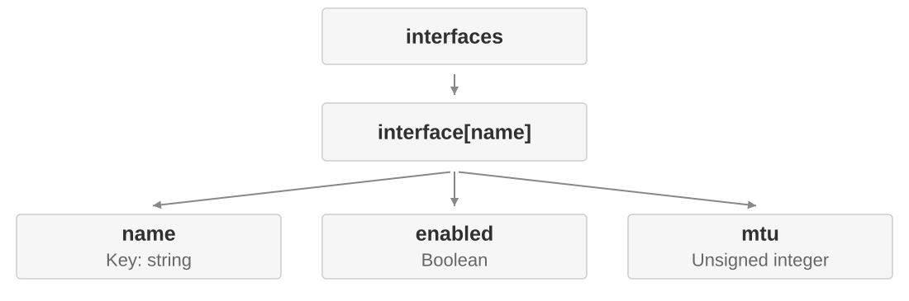

<nav class="progress" aria-label="Module progress"><span class="">INTENT</span><span class="arrow"> → </span><span class="">OBSERVE</span><span class="arrow"> → </span><span class="active">PLAN</span><span class="arrow"> → </span><span class="">CHANGE</span><span class="arrow"> → </span><span class="">VERIFY</span><span class="arrow"> → </span><span class="">RECORD</span></nav>

---
<!-- _class: content deep-dive -->
<!-- _footer: "AI5049, Hochschule Fulda" -->

# YANG for our BGP group

From `srl_nokia-bgp.yang` on edge01, shortened:

```yang
list group {
  key "group-name";
  leaf group-name { ... }
  leaf-list export-policy {
    ordered-by user;
    max-elements 14;
    type leafref { path "/routing-policy/policy/name"; }
  }
}
```

The key makes the path `group[group-name=lagoon-v4]`.
The leafref rejects a policy that does not exist: try `NO-SUCH-POLICY`.

<nav class="progress" aria-label="Module progress"><span class="">INTENT</span><span class="arrow"> → </span><span class="">OBSERVE</span><span class="arrow"> → </span><span class="active">PLAN</span><span class="arrow"> → </span><span class="">CHANGE</span><span class="arrow"> → </span><span class="">VERIFY</span><span class="arrow"> → </span><span class="">RECORD</span></nav>

---
<!-- _class: content core -->
<!-- _footer: "<span class=\"footer-context\">AI5049, Hochschule Fulda</span><span class=\"footer-refs\"><a href=\"https://openconfig.net/projects/models/\">OpenConfig models</a></span>" -->

# OpenConfig: one model for many vendors

Six OpenConfig models loaded on edge01:

| Model | Covers |
|---|---|
| `openconfig-interfaces` | Admin and oper state, counters |
| `openconfig-network-instance` | VRFs, BGP, OSPF, static routes |
| `openconfig-routing-policy` | Prefix sets and policies |
| `openconfig-platform` | Chassis, line cards, transceivers |
| `openconfig-lldp` | Neighbor discovery |
| `openconfig-system` | Hostname, AAA, NTP, logging |

<nav class="progress" aria-label="Module progress"><span class="">INTENT</span><span class="arrow"> → </span><span class="">OBSERVE</span><span class="arrow"> → </span><span class="active">PLAN</span><span class="arrow"> → </span><span class="">CHANGE</span><span class="arrow"> → </span><span class="">VERIFY</span><span class="arrow"> → </span><span class="">RECORD</span></nav>

---
<!-- _class: content core -->
<!-- _footer: "<span class=\"footer-context\">AI5049, Hochschule Fulda</span><span class=\"footer-refs\"><a href=\"https://openconfig.net/projects/models/\">OpenConfig models</a></span>" -->

# Same router, two models

gNMI reads on edge01:

| Data | Native SR Linux | OpenConfig |
|---|---|---|
| ethernet-1/3 state | `…/oper-state`: `up` | `…/state/oper-status`: `UP` |
| BGP group lagoon-v4 | full configuration | empty |

Paths: `/interface[name=ethernet-1/3]/oper-state` and
`/interfaces/interface[name=ethernet-1/3]/state/oper-status`.

<nav class="progress" aria-label="Module progress"><span class="">INTENT</span><span class="arrow"> → </span><span class="">OBSERVE</span><span class="arrow"> → </span><span class="active">PLAN</span><span class="arrow"> → </span><span class="">CHANGE</span><span class="arrow"> → </span><span class="">VERIFY</span><span class="arrow"> → </span><span class="">RECORD</span></nav>

---
<!-- _class: content core -->
<!-- _footer: "<span class=\"footer-context\">AI5049, Hochschule Fulda</span><span class=\"footer-refs\"><a href=\"https://www.rfc-editor.org/rfc/rfc6241.html\">NETCONF: RFC 6241</a></span>" -->

# NETCONF and RESTCONF are siblings

| | NETCONF | RESTCONF |
|---|---|---|
| Standard | RFC 6241 (2011) | RFC 8040 (2017) |
| Transport | SSH, port 830 | HTTPS |
| Encoding | XML | JSON or XML |
| Operations | `get-config`, `edit-config`, `lock`, `commit` | `GET`, `POST`, `PUT`, `PATCH`, `DELETE` |
| Datastores | running, candidate, startup | one view, no commit step |
| BOB1 routers | enabled | not offered |

<nav class="progress" aria-label="Module progress"><span class="">INTENT</span><span class="arrow"> → </span><span class="">OBSERVE</span><span class="arrow"> → </span><span class="active">PLAN</span><span class="arrow"> → </span><span class="">CHANGE</span><span class="arrow"> → </span><span class="">VERIFY</span><span class="arrow"> → </span><span class="">RECORD</span></nav>

---
<!-- _class: content core -->
<!-- _footer: "<span class=\"footer-context\">AI5049, Hochschule Fulda</span><span class=\"footer-refs\"><a href=\"https://www.rfc-editor.org/rfc/rfc6241.html\">NETCONF: RFC 6241</a></span>" -->

# NETCONF edits a datastore

```xml
<edit-config>
  <target><candidate/></target>
  <config>
    <network-instance xmlns="urn:nokia.com:srlinux:net-inst:network-instance">
      <name>default</name>
      <protocols><bgp xmlns="urn:nokia.com:srlinux:bgp:bgp"><group>
        <group-name>lagoon-v4</group-name>
        <export-policy nc:operation="delete">BLOCK-CUSTOMER-V4</export-policy>
      </group></bgp></protocols></network-instance>
  </config>
</edit-config>
```

Over SSH port 830 on edge01: `lock` → `edit-config` → `commit` → `unlock`, each `<ok/>`.
Then verify the service.

<nav class="progress" aria-label="Module progress"><span class="">INTENT</span><span class="arrow"> → </span><span class="">OBSERVE</span><span class="arrow"> → </span><span class="active">PLAN</span><span class="arrow"> → </span><span class="">CHANGE</span><span class="arrow"> → </span><span class="">VERIFY</span><span class="arrow"> → </span><span class="">RECORD</span></nav>

---
<!-- _class: visual deep-dive -->
<!-- _footer: "<span class=\"footer-context\">AI5049, Hochschule Fulda</span><span class=\"footer-refs\"><a href=\"https://www.rfc-editor.org/rfc/rfc6241.html#section-8.4\">Confirmed commit: RFC 6241</a></span>" -->

# Confirmed commit

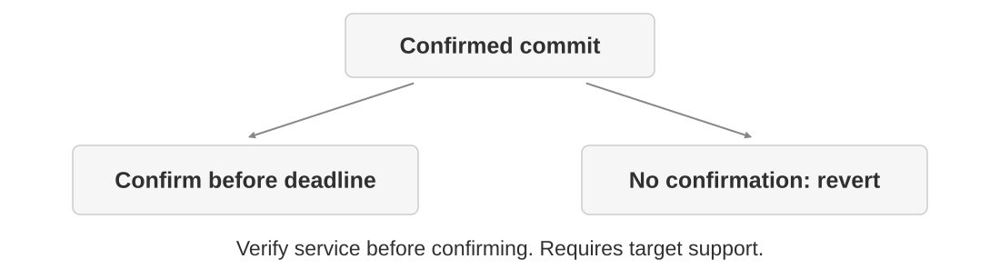

No confirmation before the timeout: the router reverts. Test that revert.

<nav class="progress" aria-label="Module progress"><span class="">INTENT</span><span class="arrow"> → </span><span class="">OBSERVE</span><span class="arrow"> → </span><span class="active">PLAN</span><span class="arrow"> → </span><span class="">CHANGE</span><span class="arrow"> → </span><span class="">VERIFY</span><span class="arrow"> → </span><span class="">RECORD</span></nav>

---
<!-- _class: visual core -->
<!-- _footer: "<span class=\"footer-context\">AI5049, Hochschule Fulda</span><span class=\"footer-refs\"><a href=\"https://github.com/openconfig/reference/blob/master/rpc/gnmi/gnmi-specification.md\">gNMI specification</a></span>" -->

# gNMI defines four RPCs

**RPC = remote procedure call**

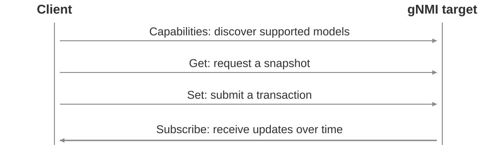

<nav class="progress" aria-label="Module progress"><span class="">INTENT</span><span class="arrow"> → </span><span class="">OBSERVE</span><span class="arrow"> → </span><span class="active">PLAN</span><span class="arrow"> → </span><span class="">CHANGE</span><span class="arrow"> → </span><span class="">VERIFY</span><span class="arrow"> → </span><span class="">RECORD</span></nav>

---
<!-- _class: content core -->
<!-- _footer: "AI5049, Hochschule Fulda" -->

# Read a gNMI path

Our repair path on edge01:

```text
/network-instance[name=default]/protocols/bgp/group[group-name=lagoon-v4]/export-policy
```

- `[name=default]` selects one network instance.
- `[group-name=lagoon-v4]` selects one BGP group, by its YANG key.
- `export-policy` is the leaf-list we read or delete.
- The **target** `edge01.bob1.reefnet.test:57400` selects the router.

<nav class="progress" aria-label="Module progress"><span class="">INTENT</span><span class="arrow"> → </span><span class="">OBSERVE</span><span class="arrow"> → </span><span class="active">PLAN</span><span class="arrow"> → </span><span class="">CHANGE</span><span class="arrow"> → </span><span class="">VERIFY</span><span class="arrow"> → </span><span class="">RECORD</span></nav>

---
<!-- _class: content core -->
<!-- _footer: "<span class=\"footer-context\">AI5049, Hochschule Fulda</span><span class=\"footer-refs\"><a href=\"https://github.com/openconfig/reference/blob/master/rpc/gnmi/gnmi-specification.md#34-set\">gNMI Set specification</a></span>" -->

# gNMI Set

One request, one target, one transaction.

| Result | Target behavior |
|---|---|
| Success | Apply all requested changes |
| Failure | Restore the pre-request state |
| Timeout | Outcome unknown to the client |

Read back after a timeout. On SR Linux, Set applies immediately: no commit step.

<nav class="progress" aria-label="Module progress"><span class="">INTENT</span><span class="arrow"> → </span><span class="">OBSERVE</span><span class="arrow"> → </span><span class="active">PLAN</span><span class="arrow"> → </span><span class="">CHANGE</span><span class="arrow"> → </span><span class="">VERIFY</span><span class="arrow"> → </span><span class="">RECORD</span></nav>

---
<!-- _class: visual deep-dive -->
<!-- _footer: "AI5049, Hochschule Fulda" -->

# Prevent a lost update

Two operators read `lagoon-v4`, then both write. The later write silently undoes the earlier one.

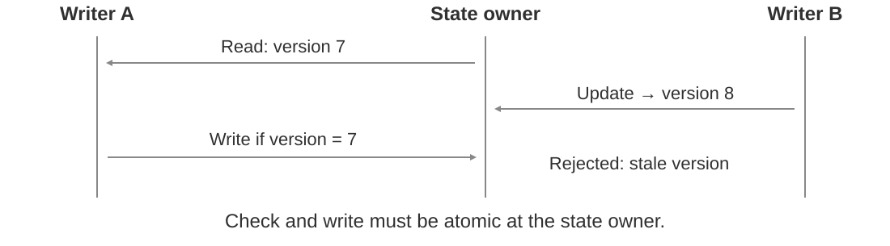

Fix: block the second writer, or write only if your read is still current.

<nav class="progress" aria-label="Module progress"><span class="">INTENT</span><span class="arrow"> → </span><span class="">OBSERVE</span><span class="arrow"> → </span><span class="active">PLAN</span><span class="arrow"> → </span><span class="">CHANGE</span><span class="arrow"> → </span><span class="">VERIFY</span><span class="arrow"> → </span><span class="">RECORD</span></nav>

---
<!-- _class: content deep-dive -->
<!-- _footer: "AI5049, Hochschule Fulda" -->

# Block the second writer

| Interface | Protection | Tested on edge01 |
|---|---|---|
| CLI | `enter candidate exclusive` | Second CLI session refused |
| NETCONF | `lock` → read → `edit-config` → `commit` → `unlock` | Second lock: `lock-denied` |
| gNMI Set | none | Set went through while NETCONF held the lock |

Keep one writer per router and read back after every write.

<nav class="progress" aria-label="Module progress"><span class="">INTENT</span><span class="arrow"> → </span><span class="">OBSERVE</span><span class="arrow"> → </span><span class="active">PLAN</span><span class="arrow"> → </span><span class="">CHANGE</span><span class="arrow"> → </span><span class="">VERIFY</span><span class="arrow"> → </span><span class="">RECORD</span></nav>

---
<!-- _class: visual core -->
<!-- _footer: "AI5049, Hochschule Fulda" -->

# Plan the maintenance window

**Method of Procedure (MOP):** steps, checks and recovery ownership.

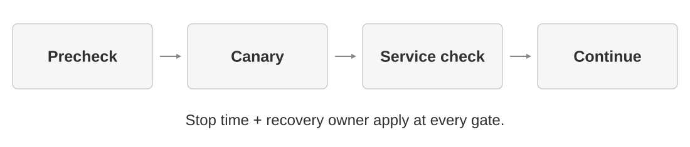

<nav class="progress" aria-label="Module progress"><span class="">INTENT</span><span class="arrow"> → </span><span class="">OBSERVE</span><span class="arrow"> → </span><span class="active">PLAN</span><span class="arrow"> → </span><span class="">CHANGE</span><span class="arrow"> → </span><span class="">VERIFY</span><span class="arrow"> → </span><span class="">RECORD</span></nav>

---
<!-- _class: content core -->
<!-- _footer: "AI5049, Hochschule Fulda" -->

# Plan the repair verification

| Check | Expected |
|---|---|
| Lagoon: `198.51.100.0/24` | Export restored |
| Lagoon: `2001:db8:100::/48` | Still exported |
| Pacific IPv4 path | Still healthy |
| Both probes, both families | Service responds |

<nav class="progress" aria-label="Module progress"><span class="">INTENT</span><span class="arrow"> → </span><span class="">OBSERVE</span><span class="arrow"> → </span><span class="active">PLAN</span><span class="arrow"> → </span><span class="">CHANGE</span><span class="arrow"> → </span><span class="">VERIFY</span><span class="arrow"> → </span><span class="">RECORD</span></nav>

---
<!-- _class: content task -->
<!-- _footer: "<span class=\"footer-context\">AI5049, Hochschule Fulda</span><span class=\"footer-refs\"><a href=\"https://gnmic.openconfig.net/\">gNMIc documentation</a></span>" -->

# Exercise: repair it through gNMI

Find ReefNet Edge 01 in NetBox. Read its configuration and justify a change.

In WSL:
```bash
make fault-routing;
make task STEP=6;
```
Lab not running? `make operations` starts it with the fault already in place.

**60 minutes:** steps 6–8. Repair through gNMI and verify the service from both probes.
Use `make hint` for investigation commands.

[Exercise overview](https://github.com/Stinktopf/network-management-and-monitoring#exercises)

---
<!-- _class: content core -->
<!-- _footer: "<span class=\"footer-context\">AI5049, Hochschule Fulda</span><span class=\"footer-refs\"><a href=\"https://gnmic.openconfig.net/cmd/set/\">gNMIc Set documentation</a></span>" -->

# Apply the repair through gNMI

<div class="terminal">
<div class="terminal-entry"><strong>WSL</strong><code>make enter NODE=operations01.bob1.reefnet.test</code></div>
<div class="terminal-label">Inside operations01, after <code>get</code> confirmed <code>BLOCK-CUSTOMER-V4</code></div>
<pre><code>export GNMIC_ADDRESS=edge01.bob1.reefnet.test:57400;
export GNMIC_USERNAME=admin GNMIC_PASSWORD=&#x27;NokiaSrl1!&#x27;;
export GNMIC_SKIP_VERIFY=true GNMIC_ENCODING=json_ietf GNMIC_TIMEOUT=10s;
GROUP=&#x27;/network-instance[name=default]/protocols/bgp/group[group-name=lagoon-v4]&#x27;;
gnmic set --delete &quot;$GROUP/export-policy&quot;;</code></pre>
</div>

Read back the group. Check Lagoon’s route and HTTP from both probes.

<nav class="progress" aria-label="Module progress"><span class="">INTENT</span><span class="arrow"> → </span><span class="">OBSERVE</span><span class="arrow"> → </span><span class="">PLAN</span><span class="arrow"> → </span><span class="active">CHANGE</span><span class="arrow"> → </span><span class="">VERIFY</span><span class="arrow"> → </span><span class="">RECORD</span></nav>

---
<!-- _class: chapter core -->
<!-- _footer: "AI5049, Hochschule Fulda" -->

# Beyond one router: execute and recover

What changes when one change targets many routers?

---
<!-- _class: content core -->
<!-- _footer: "AI5049, Hochschule Fulda" -->

# Bound the rollout

1. Re-read live preconditions.
2. Change one representative canary.
3. Verify the service before expanding.

Set a stop time. Keep the backout path reachable.

<nav class="progress" aria-label="Module progress"><span class="">INTENT</span><span class="arrow"> → </span><span class="">OBSERVE</span><span class="arrow"> → </span><span class="">PLAN</span><span class="arrow"> → </span><span class="active">CHANGE</span><span class="arrow"> → </span><span class="">VERIFY</span><span class="arrow"> → </span><span class="">RECORD</span></nav>

---
<!-- _class: content core -->
<!-- _footer: "AI5049, Hochschule Fulda" -->

# Give automation a bounded identity

| Identity | Read | Write |
|---|---|---|
| Collector | Required state | No |
| Change service | Prechecks + verification | Approved scope |
| Reviewer | Evidence | No |

In the lab, `gnmic` logs in as `admin`, with full write access. A collector should not.

<nav class="progress" aria-label="Module progress"><span class="">INTENT</span><span class="arrow"> → </span><span class="">OBSERVE</span><span class="arrow"> → </span><span class="">PLAN</span><span class="arrow"> → </span><span class="active">CHANGE</span><span class="arrow"> → </span><span class="">VERIFY</span><span class="arrow"> → </span><span class="">RECORD</span></nav>

---
<!-- _class: visual core -->
<!-- _footer: "AI5049, Hochschule Fulda" -->

# A fleet changes the failure model

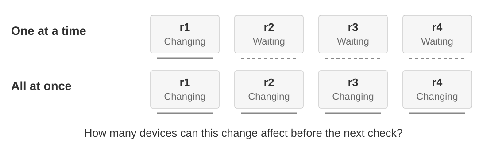

<nav class="progress" aria-label="Module progress"><span class="">INTENT</span><span class="arrow"> → </span><span class="">OBSERVE</span><span class="arrow"> → </span><span class="">PLAN</span><span class="arrow"> → </span><span class="active">CHANGE</span><span class="arrow"> → </span><span class="">VERIFY</span><span class="arrow"> → </span><span class="">RECORD</span></nav>

---
<!-- _class: content core -->
<!-- _footer: "AI5049, Hochschule Fulda" -->

# Run it twice. What changes?

**Idempotence**, for a fixed operation F and state s:

$$F(F(s))=F(s)$$

Deleting the `lagoon-v4` export-policy twice leaves the same state: no override.

<nav class="progress" aria-label="Module progress"><span class="">INTENT</span><span class="arrow"> → </span><span class="">OBSERVE</span><span class="arrow"> → </span><span class="">PLAN</span><span class="arrow"> → </span><span class="active">CHANGE</span><span class="arrow"> → </span><span class="">VERIFY</span><span class="arrow"> → </span><span class="">RECORD</span></nav>

---
<!-- _class: visual deep-dive -->
<!-- _footer: "AI5049, Hochschule Fulda" -->

# One router timed out after the write

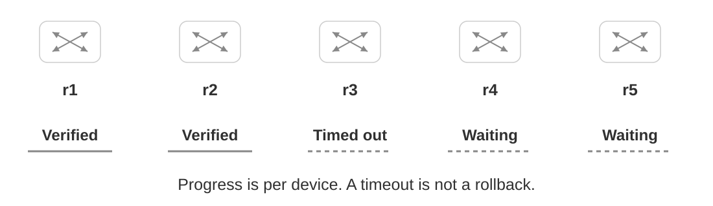

Which device needs a fresh read before any retry?

<nav class="progress" aria-label="Module progress"><span class="">INTENT</span><span class="arrow"> → </span><span class="">OBSERVE</span><span class="arrow"> → </span><span class="">PLAN</span><span class="arrow"> → </span><span class="active">CHANGE</span><span class="arrow"> → </span><span class="">VERIFY</span><span class="arrow"> → </span><span class="">RECORD</span></nav>

---
<!-- _class: content core -->
<!-- _footer: "AI5049, Hochschule Fulda" -->

# Which state are we restoring?

“Restore last Tuesday” is not a precise instruction.

| Golden configuration | Backup |
|---|---|
| Approved baseline | Captured device state |

Keep identity, time, version and checksum outside the device.

<nav class="progress" aria-label="Module progress"><span class="">INTENT</span><span class="arrow"> → </span><span class="">OBSERVE</span><span class="arrow"> → </span><span class="">PLAN</span><span class="arrow"> → </span><span class="">CHANGE</span><span class="arrow"> → </span><span class="">VERIFY</span><span class="arrow"> → </span><span class="active">RECORD</span></nav>

---
<!-- _class: content core -->
<!-- _footer: "AI5049, Hochschule Fulda" -->

# Keep an audit trail

```json
{
  "actor": "course-automation",
  "target": "edge01.bob1.reefnet.test",
  "change_id": "CHG-017",
  "deleted_override": "BLOCK-CUSTOMER-V4",
  "inherited_policy": "EXPORT-BGP",
  "lagoon_ipv4_probe_passed": true
}
```

<nav class="progress" aria-label="Module progress"><span class="">INTENT</span><span class="arrow"> → </span><span class="">OBSERVE</span><span class="arrow"> → </span><span class="">PLAN</span><span class="arrow"> → </span><span class="">CHANGE</span><span class="arrow"> → </span><span class="">VERIFY</span><span class="arrow"> → </span><span class="active">RECORD</span></nav>

---
<!-- _class: visual core -->
<!-- _footer: "<span class=\"footer-context\">AI5049, Hochschule Fulda</span><span class=\"footer-refs\"><a href=\"https://opengitops.dev/\">OpenGitOps principles</a></span>" -->

# GitOps gives us a reviewed desired state

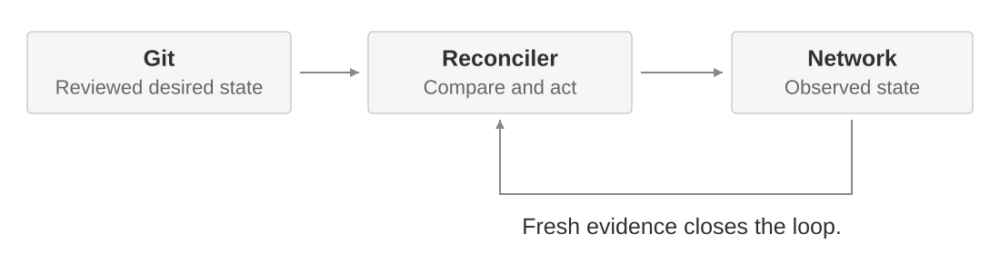

<nav class="progress" aria-label="Module progress"><span class="">INTENT</span><span class="arrow"> → </span><span class="">OBSERVE</span><span class="arrow"> → </span><span class="">PLAN</span><span class="arrow"> → </span><span class="">CHANGE</span><span class="arrow"> → </span><span class="">VERIFY</span><span class="arrow"> → </span><span class="active">RECORD</span></nav>

---
<!-- _class: chapter deep-dive -->
<!-- _footer: "AI5049, Hochschule Fulda" -->

# Who Broke the Internet?

**Everything is redundant until the shared dependency breaks.**

Which safeguard would have changed the outcome?

---
<!-- _class: content deep-dive -->
<!-- _footer: "<span class=\"footer-context\">AI5049, Hochschule Fulda</span><span class=\"footer-refs\"><a href=\"https://engineering.fb.com/2021/10/05/networking-traffic/outage-details/\">Meta outage report (2021)</a> <a href=\"https://blog.cloudflare.com/october-2021-facebook-outage/\">Observed impact</a></span>" -->

# Facebook: the backbone took DNS with it

**4 October 2021**

1. An audit-tool bug allowed a maintenance command to disconnect the backbone.
2. DNS sites lost data-center reachability and withdrew BGP routes.
3. Running DNS servers became unreachable.

**Facebook, Instagram and WhatsApp went offline.**

---
<!-- _class: visual deep-dive -->
<!-- _footer: "<span class=\"footer-context\">AI5049, Hochschule Fulda</span><span class=\"footer-refs\"><a href=\"https://engineering.fb.com/2021/10/05/networking-traffic/outage-details/\">Meta report</a><a href=\"https://www.rfc-editor.org/rfc/rfc1958.html#section-3.11\">RFC 1958 §3.11</a></span>" -->

# Facebook: recovery lost its own tools

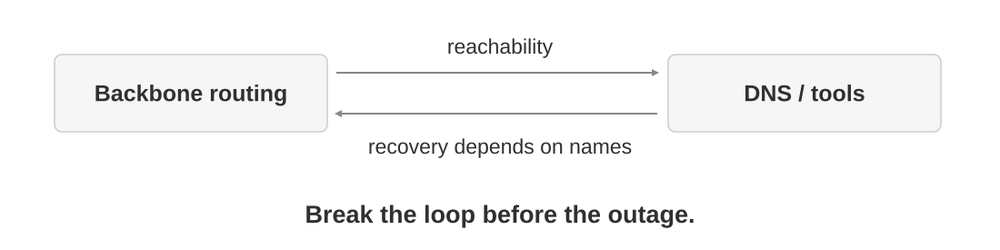

Normal and out-of-band access failed. Engineers had to go onsite.

They restored the backbone, then brought services back under controlled load.

---
<!-- _class: content deep-dive -->
<!-- _footer: "AI5049, Hochschule Fulda" -->

# Can you still reach the router?

| Management path | Uses |
|---|---|
| In-band | Production network |
| Out-of-band | Separate device or console access |

Check shared dependencies: **power, fiber, DNS and authentication**.

---
<!-- _class: visual deep-dive -->
<!-- _footer: "AI5049, Hochschule Fulda" -->

# Production recovery example: a console path

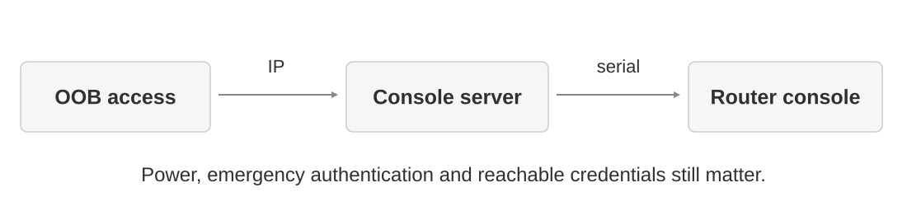

Test login and repair while the production path is unavailable.

---
<!-- _class: visual deep-dive -->
<!-- _footer: "AI5049, Hochschule Fulda" -->

# Task: the console is reachable, login fails

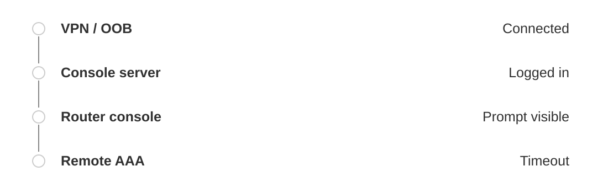

AAA uses the failed backbone. Which fallback must exist?

---
<!-- _class: content deep-dive -->
<!-- _footer: "AI5049, Hochschule Fulda" -->

# Recovery only works if it was prepared

| Dependency | Prepare |
|---|---|
| Transit | Circuit and provider contact |
| Console | Server, port and serial settings |
| Login | Tested emergency credentials |
| DNS / secrets | Reachable during the outage |
| Power | Backup along the recovery path |

Test that the emergency account can make the repair.

---
<!-- _class: content deep-dive -->
<!-- _footer: "AI5049, Hochschule Fulda" -->

# Who do we call, and when?

An **escalation matrix** fixes contacts and triggers before the incident. Illustrative for ReefNet:

| Level | Who | Escalate when |
|---|---|---|
| 1 | NOC on shift | Alert or customer report |
| 2 | Network engineer on call | No diagnosis after 15 minutes |
| 3 | Vendor support | Suspected software or hardware fault |
| Provider | Lagoon Transit NOC | Fault on circuit `BOB1-LAGOON-001` |
| Management | Duty manager | SLA breach likely |

---
<!-- _class: content deep-dive -->
<!-- _footer: "<span class=\"footer-context\">AI5049, Hochschule Fulda</span><span class=\"footer-refs\"><a href=\"https://docs.equinix.com/smart-hands/\">Equinix Smart Hands</a></span>" -->

# Remote hands need an exact job

If remote recovery is blocked, onsite staff become your eyes and hands.

```text
Location:   BOB1, rack BOB1-R01
Equipment:  edge01.bob1.reefnet.test, ethernet-1/3
Task:       verify label and photograph LEDs
Scope:      inspect only, no disconnect
Return:     timestamp, photos, label mismatch
```

For vendor escalation, add version, symptoms and logs.

---
<!-- _class: content deep-dive -->
<!-- _footer: "<span class=\"footer-context\">AI5049, Hochschule Fulda</span><span class=\"footer-refs\"><a href=\"https://status.cloud.google.com/incidents/J5ia5t9p3g9Q5Wi7r8Ev\">Google Cloud report (Sep 2026)</a></span>" -->

# Google Cloud: incompatible optics

**1 September 2026, us-central1**

New router optics were incompatible with the fabric side.
The work crossed redundant routers before connectivity was checked.

**Affected VMs lost connectivity** in parts of us-central1-b and us-central1-f.

---
<!-- _class: visual deep-dive -->
<!-- _footer: "<span class=\"footer-context\">AI5049, Hochschule Fulda</span><span class=\"footer-refs\"><a href=\"https://status.cloud.google.com/incidents/J5ia5t9p3g9Q5Wi7r8Ev\">Google Cloud report (Sep 2026)</a></span>" -->

# Google Cloud: one worklist defeated redundancy

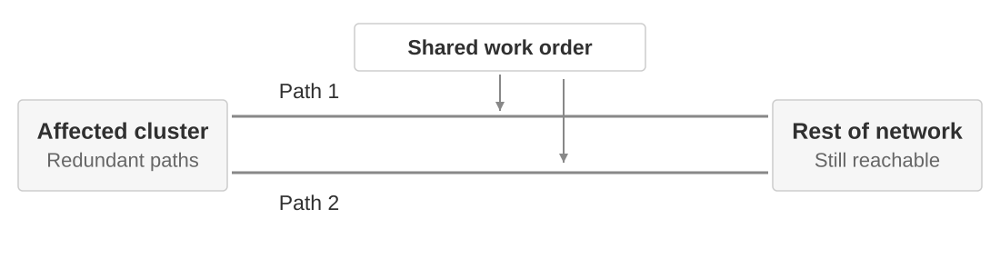

All affected paths were unplugged within **13 minutes**.
The worklist omitted router-by-router sequencing and verification.

Recovery: divert traffic, reinstall the original optics, verify links.

---
<!-- _class: visual deep-dive -->
<!-- _footer: "<span class=\"footer-context\">AI5049, Hochschule Fulda</span><span class=\"footer-refs\"><a href=\"https://labs.ripe.net/author/emileaben/a-deep-dive-into-the-baltic-sea-cable-cuts/\">RIPE Labs: Baltic Sea (2024)</a></span>" -->

# Baltic Sea: paths after the cuts

RIPE Atlas, 17–18 November 2024: Germany–Finland paths after the C-Lion1 cut.

Of 2,141 probe pairs, 21.5% kept identical IP paths.
5.2% of those still got 3 ms or more slower.

No extra packet loss: the networks rerouted, partly below IP.

---
<!-- _class: visual deep-dive -->
<!-- _footer: "<span class=\"footer-context\">AI5049, Hochschule Fulda</span><span class=\"footer-refs\"><a href=\"https://labs.ripe.net/author/emileaben/a-deep-dive-into-the-baltic-sea-cable-cuts/\">RIPE Labs: Baltic Sea (2024)</a></span>" -->

# The IP path can look unchanged

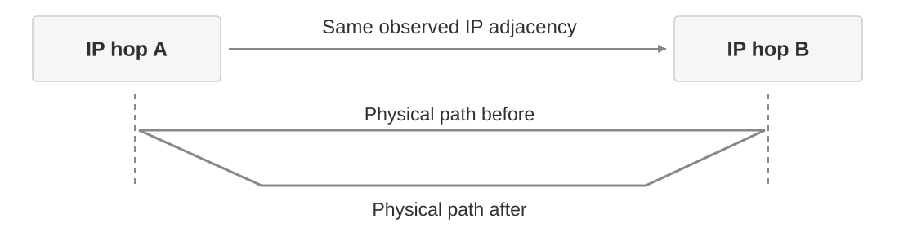

Traceroute alone cannot identify a damaged cable.
Tomorrow you measure RTT from fixed probes, the same method RIPE Atlas uses.

---
<!-- _class: day core -->
<!-- _footer: "AI5049, Hochschule Fulda" -->

# 14 October 2026

## Monitoring / Observability

In Operations, the customer had to tell us something was wrong.

**How could the network have told us first?**

---
<!-- _class: content core -->
<!-- _footer: "AI5049, Hochschule Fulda" -->

# What do we want to know?

| | Service | Network | Device |
|---|---|---|---|
| Question | Does the exchange work? | Do packets get through? | Is the box healthy? |
| Examples | Availability, latency | Loss, routing state | Discards, resources |
| In BOB1 | `reefnet_probe_success` | BGP, OSPF, link rates | Interface state, discards |

<nav class="progress" aria-label="Module progress"><span class="active">QUESTION</span><span class="arrow"> → </span><span class="">PROTOCOL</span><span class="arrow"> → </span><span class="">COLLECT</span><span class="arrow"> → </span><span class="">INTERPRET</span><span class="arrow"> → </span><span class="">ALERT</span><span class="arrow"> → </span><span class="">RESPOND</span></nav>

---
<!-- _class: content core -->
<!-- _footer: "<span class=\"footer-context\">AI5049, Hochschule Fulda</span><span class=\"footer-refs\"><a href=\"https://sre.google/sre-book/monitoring-distributed-systems/\">SRE book: monitoring</a><a href=\"https://www.brendangregg.com/usemethod.html\">USE method</a><a href=\"https://grafana.com/blog/2018/08/02/the-red-method-how-to-instrument-your-services/\">RED method</a></span>" -->

# Three methods: what should we measure?

Three published methods, each a checklist for a different view:

| Method | Origin | Applies to | Measure |
|---|---|---|---|
| Four golden signals | Google, SRE book (2016) | A user-facing service | Latency, traffic, errors, saturation |
| USE | Brendan Gregg (2012) | Each resource: link, CPU, queue | Utilization, saturation, errors |
| RED | Tom Wilkie (2015) | Each service, as callers see it | Rate, errors, duration |

BOB1: USE fits the Lagoon handoff, RED fits the DNS and HTTP probes.

<nav class="progress" aria-label="Module progress"><span class="active">QUESTION</span><span class="arrow"> → </span><span class="">PROTOCOL</span><span class="arrow"> → </span><span class="">COLLECT</span><span class="arrow"> → </span><span class="">INTERPRET</span><span class="arrow"> → </span><span class="">ALERT</span><span class="arrow"> → </span><span class="">RESPOND</span></nav>

---
<!-- _class: content core -->
<!-- _footer: "AI5049, Hochschule Fulda" -->

# Different signals answer different questions

| Signal | Question | Typical protocol |
|---|---|---|
| Metric | How much or how fast? | SNMP, gNMI |
| Event / log | What changed? | Syslog, SNMP trap |
| Flow record | Which traffic? | NetFlow, IPFIX, sFlow |
| Packet capture | What was on the wire? | Port mirror, tcpdump |
| Active probe | Does this exchange work? | ICMP, TCP, HTTP, DNS |

<nav class="progress" aria-label="Module progress"><span class="active">QUESTION</span><span class="arrow"> → </span><span class="">PROTOCOL</span><span class="arrow"> → </span><span class="">COLLECT</span><span class="arrow"> → </span><span class="">INTERPRET</span><span class="arrow"> → </span><span class="">ALERT</span><span class="arrow"> → </span><span class="">RESPOND</span></nav>

---
<!-- _class: content core -->
<!-- _footer: "AI5049, Hochschule Fulda" -->

# What must our monitoring achieve?

Ocean Research's service, seen from Lagoon:

| Requirement | Reason |
|---|---|
| Detect outages of **5 s** or longer | Short link and BGP faults hurt the customer |
| At most **20 HTTP requests/s** | The probe must not become the load |
| Stale data **unknown within 10 s** | A silent collector must not look healthy |

We test all three at the end of the day.

<nav class="progress" aria-label="Module progress"><span class="active">QUESTION</span><span class="arrow"> → </span><span class="">PROTOCOL</span><span class="arrow"> → </span><span class="">COLLECT</span><span class="arrow"> → </span><span class="">INTERPRET</span><span class="arrow"> → </span><span class="">ALERT</span><span class="arrow"> → </span><span class="">RESPOND</span></nav>

---
<!-- _class: visual core -->
<!-- _footer: "AI5049, Hochschule Fulda" -->

# Delay and loss need endpoints

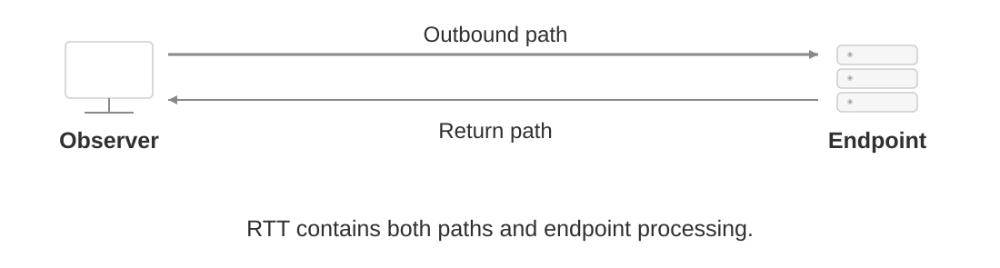

<nav class="progress" aria-label="Module progress"><span class="">QUESTION</span><span class="arrow"> → </span><span class="active">PROTOCOL</span><span class="arrow"> → </span><span class="">COLLECT</span><span class="arrow"> → </span><span class="">INTERPRET</span><span class="arrow"> → </span><span class="">ALERT</span><span class="arrow"> → </span><span class="">RESPOND</span></nav>

---
<!-- _class: content core -->
<!-- _footer: "AI5049, Hochschule Fulda" -->

# Choose the probe from the question

| Probe | Tells us |
|---|---|
| ICMP echo | IP reachability to a responding endpoint |
| TCP connect | transport handshake |
| HTTP request | application transaction |
| traceroute | responding hops along a path |

<nav class="progress" aria-label="Module progress"><span class="">QUESTION</span><span class="arrow"> → </span><span class="active">PROTOCOL</span><span class="arrow"> → </span><span class="">COLLECT</span><span class="arrow"> → </span><span class="">INTERPRET</span><span class="arrow"> → </span><span class="">ALERT</span><span class="arrow"> → </span><span class="">RESPOND</span></nav>

---
<!-- _class: content core -->
<!-- _footer: "AI5049, Hochschule Fulda" -->

# Define the probe before you run it

One BOB1 probe is:

```text
source:          probe01.bob1.lagoontransit.test
target:          198.51.100.10
address family:  IPv4
protocol:        ICMP echo
reply wait:      1 s
success:         ping exits successfully
```

<nav class="progress" aria-label="Module progress"><span class="">QUESTION</span><span class="arrow"> → </span><span class="active">PROTOCOL</span><span class="arrow"> → </span><span class="">COLLECT</span><span class="arrow"> → </span><span class="">INTERPRET</span><span class="arrow"> → </span><span class="">ALERT</span><span class="arrow"> → </span><span class="">RESPOND</span></nav>

---
<!-- _class: content deep-dive -->
<!-- _footer: "AI5049, Hochschule Fulda" -->

# Budget the ReefNet probe round

For the BOB1 probe set:

**2 sources × 2 families × 3 probe types = 12 checks**

All checks of a probe run in parallel. Each check gives up after 1 s.
Then the exporter pauses 1 s: about one round per second, about **4 HTTP requests/s**.
A failing round takes about 2 s. That stays well within the 10 s UNKNOWN threshold.

<nav class="progress" aria-label="Module progress"><span class="">QUESTION</span><span class="arrow"> → </span><span class="active">PROTOCOL</span><span class="arrow"> → </span><span class="">COLLECT</span><span class="arrow"> → </span><span class="">INTERPRET</span><span class="arrow"> → </span><span class="">ALERT</span><span class="arrow"> → </span><span class="">RESPOND</span></nav>

---
<!-- _class: content core -->
<!-- _footer: "<span class=\"footer-context\">AI5049, Hochschule Fulda</span><span class=\"footer-refs\"><a href=\"https://www.youtube.com/watch?v=nndJXD1mYoM\">Teltonika: SNMP agents and managers</a></span>" -->

# Video: SNMP basics

[Understanding SNMP Agents & Managers, Teltonika Networks (YouTube)](https://www.youtube.com/watch?v=nndJXD1mYoM)


<nav class="progress" aria-label="Module progress"><span class="">QUESTION</span><span class="arrow"> → </span><span class="active">PROTOCOL</span><span class="arrow"> → </span><span class="">COLLECT</span><span class="arrow"> → </span><span class="">INTERPRET</span><span class="arrow"> → </span><span class="">ALERT</span><span class="arrow"> → </span><span class="">RESPOND</span></nav>

---
<!-- _class: content core -->
<!-- _footer: "<span class=\"footer-context\">AI5049, Hochschule Fulda</span><span class=\"footer-refs\"><a href=\"https://www.rfc-editor.org/rfc/rfc3411.html\">SNMP: RFC 3411</a><a href=\"https://www.rfc-editor.org/rfc/rfc3416.html\">Operations: RFC 3416</a></span>" -->

# SNMP: manager and agent

| | Manager → agent | Agent → manager |
|---|---|---|
| Messages | Get, GetNext, GetBulk, Set | Trap, Inform |
| Port | UDP 161 | UDP 162 |
| Used for | Polling counters and state | Reporting events |

SNMP: IETF standard since 1988, version 3 since 1998.
**Trap:** no acknowledgement. **Inform:** acknowledged, resent if lost.
**v2c:** community string in clear text. **v3:** users, authentication, encryption.

<nav class="progress" aria-label="Module progress"><span class="">QUESTION</span><span class="arrow"> → </span><span class="active">PROTOCOL</span><span class="arrow"> → </span><span class="">COLLECT</span><span class="arrow"> → </span><span class="">INTERPRET</span><span class="arrow"> → </span><span class="">ALERT</span><span class="arrow"> → </span><span class="">RESPOND</span></nav>

---
<!-- _class: content core -->
<!-- _footer: "<span class=\"footer-context\">AI5049, Hochschule Fulda</span><span class=\"footer-refs\"><a href=\"https://www.rfc-editor.org/rfc/rfc2863.html\">IF-MIB: RFC 2863</a></span>" -->

# MIB and OID: a number for every value

`1.3.6.1.2.1` = iso.org.dod.internet.mgmt.mib-2

| IF-MIB object | OID | Value |
|---|---|---|
| `ifName` | `1.3.6.1.2.1.31.1.1.1.1` | `ethernet-1/3` |
| `ifOperStatus` | `1.3.6.1.2.1.2.2.1.8` | `up(1)`, `down(2)` |
| `ifInOctets` | `1.3.6.1.2.1.2.2.1.10` | Counter32: wraps after 3.4 s at 10 Gbit/s |
| `ifHCInOctets` | `1.3.6.1.2.1.31.1.1.1.6` | Counter64 |

The last number selects the row: `ifHCInOctets.3` is the interface with `ifIndex` 3.

<nav class="progress" aria-label="Module progress"><span class="">QUESTION</span><span class="arrow"> → </span><span class="active">PROTOCOL</span><span class="arrow"> → </span><span class="">COLLECT</span><span class="arrow"> → </span><span class="">INTERPRET</span><span class="arrow"> → </span><span class="">ALERT</span><span class="arrow"> → </span><span class="">RESPOND</span></nav>

---
<!-- _class: content core -->
<!-- _footer: "<span class=\"footer-context\">AI5049, Hochschule Fulda</span><span class=\"footer-refs\"><a href=\"https://www.rfc-editor.org/rfc/rfc2863.html\">IF-MIB: RFC 2863</a><a href=\"https://www.rfc-editor.org/rfc/rfc3416.html\">SNMP PDUs: RFC 3416</a></span>" -->

# GetNext walks a table

| Manager asks | Agent answers |
|---|---|
| GetNext `ifName` | `ifName.1` = `ethernet-1/1` |
| GetNext `ifName.1` | `ifName.2` = `ethernet-1/2` |
| GetNext `ifName.2` | `ifName.3` = `ethernet-1/3` |
| GetNext `ifName.3` | `ifInMulticastPkts.1`: next column, stop |

The manager needs no list of interfaces.
**GetBulk** returns many next values in one request.

<nav class="progress" aria-label="Module progress"><span class="">QUESTION</span><span class="arrow"> → </span><span class="active">PROTOCOL</span><span class="arrow"> → </span><span class="">COLLECT</span><span class="arrow"> → </span><span class="">INTERPRET</span><span class="arrow"> → </span><span class="">ALERT</span><span class="arrow"> → </span><span class="">RESPOND</span></nav>

---
<!-- _class: content task -->
<!-- _footer: "AI5049, Hochschule Fulda" -->

# Task: present one network management system

Small groups, one system each:

**OpenNMS, Zabbix, LibreNMS, Icinga, Checkmk, PRTG, Nagios Core**

**20 minutes** research, then **3 minutes** per group.

<nav class="progress" aria-label="Module progress"><span class="">QUESTION</span><span class="arrow"> → </span><span class="active">PROTOCOL</span><span class="arrow"> → </span><span class="">COLLECT</span><span class="arrow"> → </span><span class="">INTERPRET</span><span class="arrow"> → </span><span class="">ALERT</span><span class="arrow"> → </span><span class="">RESPOND</span></nav>

---
<!-- _class: content core -->
<!-- _footer: "<span class=\"footer-context\">AI5049, Hochschule Fulda</span><span class=\"footer-refs\"><a href=\"https://www.rfc-editor.org/rfc/rfc5424.html\">Syslog: RFC 5424</a></span>" -->

# Syslog: one line per event

Sendmail (1980s), standardized as RFC 5424 (2009). From `make fault-link`, shortened:

```text
<180>1 2026-10-14T10:02:11Z edge01 sr_ospf_mgr - - - … moved to state DOWN
```

The number in angle brackets says **who** logged and **how urgent**:

| | From 180 | Meaning |
|---|---|---|
| Facility | 180 ÷ 8 = **22** | local6: SR Linux applications |
| Severity | Remainder **4** | warning |

Severities: 0 emerg, 1 alert, 2 crit, 3 err, **4 warning**, 5 notice, 6 info, 7 debug

<nav class="progress" aria-label="Module progress"><span class="">QUESTION</span><span class="arrow"> → </span><span class="active">PROTOCOL</span><span class="arrow"> → </span><span class="">COLLECT</span><span class="arrow"> → </span><span class="">INTERPRET</span><span class="arrow"> → </span><span class="">ALERT</span><span class="arrow"> → </span><span class="">RESPOND</span></nav>

---
<!-- _class: content core -->
<!-- _footer: "AI5049, Hochschule Fulda" -->

# Which events does a router log?

| Type | Example |
|---|---|
| System | Process restart, hardware alarm |
| Configuration | Commit by user `admin` |
| Security / AAA | Login, failed authentication |
| Protocol | BGP or OSPF neighbor down |
| Debug | Packet-level detail, off by default |

BOB1: SR Linux → **UDP** 1514 → Alloy → Loki → Grafana.
A lost UDP datagram leaves no trace.

<nav class="progress" aria-label="Module progress"><span class="">QUESTION</span><span class="arrow"> → </span><span class="active">PROTOCOL</span><span class="arrow"> → </span><span class="">COLLECT</span><span class="arrow"> → </span><span class="">INTERPRET</span><span class="arrow"> → </span><span class="">ALERT</span><span class="arrow"> → </span><span class="">RESPOND</span></nav>

---
<!-- _class: visual core -->
<!-- _footer: "<span class=\"footer-context\">AI5049, Hochschule Fulda</span><span class=\"footer-refs\"><a href=\"https://www.rfc-editor.org/rfc/rfc7011.html\">IPFIX: RFC 7011</a></span>" -->

# Flow export: packets become records

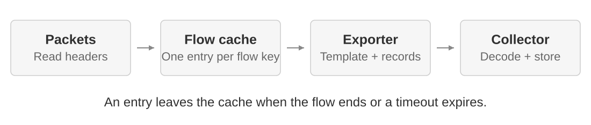

**Inactive timeout:** no packet for about 15 s.
**Active timeout:** long flows are reported every 1 to 30 min.

<nav class="progress" aria-label="Module progress"><span class="">QUESTION</span><span class="arrow"> → </span><span class="active">PROTOCOL</span><span class="arrow"> → </span><span class="">COLLECT</span><span class="arrow"> → </span><span class="">INTERPRET</span><span class="arrow"> → </span><span class="">ALERT</span><span class="arrow"> → </span><span class="">RESPOND</span></nav>

---
<!-- _class: content core -->
<!-- _footer: "<span class=\"footer-context\">AI5049, Hochschule Fulda</span><span class=\"footer-refs\"><a href=\"https://www.rfc-editor.org/rfc/rfc3954.html\">NetFlow v9: RFC 3954</a><a href=\"https://www.rfc-editor.org/rfc/rfc7011.html\">IPFIX: RFC 7011</a><a href=\"https://www.rfc-editor.org/rfc/rfc3176.html\">sFlow: RFC 3176</a></span>" -->

# NetFlow, IPFIX and sFlow

| Protocol | Origin | Format | On the router |
|---|---|---|---|
| NetFlow v5 | Cisco | Fixed fields, IPv4 only | Flow cache |
| NetFlow v9 | Cisco, RFC 3954 | Templates, IPv6, MPLS | Flow cache |
| IPFIX | IETF standard, RFC 7011 | Templates, based on v9 | Flow cache |
| sFlow | InMon, RFC 3176 | Sampled packet headers | No cache |

"NetFlow" is often used for all of them.

<nav class="progress" aria-label="Module progress"><span class="">QUESTION</span><span class="arrow"> → </span><span class="active">PROTOCOL</span><span class="arrow"> → </span><span class="">COLLECT</span><span class="arrow"> → </span><span class="">INTERPRET</span><span class="arrow"> → </span><span class="">ALERT</span><span class="arrow"> → </span><span class="">RESPOND</span></nav>

---
<!-- _class: content core -->
<!-- _footer: "<span class=\"footer-context\">AI5049, Hochschule Fulda</span><span class=\"footer-refs\"><a href=\"https://www.rfc-editor.org/rfc/rfc7011.html\">IPFIX: RFC 7011</a></span>" -->

# IPFIX: which traffic crossed here?

| Record field | Example |
|---|---|
| Flow key | The 5-tuple: addresses, ports, protocol |
| Counters | Packets, bytes |
| Time | First and last packet |
| Context | Ingress interface, AS numbers |

The **template** comes first. Without it, the collector cannot decode the records.
Used for top talkers, DDoS detection and peering decisions. Not provisioned in BOB1.

<nav class="progress" aria-label="Module progress"><span class="">QUESTION</span><span class="arrow"> → </span><span class="active">PROTOCOL</span><span class="arrow"> → </span><span class="">COLLECT</span><span class="arrow"> → </span><span class="">INTERPRET</span><span class="arrow"> → </span><span class="">ALERT</span><span class="arrow"> → </span><span class="">RESPOND</span></nav>

---
<!-- _class: content core -->
<!-- _footer: "<span class=\"footer-context\">AI5049, Hochschule Fulda</span><span class=\"footer-refs\"><a href=\"https://sflow.org/packetSamplingBasics/index.htm\">sFlow: packet sampling basics</a><a href=\"https://www.rfc-editor.org/rfc/rfc3176.html\">sFlow: RFC 3176</a></span>" -->

# Sampled flows: count samples, not packets

**sFlow** (InMon, 2001) copies the header of 1 in N packets. No flow cache on the router.

Error at 95% confidence ≈ 196 · √(1/c) %, with c samples:

| Samples | Error |
|---:|---:|
| 100 | ±19.6% |
| 1,000 | ±6.2% |
| 10,000 | ±2.0% |

Accuracy depends on the number of samples, not on the traffic volume.

<nav class="progress" aria-label="Module progress"><span class="">QUESTION</span><span class="arrow"> → </span><span class="active">PROTOCOL</span><span class="arrow"> → </span><span class="">COLLECT</span><span class="arrow"> → </span><span class="">INTERPRET</span><span class="arrow"> → </span><span class="">ALERT</span><span class="arrow"> → </span><span class="">RESPOND</span></nav>

---
<!-- _class: content core -->
<!-- _footer: "<span class=\"footer-context\">AI5049, Hochschule Fulda</span><span class=\"footer-refs\"><a href=\"https://github.com/openconfig/reference/blob/master/rpc/gnmi/gnmi-specification.md\">gNMI specification</a></span>" -->

# SNMP and gNMI side by side

| | SNMP | gNMI |
|---|---|---|
| Data model | MIB, numeric OIDs | YANG, named paths |
| Interface key | `ifIndex`, may change on reload | Interface name |
| Delivery | Manager polls | Device streams |
| Events | Trap, Inform | ON_CHANGE subscription |
| Origin | IETF, 1988 | OpenConfig, led by Google |
| BOB1 | Not provisioned | gNMIc, every 1–2 s |

Most production networks still poll with SNMP.

<nav class="progress" aria-label="Module progress"><span class="">QUESTION</span><span class="arrow"> → </span><span class="active">PROTOCOL</span><span class="arrow"> → </span><span class="">COLLECT</span><span class="arrow"> → </span><span class="">INTERPRET</span><span class="arrow"> → </span><span class="">ALERT</span><span class="arrow"> → </span><span class="">RESPOND</span></nav>


---
<!-- _class: content core -->
<!-- _footer: "AI5049, Hochschule Fulda" -->

# Streaming state: what changed?

| | |
|---|---|
| Observation | Target, keyed path, timestamp, update/deletion |
| Limit | Reconnect cannot restore every missed event |
| ReefNet | gNMIc SAMPLE: interfaces every 1 s, BGP and OSPF every 2 s |

<nav class="progress" aria-label="Module progress"><span class="">QUESTION</span><span class="arrow"> → </span><span class="active">PROTOCOL</span><span class="arrow"> → </span><span class="">COLLECT</span><span class="arrow"> → </span><span class="">INTERPRET</span><span class="arrow"> → </span><span class="">ALERT</span><span class="arrow"> → </span><span class="">RESPOND</span></nav>

---
<!-- _class: visual core -->
<!-- _footer: "<span class=\"footer-context\">AI5049, Hochschule Fulda</span><span class=\"footer-refs\"><a href=\"https://github.com/openconfig/reference/blob/master/rpc/gnmi/gnmi-specification.md#35-subscribing-to-telemetry-updates\">gNMI Subscribe specification</a></span>" -->

# Choose the subscription semantics

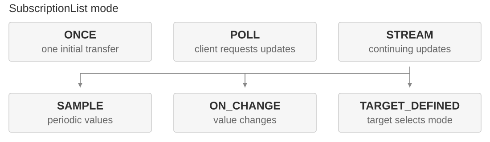

<nav class="progress" aria-label="Module progress"><span class="">QUESTION</span><span class="arrow"> → </span><span class="active">PROTOCOL</span><span class="arrow"> → </span><span class="">COLLECT</span><span class="arrow"> → </span><span class="">INTERPRET</span><span class="arrow"> → </span><span class="">ALERT</span><span class="arrow"> → </span><span class="">RESPOND</span></nav>

---
<!-- _class: content core -->
<!-- _footer: "<span class=\"footer-context\">AI5049, Hochschule Fulda</span><span class=\"footer-refs\"><a href=\"https://gnmic.openconfig.net/user_guide/subscriptions/\">gNMIc subscriptions</a></span>" -->

# Watch counters arrive through gNMI

<div class="terminal">
<div class="terminal-entry"><strong>WSL</strong><code>make enter NODE=operations01.bob1.reefnet.test</code></div>
<div class="terminal-label">Inside operations01</div>
<pre><code>export GNMIC_ADDRESS=edge01.bob1.reefnet.test:57400;
export GNMIC_USERNAME=admin GNMIC_PASSWORD=&#x27;NokiaSrl1!&#x27;;
export GNMIC_SKIP_VERIFY=true GNMIC_ENCODING=json_ietf GNMIC_TIMEOUT=10s;
IF=&#x27;/interface[name=ethernet-1/3]/statistics&#x27;;
gnmic subscribe --path &quot;$IF&quot; --stream-mode sample --sample-interval 5s;</code></pre>
</div>

**Ctrl+C** stops the subscription.

<nav class="progress" aria-label="Module progress"><span class="">QUESTION</span><span class="arrow"> → </span><span class="active">PROTOCOL</span><span class="arrow"> → </span><span class="">COLLECT</span><span class="arrow"> → </span><span class="">INTERPRET</span><span class="arrow"> → </span><span class="">ALERT</span><span class="arrow"> → </span><span class="">RESPOND</span></nav>

---
<!-- _class: visual core -->
<!-- _footer: "AI5049, Hochschule Fulda" -->

# Zero, missing or deleted

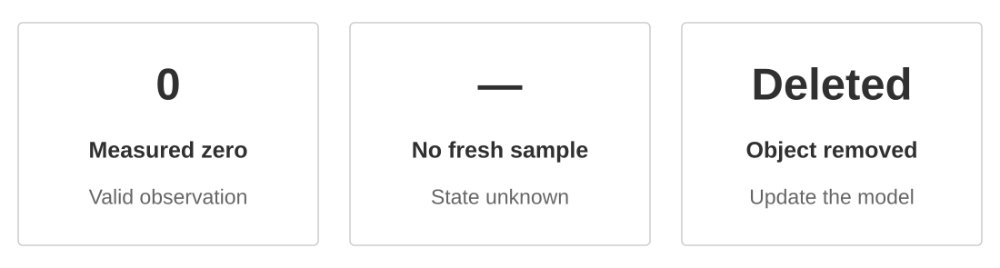

<nav class="progress" aria-label="Module progress"><span class="">QUESTION</span><span class="arrow"> → </span><span class="active">PROTOCOL</span><span class="arrow"> → </span><span class="">COLLECT</span><span class="arrow"> → </span><span class="">INTERPRET</span><span class="arrow"> → </span><span class="">ALERT</span><span class="arrow"> → </span><span class="">RESPOND</span></nav>

---
<!-- _class: visual core -->
<!-- _footer: "AI5049, Hochschule Fulda" -->

# Reconnect cannot restore lost history

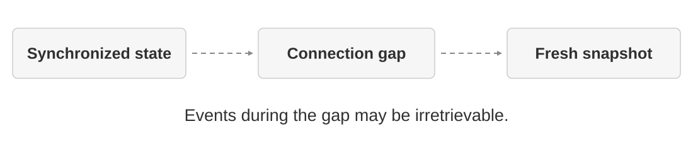

<nav class="progress" aria-label="Module progress"><span class="">QUESTION</span><span class="arrow"> → </span><span class="active">PROTOCOL</span><span class="arrow"> → </span><span class="">COLLECT</span><span class="arrow"> → </span><span class="">INTERPRET</span><span class="arrow"> → </span><span class="">ALERT</span><span class="arrow"> → </span><span class="">RESPOND</span></nav>

---
<!-- _class: visual core -->
<!-- _footer: "AI5049, Hochschule Fulda" -->

# Metrics and logs in ReefNet

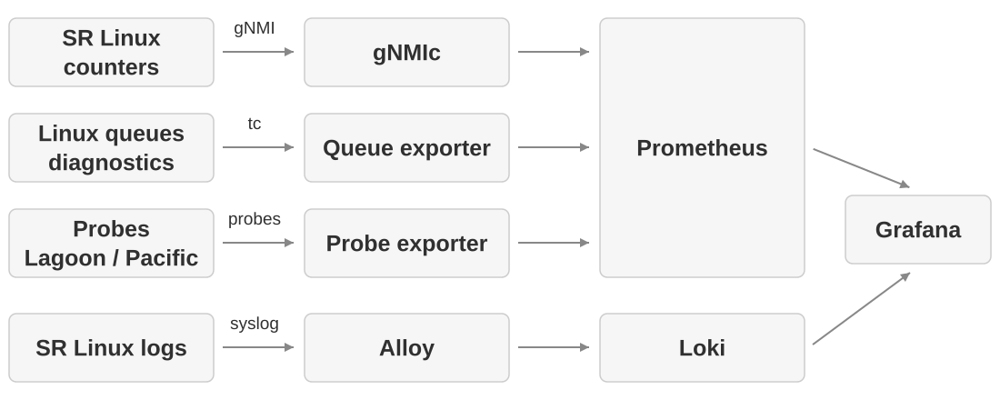

<nav class="progress" aria-label="Module progress"><span class="">QUESTION</span><span class="arrow"> → </span><span class="">PROTOCOL</span><span class="arrow"> → </span><span class="active">COLLECT</span><span class="arrow"> → </span><span class="">INTERPRET</span><span class="arrow"> → </span><span class="">ALERT</span><span class="arrow"> → </span><span class="">RESPOND</span></nav>

---
<!-- _class: content core -->
<!-- _footer: "<span class=\"footer-context\">AI5049, Hochschule Fulda</span><span class=\"footer-refs\"><a href=\"https://prometheus.io/docs/introduction/overview/\">Prometheus overview</a></span>" -->

# Prometheus ingests, Grafana shows

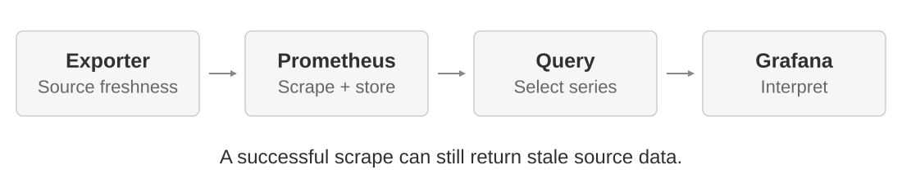

**Prometheus** (SoundCloud, 2012) collects and stores. **Grafana** draws dashboards.
Try PromQL at `http://localhost:9090`.

<nav class="progress" aria-label="Module progress"><span class="">QUESTION</span><span class="arrow"> → </span><span class="">PROTOCOL</span><span class="arrow"> → </span><span class="active">COLLECT</span><span class="arrow"> → </span><span class="">INTERPRET</span><span class="arrow"> → </span><span class="">ALERT</span><span class="arrow"> → </span><span class="">RESPOND</span></nav>

---
<!-- _class: content core -->
<!-- _footer: "<span class=\"footer-context\">AI5049, Hochschule Fulda</span><span class=\"footer-refs\"><a href=\"https://prometheus.io/docs/instrumenting/exposition_formats/\">Prometheus: exposition format</a></span>" -->

# What Prometheus fetches every second

<div class="terminal">
<div class="terminal-entry"><strong>WSL</strong><code>make enter NODE=probe01.bob1.lagoontransit.test</code></div>
<div class="terminal-label">Inside probe01</div>
<pre><code>curl -s localhost:9100/metrics | grep -e TYPE -e icmp;</code></pre>
</div>

```text
# TYPE reefnet_probe_success gauge
reefnet_probe_success{source="probe01…",probe="icmp",af="ipv4",…} 1
```

One line: **name**, **labels**, **value**. Prometheus adds the scrape time.

<nav class="progress" aria-label="Module progress"><span class="">QUESTION</span><span class="arrow"> → </span><span class="">PROTOCOL</span><span class="arrow"> → </span><span class="active">COLLECT</span><span class="arrow"> → </span><span class="">INTERPRET</span><span class="arrow"> → </span><span class="">ALERT</span><span class="arrow"> → </span><span class="">RESPOND</span></nav>

---
<!-- _class: visual core -->
<!-- _footer: "AI5049, Hochschule Fulda" -->

# Measuring and scraping run on separate clocks

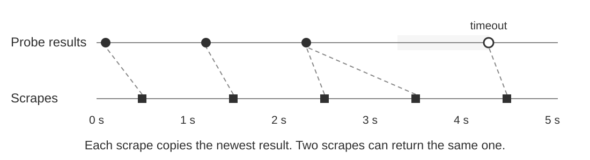

`reefnet_probe_last_run_timestamp_seconds` tells the age of the result.

<nav class="progress" aria-label="Module progress"><span class="">QUESTION</span><span class="arrow"> → </span><span class="">PROTOCOL</span><span class="arrow"> → </span><span class="active">COLLECT</span><span class="arrow"> → </span><span class="">INTERPRET</span><span class="arrow"> → </span><span class="">ALERT</span><span class="arrow"> → </span><span class="">RESPOND</span></nav>

---
<!-- _class: visual core -->
<!-- _footer: "AI5049, Hochschule Fulda" -->

# One ReefNet interface, one series

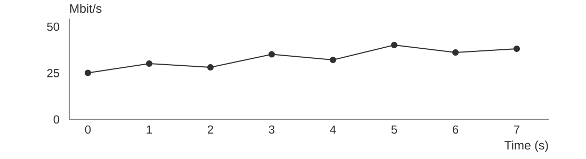

`reefnet_interface_in_octets_total{source="edge01.bob1.reefnet.test", interface_name="ethernet-1/3"}`

<nav class="progress" aria-label="Module progress"><span class="">QUESTION</span><span class="arrow"> → </span><span class="">PROTOCOL</span><span class="arrow"> → </span><span class="active">COLLECT</span><span class="arrow"> → </span><span class="">INTERPRET</span><span class="arrow"> → </span><span class="">ALERT</span><span class="arrow"> → </span><span class="">RESPOND</span></nav>

---
<!-- _class: visual core -->
<!-- _footer: "AI5049, Hochschule Fulda" -->

# Counter or gauge?

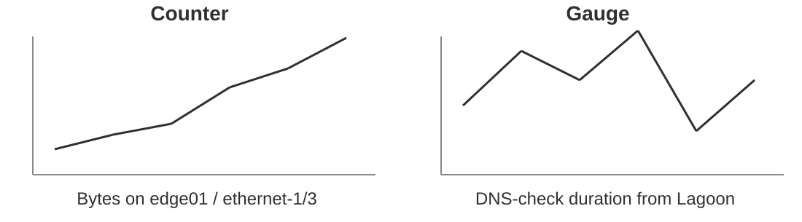

<nav class="progress" aria-label="Module progress"><span class="">QUESTION</span><span class="arrow"> → </span><span class="">PROTOCOL</span><span class="arrow"> → </span><span class="active">COLLECT</span><span class="arrow"> → </span><span class="">INTERPRET</span><span class="arrow"> → </span><span class="">ALERT</span><span class="arrow"> → </span><span class="">RESPOND</span></nav>

---
<!-- _class: visual core -->
<!-- _footer: "AI5049, Hochschule Fulda" -->

# Cardinality: count ReefNet’s series

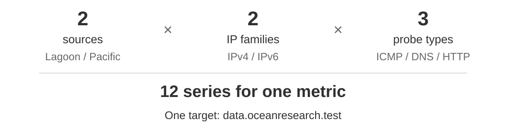

`count(reefnet_probe_success)` → **12**
Success, duration and timestamp together → **36 series**.

<nav class="progress" aria-label="Module progress"><span class="">QUESTION</span><span class="arrow"> → </span><span class="">PROTOCOL</span><span class="arrow"> → </span><span class="active">COLLECT</span><span class="arrow"> → </span><span class="">INTERPRET</span><span class="arrow"> → </span><span class="">ALERT</span><span class="arrow"> → </span><span class="">RESPOND</span></nav>

---
<!-- _class: task core -->
<!-- _footer: "<span class=\"footer-context\">AI5049, Hochschule Fulda</span><span class=\"footer-refs\"><a href=\"https://prometheus.io/docs/practices/naming/#labels\">Prometheus: metric labels</a></span>" -->

# Would you add a request ID?

A proposed change to ReefNet's probe metric:

```text
source="probe01.bob1.lagoontransit.test"
probe="icmp"
af="ipv4"
target="data.oceanresearch.test"
request_id="a-new-value-for-every-run"
```

What does `request_id` do to cardinality? Where should it go?

<nav class="progress" aria-label="Module progress"><span class="">QUESTION</span><span class="arrow"> → </span><span class="">PROTOCOL</span><span class="arrow"> → </span><span class="active">COLLECT</span><span class="arrow"> → </span><span class="">INTERPRET</span><span class="arrow"> → </span><span class="">ALERT</span><span class="arrow"> → </span><span class="">RESPOND</span></nav>

---
<!-- _class: content core -->
<!-- _footer: "AI5049, Hochschule Fulda" -->

# Choose a dashboard

| Question | BOB1 dashboard |
|---|---|
| Network status and topology | Network Overview |
| Reachability and response time | Service Health |
| Sessions, routes and updates | BGP |
| Core adjacencies and SPF activity | OSPF |
| Port state, discards and device events | Devices & Interfaces |
| Rates and utilization | Traffic & Capacity |
| Collection and freshness | Telemetry Health |

<nav class="progress" aria-label="Module progress"><span class="">QUESTION</span><span class="arrow"> → </span><span class="">PROTOCOL</span><span class="arrow"> → </span><span class="active">COLLECT</span><span class="arrow"> → </span><span class="">INTERPRET</span><span class="arrow"> → </span><span class="">ALERT</span><span class="arrow"> → </span><span class="">RESPOND</span></nav>

---
<!-- _class: visual core -->
<!-- _footer: "AI5049, Hochschule Fulda" -->

# Timestamps in the pipeline

One event, several clocks.


<nav class="progress" aria-label="Module progress"><span class="">QUESTION</span><span class="arrow"> → </span><span class="">PROTOCOL</span><span class="arrow"> → </span><span class="">COLLECT</span><span class="arrow"> → </span><span class="active">INTERPRET</span><span class="arrow"> → </span><span class="">ALERT</span><span class="arrow"> → </span><span class="">RESPOND</span></nav>

---
<!-- _class: content core -->
<!-- _footer: "AI5049, Hochschule Fulda" -->

# Turn ReefNet byte counters into bit/s

Use `in-octets` on `edge01.bob1.reefnet.test`, interface `ethernet-1/3`.

$$rate = \frac{8(C_2-C_1)}{t_2-t_1}$$

$C_1, C_2$: byte counter at the times $t_1, t_2$ in seconds. The 8 turns bytes into bits.

BOB1: `reefnet_interface_in_bps = rate(reefnet_interface_in_octets_total[10s]) * 8`

<nav class="progress" aria-label="Module progress"><span class="">QUESTION</span><span class="arrow"> → </span><span class="">PROTOCOL</span><span class="arrow"> → </span><span class="">COLLECT</span><span class="arrow"> → </span><span class="active">INTERPRET</span><span class="arrow"> → </span><span class="">ALERT</span><span class="arrow"> → </span><span class="">RESPOND</span></nav>

---
<!-- _class: content core -->
<!-- _footer: "AI5049, Hochschule Fulda" -->

# From counter to rate: Lagoon ingress

`in-octets` on `edge01.bob1.reefnet.test`, interface `ethernet-1/3`:

| Time | Byte counter | Rate since the previous sample |
|---|---:|---|
| 10:00:00 | 1,000,000 | |
| 10:00:10 | 32,250,000 | 8 × 31,250,000 / 10 s = **25 Mbit/s** |
| 10:00:20 | 20,000 | Counter went down: reset, **no rate** |
| 10:00:32 | 37,520,000 | 8 × 37,500,000 / 12 s = **25 Mbit/s** |

25 Mbit/s is **50%** of the Lagoon handoff.

<nav class="progress" aria-label="Module progress"><span class="">QUESTION</span><span class="arrow"> → </span><span class="">PROTOCOL</span><span class="arrow"> → </span><span class="">COLLECT</span><span class="arrow"> → </span><span class="active">INTERPRET</span><span class="arrow"> → </span><span class="">ALERT</span><span class="arrow"> → </span><span class="">RESPOND</span></nav>

---
<!-- _class: visual core -->
<!-- _footer: "AI5049, Hochschule Fulda" -->

# What Lagoon sees when it probes DNS


Would the **44 ms mean** explain the five long waits?

<nav class="progress" aria-label="Module progress"><span class="">QUESTION</span><span class="arrow"> → </span><span class="">PROTOCOL</span><span class="arrow"> → </span><span class="">COLLECT</span><span class="arrow"> → </span><span class="active">INTERPRET</span><span class="arrow"> → </span><span class="">ALERT</span><span class="arrow"> → </span><span class="">RESPOND</span></nav>

---
<!-- _class: content core -->
<!-- _footer: "<span class=\"footer-context\">AI5049, Hochschule Fulda</span><span class=\"footer-refs\"><a href=\"https://prometheus.io/docs/practices/histograms/\">Prometheus: histograms</a></span>" -->

# Read the distribution

| View | What it tells us |
|---|---|
| Median | Half of the checks were faster, half slower |
| p95 | 95% of the checks were at most this slow |
| Histogram | How many checks fell into each range |
| Cumulative distribution | Share of checks at or below each value |

p95 in BOB1, without histograms:
`quantile_over_time(0.95, reefnet_probe_duration_seconds{probe="dns"}[5m])`

<nav class="progress" aria-label="Module progress"><span class="">QUESTION</span><span class="arrow"> → </span><span class="">PROTOCOL</span><span class="arrow"> → </span><span class="">COLLECT</span><span class="arrow"> → </span><span class="active">INTERPRET</span><span class="arrow"> → </span><span class="">ALERT</span><span class="arrow"> → </span><span class="">RESPOND</span></nav>

---
<!-- _class: content core -->
<!-- _footer: "AI5049, Hochschule Fulda" -->

# Three ways to hide a short problem

| Hidden by | Countermeasure |
|---|---|
| Sampling too rarely | Probe more often, or count every event |
| Averaging over a long window | Shorter windows, maxima, discard counters |
| Averaging percentiles | Merge observations, then take the percentile |

<nav class="progress" aria-label="Module progress"><span class="">QUESTION</span><span class="arrow"> → </span><span class="">PROTOCOL</span><span class="arrow"> → </span><span class="">COLLECT</span><span class="arrow"> → </span><span class="active">INTERPRET</span><span class="arrow"> → </span><span class="">ALERT</span><span class="arrow"> → </span><span class="">RESPOND</span></nav>

---
<!-- _class: visual core -->
<!-- _footer: "AI5049, Hochschule Fulda" -->

# Four seconds can disappear


With a 10 s interval, a 4 s outage can fall between samples. BOB1 probes about every second and would see it.

<nav class="progress" aria-label="Module progress"><span class="">QUESTION</span><span class="arrow"> → </span><span class="">PROTOCOL</span><span class="arrow"> → </span><span class="">COLLECT</span><span class="arrow"> → </span><span class="active">INTERPRET</span><span class="arrow"> → </span><span class="">ALERT</span><span class="arrow"> → </span><span class="">RESPOND</span></nav>

---
<!-- _class: visual deep-dive -->
<!-- _footer: "<span class=\"footer-context\">AI5049, Hochschule Fulda</span><span class=\"footer-refs\"><a href=\"https://www.cisco.com/c/en/us/support/docs/switches/catalyst-9600-series-switches/220491-understand-output-drops-on-high-speed-in.html\">Cisco: bursts and output drops</a></span>" -->

# A short burst inside a long average


Check discards, not only rates.

<nav class="progress" aria-label="Module progress"><span class="">QUESTION</span><span class="arrow"> → </span><span class="">PROTOCOL</span><span class="arrow"> → </span><span class="">COLLECT</span><span class="arrow"> → </span><span class="active">INTERPRET</span><span class="arrow"> → </span><span class="">ALERT</span><span class="arrow"> → </span><span class="">RESPOND</span></nav>

---
<!-- _class: content core -->
<!-- _footer: "AI5049, Hochschule Fulda" -->

# Percentiles do not average

DNS checks: most take 20 ms, a few take 500 ms.

| | Checks | Slow | p95 |
|---|---:|---:|---:|
| Lagoon | 100 | 6 | 500 ms |
| Pacific | 100 | 0 | 20 ms |
| Average of both p95 | | | 260 ms |
| All 200 checks together | 200 | 6 = 3% | **20 ms** |

Lagoon alone: 6% slow, more than 5%, so p95 is slow.
All checks: 3% slow, less than 5%, so p95 is fast. No check took 260 ms.

<nav class="progress" aria-label="Module progress"><span class="">QUESTION</span><span class="arrow"> → </span><span class="">PROTOCOL</span><span class="arrow"> → </span><span class="">COLLECT</span><span class="arrow"> → </span><span class="active">INTERPRET</span><span class="arrow"> → </span><span class="">ALERT</span><span class="arrow"> → </span><span class="">RESPOND</span></nav>

---
<!-- _class: visual core -->
<!-- _footer: "AI5049, Hochschule Fulda" -->

# Watch the sample age


<nav class="progress" aria-label="Module progress"><span class="">QUESTION</span><span class="arrow"> → </span><span class="">PROTOCOL</span><span class="arrow"> → </span><span class="">COLLECT</span><span class="arrow"> → </span><span class="active">INTERPRET</span><span class="arrow"> → </span><span class="">ALERT</span><span class="arrow"> → </span><span class="">RESPOND</span></nav>

---
<!-- _class: content core -->
<!-- _footer: "AI5049, Hochschule Fulda" -->

# Monitor the monitoring

| Component | BOB1 check |
|---|---|
| Scrape targets | 8 targets: gNMIc, 2 probe and 5 queue exporters, all `up` = 1 |
| Probe freshness | Telemetry Health → Oldest probe sample |
| Router sources | Telemetry Health → Router sources / 5 expected |
| Queue collection | Telemetry Health → Queue collection |

```promql
up{job=~"gnmic|reefnet-service-probes|reefnet-qdisc"}
```

<nav class="progress" aria-label="Module progress"><span class="">QUESTION</span><span class="arrow"> → </span><span class="">PROTOCOL</span><span class="arrow"> → </span><span class="">COLLECT</span><span class="arrow"> → </span><span class="active">INTERPRET</span><span class="arrow"> → </span><span class="">ALERT</span><span class="arrow"> → </span><span class="">RESPOND</span></nav>

---
<!-- _class: content core -->
<!-- _footer: "<span class=\"footer-context\">AI5049, Hochschule Fulda</span><span class=\"footer-refs\"><a href=\"https://doi.org/10.1287/opre.9.3.383\">Little's law (1961)</a><a href=\"https://github.com/openconfig/reference/blob/master/rpc/gnmi/gnmi-specification.md\">gNMI specification</a></span>" -->

# Backpressure: the receiver is too slow

A stage that receives more than it can process has four choices:

| Choice | Effect | BOB1 example |
|---|---|---|
| Block | Sender slows down | gNMI: HTTP/2 flow control |
| Coalesce | Only the newest value per path | gNMI: counted in `duplicates` |
| Buffer | Delay and memory grow | Alloy retries toward Loki |
| Drop | Data is lost | Syslog over UDP |

**Little's law** (John Little, 1961): 100,000 samples/s, 30 s behind → **3 million** samples queued.

<nav class="progress" aria-label="Module progress"><span class="">QUESTION</span><span class="arrow"> → </span><span class="">PROTOCOL</span><span class="arrow"> → </span><span class="">COLLECT</span><span class="arrow"> → </span><span class="active">INTERPRET</span><span class="arrow"> → </span><span class="">ALERT</span><span class="arrow"> → </span><span class="">RESPOND</span></nav>

---
<!-- _class: visual deep-dive -->
<!-- _footer: "<span class=\"footer-context\">AI5049, Hochschule Fulda</span><span class=\"footer-refs\"><a href=\"https://paris-traceroute.net/\">Paris Traceroute paper</a></span>" -->

# Traceroute: read replies carefully


<nav class="progress" aria-label="Module progress"><span class="">QUESTION</span><span class="arrow"> → </span><span class="">PROTOCOL</span><span class="arrow"> → </span><span class="">COLLECT</span><span class="arrow"> → </span><span class="active">INTERPRET</span><span class="arrow"> → </span><span class="">ALERT</span><span class="arrow"> → </span><span class="">RESPOND</span></nav>

---
<!-- _class: content core -->
<!-- _footer: "AI5049, Hochschule Fulda" -->

# Admin state and oper state
`make fault-link` disables `ethernet-1/4` on ReefNet Edge 01:

```text
/interface[name=ethernet-1/4]/admin-state   "disable"
/interface[name=ethernet-1/4]/oper-state    "down"
```

**Admin:** configured intent. **Oper:** observed behavior.

<nav class="progress" aria-label="Module progress"><span class="">QUESTION</span><span class="arrow"> → </span><span class="">PROTOCOL</span><span class="arrow"> → </span><span class="">COLLECT</span><span class="arrow"> → </span><span class="active">INTERPRET</span><span class="arrow"> → </span><span class="">ALERT</span><span class="arrow"> → </span><span class="">RESPOND</span></nav>

---
<!-- _class: visual core -->
<!-- _footer: "AI5049, Hochschule Fulda" -->

# 60 Mbit/s offered, 50 Mbit/s delivered


The customer link has 100 Mbit/s, the Lagoon handoff only 50 Mbit/s. At 60 Mbit/s the receiver loses about one sixth.

<nav class="progress" aria-label="Module progress"><span class="">QUESTION</span><span class="arrow"> → </span><span class="">PROTOCOL</span><span class="arrow"> → </span><span class="">COLLECT</span><span class="arrow"> → </span><span class="active">INTERPRET</span><span class="arrow"> → </span><span class="">ALERT</span><span class="arrow"> → </span><span class="">RESPOND</span></nav>

---
<!-- _class: content task -->
<!-- _footer: "AI5049, Hochschule Fulda" -->

# Where do the packets go?

What happens when offered traffic exceeds the **50 Mbit/s** handoff?

In WSL:
```bash
cd ~/network-management-and-monitoring && git pull;
make monitoring;
make task;
```

**75 minutes:** compare load, received traffic and new discards.
Then try link and routing faults and a short burst.

[Exercise overview](https://github.com/Stinktopf/network-management-and-monitoring#exercises)


---
<!-- _class: content core -->
<!-- _footer: "AI5049, Hochschule Fulda" -->

# How much traffic reached the customer?

<div class="terminal">
<div class="terminal-entry"><strong>WSL</strong><code>make enter NODE=edge01.bob1.lagoontransit.test</code></div>
<div class="terminal-label">Router CLI: physical interface counters</div>
<pre><code>info from state interface ethernet-1/1 statistics</code></pre>
</div>

<div class="terminal">
<div class="terminal-entry"><strong>WSL after quit</strong><code>make enter NODE=service01.bob1.oceanresearch.test</code></div>
<div class="terminal-label">Inside the receiver: Mbit/s and loss</div>
<pre><code>tail -n 15 /tmp/iperf-server.log;</code></pre>
</div>

Compare new egress discards with receiver loss.
Then in WSL: `make traffic-10mbit;`


---
<!-- _class: content deep-dive -->
<!-- _footer: "AI5049, Hochschule Fulda" -->

# Keep the simulator out of the result

75 Mbit/s, 1,200-byte UDP datagrams:

**≈ 7,800 packets/s**, below the 10,000 packets/s that `traffic.sh` allows

The **50 Mbit/s handoff** should limit first.

<nav class="progress" aria-label="Module progress"><span class="">QUESTION</span><span class="arrow"> → </span><span class="">PROTOCOL</span><span class="arrow"> → </span><span class="">COLLECT</span><span class="arrow"> → </span><span class="active">INTERPRET</span><span class="arrow"> → </span><span class="">ALERT</span><span class="arrow"> → </span><span class="">RESPOND</span></nav>

---
<!-- _class: visual core -->
<!-- _footer: "AI5049, Hochschule Fulda" -->

# Several signals, one incident


<nav class="progress" aria-label="Module progress"><span class="">QUESTION</span><span class="arrow"> → </span><span class="">PROTOCOL</span><span class="arrow"> → </span><span class="">COLLECT</span><span class="arrow"> → </span><span class="active">INTERPRET</span><span class="arrow"> → </span><span class="">ALERT</span><span class="arrow"> → </span><span class="">RESPOND</span></nav>

---
<!-- _class: visual core -->
<!-- _footer: "AI5049, Hochschule Fulda" -->

# Rule, routing, notification


BOB1 has no Alertmanager: a rule can fire, but nobody is paged.

<nav class="progress" aria-label="Module progress"><span class="">QUESTION</span><span class="arrow"> → </span><span class="">PROTOCOL</span><span class="arrow"> → </span><span class="">COLLECT</span><span class="arrow"> → </span><span class="">INTERPRET</span><span class="arrow"> → </span><span class="active">ALERT</span><span class="arrow"> → </span><span class="">RESPOND</span></nav>

---
<!-- _class: content core -->
<!-- _footer: "<span class=\"footer-context\">AI5049, Hochschule Fulda</span><span class=\"footer-refs\"><a href=\"https://prometheus.io/docs/prometheus/latest/configuration/alerting_rules/\">Prometheus: alerting rules</a></span>" -->

# An alert rule from the lab metric

A rule on the real BOB1 metric, checked with `promtool`:

```yaml
- alert: LagoonIPv4ProbeFailed
  expr: |
    reefnet_probe_success{
      source="probe01.bob1.lagoontransit.test",
      probe="icmp", af="ipv4"
    } == 0
  for: 30s
```

This sustained-failure rule does **not** meet our 5-second detection requirement.

<nav class="progress" aria-label="Module progress"><span class="">QUESTION</span><span class="arrow"> → </span><span class="">PROTOCOL</span><span class="arrow"> → </span><span class="">COLLECT</span><span class="arrow"> → </span><span class="">INTERPRET</span><span class="arrow"> → </span><span class="active">ALERT</span><span class="arrow"> → </span><span class="">RESPOND</span></nav>

---
<!-- _class: content core -->
<!-- _footer: "<span class=\"footer-context\">AI5049, Hochschule Fulda</span><span class=\"footer-refs\"><a href=\"https://prometheus.io/docs/prometheus/latest/configuration/alerting_rules/\">Prometheus: alerting rules</a></span>" -->

# How fast can BOB1 alert?

| Step | Worst case |
|---|---:|
| Probe round with a 1 s timeout | 2 s |
| Scrape interval | 1 s |
| Rule evaluation interval | 1 s |
| `for:` duration | 0 s |
| **Until the alert fires** | **about 4 s** |

With `for: 30s`, the same alert needs up to 34 s.
An Alertmanager adds `group_wait`, by default 30 s.

<nav class="progress" aria-label="Module progress"><span class="">QUESTION</span><span class="arrow"> → </span><span class="">PROTOCOL</span><span class="arrow"> → </span><span class="">COLLECT</span><span class="arrow"> → </span><span class="">INTERPRET</span><span class="arrow"> → </span><span class="active">ALERT</span><span class="arrow"> → </span><span class="">RESPOND</span></nav>

---
<!-- _class: content core -->
<!-- _footer: "<span class=\"footer-context\">AI5049, Hochschule Fulda</span><span class=\"footer-refs\"><a href=\"https://prometheus.io/docs/prometheus/latest/querying/basics/#staleness\">Prometheus: staleness</a></span>" -->

# Alert on stale observations

```promql
time() - reefnet_probe_last_run_timestamp_seconds > 10
```
This detects old exported results, matching the 10 s UNKNOWN rule in Grafana.
Missing results need their own rules:
```promql
count(reefnet_probe_success) < 12
up{job="reefnet-service-probes"} == 0
```

<nav class="progress" aria-label="Module progress"><span class="">QUESTION</span><span class="arrow"> → </span><span class="">PROTOCOL</span><span class="arrow"> → </span><span class="">COLLECT</span><span class="arrow"> → </span><span class="">INTERPRET</span><span class="arrow"> → </span><span class="active">ALERT</span><span class="arrow"> → </span><span class="">RESPOND</span></nav>

---
<!-- _class: content core -->
<!-- _footer: "<span class=\"footer-context\">AI5049, Hochschule Fulda</span><span class=\"footer-refs\"><a href=\"https://sre.google/sre-book/monitoring-distributed-systems/\">SRE book: monitoring</a></span>" -->

# Page on symptoms, investigate causes

| | Symptom | Cause |
|---|---|---|
| Example | Lagoon IPv4 probe fails | Lagoon BGP session down, discards rise |
| Customer notices | Yes | Not directly |
| Response | Page someone now | Ticket, dashboard |

Google's SRE book: a page must be urgent, actionable and real.

<nav class="progress" aria-label="Module progress"><span class="">QUESTION</span><span class="arrow"> → </span><span class="">PROTOCOL</span><span class="arrow"> → </span><span class="">COLLECT</span><span class="arrow"> → </span><span class="">INTERPRET</span><span class="arrow"> → </span><span class="active">ALERT</span><span class="arrow"> → </span><span class="">RESPOND</span></nav>

---
<!-- _class: content core -->
<!-- _footer: "<span class=\"footer-context\">AI5049, Hochschule Fulda</span><span class=\"footer-refs\"><a href=\"https://prometheus.io/docs/alerting/latest/alertmanager/\">Alertmanager</a></span>" -->

# One fault, one notification

`make fault-link` takes core-b down. Several rules could fire.

| Mechanism | Effect |
|---|---|
| Group | Interface and OSPF alerts of edge01 arrive together |
| Inhibit | Interface down suppresses OSPF neighbor down on that link |
| Silence | Planned maintenance mutes alerts for its window |

<nav class="progress" aria-label="Module progress"><span class="">QUESTION</span><span class="arrow"> → </span><span class="">PROTOCOL</span><span class="arrow"> → </span><span class="">COLLECT</span><span class="arrow"> → </span><span class="">INTERPRET</span><span class="arrow"> → </span><span class="active">ALERT</span><span class="arrow"> → </span><span class="">RESPOND</span></nav>

---
<!-- _class: content core -->
<!-- _footer: "<span class=\"footer-context\">AI5049, Hochschule Fulda</span><span class=\"footer-refs\"><a href=\"https://sre.google/sre-book/service-level-objectives/\">Google SRE: service objectives</a></span>" -->

# SLI and SLO

**Service Level Indicator (SLI):** measured service behavior

**Service Level Objective (SLO):** target over a defined window

$$SLI=\frac{successful\ requests}{eligible\ requests}$$

BOB1, one hour:
`avg_over_time(reefnet_probe_success{source="probe01.bob1.lagoontransit.test",probe="icmp",af="ipv4"}[1h])`

<nav class="progress" aria-label="Module progress"><span class="">QUESTION</span><span class="arrow"> → </span><span class="">PROTOCOL</span><span class="arrow"> → </span><span class="">COLLECT</span><span class="arrow"> → </span><span class="">INTERPRET</span><span class="arrow"> → </span><span class="active">ALERT</span><span class="arrow"> → </span><span class="">RESPOND</span></nav>

---
<!-- _class: content core -->
<!-- _footer: "AI5049, Hochschule Fulda" -->

# SLA: the SLO in a contract

**Service Level Agreement (SLA):** promise to a customer, with consequences.
The internal SLO stays stricter.

| | Ocean Research, illustrative |
|---|---|
| Service | `data.oceanresearch.test` over IPv4 and IPv6 |
| Measured by | ReefNet probes from Lagoon and Pacific |
| Availability | 99.9% per month: about 43 minutes of downtime |
| Exclusions | Announced maintenance windows |
| Breach | Service credit |

<nav class="progress" aria-label="Module progress"><span class="">QUESTION</span><span class="arrow"> → </span><span class="">PROTOCOL</span><span class="arrow"> → </span><span class="">COLLECT</span><span class="arrow"> → </span><span class="">INTERPRET</span><span class="arrow"> → </span><span class="active">ALERT</span><span class="arrow"> → </span><span class="">RESPOND</span></nav>

---
<!-- _class: content core -->
<!-- _footer: "AI5049, Hochschule Fulda" -->

# An error budget for the Lagoon probe

IPv4 ICMP from Lagoon to Ocean Research:
**99.9% SLO across 10,000 completed checks**.

$$10000\times(1-0.999)=10\text{ allowed failures}$$

Six failures leave **four**. Report missing checks separately.

<nav class="progress" aria-label="Module progress"><span class="">QUESTION</span><span class="arrow"> → </span><span class="">PROTOCOL</span><span class="arrow"> → </span><span class="">COLLECT</span><span class="arrow"> → </span><span class="">INTERPRET</span><span class="arrow"> → </span><span class="active">ALERT</span><span class="arrow"> → </span><span class="">RESPOND</span></nav>

---
<!-- _class: content core -->
<!-- _footer: "<span class=\"footer-context\">AI5049, Hochschule Fulda</span><span class=\"footer-refs\"><a href=\"https://sre.google/workbook/alerting-on-slos/\">SRE workbook: alerting on SLOs</a></span>" -->

# Alert on the burn rate

**Burn rate** (Google SRE workbook) = observed failure rate ÷ allowed failure rate.
99.9% SLO: 0.1% allowed. Burn rate 1 uses the budget in exactly 30 days.

| Window | Burn rate | Budget used | Action |
|---|---:|---:|---|
| 1 hour | 14.4 | 2% | Page |
| 6 hours | 6 | 5% | Page |
| 3 days | 1 | 10% | Ticket |

<nav class="progress" aria-label="Module progress"><span class="">QUESTION</span><span class="arrow"> → </span><span class="">PROTOCOL</span><span class="arrow"> → </span><span class="">COLLECT</span><span class="arrow"> → </span><span class="">INTERPRET</span><span class="arrow"> → </span><span class="active">ALERT</span><span class="arrow"> → </span><span class="">RESPOND</span></nav>

---
<!-- _class: visual core -->
<!-- _footer: "AI5049, Hochschule Fulda" -->

# Detection and recovery are different clocks


<nav class="progress" aria-label="Module progress"><span class="">QUESTION</span><span class="arrow"> → </span><span class="">PROTOCOL</span><span class="arrow"> → </span><span class="">COLLECT</span><span class="arrow"> → </span><span class="">INTERPRET</span><span class="arrow"> → </span><span class="active">ALERT</span><span class="arrow"> → </span><span class="">RESPOND</span></nav>

---
<!-- _class: task core -->
<!-- _footer: "AI5049, Hochschule Fulda" -->

# Rehearse a response

Five-minute tabletop during a change:

| Vantage point | Service result |
|---|---|
| Lagoon, IPv4 | Fails |
| Pacific, IPv4 | Works |
| Lagoon, IPv6 | Works |

Name the first observation, incident owner and backout trigger.

<nav class="progress" aria-label="Module progress"><span class="">QUESTION</span><span class="arrow"> → </span><span class="">PROTOCOL</span><span class="arrow"> → </span><span class="">COLLECT</span><span class="arrow"> → </span><span class="">INTERPRET</span><span class="arrow"> → </span><span class="">ALERT</span><span class="arrow"> → </span><span class="active">RESPOND</span></nav>

---
<!-- _class: task core -->
<!-- _footer: "AI5049, Hochschule Fulda" -->

# Did we meet the requirements?

| Requirement | Test |
|---|---|
| Detect 5 s interruptions | Vary onset phase |
| ≤ 20 requests/s | Count requests and retries |
| Unknown within 10 s | Stop a probe exporter, watch Service Health |
| Useful diagnosis | Compare route loss and drops |

<nav class="progress" aria-label="Module progress"><span class="">QUESTION</span><span class="arrow"> → </span><span class="">PROTOCOL</span><span class="arrow"> → </span><span class="">COLLECT</span><span class="arrow"> → </span><span class="">INTERPRET</span><span class="arrow"> → </span><span class="">ALERT</span><span class="arrow"> → </span><span class="active">RESPOND</span></nav>

---
<!-- _class: content task -->
<!-- _footer: "AI5049, Hochschule Fulda" -->

# Task: the RFO, now with monitoring

13 October: Lagoon IPv4 lost `198.51.100.0/24` through `BLOCK-CUSTOMER-V4`.
Rewrite the RFO with today's evidence:

| Record | Add from monitoring |
|---|---|
| Impact | Duration, address family and vantage point from the probes |
| Detection | Which signal showed it first, after how many seconds |
| Root cause | Why the change was not caught |
| Prevention | The alert rule that would have paged |

**15 minutes** in pairs. Then stop the lab: `make traffic-stop; make down;`

---
<!-- _class: day research -->
<!-- _footer: "AI5049, Hochschule Fulda" -->

# 30 October 2026

## Research questions and sources

Find a topic worth investigating.

Today: explore the literature and develop **your own project idea**.

<nav class="progress" aria-label="Module progress"><span class="active">QUESTION</span><span class="arrow"> → </span><span class="">RELATED WORK</span><span class="arrow"> → </span><span class="">DESIGN</span><span class="arrow"> → </span><span class="">ANALYSIS</span><span class="arrow"> → </span><span class="">ARGUMENT</span><span class="arrow"> → </span><span class="">REVIEW</span><span class="arrow"> → </span><span class="">PUBLISH</span></nav>

---
<!-- _class: content research -->
<!-- _footer: "AI5049, Hochschule Fulda" -->

# Today: plan and working times

| Time | Activity |
|---|---|
| 13:45–14:45 | Research questions and evidence |
| 15:00–16:15 | Finding and reading relevant work |
| 16:30–18:00 | Independent topic exploration |
| 18:00–18:30 | Discuss proposals and next steps |
| 18:30–18:45 | Closing discussion |

**Breaks:** 14:45–15:00 and 16:15–16:30.

<nav class="progress" aria-label="Module progress"><span class="active">QUESTION</span><span class="arrow"> → </span><span class="">RELATED WORK</span><span class="arrow"> → </span><span class="">DESIGN</span><span class="arrow"> → </span><span class="">ANALYSIS</span><span class="arrow"> → </span><span class="">ARGUMENT</span><span class="arrow"> → </span><span class="">REVIEW</span><span class="arrow"> → </span><span class="">PUBLISH</span></nav>

---
<!-- _class: visual research -->
<!-- _footer: "AI5049, Hochschule Fulda" -->

# One project, six research workshops


From a research question to a paper others can assess.

<nav class="progress" aria-label="Module progress"><span class="active">QUESTION</span><span class="arrow"> → </span><span class="">RELATED WORK</span><span class="arrow"> → </span><span class="">DESIGN</span><span class="arrow"> → </span><span class="">ANALYSIS</span><span class="arrow"> → </span><span class="">ARGUMENT</span><span class="arrow"> → </span><span class="">REVIEW</span><span class="arrow"> → </span><span class="">PUBLISH</span></nav>

---
<!-- _class: content research -->
<!-- _footer: "<span class=\"footer-context\">AI5049, Hochschule Fulda</span><span class=\"footer-refs\"><a href=\"https://mitcommlab.mit.edu/eecs/commkit/thesis-proposal/\">MIT: research proposals</a></span>" -->

# What will your work let someone know?

**An artifact is what you build. A contribution is what others learn.**

| Starting point | Possible contribution |
|---|---|
| A working dashboard | Evidence about which signals detect a failure |
| A new algorithm | A justified advantage under stated conditions |
| A repeated experiment | Evidence about where an earlier result holds |


<nav class="progress" aria-label="Module progress"><span class="active">QUESTION</span><span class="arrow"> → </span><span class="">RELATED WORK</span><span class="arrow"> → </span><span class="">DESIGN</span><span class="arrow"> → </span><span class="">ANALYSIS</span><span class="arrow"> → </span><span class="">ARGUMENT</span><span class="arrow"> → </span><span class="">REVIEW</span><span class="arrow"> → </span><span class="">PUBLISH</span></nav>

---
<!-- _class: visual research -->
<!-- _footer: "<span class=\"footer-context\">AI5049, Hochschule Fulda</span><span class=\"footer-refs\"><a href=\"https://plato.stanford.edu/entries/popper/\">Popper, Stanford Encyclopedia of Philosophy</a></span>" -->

# The empirical cycle


One route through empirical research. Exploratory work can develop hypotheses.
Confirmatory work tests predictions specified before examining the test results.

<nav class="progress" aria-label="Module progress"><span class="active">QUESTION</span><span class="arrow"> → </span><span class="">RELATED WORK</span><span class="arrow"> → </span><span class="">DESIGN</span><span class="arrow"> → </span><span class="">ANALYSIS</span><span class="arrow"> → </span><span class="">ARGUMENT</span><span class="arrow"> → </span><span class="">REVIEW</span><span class="arrow"> → </span><span class="">PUBLISH</span></nav>

---
<!-- _class: content research -->
<!-- _footer: "AI5049, Hochschule Fulda" -->

# Different questions need different evidence

| Purpose | Network-management question |
|---|---|
| Describe | How often do BGP sessions fail on these routers? |
| Explain | Why do operators override automated repairs? |
| Estimate an effect | Does a checker reduce unsafe configuration changes? |
| Predict | Can recent traffic predict next-minute link load? |

<nav class="progress" aria-label="Module progress"><span class="active">QUESTION</span><span class="arrow"> → </span><span class="">RELATED WORK</span><span class="arrow"> → </span><span class="">DESIGN</span><span class="arrow"> → </span><span class="">ANALYSIS</span><span class="arrow"> → </span><span class="">ARGUMENT</span><span class="arrow"> → </span><span class="">REVIEW</span><span class="arrow"> → </span><span class="">PUBLISH</span></nav>

---
<!-- _class: content research -->
<!-- _footer: "AI5049, Hochschule Fulda" -->

# Design, comparison and synthesis

| Purpose | Example in our field |
|---|---|
| Design and evaluate | Can a repair tool enforce a stated safety constraint? |
| Compare | Which detector works best at the same resource budget? |
| Synthesize evidence | Which failure classes have published studies covered? |


<nav class="progress" aria-label="Module progress"><span class="active">QUESTION</span><span class="arrow"> → </span><span class="">RELATED WORK</span><span class="arrow"> → </span><span class="">DESIGN</span><span class="arrow"> → </span><span class="">ANALYSIS</span><span class="arrow"> → </span><span class="">ARGUMENT</span><span class="arrow"> → </span><span class="">REVIEW</span><span class="arrow"> → </span><span class="">PUBLISH</span></nav>

---
<!-- _class: visual research -->
<!-- _footer: "<span class=\"footer-context\">AI5049, Hochschule Fulda</span><span class=\"footer-refs\"><a href=\"https://advice.writing.utoronto.ca/types-of-writing/literature-review/\">Toronto: literature reviews</a></span>" -->

# Turn an interest into a researchable question


Literature shows what is known and which questions remain open.

<nav class="progress" aria-label="Module progress"><span class="active">QUESTION</span><span class="arrow"> → </span><span class="">RELATED WORK</span><span class="arrow"> → </span><span class="">DESIGN</span><span class="arrow"> → </span><span class="">ANALYSIS</span><span class="arrow"> → </span><span class="">ARGUMENT</span><span class="arrow"> → </span><span class="">REVIEW</span><span class="arrow"> → </span><span class="">PUBLISH</span></nav>

---
<!-- _class: content research -->
<!-- _footer: "<span class=\"footer-context\">AI5049, Hochschule Fulda</span><span class=\"footer-refs\"><a href=\"https://psychology.nottingham.ac.uk/staff/lpztb1/Teaching/C82MST/Popper%20%281963%29%20Science-Conjectures%20and%20refutations.pdf\">Popper: Conjectures and Refutations (1963)</a></span>" -->

# Popper: a claim must risk being wrong

**Falsifiable:** a possible observation could contradict the claim.
Karl Popper made this central to his critical rationalism.

Example claim: **“The checker blocks every unsafe repair.”**

<div class="paired-notes">
<div><h2>100 successful tests</h2><p>The claim survives these tests. They do not prove that it holds for every possible repair.</p></div>
<div><h2>One genuine counterexample</h2><p>An unsafe repair passes the checker. That contradicts the claim as stated.</p></div>
</div>

Falsifiable means testable, not already false.

<nav class="progress" aria-label="Module progress"><span class="active">QUESTION</span><span class="arrow"> → </span><span class="">RELATED WORK</span><span class="arrow"> → </span><span class="">DESIGN</span><span class="arrow"> → </span><span class="">ANALYSIS</span><span class="arrow"> → </span><span class="">ARGUMENT</span><span class="arrow"> → </span><span class="">REVIEW</span><span class="arrow"> → </span><span class="">PUBLISH</span></nav>

---
<!-- _class: content research -->
<!-- _footer: "AI5049, Hochschule Fulda" -->

# A question becomes a testable prediction

**Question:** Does independent verification reduce unsafe repairs?

**Hypothesis:** A separate checker catches errors that the repair planner misses.

**Prediction:** On matched fault cases, the checker reduces violations of the safety constraint.

Checking may also delay recovery or reject a valid repair.

<nav class="progress" aria-label="Module progress"><span class="active">QUESTION</span><span class="arrow"> → </span><span class="">RELATED WORK</span><span class="arrow"> → </span><span class="">DESIGN</span><span class="arrow"> → </span><span class="">ANALYSIS</span><span class="arrow"> → </span><span class="">ARGUMENT</span><span class="arrow"> → </span><span class="">REVIEW</span><span class="arrow"> → </span><span class="">PUBLISH</span></nav>

---
<!-- _class: content research -->
<!-- _footer: "<span class=\"footer-context\">AI5049, Hochschule Fulda</span><span class=\"footer-refs\"><a href=\"https://plato.stanford.edu/entries/popper/#BasiStatFalsConv\">Stanford Encyclopedia: Popper, §4</a></span>" -->

# A failed prediction also tests our assumptions

Suppose adding the checker does not reduce unsafe repairs.

| What may have failed? | Possible explanation |
|---|---|
| Hypothesis | It does not catch the planner’s errors |
| Implementation | The checker was never actually enabled |
| Measurement | The safety test missed the violations |

Each explanation needs evidence. Ad hoc excuses shield a claim from criticism.

<nav class="progress" aria-label="Module progress"><span class="active">QUESTION</span><span class="arrow"> → </span><span class="">RELATED WORK</span><span class="arrow"> → </span><span class="">DESIGN</span><span class="arrow"> → </span><span class="">ANALYSIS</span><span class="arrow"> → </span><span class="">ARGUMENT</span><span class="arrow"> → </span><span class="">REVIEW</span><span class="arrow"> → </span><span class="">PUBLISH</span></nav>

---
<!-- _class: content research -->
<!-- _footer: "AI5049, Hochschule Fulda" -->

# Exploration and confirmation

<div class="paired-notes">
<div><h2>Explore</h2><p>Find patterns, develop explanations and refine measures.</p></div>
<div><h2>Confirm</h2><p>Test a stated prediction on evidence not used to invent it.</p></div>
</div>

An explanation developed from the results is exploratory until tested on fresh evidence.


<nav class="progress" aria-label="Module progress"><span class="active">QUESTION</span><span class="arrow"> → </span><span class="">RELATED WORK</span><span class="arrow"> → </span><span class="">DESIGN</span><span class="arrow"> → </span><span class="">ANALYSIS</span><span class="arrow"> → </span><span class="">ARGUMENT</span><span class="arrow"> → </span><span class="">REVIEW</span><span class="arrow"> → </span><span class="">PUBLISH</span></nav>

---
<!-- _class: task research -->
<!-- _footer: "AI5049, Hochschule Fulda" -->

# Task: make the question answerable

> “AI makes administration better.”

**Eight minutes, in pairs:** specify the task, comparator and conditions.
Define “better” with one primary outcome and one possible cost.

Exchange questions. Identify one result that would change your partner's conclusion.

<nav class="progress" aria-label="Module progress"><span class="active">QUESTION</span><span class="arrow"> → </span><span class="">RELATED WORK</span><span class="arrow"> → </span><span class="">DESIGN</span><span class="arrow"> → </span><span class="">ANALYSIS</span><span class="arrow"> → </span><span class="">ARGUMENT</span><span class="arrow"> → </span><span class="">REVIEW</span><span class="arrow"> → </span><span class="">PUBLISH</span></nav>

---
<!-- _class: content research -->
<!-- _footer: "AI5049, Hochschule Fulda" -->

# Example: repair a blocked customer route

**Can AI restore the customer route faster?**

| Study decision | Concrete test |
|---|---|
| Fault | A wrong BGP export policy blocks the customer route |
| Comparison | AI assistant versus a fixed repair script |
| Conditions | Same faults, initial configuration and tool access |
| Main outcome | Time until an external IPv4 ping succeeds |
| Also check | Failed repairs and unintended configuration changes |

<nav class="progress" aria-label="Module progress"><span class="active">QUESTION</span><span class="arrow"> → </span><span class="">RELATED WORK</span><span class="arrow"> → </span><span class="">DESIGN</span><span class="arrow"> → </span><span class="">ANALYSIS</span><span class="arrow"> → </span><span class="">ARGUMENT</span><span class="arrow"> → </span><span class="">REVIEW</span><span class="arrow"> → </span><span class="">PUBLISH</span></nav>

---
<!-- _class: visual research -->
<!-- _footer: "AI5049, Hochschule Fulda" -->

# What makes a scientific argument?


<nav class="progress" aria-label="Module progress"><span class="active">QUESTION</span><span class="arrow"> → </span><span class="">RELATED WORK</span><span class="arrow"> → </span><span class="">DESIGN</span><span class="arrow"> → </span><span class="">ANALYSIS</span><span class="arrow"> → </span><span class="">ARGUMENT</span><span class="arrow"> → </span><span class="">REVIEW</span><span class="arrow"> → </span><span class="">PUBLISH</span></nav>

---
<!-- _class: content research -->
<!-- _footer: "AI5049, Hochschule Fulda" -->

# Choose a research approach

| Approach | Evidence for the answer |
|---|---|
| Empirical study | Measurements, observations or participant accounts |
| Design and evaluate | An artifact tested against justified requirements |
| Formal analysis | A derivation or proof under stated assumptions |


<nav class="progress" aria-label="Module progress"><span class="active">QUESTION</span><span class="arrow"> → </span><span class="">RELATED WORK</span><span class="arrow"> → </span><span class="">DESIGN</span><span class="arrow"> → </span><span class="">ANALYSIS</span><span class="arrow"> → </span><span class="">ARGUMENT</span><span class="arrow"> → </span><span class="">REVIEW</span><span class="arrow"> → </span><span class="">PUBLISH</span></nav>

---
<!-- _class: visual research -->
<!-- _footer: "<span class=\"footer-context\">AI5049, Hochschule Fulda</span><span class=\"footer-refs\"><a href=\"https://advice.writing.utoronto.ca/types-of-writing/literature-review/\">Toronto: literature reviews</a></span>" -->

# From reading to a research question


**Synthesis:** what do the studies establish together?

<nav class="progress" aria-label="Module progress"><span class="">QUESTION</span><span class="arrow"> → </span><span class="active">RELATED WORK</span><span class="arrow"> → </span><span class="">DESIGN</span><span class="arrow"> → </span><span class="">ANALYSIS</span><span class="arrow"> → </span><span class="">ARGUMENT</span><span class="arrow"> → </span><span class="">REVIEW</span><span class="arrow"> → </span><span class="">PUBLISH</span></nav>

---
<!-- _class: content research -->
<!-- _footer: "<span class=\"footer-context\">AI5049, Hochschule Fulda</span><span class=\"footer-refs\"><a href=\"https://scholar.google.com/intl/en/scholar/help.html\">Scholar: coverage</a><a href=\"https://www.elsevier.com/products/scopus/content\">Scopus: coverage</a></span>" -->

# Where to find scholarly work

| Resource | Use it for |
|---|---|
| Google Scholar | Broad discovery and citation trails |
| Scopus / Web of Science | Structured searches and citation indexes |
| ACM DL / IEEE Xplore / USENIX | Published papers and proceedings |
| DBLP | Computing publication records |
| arXiv / institutional repositories | Preprints and accessible manuscripts |

Check publication status and version. Database access may need a library login.

<nav class="progress" aria-label="Module progress"><span class="">QUESTION</span><span class="arrow"> → </span><span class="active">RELATED WORK</span><span class="arrow"> → </span><span class="">DESIGN</span><span class="arrow"> → </span><span class="">ANALYSIS</span><span class="arrow"> → </span><span class="">ARGUMENT</span><span class="arrow"> → </span><span class="">REVIEW</span><span class="arrow"> → </span><span class="">PUBLISH</span></nav>

---
<!-- _class: content research -->
<!-- _footer: "AI5049, Hochschule Fulda" -->

# Build a search you can explain

Example: independent verification in automated repair.

```text
("network repair" OR "network troubleshooting")
AND (verification OR validation OR safety)
```

Database syntax and terminology differ.

A search record contains **database, query, date and selection criteria**.

<nav class="progress" aria-label="Module progress"><span class="">QUESTION</span><span class="arrow"> → </span><span class="active">RELATED WORK</span><span class="arrow"> → </span><span class="">DESIGN</span><span class="arrow"> → </span><span class="">ANALYSIS</span><span class="arrow"> → </span><span class="">ARGUMENT</span><span class="arrow"> → </span><span class="">REVIEW</span><span class="arrow"> → </span><span class="">PUBLISH</span></nav>

---
<!-- _class: content core -->
<!-- _footer: "AI5049, Hochschule Fulda" -->

# Research venues close to this course

| Venue | Typical contribution |
|---|---|
| [IEEE/IFIP NOMS](https://www.comsoc.org/conferences-events/ieeeifip-network-operations-and-management-symposium-2026) | operating, managing and automating networks |
| [CNSM](https://www.cnsm-conf.org/2026/about.html) | management systems, telemetry and orchestration |
| [ACM IMC](https://conferences.sigcomm.org/imc/2026/cfp/) | measuring and understanding Internet behavior |
| [IEEE TNSM](https://www.comsoc.org/publications/journals/ieee-transactions-network-and-service-management) | journal research on network and service management |

<nav class="progress" aria-label="Module progress"><span class="">QUESTION</span><span class="arrow"> → </span><span class="active">RELATED WORK</span><span class="arrow"> → </span><span class="">DESIGN</span><span class="arrow"> → </span><span class="">ANALYSIS</span><span class="arrow"> → </span><span class="">ARGUMENT</span><span class="arrow"> → </span><span class="">REVIEW</span><span class="arrow"> → </span><span class="">PUBLISH</span></nav>

---
<!-- _class: content research -->
<!-- _footer: "<span class=\"footer-context\">AI5049, Hochschule Fulda</span><span class=\"footer-refs\"><a href=\"https://conferences.sigcomm.org/sigcomm/2026/cfp/\">SIGCOMM</a><a href=\"https://www.usenix.org/conference/nsdi27/call-for-papers\">NSDI</a></span>" -->

# The wider networking research community

| Venue | Typical focus |
|---|---|
| [ACM SIGCOMM](https://www.sigcomm.org/events/sigcomm-conference) | Network architectures, mechanisms and systems |
| [USENIX NSDI](https://www.usenix.org/conferences/byname/178) | Design and practical evaluation of networked systems |
| [IEEE INFOCOM](https://www.comsoc.org/conferences-events/ieee-international-conference-computer-communications-2026) | Networking protocols, algorithms and performance |
| [ACM CoNEXT](https://www.sigcomm.org/events/conext-conference) | Emerging networking technologies and systems |
| [IEEE Transactions on Networking](https://www.comsoc.org/publications/journals/ieee-tnet) | Journal research across networking |


<nav class="progress" aria-label="Module progress"><span class="">QUESTION</span><span class="arrow"> → </span><span class="active">RELATED WORK</span><span class="arrow"> → </span><span class="">DESIGN</span><span class="arrow"> → </span><span class="">ANALYSIS</span><span class="arrow"> → </span><span class="">ARGUMENT</span><span class="arrow"> → </span><span class="">REVIEW</span><span class="arrow"> → </span><span class="">PUBLISH</span></nav>

---
<!-- _class: content core -->
<!-- _footer: "AI5049, Hochschule Fulda" -->

# Who develops Internet technology?

**[IETF](https://www.ietf.org/about/introduction/)**\
Working Groups engineer interoperable Internet protocols and standards.

**[IRTF](https://www.irtf.org/)**\
Research Groups study long-term questions about Internet technology.


<nav class="progress" aria-label="Module progress"><span class="">QUESTION</span><span class="arrow"> → </span><span class="active">RELATED WORK</span><span class="arrow"> → </span><span class="">DESIGN</span><span class="arrow"> → </span><span class="">ANALYSIS</span><span class="arrow"> → </span><span class="">ARGUMENT</span><span class="arrow"> → </span><span class="">REVIEW</span><span class="arrow"> → </span><span class="">PUBLISH</span></nav>

---
<!-- _class: content core -->
<!-- _footer: "AI5049, Hochschule Fulda" -->

# Where do operators compare notes?

**[RIPE Meetings](https://www.ripe.net/community/)**\
Routing, addressing, measurement and Internet coordination

**[DENOG](https://www.denog.de/) and [NANOG](https://nanog.org/)**\
Backbone operations, routing, peering and incidents

**[NAF and AutoCon](https://networkautomation.forum/)**\
Network automation, orchestration and operational tooling


<nav class="progress" aria-label="Module progress"><span class="">QUESTION</span><span class="arrow"> → </span><span class="active">RELATED WORK</span><span class="arrow"> → </span><span class="">DESIGN</span><span class="arrow"> → </span><span class="">ANALYSIS</span><span class="arrow"> → </span><span class="">ARGUMENT</span><span class="arrow"> → </span><span class="">REVIEW</span><span class="arrow"> → </span><span class="">PUBLISH</span></nav>

---
<!-- _class: content research -->
<!-- _footer: "AI5049, Hochschule Fulda" -->

# Match the source to the claim

| Claim | Evidence source |
|---|---|
| Required protocol behavior | Specification and exact section |
| Implemented feature | Versioned code or official documentation |
| Measured improvement | Paper and evaluation data |
| Production failure | Attributed operator report |

An RFC’s status, updates and errata determine how its requirements should be read.

<nav class="progress" aria-label="Module progress"><span class="">QUESTION</span><span class="arrow"> → </span><span class="active">RELATED WORK</span><span class="arrow"> → </span><span class="">DESIGN</span><span class="arrow"> → </span><span class="">ANALYSIS</span><span class="arrow"> → </span><span class="">ARGUMENT</span><span class="arrow"> → </span><span class="">REVIEW</span><span class="arrow"> → </span><span class="">PUBLISH</span></nav>

---
<!-- _class: content research -->
<!-- _footer: "AI5049, Hochschule Fulda" -->

# Venue reputation does not validate a result

<div class="paired-notes">
<div><h2>The venue</h2><p>Official proceedings, relevant scope, identifiable organizers and a clear review process.</p></div>
<div><h2>The paper</h2><p>Sound methods, appropriate comparisons and conclusions supported by the data.</p></div>
</div>

A reputable venue is a useful filter, not a quality guarantee.

<nav class="progress" aria-label="Module progress"><span class="">QUESTION</span><span class="arrow"> → </span><span class="active">RELATED WORK</span><span class="arrow"> → </span><span class="">DESIGN</span><span class="arrow"> → </span><span class="">ANALYSIS</span><span class="arrow"> → </span><span class="">ARGUMENT</span><span class="arrow"> → </span><span class="">REVIEW</span><span class="arrow"> → </span><span class="">PUBLISH</span></nav>

---
<!-- _class: content research -->
<!-- _footer: "<span class=\"footer-context\">AI5049, Hochschule Fulda</span><span class=\"footer-refs\"><a href=\"https://scholar.google.com/intl/en/scholar/help.html\">Google Scholar: citation search</a></span>" -->

# Snowballing: follow the citations

Start with a paper that fits your question. Search in **both directions**.


Stop after a full round finds no new eligible papers. Record each round.

<nav class="progress" aria-label="Module progress"><span class="">QUESTION</span><span class="arrow"> → </span><span class="active">RELATED WORK</span><span class="arrow"> → </span><span class="">DESIGN</span><span class="arrow"> → </span><span class="">ANALYSIS</span><span class="arrow"> → </span><span class="">ARGUMENT</span><span class="arrow"> → </span><span class="">REVIEW</span><span class="arrow"> → </span><span class="">PUBLISH</span></nav>

---
<!-- _class: content research -->
<!-- _footer: "<span class=\"footer-context\">AI5049, Hochschule Fulda</span><span class=\"footer-refs\"><a href=\"https://advice.writing.utoronto.ca/types-of-writing/literature-review/\">Toronto: literature reviews</a><a href=\"https://jbi-global-wiki.refined.site/space/MANUAL/355862599/10.1.3%2BThe%2Bpurpose%2Bof%2Bscoping%2Breviews\">JBI: scoping reviews</a></span>" -->

# Recognize the reviews you read

| Purpose | Suitable review |
|---|---|
| Explain a debate or position a study | Narrative / critical review |
| Map concepts, methods and evidence coverage | Scoping review |
| Answer a focused question with explicit selection | Systematic review |

Use these sources to build your **Related Work**. A literature review alone does not meet this course’s project requirements.

<nav class="progress" aria-label="Module progress"><span class="">QUESTION</span><span class="arrow"> → </span><span class="active">RELATED WORK</span><span class="arrow"> → </span><span class="">DESIGN</span><span class="arrow"> → </span><span class="">ANALYSIS</span><span class="arrow"> → </span><span class="">ARGUMENT</span><span class="arrow"> → </span><span class="">REVIEW</span><span class="arrow"> → </span><span class="">PUBLISH</span></nav>

---
<!-- _class: content research -->
<!-- _footer: "<span class=\"footer-context\">AI5049, Hochschule Fulda</span><span class=\"footer-refs\"><a href=\"https://jbi-global-wiki.refined.site/space/MANUAL/355862599/10.1.3%2BThe%2Bpurpose%2Bof%2Bscoping%2Breviews\">JBI: scoping reviews</a><a href=\"https://www.prisma-statement.org/scoping\">PRISMA-ScR</a></span>" -->

# A scoping review maps what has been studied

Example: **How have automated repairs been evaluated?**

| Part of the review | In this example |
|---|---|
| Scope (PCC) | Population: network repair systems<br>Concept: evaluation methods<br>Context: operational settings |
| Selection | Protocol, eligibility rules, search and screening |
| Evidence chart | Fault classes, methods, datasets and outcomes |

The result is a map of coverage. Sparse coverage does not show that a method fails.
Critical appraisal depends on the review objective.

<nav class="progress" aria-label="Module progress"><span class="">QUESTION</span><span class="arrow"> → </span><span class="active">RELATED WORK</span><span class="arrow"> → </span><span class="">DESIGN</span><span class="arrow"> → </span><span class="">ANALYSIS</span><span class="arrow"> → </span><span class="">ARGUMENT</span><span class="arrow"> → </span><span class="">REVIEW</span><span class="arrow"> → </span><span class="">PUBLISH</span></nav>

---
<!-- _class: content research -->
<!-- _footer: "<span class=\"footer-context\">AI5049, Hochschule Fulda</span><span class=\"footer-refs\"><a href=\"https://www.cochrane.org/authors/handbooks-and-manuals/handbook/current/chapter-03\">Cochrane: review protocol</a><a href=\"https://www.cochrane.org/authors/handbooks-and-manuals/handbook/current/chapter-04\">Study selection</a></span>" -->

# Systematic review: answer a focused question

**Does verification reduce unsafe repairs compared with no verification?**

<div class="paired-notes">
<div><h2>Plan and select</h2><p>Specify question, eligibility and synthesis in a protocol. Document searches and exclusions.</p></div>
<div><h2>Check and synthesize</h2><p>Screen independently and resolve disagreements. Check extracted outcomes and assess risk of bias.</p></div>
</div>


<nav class="progress" aria-label="Module progress"><span class="">QUESTION</span><span class="arrow"> → </span><span class="active">RELATED WORK</span><span class="arrow"> → </span><span class="">DESIGN</span><span class="arrow"> → </span><span class="">ANALYSIS</span><span class="arrow"> → </span><span class="">ARGUMENT</span><span class="arrow"> → </span><span class="">REVIEW</span><span class="arrow"> → </span><span class="">PUBLISH</span></nav>

---
<!-- _class: visual research -->
<!-- _footer: "<span class=\"footer-context\">AI5049, Hochschule Fulda</span><span class=\"footer-refs\"><a href=\"https://www.prisma-statement.org/prisma-2020\">PRISMA 2020</a><a href=\"https://www.prisma-statement.org/scoping\">PRISMA-ScR</a></span>" -->

# Make the selection process visible


One study may produce several papers. Link them to avoid counting the evidence twice.

<nav class="progress" aria-label="Module progress"><span class="">QUESTION</span><span class="arrow"> → </span><span class="active">RELATED WORK</span><span class="arrow"> → </span><span class="">DESIGN</span><span class="arrow"> → </span><span class="">ANALYSIS</span><span class="arrow"> → </span><span class="">ARGUMENT</span><span class="arrow"> → </span><span class="">REVIEW</span><span class="arrow"> → </span><span class="">PUBLISH</span></nav>

---
<!-- _class: content research -->
<!-- _footer: "<span class=\"footer-context\">AI5049, Hochschule Fulda</span><span class=\"footer-refs\"><a href=\"https://www.prisma-statement.org/prisma-2020\">PRISMA 2020</a><a href=\"https://www.prisma-statement.org/scoping\">PRISMA-ScR</a></span>" -->

# PRISMA describes reporting

**PRISMA 2020:** reporting systematic reviews.
**PRISMA-ScR:** reporting scoping reviews.

The checklist makes decisions visible. It does not replace a review method or certify quality.


<nav class="progress" aria-label="Module progress"><span class="">QUESTION</span><span class="arrow"> → </span><span class="active">RELATED WORK</span><span class="arrow"> → </span><span class="">DESIGN</span><span class="arrow"> → </span><span class="">ANALYSIS</span><span class="arrow"> → </span><span class="">ARGUMENT</span><span class="arrow"> → </span><span class="">REVIEW</span><span class="arrow"> → </span><span class="">PUBLISH</span></nav>

---
<!-- _class: content research -->
<!-- _footer: "<span class=\"footer-context\">AI5049, Hochschule Fulda</span><span class=\"footer-refs\"><a href=\"https://www.cochrane.org/authors/handbooks-and-manuals/handbook/current/chapter-10\">Cochrane: meta-analysis</a></span>" -->

# Meta-analysis is a synthesis technique

It combines effect estimates from separate studies statistically.

Pooling needs compatible questions, outcomes and comparisons.
Uncertainty, dependence and bias affect the combined estimate.

**A systematic review can be valuable without a meta-analysis.**
Percentages relative to unrelated baselines are not a common effect measure.

<nav class="progress" aria-label="Module progress"><span class="">QUESTION</span><span class="arrow"> → </span><span class="active">RELATED WORK</span><span class="arrow"> → </span><span class="">DESIGN</span><span class="arrow"> → </span><span class="">ANALYSIS</span><span class="arrow"> → </span><span class="">ARGUMENT</span><span class="arrow"> → </span><span class="">REVIEW</span><span class="arrow"> → </span><span class="">PUBLISH</span></nav>

---
<!-- _class: task research -->
<!-- _footer: "AI5049, Hochschule Fulda" -->

# Check: which review answers the question?

**One minute:** match each question to a review approach. Explain your choice.

| Question | Needed answer |
|---|---|
| How is automated repair evaluated? | A map of methods and evidence |
| Does verification prevent unsafe repair? | Assessment of effects and evidence quality |
| Why do safety definitions differ? | Interpretation of concepts and disagreements |

Would pooling numerical results answer all three?

<nav class="progress" aria-label="Module progress"><span class="">QUESTION</span><span class="arrow"> → </span><span class="active">RELATED WORK</span><span class="arrow"> → </span><span class="">DESIGN</span><span class="arrow"> → </span><span class="">ANALYSIS</span><span class="arrow"> → </span><span class="">ARGUMENT</span><span class="arrow"> → </span><span class="">REVIEW</span><span class="arrow"> → </span><span class="">PUBLISH</span></nav>

---
<!-- _class: content research -->
<!-- _footer: "AI5049, Hochschule Fulda" -->

# Answer: choose by the question

| Question | Approach | Reason |
|---|---|---|
| Which methods exist? | Scoping&nbsp;review | Maps methods and evidence |
| Does verification improve safety? | Systematic&nbsp;review | Assesses effects and evidence quality |
| Why do definitions differ? | Critical&nbsp;review | Examines concepts and disputes |

**Pooling is not the answer to all three.** Meta-analysis can combine compatible effect estimates for the second question.

<nav class="progress" aria-label="Module progress"><span class="">QUESTION</span><span class="arrow"> → </span><span class="active">RELATED WORK</span><span class="arrow"> → </span><span class="">DESIGN</span><span class="arrow"> → </span><span class="">ANALYSIS</span><span class="arrow"> → </span><span class="">ARGUMENT</span><span class="arrow"> → </span><span class="">REVIEW</span><span class="arrow"> → </span><span class="">PUBLISH</span></nav>

---
<!-- _class: content research -->
<!-- _footer: "<span class=\"footer-context\">AI5049, Hochschule Fulda</span><span class=\"footer-refs\"><a href=\"https://svr-sk818-web.cl.cam.ac.uk/keshav/papers/07/paper-reading.pdf\">Keshav: How to Read a Paper</a></span>" -->

# Read first for relevance, then for evidence

| Pass | Focus | Result |
|---|---|---|
| 1. Orient | Abstract, introduction, conclusion | Relevance and contribution |
| 2. Understand | Methods, figures and results | Evidence and its conditions |
| 3. Reconstruct | Assumptions and reasoning | Strengths and missing steps |

<nav class="progress" aria-label="Module progress"><span class="">QUESTION</span><span class="arrow"> → </span><span class="active">RELATED WORK</span><span class="arrow"> → </span><span class="">DESIGN</span><span class="arrow"> → </span><span class="">ANALYSIS</span><span class="arrow"> → </span><span class="">ARGUMENT</span><span class="arrow"> → </span><span class="">REVIEW</span><span class="arrow"> → </span><span class="">PUBLISH</span></nav>

---
<!-- _class: content research -->
<!-- _footer: "AI5049, Hochschule Fulda" -->

# Assess the evidence inside the paper

| Possible bias | Check |
|---|---|
| Selection | Which cases, participants or datasets are missing? |
| Measurement | Does the instrument represent the claimed concept? |
| Comparison | Could another difference explain the result? |
| Reporting | Are failed runs and unfavorable outcomes visible? |


<nav class="progress" aria-label="Module progress"><span class="">QUESTION</span><span class="arrow"> → </span><span class="active">RELATED WORK</span><span class="arrow"> → </span><span class="">DESIGN</span><span class="arrow"> → </span><span class="">ANALYSIS</span><span class="arrow"> → </span><span class="">ARGUMENT</span><span class="arrow"> → </span><span class="">REVIEW</span><span class="arrow"> → </span><span class="">PUBLISH</span></nav>

---
<!-- _class: content research -->
<!-- _footer: "<span class=\"footer-context\">AI5049, Hochschule Fulda</span><span class=\"footer-refs\"><a href=\"https://guides.library.duke.edu/litreviews/synthesize\">Duke: synthesizing studies</a></span>" -->

# Two studies, two different outcomes

Suppose two studies compare a repair tool **with and without a checker**.

| Study | Tested faults | Finding | Not measured |
|---|---|---|---|
| Routing study | Routing faults | Fewer unsafe repairs | Recovery time |
| Service study | Service faults | Longer recovery time | Unsafe repairs |

<nav class="progress" aria-label="Module progress"><span class="">QUESTION</span><span class="arrow"> → </span><span class="active">RELATED WORK</span><span class="arrow"> → </span><span class="">DESIGN</span><span class="arrow"> → </span><span class="">ANALYSIS</span><span class="arrow"> → </span><span class="">ARGUMENT</span><span class="arrow"> → </span><span class="">REVIEW</span><span class="arrow"> → </span><span class="">PUBLISH</span></nav>

---
<!-- _class: content research -->
<!-- _footer: "<span class=\"footer-context\">AI5049, Hochschule Fulda</span><span class=\"footer-refs\"><a href=\"https://advice.writing.utoronto.ca/types-of-writing/literature-review/\">Toronto: literature reviews</a></span>" -->

# What can we conclude together?

<div class="paired-notes">
<div><h2>Separate findings</h2><p>The routing study finds fewer unsafe repairs.<br>The service study finds longer recovery.</p></div>
<div><h2>Open question</h2><p>Does the safety benefit come with a recovery-time cost on the same faults?</p></div>
</div>

Neither study measures both outcomes. These results alone cannot establish the trade-off.

<nav class="progress" aria-label="Module progress"><span class="">QUESTION</span><span class="arrow"> → </span><span class="active">RELATED WORK</span><span class="arrow"> → </span><span class="">DESIGN</span><span class="arrow"> → </span><span class="">ANALYSIS</span><span class="arrow"> → </span><span class="">ARGUMENT</span><span class="arrow"> → </span><span class="">REVIEW</span><span class="arrow"> → </span><span class="">PUBLISH</span></nav>

---
<!-- _class: content research -->
<!-- _footer: "<span class=\"footer-context\">AI5049, Hochschule Fulda</span><span class=\"footer-refs\"><a href=\"https://mitcommlab.mit.edu/eecs/commkit/journal-article-introduction/\">MIT: framing a contribution</a></span>" -->

# Test safety and recovery time together

**Refined question:** How does a checker affect unsafe routing repairs and recovery time?

<div class="paired-notes">
<div><h2>Comparison</h2><p>The same repair tool and fault cases, with and without the checker.</p></div>
<div><h2>Evidence</h2><p>Safety violations and recovery time, measured together for both conditions.</p></div>
</div>

A wider literature search must first check whether this comparison already exists.

<nav class="progress" aria-label="Module progress"><span class="">QUESTION</span><span class="arrow"> → </span><span class="active">RELATED WORK</span><span class="arrow"> → </span><span class="">DESIGN</span><span class="arrow"> → </span><span class="">ANALYSIS</span><span class="arrow"> → </span><span class="">ARGUMENT</span><span class="arrow"> → </span><span class="">REVIEW</span><span class="arrow"> → </span><span class="">PUBLISH</span></nav>

---
<!-- _class: visual research -->
<!-- _footer: "<span class=\"footer-context\">AI5049, Hochschule Fulda</span><span class=\"footer-refs\"><a href=\"https://advice.writing.utoronto.ca/types-of-writing/literature-review/\">Toronto: literature reviews</a></span>" -->

# Keep the claim within the evidence

The routing study measured unsafe repairs on a particular set of faults.

<div class="paired-notes">
<div><h2>Supported</h2><p>Adding the checker reduced unsafe repairs on the tested routing faults.</p></div>
<div><h2>Too broad</h2><p>Independent checking makes network automation safe.</p></div>
</div>

Cite the study in either case. A citation cannot justify the broader claim.

<nav class="progress" aria-label="Module progress"><span class="">QUESTION</span><span class="arrow"> → </span><span class="active">RELATED WORK</span><span class="arrow"> → </span><span class="">DESIGN</span><span class="arrow"> → </span><span class="">ANALYSIS</span><span class="arrow"> → </span><span class="">ARGUMENT</span><span class="arrow"> → </span><span class="">REVIEW</span><span class="arrow"> → </span><span class="">PUBLISH</span></nav>

---
<!-- _class: content research -->
<!-- _footer: "<span class=\"footer-context\">AI5049, Hochschule Fulda</span><span class=\"footer-refs\"><a href=\"https://advice.writing.utoronto.ca/using-sources/paraphrase/\">Toronto: paraphrase and summary</a></span>" -->

# Paraphrasing preserves meaning and attribution

| Use of a source | How it appears in your paper |
|---|---|
| Summarize | The relevant finding, briefly, with a citation |
| Paraphrase | The idea in your own words and structure, with a citation |
| Quote | Exact wording, marked as a quotation, with its location |

Changing a few words is not a paraphrase. The original meaning and limits still apply.

<nav class="progress" aria-label="Module progress"><span class="">QUESTION</span><span class="arrow"> → </span><span class="active">RELATED WORK</span><span class="arrow"> → </span><span class="">DESIGN</span><span class="arrow"> → </span><span class="">ANALYSIS</span><span class="arrow"> → </span><span class="">ARGUMENT</span><span class="arrow"> → </span><span class="">REVIEW</span><span class="arrow"> → </span><span class="">PUBLISH</span></nav>

---
<!-- _class: content research -->
<!-- _footer: "AI5049, Hochschule Fulda" -->

# Readers need to locate the exact evidence

| Artifact | Record |
|---|---|
| Software | Version or commit and repository |
| Dataset | Release, identifier, access conditions |
| Documentation | Exact page, version and section |
| Figure | Data and units, or source and adaptation |


<nav class="progress" aria-label="Module progress"><span class="">QUESTION</span><span class="arrow"> → </span><span class="active">RELATED WORK</span><span class="arrow"> → </span><span class="">DESIGN</span><span class="arrow"> → </span><span class="">ANALYSIS</span><span class="arrow"> → </span><span class="">ARGUMENT</span><span class="arrow"> → </span><span class="">REVIEW</span><span class="arrow"> → </span><span class="">PUBLISH</span></nav>

---
<!-- _class: content research -->
<!-- _footer: "<span class=\"footer-context\">AI5049, Hochschule Fulda</span><span class=\"footer-refs\"><a href=\"https://atlas.ripe.net/assets/legal/RIPEAtlasServiceTermsandConditionsV3.4.pdf\">RIPE Atlas: measurement terms</a></span>" -->

# Plan responsible measurement

| Evidence source | Planning requirement |
|---|---|
| Active network measurements | Authorized targets, rate limits and stop conditions |
| Interviews or identifiable traces | Consent, controlled access and any required ethics review |
| Stored data | Necessary fields, retention period and deletion plan |


<nav class="progress" aria-label="Module progress"><span class="">QUESTION</span><span class="arrow"> → </span><span class="active">RELATED WORK</span><span class="arrow"> → </span><span class="">DESIGN</span><span class="arrow"> → </span><span class="">ANALYSIS</span><span class="arrow"> → </span><span class="">ARGUMENT</span><span class="arrow"> → </span><span class="">REVIEW</span><span class="arrow"> → </span><span class="">PUBLISH</span></nav>

---
<!-- _class: task research -->
<!-- _footer: "AI5049, Hochschule Fulda" -->

# Task: find your project topic

**90 minutes:** develop an idea in Network Management and Monitoring.

Choose a problem that interests you. Explore related work and consider what you could investigate or build.

Be ready to explain your preferred idea, why it matters and what you would do next.

Use consultations to discuss your proposal and a specific question.

<nav class="progress" aria-label="Module progress"><span class="active">QUESTION</span><span class="arrow"> → </span><span class="">RELATED WORK</span><span class="arrow"> → </span><span class="">DESIGN</span><span class="arrow"> → </span><span class="">ANALYSIS</span><span class="arrow"> → </span><span class="">ARGUMENT</span><span class="arrow"> → </span><span class="">REVIEW</span><span class="arrow"> → </span><span class="">PUBLISH</span></nav>

---
<!-- _class: content research -->
<!-- _footer: "AI5049, Hochschule Fulda" -->

# Example: a topic worth exploring

**Interest:** monitoring that misses brief outages.

| Starting point | A possible direction |
|---|---|
| Problem | Short failures may happen between checks |
| Project idea | Compare two probe schedules at the same probe budget |
| First research | Look for outage-detection methods and their evaluations |
| Next step | Check whether the idea can be tested in a small lab |

The next workshop develops the study design.

<nav class="progress" aria-label="Module progress"><span class="active">QUESTION</span><span class="arrow"> → </span><span class="">RELATED WORK</span><span class="arrow"> → </span><span class="">DESIGN</span><span class="arrow"> → </span><span class="">ANALYSIS</span><span class="arrow"> → </span><span class="">ARGUMENT</span><span class="arrow"> → </span><span class="">REVIEW</span><span class="arrow"> → </span><span class="">PUBLISH</span></nav>

---
<!-- _class: content research -->
<!-- _footer: "<span class=\"footer-context\">AI5049, Hochschule Fulda</span><span class=\"footer-refs\"><a href=\"https://mitcommlab.mit.edu/eecs/commkit/thesis-proposal/\">MIT: research proposals</a></span>" -->

# Prepare your topic proposal

For **13 November**, bring:

- Your proposed problem and why it matters
- What your initial research has shown
- A possible way to investigate it
- One decision or obstacle you want feedback on

A finished research question is not required. An independently prepared proposal is.

**Group selection closes 27 November, 23:59.**
Provisional teams and individuals can prepare a proposal.

<nav class="progress" aria-label="Module progress"><span class="active">QUESTION</span><span class="arrow"> → </span><span class="">RELATED WORK</span><span class="arrow"> → </span><span class="">DESIGN</span><span class="arrow"> → </span><span class="">ANALYSIS</span><span class="arrow"> → </span><span class="">ARGUMENT</span><span class="arrow"> → </span><span class="">REVIEW</span><span class="arrow"> → </span><span class="">PUBLISH</span></nav>

---
<!-- _class: day research -->
<!-- _footer: "AI5049, Hochschule Fulda" -->

# 13 November 2026

## From a project idea to a first test

Choose a method, make the comparison explicit and test whether the plan works.


---
<!-- _class: content research -->
<!-- _footer: "AI5049, Hochschule Fulda" -->

# Today: plan and working times

| Time | Activity |
|---|---|
| 13:45–14:00 | Workshop agreements and starting point |
| 14:00–14:45 | Define the outcome and a fair comparison |
| 15:00–15:45 | Repetitions, conditions and the pilot |
| 15:45–16:15 | Develop your study plan |
| 16:30–17:45 | Try the method on one case |
| 17:55–18:30 | Challenge and revise the plan |
| 18:30–18:45 | Decisions and preparation |

**Breaks:** 14:45–15:00, 16:15–16:30 and 17:45–17:55.

<nav class="progress" aria-label="Module progress"><span class="">QUESTION</span><span class="arrow"> → </span><span class="">RELATED WORK</span><span class="arrow"> → </span><span class="active">DESIGN</span><span class="arrow"> → </span><span class="">ANALYSIS</span><span class="arrow"> → </span><span class="">ARGUMENT</span><span class="arrow"> → </span><span class="">REVIEW</span><span class="arrow"> → </span><span class="">PUBLISH</span></nav>

---
<!-- _class: content research -->
<!-- _footer: "AI5049, Hochschule Fulda" -->

# How we work together

| Area | Agreement |
|---|---|
| Participation | Attendance is voluntary. |
| Discussion | During discussions, let others finish speaking. |
| Consultations | Respect ongoing group consultations. Bring one prepared question and keep working while others receive advice. |
| Schedule | The lecturer coordinates the session and announces breaks and the finish. |

<nav class="progress" aria-label="Module progress"><span class="active">QUESTION</span><span class="arrow"> → </span><span class="">RELATED WORK</span><span class="arrow"> → </span><span class="">DESIGN</span><span class="arrow"> → </span><span class="">ANALYSIS</span><span class="arrow"> → </span><span class="">ARGUMENT</span><span class="arrow"> → </span><span class="">REVIEW</span><span class="arrow"> → </span><span class="">PUBLISH</span></nav>

---
<!-- _class: content research -->
<!-- _footer: "AI5049, Hochschule Fulda" -->

# Your project, your decisions

Before asking for advice, prepare:

1. Your proposal and the reason for it
2. What you have researched or tried
3. The specific question you cannot yet resolve

You do not need a finished solution. You do need an attempt and a proposed next step.

Use feedback to decide and continue. Routine project decisions do not need individual approval.

<nav class="progress" aria-label="Module progress"><span class="active">QUESTION</span><span class="arrow"> → </span><span class="">RELATED WORK</span><span class="arrow"> → </span><span class="">DESIGN</span><span class="arrow"> → </span><span class="">ANALYSIS</span><span class="arrow"> → </span><span class="">ARGUMENT</span><span class="arrow"> → </span><span class="">REVIEW</span><span class="arrow"> → </span><span class="">PUBLISH</span></nav>

---
<!-- _class: content research -->
<!-- _footer: "AI5049, Hochschule Fulda" -->

# The scope of course projects

**Focus:** investigate reliable operation, safe automation or monitoring through original empirical, technical or formal work.

Literature research supports your investigation. A literature review alone is not sufficient.

Outside the scope of this course:

- Developing attacks, exploitation or bypassing protections
- Credential capture, covert surveillance or profiling people
- DPI to inspect private communication or reconstruct its content
- Active tests on third-party systems without permission

Protocol analysis and controlled fault experiments in your own lab remain suitable.

<nav class="progress" aria-label="Module progress"><span class="active">QUESTION</span><span class="arrow"> → </span><span class="">RELATED WORK</span><span class="arrow"> → </span><span class="">DESIGN</span><span class="arrow"> → </span><span class="">ANALYSIS</span><span class="arrow"> → </span><span class="">ARGUMENT</span><span class="arrow"> → </span><span class="">REVIEW</span><span class="arrow"> → </span><span class="">PUBLISH</span></nav>

---
<!-- _class: content research -->
<!-- _footer: "AI5049, Hochschule Fulda" -->

# Start from your own proposal

Bring a topic idea, initial research and a possible investigation.

Today you will define a comparison and try a first test of your design.

If your topic is still open, begin by developing a proposal yourself. Then bring a concrete choice to a consultation.

Discuss existing ideas outside the course scope early and adapt them before implementation.

<nav class="progress" aria-label="Module progress"><span class="">QUESTION</span><span class="arrow"> → </span><span class="">RELATED WORK</span><span class="arrow"> → </span><span class="active">DESIGN</span><span class="arrow"> → </span><span class="">ANALYSIS</span><span class="arrow"> → </span><span class="">ARGUMENT</span><span class="arrow"> → </span><span class="">REVIEW</span><span class="arrow"> → </span><span class="">PUBLISH</span></nav>

---
<!-- _class: visual research -->
<!-- _footer: "AI5049, Hochschule Fulda" -->

# One investigation, three workshops


Today: decide what would count as convincing evidence.

<nav class="progress" aria-label="Module progress"><span class="">QUESTION</span><span class="arrow"> → </span><span class="">RELATED WORK</span><span class="arrow"> → </span><span class="active">DESIGN</span><span class="arrow"> → </span><span class="">ANALYSIS</span><span class="arrow"> → </span><span class="">ARGUMENT</span><span class="arrow"> → </span><span class="">REVIEW</span><span class="arrow"> → </span><span class="">PUBLISH</span></nav>

---
<!-- _class: content research -->
<!-- _footer: "AI5049, Hochschule Fulda" -->

# Does checking before a repair help?

| Method A | Method B |
|---|---|
| Apply the prescribed repair | Check state and repair only if appropriate |
| Fixed procedure | Same procedure with a precondition check |

**Question:** does the check reduce harmful changes, and what time does it cost?

We use this comparison to explain the methods. Your project keeps its own question.

<nav class="progress" aria-label="Module progress"><span class="">QUESTION</span><span class="arrow"> → </span><span class="">RELATED WORK</span><span class="arrow"> → </span><span class="active">DESIGN</span><span class="arrow"> → </span><span class="">ANALYSIS</span><span class="arrow"> → </span><span class="">ARGUMENT</span><span class="arrow"> → </span><span class="">REVIEW</span><span class="arrow"> → </span><span class="">PUBLISH</span></nav>

---
<!-- _class: content research -->
<!-- _footer: "AI5049, Hochschule Fulda" -->

# The vocabulary of an experiment

| Term | Meaning | Repair example |
|---|---|---|
| Factor | What you vary | Repair method |
| Level | A value of the factor | Immediate or prechecked repair |
| Response | What you measure | Recovery time and failures |
| Controlled | Held equal | Fault, initial state and tool access |
| Confounder | Another entangled influence | Unequal router load |
| Unit | What receives one level | One reset run |

<nav class="progress" aria-label="Module progress"><span class="">QUESTION</span><span class="arrow"> → </span><span class="">RELATED WORK</span><span class="arrow"> → </span><span class="active">DESIGN</span><span class="arrow"> → </span><span class="">ANALYSIS</span><span class="arrow"> → </span><span class="">ARGUMENT</span><span class="arrow"> → </span><span class="">REVIEW</span><span class="arrow"> → </span><span class="">PUBLISH</span></nav>

---
<!-- _class: visual research -->
<!-- _footer: "<span class=\"footer-context\">AI5049, Hochschule Fulda</span><span class=\"footer-refs\"><a href=\"https://ocw.mit.edu/courses/15-347-doctoral-seminar-in-research-methods-i-fall-2004/ad43d6c188cd35c73baabddbcfe5d6bb_assignment_2.pdf\">MIT: research critique</a></span>" -->

# Defend the design before collecting data


The next step is a design that can answer the question raised by the literature.

<nav class="progress" aria-label="Module progress"><span class="">QUESTION</span><span class="arrow"> → </span><span class="">RELATED WORK</span><span class="arrow"> → </span><span class="active">DESIGN</span><span class="arrow"> → </span><span class="">ANALYSIS</span><span class="arrow"> → </span><span class="">ARGUMENT</span><span class="arrow"> → </span><span class="">REVIEW</span><span class="arrow"> → </span><span class="">PUBLISH</span></nav>

---
<!-- _class: content research -->
<!-- _footer: "AI5049, Hochschule Fulda" -->

# Experiments are one route to evidence

| Design | Useful for | Main challenge |
|---|---|---|
| Controlled&nbsp;experiment | Effects of a deliberate change | Isolation and transfer |
| Observational&nbsp;study | Behavior in existing conditions | Selection and confounding |
| Case study | One bounded case, several evidence sources | Case selection and context |

Interviews are a data-collection method. Simulation and emulation are environments.
Each still needs a justified study design.

<nav class="progress" aria-label="Module progress"><span class="">QUESTION</span><span class="arrow"> → </span><span class="">RELATED WORK</span><span class="arrow"> → </span><span class="active">DESIGN</span><span class="arrow"> → </span><span class="">ANALYSIS</span><span class="arrow"> → </span><span class="">ARGUMENT</span><span class="arrow"> → </span><span class="">REVIEW</span><span class="arrow"> → </span><span class="">PUBLISH</span></nav>

---
<!-- _class: content research -->
<!-- _footer: "AI5049, Hochschule Fulda" -->

# Qualitative evidence needs a method too

Example: **Why do operators override automated recommendations?**

| Research step | What makes the evidence traceable |
|---|---|
| Select participants | Explain whose experience is relevant and why |
| Conduct interviews | Use a guide, obtain consent, protect identities |
| Code the accounts | Label passages and explain how themes emerge |
| Challenge the interpretation | Examine accounts that contradict a theme |

The result can explain **why operators override recommendations**. It does not estimate how common those reasons are among all operators.

<nav class="progress" aria-label="Module progress"><span class="">QUESTION</span><span class="arrow"> → </span><span class="">RELATED WORK</span><span class="arrow"> → </span><span class="active">DESIGN</span><span class="arrow"> → </span><span class="">ANALYSIS</span><span class="arrow"> → </span><span class="">ARGUMENT</span><span class="arrow"> → </span><span class="">REVIEW</span><span class="arrow"> → </span><span class="">PUBLISH</span></nav>

---
<!-- _class: content research -->
<!-- _footer: "AI5049, Hochschule Fulda" -->

# Choose the technique: realism against control

| Technique | Gives you | Must justify |
|---|---|---|
| Field measurement | Behavior in a real setting | Coverage and confounding |
| Testbed / emulation | Controlled real software | Hardware and workload fidelity |
| Simulation | Scale and controlled mechanisms | Model validation |
| Analysis | Deductions from a model | Assumptions and relevance |

No technique guarantees realism or validity. Match it to the claim.

<nav class="progress" aria-label="Module progress"><span class="">QUESTION</span><span class="arrow"> → </span><span class="">RELATED WORK</span><span class="arrow"> → </span><span class="active">DESIGN</span><span class="arrow"> → </span><span class="">ANALYSIS</span><span class="arrow"> → </span><span class="">ARGUMENT</span><span class="arrow"> → </span><span class="">REVIEW</span><span class="arrow"> → </span><span class="">PUBLISH</span></nav>

---
<!-- _class: content research -->
<!-- _footer: "AI5049, Hochschule Fulda" -->

# From a concept to a measurement

**Concept:** safe repair

| Operational measure | What it misses |
|---|---|
| Command completed | Whether service recovered |
| Service check passed | Unintended changes elsewhere |
| Recovery and invariants hold | Failures outside the checked scope |

“Safe” becomes testable only after we specify recovery and the protected state. A completed command alone is insufficient.

<nav class="progress" aria-label="Module progress"><span class="">QUESTION</span><span class="arrow"> → </span><span class="">RELATED WORK</span><span class="arrow"> → </span><span class="active">DESIGN</span><span class="arrow"> → </span><span class="">ANALYSIS</span><span class="arrow"> → </span><span class="">ARGUMENT</span><span class="arrow"> → </span><span class="">REVIEW</span><span class="arrow"> → </span><span class="">PUBLISH</span></nav>

---
<!-- _class: visual research -->
<!-- _footer: "AI5049, Hochschule Fulda" -->

# Define success before starting the clock


**Success:** three consecutive healthy checks and unchanged protected routes.

Time from before any precheck until the third healthy check.
Use identical probes and a 60-second deadline for both methods.

<nav class="progress" aria-label="Module progress"><span class="">QUESTION</span><span class="arrow"> → </span><span class="">RELATED WORK</span><span class="arrow"> → </span><span class="active">DESIGN</span><span class="arrow"> → </span><span class="">ANALYSIS</span><span class="arrow"> → </span><span class="">ARGUMENT</span><span class="arrow"> → </span><span class="">REVIEW</span><span class="arrow"> → </span><span class="">PUBLISH</span></nav>

---
<!-- _class: content research -->
<!-- _footer: "AI5049, Hochschule Fulda" -->

# Choose cases that can challenge the idea

| Case | What it tests |
|---|---|
| Expected export-policy fault | Can either procedure restore service? |
| State changed since the report | Does the precheck prevent an inappropriate edit? |
| Fault outside the procedure’s scope | Does it stop without unrelated changes? |

Report each case separately. Their frequency in this test is not their frequency in production.

<nav class="progress" aria-label="Module progress"><span class="">QUESTION</span><span class="arrow"> → </span><span class="">RELATED WORK</span><span class="arrow"> → </span><span class="active">DESIGN</span><span class="arrow"> → </span><span class="">ANALYSIS</span><span class="arrow"> → </span><span class="">ARGUMENT</span><span class="arrow"> → </span><span class="">REVIEW</span><span class="arrow"> → </span><span class="">PUBLISH</span></nav>

---
<!-- _class: content research -->
<!-- _footer: "AI5049, Hochschule Fulda" -->

# Ground truth: when did the event really happen?

| Evidence | Event | Time |
|---|---|---:|
| Fault injector log | Fault requested | 12.000 s |
| Independent reference | First lost reference packet | 12.050 s |
| Detector | Alarm reported | 14.300 s |

**Measured delay: 14.300 − 12.050 = 2.25 s.**

With 100 ms reference sampling, onset lies within a sampling gap.
Clock and measurement errors add uncertainty.

<nav class="progress" aria-label="Module progress"><span class="">QUESTION</span><span class="arrow"> → </span><span class="">RELATED WORK</span><span class="arrow"> → </span><span class="active">DESIGN</span><span class="arrow"> → </span><span class="">ANALYSIS</span><span class="arrow"> → </span><span class="">ARGUMENT</span><span class="arrow"> → </span><span class="">REVIEW</span><span class="arrow"> → </span><span class="">PUBLISH</span></nav>

---
<!-- _class: content research -->
<!-- _footer: "AI5049, Hochschule Fulda" -->

# A baseline must be a credible alternative

Compare with current practice and a strong, simple method.

Align starting reports, permissions, workloads and tuning budgets.
In our comparison, B’s additional checks are the treatment. Their time counts.

Report quality, failures and resource cost together.
An intentionally weak baseline cannot establish a useful advance.

<nav class="progress" aria-label="Module progress"><span class="">QUESTION</span><span class="arrow"> → </span><span class="">RELATED WORK</span><span class="arrow"> → </span><span class="active">DESIGN</span><span class="arrow"> → </span><span class="">ANALYSIS</span><span class="arrow"> → </span><span class="">ARGUMENT</span><span class="arrow"> → </span><span class="">REVIEW</span><span class="arrow"> → </span><span class="">PUBLISH</span></nav>

---
<!-- _class: visual research -->
<!-- _footer: "AI5049, Hochschule Fulda" -->

# A reproducible comparison starts from a reset


One matched pair uses the same fault case, load and initial configuration.
Reset and verify the state before **each** run.

<nav class="progress" aria-label="Module progress"><span class="">QUESTION</span><span class="arrow"> → </span><span class="">RELATED WORK</span><span class="arrow"> → </span><span class="active">DESIGN</span><span class="arrow"> → </span><span class="">ANALYSIS</span><span class="arrow"> → </span><span class="">ARGUMENT</span><span class="arrow"> → </span><span class="">REVIEW</span><span class="arrow"> → </span><span class="">PUBLISH</span></nav>

---
<!-- _class: content research -->
<!-- _footer: "<span class=\"footer-context\">AI5049, Hochschule Fulda</span><span class=\"footer-refs\"><a href=\"https://www.itl.nist.gov/div898/handbook/pri/section3/pri332.htm\">NIST: blocking and randomization</a></span>" -->

# Block the conditions, randomize the order

| Block: case and host conditions | First run | Reset | Second run |
|---|---|---|---|
| Expected fault, low load | B | Verified | A |
| Stale report, low load | A | Verified | B |
| Expected fault, high load | A | Verified | B |

**Blocking** makes comparisons within similar conditions.
**Randomization** avoids always giving one method the earlier run.

<nav class="progress" aria-label="Module progress"><span class="">QUESTION</span><span class="arrow"> → </span><span class="">RELATED WORK</span><span class="arrow"> → </span><span class="active">DESIGN</span><span class="arrow"> → </span><span class="">ANALYSIS</span><span class="arrow"> → </span><span class="">ARGUMENT</span><span class="arrow"> → </span><span class="">REVIEW</span><span class="arrow"> → </span><span class="">PUBLISH</span></nav>

---
<!-- _class: content research -->
<!-- _footer: "AI5049, Hochschule Fulda" -->

# Pair conditions, randomize order

Test both repair methods on each fault case from the same initial state.
Reset between runs and randomize which method runs first.

For cases both methods repair, compare **recovery time A minus B**.
Keep unsuccessful repairs in a separate success-rate comparison.

Pairing cannot compensate for unequal conditions.

<nav class="progress" aria-label="Module progress"><span class="">QUESTION</span><span class="arrow"> → </span><span class="">RELATED WORK</span><span class="arrow"> → </span><span class="active">DESIGN</span><span class="arrow"> → </span><span class="">ANALYSIS</span><span class="arrow"> → </span><span class="">ARGUMENT</span><span class="arrow"> → </span><span class="">REVIEW</span><span class="arrow"> → </span><span class="">PUBLISH</span></nav>

---
<!-- _class: task research -->
<!-- _footer: "AI5049, Hochschule Fulda" -->

# Task: review the experiment

| Method | Host | Time |
|---|---|---|
| A | Idle | Morning |
| B | Shared and busy | Afternoon |

**Four minutes:** identify the mixed effects.
Decide what to hold constant, randomize and record.

<nav class="progress" aria-label="Module progress"><span class="">QUESTION</span><span class="arrow"> → </span><span class="">RELATED WORK</span><span class="arrow"> → </span><span class="active">DESIGN</span><span class="arrow"> → </span><span class="">ANALYSIS</span><span class="arrow"> → </span><span class="">ARGUMENT</span><span class="arrow"> → </span><span class="">REVIEW</span><span class="arrow"> → </span><span class="">PUBLISH</span></nav>

---
<!-- _class: content research -->
<!-- _footer: "AI5049, Hochschule Fulda" -->

# Answer: method, load and time are confounded

We cannot tell whether a difference comes from the method, host load or time of day.

| Change | Purpose |
|---|---|
| Run both methods under the same host conditions | Separate method from host load |
| Randomize A/B order within matched blocks | Reduce systematic order effects |
| Record load and time for each run | Check remaining differences |

If load is part of the question, test **both methods at each load level**.

<nav class="progress" aria-label="Module progress"><span class="">QUESTION</span><span class="arrow"> → </span><span class="">RELATED WORK</span><span class="arrow"> → </span><span class="active">DESIGN</span><span class="arrow"> → </span><span class="">ANALYSIS</span><span class="arrow"> → </span><span class="">ARGUMENT</span><span class="arrow"> → </span><span class="">REVIEW</span><span class="arrow"> → </span><span class="">PUBLISH</span></nav>

---
<!-- _class: content research -->
<!-- _footer: "AI5049, Hochschule Fulda" -->

# From a fair comparison to enough evidence

**First block:** decide what to compare and how to observe success.

**After the break:** plan repetitions, vary conditions and test the setup.

Then apply these decisions to your own investigation.

<nav class="progress" aria-label="Module progress"><span class="">QUESTION</span><span class="arrow"> → </span><span class="">RELATED WORK</span><span class="arrow"> → </span><span class="active">DESIGN</span><span class="arrow"> → </span><span class="">ANALYSIS</span><span class="arrow"> → </span><span class="">ARGUMENT</span><span class="arrow"> → </span><span class="">REVIEW</span><span class="arrow"> → </span><span class="">PUBLISH</span></nav>

---
<!-- _class: visual research -->
<!-- _footer: "<span class=\"footer-context\">AI5049, Hochschule Fulda</span><span class=\"footer-refs\"><a href=\"https://kar.kent.ac.uk/33611/\">Kalibera & Jones: rigorous benchmarking</a></span>" -->

# A thousand samples can still be one run


Samples describe what happened **within** a run.
Independent reset runs provide evidence about run-to-run variation.

<nav class="progress" aria-label="Module progress"><span class="">QUESTION</span><span class="arrow"> → </span><span class="">RELATED WORK</span><span class="arrow"> → </span><span class="active">DESIGN</span><span class="arrow"> → </span><span class="">ANALYSIS</span><span class="arrow"> → </span><span class="">ARGUMENT</span><span class="arrow"> → </span><span class="">REVIEW</span><span class="arrow"> → </span><span class="">PUBLISH</span></nav>

---
<!-- _class: task research -->
<!-- _footer: "AI5049, Hochschule Fulda" -->

# Task: how many independent repetitions?

A student starts each repair method once and samples service health 1,000 times.

The paper reports “1,000 repetitions per method.”

**Two minutes:** identify the experimental unit and propose a better design.

<nav class="progress" aria-label="Module progress"><span class="">QUESTION</span><span class="arrow"> → </span><span class="">RELATED WORK</span><span class="arrow"> → </span><span class="active">DESIGN</span><span class="arrow"> → </span><span class="">ANALYSIS</span><span class="arrow"> → </span><span class="">ARGUMENT</span><span class="arrow"> → </span><span class="">REVIEW</span><span class="arrow"> → </span><span class="">PUBLISH</span></nav>

---
<!-- _class: content research -->
<!-- _footer: "<span class=\"footer-context\">AI5049, Hochschule Fulda</span><span class=\"footer-refs\"><a href=\"https://kar.kent.ac.uk/33611/\">Kalibera & Jones: rigorous benchmarking</a></span>" -->

# Answer: repeat the repair, not just the probe

There is **one repair run per method**. The samples share that run’s conditions.

Repeat from verified reset states and compare matched runs.
Keep the samples to determine each run’s recovery time.

Several runs on one host still do not establish performance across different hardware.

<nav class="progress" aria-label="Module progress"><span class="">QUESTION</span><span class="arrow"> → </span><span class="">RELATED WORK</span><span class="arrow"> → </span><span class="active">DESIGN</span><span class="arrow"> → </span><span class="">ANALYSIS</span><span class="arrow"> → </span><span class="">ARGUMENT</span><span class="arrow"> → </span><span class="">REVIEW</span><span class="arrow"> → </span><span class="">PUBLISH</span></nav>

---
<!-- _class: visual research -->
<!-- _footer: "<span class=\"footer-context\">AI5049, Hochschule Fulda</span><span class=\"footer-refs\"><a href=\"https://www.itl.nist.gov/div898/handbook/pri/section2/pri212.htm\">NIST: interactions</a></span>" -->

# The effect can depend on the workload


An **interaction** means the method’s effect changes with the load.
Test both methods at both loads to see it.

<nav class="progress" aria-label="Module progress"><span class="">QUESTION</span><span class="arrow"> → </span><span class="">RELATED WORK</span><span class="arrow"> → </span><span class="active">DESIGN</span><span class="arrow"> → </span><span class="">ANALYSIS</span><span class="arrow"> → </span><span class="">ARGUMENT</span><span class="arrow"> → </span><span class="">REVIEW</span><span class="arrow"> → </span><span class="">PUBLISH</span></nav>

---
<!-- _class: content research -->
<!-- _footer: "AI5049, Hochschule Fulda" -->

# From a factorial plan to actual runs

| | Low load | High load |
|---|---|---|
| A: immediate repair | Repeat reset runs | Repeat reset runs |
| B: prechecked repair | Repeat reset runs | Repeat reset runs |

Two methods × two loads = **four conditions**, not four sufficient observations.

Choose the load levels to represent a meaningful operating range.

<nav class="progress" aria-label="Module progress"><span class="">QUESTION</span><span class="arrow"> → </span><span class="">RELATED WORK</span><span class="arrow"> → </span><span class="active">DESIGN</span><span class="arrow"> → </span><span class="">ANALYSIS</span><span class="arrow"> → </span><span class="">ARGUMENT</span><span class="arrow"> → </span><span class="">REVIEW</span><span class="arrow"> → </span><span class="">PUBLISH</span></nav>

---
<!-- _class: content research -->
<!-- _footer: "AI5049, Hochschule Fulda" -->

# Decide how a run can fail

| Outcome | Record |
|---|---|
| Service restored | Recovery time and verification result |
| Service not restored | Failure and observation deadline |
| Verification did not run | Measurement failure |
| Reset failed | Invalid run and reason |

Choose the categories before comparing methods.

<nav class="progress" aria-label="Module progress"><span class="">QUESTION</span><span class="arrow"> → </span><span class="">RELATED WORK</span><span class="arrow"> → </span><span class="active">DESIGN</span><span class="arrow"> → </span><span class="">ANALYSIS</span><span class="arrow"> → </span><span class="">ARGUMENT</span><span class="arrow"> → </span><span class="">REVIEW</span><span class="arrow"> → </span><span class="">PUBLISH</span></nav>

---
<!-- _class: content research -->
<!-- _footer: "AI5049, Hochschule Fulda" -->

# Test the instrument before the study

| Step | Question | Example |
|---|---|---|
| Smoke test | Does the setup run at all? | One short run, end to end |
| Calibration | Does it measure known values? | Inject a known 100 ms delay |
| Observer&nbsp;effect | Does measurement interfere? | CPU logging: on versus off |
| Study | Only now: the real comparison | Paired runs |

Unexpected calibration results must be understood before interpreting the study.

<nav class="progress" aria-label="Module progress"><span class="">QUESTION</span><span class="arrow"> → </span><span class="">RELATED WORK</span><span class="arrow"> → </span><span class="active">DESIGN</span><span class="arrow"> → </span><span class="">ANALYSIS</span><span class="arrow"> → </span><span class="">ARGUMENT</span><span class="arrow"> → </span><span class="">REVIEW</span><span class="arrow"> → </span><span class="">PUBLISH</span></nav>

---
<!-- _class: content research -->
<!-- _footer: "<span class=\"footer-context\">AI5049, Hochschule Fulda</span><span class=\"footer-refs\"><a href=\"https://www.itl.nist.gov/div898/handbook/ppc/section3/ppc333.htm\">NIST: sample size</a></span>" -->

# How much evidence can we afford?

| Planning decision | Basis |
|---|---|
| Smallest useful difference | Operational need, specified before results |
| Expected variation | Pilot or relevant prior measurements |
| Independent repetitions | Precision target and feasible runtime |
| Stopping rule | Fixed plan, not “until A wins” |

More probe samples cannot replace more independent runs.

<nav class="progress" aria-label="Module progress"><span class="">QUESTION</span><span class="arrow"> → </span><span class="">RELATED WORK</span><span class="arrow"> → </span><span class="active">DESIGN</span><span class="arrow"> → </span><span class="">ANALYSIS</span><span class="arrow"> → </span><span class="">ARGUMENT</span><span class="arrow"> → </span><span class="">REVIEW</span><span class="arrow"> → </span><span class="">PUBLISH</span></nav>

---
<!-- _class: content research -->
<!-- _footer: "<span class=\"footer-context\">AI5049, Hochschule Fulda</span><span class=\"footer-refs\"><a href=\"https://www.itl.nist.gov/div898/handbook/ppc/section3/ppc333.htm\">NIST: precision and sample size</a></span>" -->

# Precision has a runtime cost

Suppose a pilot suggests a paired-difference standard deviation of **4 s**.
For an approximate **95% interval with a ±2 s margin**:

$$n \approx (1.96 \times 4 / 2)^2 \approx 16\text{ independent pairs}$$

At four minutes per pair, allow about **64 minutes**, plus setup and failures.

This normal approximation is a planning estimate. Small samples, skew and uncertain pilot variance require reassessment.

<nav class="progress" aria-label="Module progress"><span class="">QUESTION</span><span class="arrow"> → </span><span class="">RELATED WORK</span><span class="arrow"> → </span><span class="active">DESIGN</span><span class="arrow"> → </span><span class="">ANALYSIS</span><span class="arrow"> → </span><span class="">ARGUMENT</span><span class="arrow"> → </span><span class="">REVIEW</span><span class="arrow"> → </span><span class="">PUBLISH</span></nav>

---
<!-- _class: content research -->
<!-- _footer: "AI5049, Hochschule Fulda" -->

# A pilot decides whether the study can start

| Pilot finding | Decision |
|---|---|
| Both methods and independent checks work | Freeze the procedure and start the study |
| Timing measures command completion only | Fix the measurement and repeat the pilot |
| Reset leaves a previous repair in place | Fix the reset before comparing methods |
| Runtime exceeds the available budget | Narrow the scope and revise the plan |

A successful pilot validates the procedure, not the research claim.

<nav class="progress" aria-label="Module progress"><span class="">QUESTION</span><span class="arrow"> → </span><span class="">RELATED WORK</span><span class="arrow"> → </span><span class="active">DESIGN</span><span class="arrow"> → </span><span class="">ANALYSIS</span><span class="arrow"> → </span><span class="">ARGUMENT</span><span class="arrow"> → </span><span class="">REVIEW</span><span class="arrow"> → </span><span class="">PUBLISH</span></nav>

---
<!-- _class: content research -->
<!-- _footer: "<span class=\"footer-context\">AI5049, Hochschule Fulda</span><span class=\"footer-refs\"><a href=\"https://doi.org/10.1073/pnas.1708274114\">Nosek et al.: preregistration (2018)</a></span>" -->

# Freeze the protocol after the pilot

| Fix in advance | Why |
|---|---|
| Question, primary outcome and comparison | Make the claim testable |
| Units, sample size and run order | Control dependence and stopping |
| Exclusions and analysis | Keep inconvenient results visible |
| Scope and expected failure modes | Bound interpretation |

Pilot first, then freeze the confirmatory protocol. Version and explain deviations.

<nav class="progress" aria-label="Module progress"><span class="">QUESTION</span><span class="arrow"> → </span><span class="">RELATED WORK</span><span class="arrow"> → </span><span class="active">DESIGN</span><span class="arrow"> → </span><span class="">ANALYSIS</span><span class="arrow"> → </span><span class="">ARGUMENT</span><span class="arrow"> → </span><span class="">REVIEW</span><span class="arrow"> → </span><span class="">PUBLISH</span></nav>

---
<!-- _class: content research -->
<!-- _footer: "AI5049, Hochschule Fulda" -->

# Four types of validity

| Type | Example failure |
|---|---|
| Construct | DNS used as HTTP health |
| Internal | Only one method runs under host load |
| External | One topology stands for all networks |
| Statistical | Correlated samples counted as independent |

<nav class="progress" aria-label="Module progress"><span class="">QUESTION</span><span class="arrow"> → </span><span class="">RELATED WORK</span><span class="arrow"> → </span><span class="active">DESIGN</span><span class="arrow"> → </span><span class="">ANALYSIS</span><span class="arrow"> → </span><span class="">ARGUMENT</span><span class="arrow"> → </span><span class="">REVIEW</span><span class="arrow"> → </span><span class="">PUBLISH</span></nav>

---
<!-- _class: content research -->
<!-- _footer: "<span class=\"footer-context\">AI5049, Hochschule Fulda</span><span class=\"footer-refs\"><a href=\"https://www2.sigsoft.org/EmpiricalStandards/\">ACM SIGSOFT: empirical standards</a></span>" -->

# Different methods need different checks

| Investigation | Evidence that supports it |
|---|---|
| Controlled comparison | Fair baseline, independent runs, uncertainty |
| Operator interviews | Relevant participants, traceable coding, contrary accounts |
| Formal analysis | Explicit assumptions, valid deductions, checked boundary cases |

A p-value cannot validate a proof. An interview quotation cannot establish a population frequency.

<nav class="progress" aria-label="Module progress"><span class="">QUESTION</span><span class="arrow"> → </span><span class="">RELATED WORK</span><span class="arrow"> → </span><span class="active">DESIGN</span><span class="arrow"> → </span><span class="">ANALYSIS</span><span class="arrow"> → </span><span class="">ARGUMENT</span><span class="arrow"> → </span><span class="">REVIEW</span><span class="arrow"> → </span><span class="">PUBLISH</span></nav>

---
<!-- _class: content research -->
<!-- _footer: "AI5049, Hochschule Fulda" -->

# What goes into your Method section

| Explain | Adapt to your study |
|---|---|
| Evidence and selection | Runs, cases, participants or formal assumptions |
| Comparison and procedure | Treatment, baseline, protocol or coding approach |
| Measures and analysis | Outcomes, themes, categories or proof obligations |
| Trustworthiness | Validation, contradictory evidence and uncertainty |
| Reproduction and limits | Records, access conditions and threats to validity |

Describe what you did precisely enough for someone else to assess it.

<nav class="progress" aria-label="Module progress"><span class="">QUESTION</span><span class="arrow"> → </span><span class="">RELATED WORK</span><span class="arrow"> → </span><span class="active">DESIGN</span><span class="arrow"> → </span><span class="">ANALYSIS</span><span class="arrow"> → </span><span class="">ARGUMENT</span><span class="arrow"> → </span><span class="">REVIEW</span><span class="arrow"> → </span><span class="">PUBLISH</span></nav>

---
<!-- _class: task research -->
<!-- _footer: "AI5049, Hochschule Fulda" -->

# Task: design your investigation

**15:45–16:15:** turn your proposal into a study you can carry out.

Define the question, evidence, comparison and measures. Explain which result would support your answer and which would challenge it.

For formal work, state your assumptions and how you will check the argument.

Before consultation, identify the decision you need feedback on.

<nav class="progress" aria-label="Module progress"><span class="">QUESTION</span><span class="arrow"> → </span><span class="">RELATED WORK</span><span class="arrow"> → </span><span class="active">DESIGN</span><span class="arrow"> → </span><span class="">ANALYSIS</span><span class="arrow"> → </span><span class="">ARGUMENT</span><span class="arrow"> → </span><span class="">REVIEW</span><span class="arrow"> → </span><span class="">PUBLISH</span></nav>

---
<!-- _class: content research -->
<!-- _footer: "AI5049, Hochschule Fulda" -->

# Example: a first study plan

| Decision | BGP repair comparison |
|---|---|
| Question | Does a precheck prevent harmful changes, and what time does it cost? |
| Conditions | Same faults, reset state and tool access |
| Outcomes | Verified recovery time, failures and unintended changes |
| First test | One case with both methods, including the verification |
| Limit | One case tests the setup, not the general claim |

<nav class="progress" aria-label="Module progress"><span class="">QUESTION</span><span class="arrow"> → </span><span class="">RELATED WORK</span><span class="arrow"> → </span><span class="active">DESIGN</span><span class="arrow"> → </span><span class="">ANALYSIS</span><span class="arrow"> → </span><span class="">ARGUMENT</span><span class="arrow"> → </span><span class="">REVIEW</span><span class="arrow"> → </span><span class="">PUBLISH</span></nav>

---
<!-- _class: task research -->
<!-- _footer: "AI5049, Hochschule Fulda" -->

# Task: test the plan on one case

**16:30–17:45:** check whether your proposed method works.

| Project | A useful first test |
|---|---|
| Experiment or system | Run one case and check that the measurement works |
| Observational study | Test your collection procedure on a permitted sample |
| Formal analysis | Work through a small case and inspect the assumptions |

If execution is blocked, investigate the blocker and specify the smallest test you can run next.

<nav class="progress" aria-label="Module progress"><span class="">QUESTION</span><span class="arrow"> → </span><span class="">RELATED WORK</span><span class="arrow"> → </span><span class="active">DESIGN</span><span class="arrow"> → </span><span class="">ANALYSIS</span><span class="arrow"> → </span><span class="">ARGUMENT</span><span class="arrow"> → </span><span class="">REVIEW</span><span class="arrow"> → </span><span class="">PUBLISH</span></nav>

---
<!-- _class: content research -->
<!-- _footer: "AI5049, Hochschule Fulda" -->

# Example: what the first test can reveal

The repair command succeeds, but no external service check was recorded.

**Finding:** the setup measures command completion, not service recovery.

**Change:** add an independent probe and repeat the test from a reset state.

**Next step:** use the working setup to compare the selected fault cases.

<nav class="progress" aria-label="Module progress"><span class="">QUESTION</span><span class="arrow"> → </span><span class="">RELATED WORK</span><span class="arrow"> → </span><span class="active">DESIGN</span><span class="arrow"> → </span><span class="">ANALYSIS</span><span class="arrow"> → </span><span class="">ARGUMENT</span><span class="arrow"> → </span><span class="">REVIEW</span><span class="arrow"> → </span><span class="">PUBLISH</span></nav>

---
<!-- _class: task research -->
<!-- _footer: "AI5049, Hochschule Fulda" -->

# Task: challenge the study design

**17:55–18:30:** review the next group’s plan in the assigned ring.
The last group reviews the first.

Identify one difference that could explain the result besides the proposed method. Ask how the design separates those explanations.

Revise your plan or justify why the concern does not apply.

Each group decides and records its next step.

<nav class="progress" aria-label="Module progress"><span class="">QUESTION</span><span class="arrow"> → </span><span class="">RELATED WORK</span><span class="arrow"> → </span><span class="active">DESIGN</span><span class="arrow"> → </span><span class="">ANALYSIS</span><span class="arrow"> → </span><span class="">ARGUMENT</span><span class="arrow"> → </span><span class="">REVIEW</span><span class="arrow"> → </span><span class="">PUBLISH</span></nav>

---
<!-- _class: content research -->
<!-- _footer: "AI5049, Hochschule Fulda" -->

# Example: a fair comparison

**Concern:** A is stopped after 10 seconds, while B receives 60 seconds.

The success comparison mixes the repair method with the observation window.

**Revision:** use the same 60-second deadline and count B’s precheck time.

Keep the intended difference: only B performs the precheck.

<nav class="progress" aria-label="Module progress"><span class="">QUESTION</span><span class="arrow"> → </span><span class="">RELATED WORK</span><span class="arrow"> → </span><span class="active">DESIGN</span><span class="arrow"> → </span><span class="">ANALYSIS</span><span class="arrow"> → </span><span class="">ARGUMENT</span><span class="arrow"> → </span><span class="">REVIEW</span><span class="arrow"> → </span><span class="">PUBLISH</span></nav>

---
<!-- _class: content research -->
<!-- _footer: "AI5049, Hochschule Fulda" -->

# Before 27 November

Bring an initial working result and the material behind it:

- Pilot measurements, initial observations or a checked analysis
- Enough records to explain how it was produced
- One uncertainty or methodological problem

If a test failed, bring the failure evidence and what you tried to fix it.

Continue independently between workshops. These are preparation expectations, not additional graded submissions.

<nav class="progress" aria-label="Module progress"><span class="">QUESTION</span><span class="arrow"> → </span><span class="">RELATED WORK</span><span class="arrow"> → </span><span class="active">DESIGN</span><span class="arrow"> → </span><span class="">ANALYSIS</span><span class="arrow"> → </span><span class="">ARGUMENT</span><span class="arrow"> → </span><span class="">REVIEW</span><span class="arrow"> → </span><span class="">PUBLISH</span></nav>

---
<!-- _class: day research -->
<!-- _footer: "AI5049, Hochschule Fulda" -->

# 27 November 2026

## From evidence to a defensible result

Inspect your evidence, state what it supports and identify the remaining uncertainty.


---
<!-- _class: content research -->
<!-- _footer: "AI5049, Hochschule Fulda" -->

# Today: plan and working times

| Time | Activity |
|---|---|
| 13:45–14:45 | Inspecting results and uncertainty |
| 15:00–15:30 | From evidence to a bounded claim |
| 15:30–16:15 | Audit your first result |
| 16:30–17:45 | Analyze and write |
| 17:55–18:30 | Peer feedback and revision |
| 18:30–18:45 | Next steps |

**Breaks:** 14:45–15:00, 16:15–16:30 and 17:45–17:55.

<nav class="progress" aria-label="Module progress"><span class="">QUESTION</span><span class="arrow"> → </span><span class="">RELATED WORK</span><span class="arrow"> → </span><span class="">DESIGN</span><span class="arrow"> → </span><span class="active">ANALYSIS</span><span class="arrow"> → </span><span class="">ARGUMENT</span><span class="arrow"> → </span><span class="">REVIEW</span><span class="arrow"> → </span><span class="">PUBLISH</span></nav>

---
<!-- _class: content research -->
<!-- _footer: "AI5049, Hochschule Fulda" -->

# Work with your project's evidence

Bring your first result, its source records and a question about the analysis.

Bring measurements, analyzed observations or a checked formal argument.

The shared examples explain the method. During project time, apply it to your own work.

If you have no result yet, use the work period to obtain the smallest useful piece of evidence.

<nav class="progress" aria-label="Module progress"><span class="">QUESTION</span><span class="arrow"> → </span><span class="">RELATED WORK</span><span class="arrow"> → </span><span class="">DESIGN</span><span class="arrow"> → </span><span class="active">ANALYSIS</span><span class="arrow"> → </span><span class="">ARGUMENT</span><span class="arrow"> → </span><span class="">REVIEW</span><span class="arrow"> → </span><span class="">PUBLISH</span></nav>

---
<!-- _class: content research -->
<!-- _footer: "AI5049, Hochschule Fulda" -->

# Today we analyze the planned comparison

November 13: specify outcomes, reset states and record independent runs.

Today: inspect those records, compare the methods and write a bounded result.

**Running example:** A repairs immediately. B checks first.
Measure recovery time and unintended changes separately.

<nav class="progress" aria-label="Module progress"><span class="">QUESTION</span><span class="arrow"> → </span><span class="">RELATED WORK</span><span class="arrow"> → </span><span class="">DESIGN</span><span class="arrow"> → </span><span class="active">ANALYSIS</span><span class="arrow"> → </span><span class="">ARGUMENT</span><span class="arrow"> → </span><span class="">REVIEW</span><span class="arrow"> → </span><span class="">PUBLISH</span></nav>

---
<!-- _class: content research -->
<!-- _footer: "<span class=\"footer-context\">AI5049, Hochschule Fulda</span><span class=\"footer-refs\"><a href=\"https://www.itl.nist.gov/div898/handbook/eda/section3/eda35h.htm\">NIST: outliers</a></span>" -->

# Inspect the evidence before testing

Check units, duplicates, missingness and collection failures.
Plot distributions, paired observations and change over time.

Investigate unusual values before excluding them.
Report exclusions and whether conclusions change with reasonable alternatives.

Separate planned analyses from patterns discovered during inspection.

<nav class="progress" aria-label="Module progress"><span class="">QUESTION</span><span class="arrow"> → </span><span class="">RELATED WORK</span><span class="arrow"> → </span><span class="">DESIGN</span><span class="arrow"> → </span><span class="active">ANALYSIS</span><span class="arrow"> → </span><span class="">ARGUMENT</span><span class="arrow"> → </span><span class="">REVIEW</span><span class="arrow"> → </span><span class="">PUBLISH</span></nav>

---
<!-- _class: task research -->
<!-- _footer: "AI5049, Hochschule Fulda" -->

# Task: compare recovery times

The repair comparison: five matched pairs, both methods successful.
Recovery times in **seconds**, using illustrative data.

| Pair | 1 | 2 | 3 | 4 | 5 |
|---|---:|---:|---:|---:|---:|
| A | 11 | 12 | 10 | 13 | 54 |
| B | 17 | 18 | 16 | 17 | 18 |

**Three minutes:** which is usually faster, which more predictable?
Choose a summary and state its limit.

<nav class="progress" aria-label="Module progress"><span class="">QUESTION</span><span class="arrow"> → </span><span class="">RELATED WORK</span><span class="arrow"> → </span><span class="">DESIGN</span><span class="arrow"> → </span><span class="active">ANALYSIS</span><span class="arrow"> → </span><span class="">ARGUMENT</span><span class="arrow"> → </span><span class="">REVIEW</span><span class="arrow"> → </span><span class="">PUBLISH</span></nav>

---
<!-- _class: content research -->
<!-- _footer: "AI5049, Hochschule Fulda" -->

# One outlier changes the mean

| Statistic | A | B |
|---|---:|---:|
| Mean | 20.0 s | 17.2 s |
| Median | 12 s | 17 s |
| Range | 10-54 s | 16-18 s |

**Answer:** A is quicker in four pairs. B varies less in these five runs.
The fifth run makes A slower on average. “Faster” needs a specified summary and scope.

<nav class="progress" aria-label="Module progress"><span class="">QUESTION</span><span class="arrow"> → </span><span class="">RELATED WORK</span><span class="arrow"> → </span><span class="active">DESIGN</span><span class="arrow"> → </span><span class="">ANALYSIS</span><span class="arrow"> → </span><span class="">ARGUMENT</span><span class="arrow"> → </span><span class="">REVIEW</span><span class="arrow"> → </span><span class="">PUBLISH</span></nav>

---
<!-- _class: visual research -->
<!-- _footer: "AI5049, Hochschule Fulda" -->

# See the observations behind the summary


Both summaries are correct. They answer different questions about these five runs.

<nav class="progress" aria-label="Module progress"><span class="">QUESTION</span><span class="arrow"> → </span><span class="">RELATED WORK</span><span class="arrow"> → </span><span class="">DESIGN</span><span class="arrow"> → </span><span class="active">ANALYSIS</span><span class="arrow"> → </span><span class="">ARGUMENT</span><span class="arrow"> → </span><span class="">REVIEW</span><span class="arrow"> → </span><span class="">PUBLISH</span></nav>

---
<!-- _class: content research -->
<!-- _footer: "<span class=\"footer-context\">AI5049, Hochschule Fulda</span><span class=\"footer-refs\"><a href=\"https://www.itl.nist.gov/div898/handbook/eda/section3/eda352.htm\">NIST: confidence limits</a></span>" -->

# From these runs to a wider claim

**Question:** How much does mean recovery time differ between A and B?

| Term | In this study |
|---|---|
| Target population | Runs under those conditions |
| Sample | The paired runs we observed |
| Estimand | The population mean of A minus B |
| Estimate | The sample mean difference: +2.8 s in our five pairs |

This time comparison includes only cases both methods repair. Unsuccessful repairs require a separate outcome.

<nav class="progress" aria-label="Module progress"><span class="">QUESTION</span><span class="arrow"> → </span><span class="">RELATED WORK</span><span class="arrow"> → </span><span class="">DESIGN</span><span class="arrow"> → </span><span class="active">ANALYSIS</span><span class="arrow"> → </span><span class="">ARGUMENT</span><span class="arrow"> → </span><span class="">REVIEW</span><span class="arrow"> → </span><span class="">PUBLISH</span></nav>

---
<!-- _class: content research -->
<!-- _footer: "AI5049, Hochschule Fulda" -->

# Keep one row per run

The first pair from our repair example:

| Pair | Method | Service recovered | Time, s | Protected state |
|---|---|---|---:|---|
| 1 | A | Yes | 11 | Unchanged |
| 1 | B | Yes | 17 | Unchanged |

Keep the case, load, run order and reset check with these records.
One row represents one repair attempt, not one probe sample.

<nav class="progress" aria-label="Module progress"><span class="">QUESTION</span><span class="arrow"> → </span><span class="">RELATED WORK</span><span class="arrow"> → </span><span class="">DESIGN</span><span class="arrow"> → </span><span class="active">ANALYSIS</span><span class="arrow"> → </span><span class="">ARGUMENT</span><span class="arrow"> → </span><span class="">REVIEW</span><span class="arrow"> → </span><span class="">PUBLISH</span></nav>

---
<!-- _class: content research -->
<!-- _footer: "AI5049, Hochschule Fulda" -->

# Count every attempt before summarizing time

Suppose a later study has **20 valid attempts per method**.

| Method | Recovered within 60 s | Unintended changes |
|---|---:|---:|
| A | 16/20 | 3/20 |
| B | 18/20 | 0/20 |

These counts are a separate illustration of outcome reporting.
Recovery and unintended changes may overlap. Keep the run-level records.

<nav class="progress" aria-label="Module progress"><span class="">QUESTION</span><span class="arrow"> → </span><span class="">RELATED WORK</span><span class="arrow"> → </span><span class="">DESIGN</span><span class="arrow"> → </span><span class="active">ANALYSIS</span><span class="arrow"> → </span><span class="">ARGUMENT</span><span class="arrow"> → </span><span class="">REVIEW</span><span class="arrow"> → </span><span class="">PUBLISH</span></nav>

---
<!-- _class: task research -->
<!-- _footer: "AI5049, Hochschule Fulda" -->

# Task: which recovery times can we compare?

In those 20 matched cases, both methods recover in 15.
A alone recovers in one. B alone recovers in three. Neither recovers in one.

**Two minutes:** how many paired time differences exist?
What information would be lost by reporting only those differences?

<nav class="progress" aria-label="Module progress"><span class="">QUESTION</span><span class="arrow"> → </span><span class="">RELATED WORK</span><span class="arrow"> → </span><span class="">DESIGN</span><span class="arrow"> → </span><span class="active">ANALYSIS</span><span class="arrow"> → </span><span class="">ARGUMENT</span><span class="arrow"> → </span><span class="">REVIEW</span><span class="arrow"> → </span><span class="">PUBLISH</span></nav>

---
<!-- _class: content research -->
<!-- _footer: "AI5049, Hochschule Fulda" -->

# Answer: 15 paired times, 20 outcome pairs

The paired time analysis contains **15 cases where both recover**.
It describes speed conditional on joint recovery.

The success comparison keeps **all 20 cases**:
A recovers in 16, B in 18.

Report both. Dropping the other five cases would hide differences in reliability.

<nav class="progress" aria-label="Module progress"><span class="">QUESTION</span><span class="arrow"> → </span><span class="">RELATED WORK</span><span class="arrow"> → </span><span class="">DESIGN</span><span class="arrow"> → </span><span class="active">ANALYSIS</span><span class="arrow"> → </span><span class="">ARGUMENT</span><span class="arrow"> → </span><span class="">REVIEW</span><span class="arrow"> → </span><span class="">PUBLISH</span></nav>

---
<!-- _class: content research -->
<!-- _footer: "AI5049, Hochschule Fulda" -->

# Failure and missing evidence are different

| Observation | Interpretation |
|---|---|
| No recovery within 60 s | Unsuccessful within the defined window |
| Service check never ran | Recovery unknown because measurement failed |
| Protected route changed | Unintended change, even if service recovered |
| Initial reset failed | Invalid starting state, record the exclusion |

A timeout is not a measured recovery time of 60 s.

<nav class="progress" aria-label="Module progress"><span class="">QUESTION</span><span class="arrow"> → </span><span class="">RELATED WORK</span><span class="arrow"> → </span><span class="">DESIGN</span><span class="arrow"> → </span><span class="active">ANALYSIS</span><span class="arrow"> → </span><span class="">ARGUMENT</span><span class="arrow"> → </span><span class="">REVIEW</span><span class="arrow"> → </span><span class="">PUBLISH</span></nav>

---
<!-- _class: content research -->
<!-- _footer: "AI5049, Hochschule Fulda" -->

# Compare within each pair


Use the five paired runs shown earlier today, methods A and B.

<nav class="progress" aria-label="Module progress"><span class="">QUESTION</span><span class="arrow"> → </span><span class="">RELATED WORK</span><span class="arrow"> → </span><span class="">DESIGN</span><span class="arrow"> → </span><span class="active">ANALYSIS</span><span class="arrow"> → </span><span class="">ARGUMENT</span><span class="arrow"> → </span><span class="">REVIEW</span><span class="arrow"> → </span><span class="">PUBLISH</span></nav>

---
<!-- _class: content research -->
<!-- _footer: "AI5049, Hochschule Fulda" -->

# Work with paired differences

| Pair | 1 | 2 | 3 | 4 | 5 |
|---|---:|---:|---:|---:|---:|
| A − B, s | −6 | −6 | −6 | −4 | +36 |

**Mean +2.8 s. Median −6 s.** A recovers earlier in four pairs.

These summaries describe the sample. Next: uncertainty about the population mean.

<nav class="progress" aria-label="Module progress"><span class="">QUESTION</span><span class="arrow"> → </span><span class="">RELATED WORK</span><span class="arrow"> → </span><span class="">DESIGN</span><span class="arrow"> → </span><span class="active">ANALYSIS</span><span class="arrow"> → </span><span class="">ARGUMENT</span><span class="arrow"> → </span><span class="">REVIEW</span><span class="arrow"> → </span><span class="">PUBLISH</span></nav>

---
<!-- _class: content research -->
<!-- _footer: "AI5049, Hochschule Fulda" -->

# One unusual run changes the conclusion

| Descriptive sensitivity check | Mean A − B |
|---|---:|
| All five pairs | +2.8 s |
| First four pairs only | −5.5 s |

The sign changes. Inspect the fifth run’s logs and conditions.

A genuine slow repair stays in the analysis. A documented measurement failure follows the predefined exclusion rule.

<nav class="progress" aria-label="Module progress"><span class="">QUESTION</span><span class="arrow"> → </span><span class="">RELATED WORK</span><span class="arrow"> → </span><span class="">DESIGN</span><span class="arrow"> → </span><span class="active">ANALYSIS</span><span class="arrow"> → </span><span class="">ARGUMENT</span><span class="arrow"> → </span><span class="">REVIEW</span><span class="arrow"> → </span><span class="">PUBLISH</span></nav>

---
<!-- _class: content research -->
<!-- _footer: "AI5049, Hochschule Fulda" -->

# Would another sample give the same answer?


A **95% confidence procedure** covers the fixed population value in about 95% of repeated studies, under its assumptions.

<nav class="progress" aria-label="Module progress"><span class="">QUESTION</span><span class="arrow"> → </span><span class="">RELATED WORK</span><span class="arrow"> → </span><span class="">DESIGN</span><span class="arrow"> → </span><span class="active">ANALYSIS</span><span class="arrow"> → </span><span class="">ARGUMENT</span><span class="arrow"> → </span><span class="">REVIEW</span><span class="arrow"> → </span><span class="">PUBLISH</span></nav>

---
<!-- _class: content research -->
<!-- _footer: "<span class=\"footer-context\">AI5049, Hochschule Fulda</span><span class=\"footer-refs\"><a href=\"https://nvlpubs.nist.gov/nistpubs/TechnicalNotes/NIST.TN.2106.pdf\">NIST: paired confidence intervals</a></span>" -->

# An interval needs a defensible model

For independent, approximately normal paired differences:

$$\bar d \pm t_{0.975,n-1}\frac{s_d}{\sqrt n}$$

| Term | Meaning |
|---|---|
| $\bar d$ | Mean of the within-pair differences |
| $s_d / \sqrt n$ | Estimated standard error across independent pairs |
| $t_{0.975,n-1}$ | Critical value for the chosen coverage |

Our five strongly skewed pairs are too fragile for an unqualified t-interval claim.

<nav class="progress" aria-label="Module progress"><span class="">QUESTION</span><span class="arrow"> → </span><span class="">RELATED WORK</span><span class="arrow"> → </span><span class="">DESIGN</span><span class="arrow"> → </span><span class="active">ANALYSIS</span><span class="arrow"> → </span><span class="">ARGUMENT</span><span class="arrow"> → </span><span class="">REVIEW</span><span class="arrow"> → </span><span class="">PUBLISH</span></nav>

---
<!-- _class: visual research -->
<!-- _footer: "AI5049, Hochschule Fulda" -->

# More samples do not remove systematic error


Repeating a biased measurement can produce a precise answer to the wrong question.
Check the instrument and comparison before increasing the run count.

<nav class="progress" aria-label="Module progress"><span class="">QUESTION</span><span class="arrow"> → </span><span class="">RELATED WORK</span><span class="arrow"> → </span><span class="">DESIGN</span><span class="arrow"> → </span><span class="active">ANALYSIS</span><span class="arrow"> → </span><span class="">ARGUMENT</span><span class="arrow"> → </span><span class="">REVIEW</span><span class="arrow"> → </span><span class="">PUBLISH</span></nav>

---
<!-- _class: content research -->
<!-- _footer: "<span class=\"footer-context\">AI5049, Hochschule Fulda</span><span class=\"footer-refs\"><a href=\"https://doi.org/10.1080/00031305.2016.1154108\">ASA: interpreting p-values</a></span>" -->

# What a p-value does and does not say

**Example null hypothesis:** the population mean paired difference is zero.

Assuming that null and the test’s model, the p-value is the probability of a result at least as extreme as the observed one.

It is not the probability that the null is true, nor the size or practical importance of the effect.

<nav class="progress" aria-label="Module progress"><span class="">QUESTION</span><span class="arrow"> → </span><span class="">RELATED WORK</span><span class="arrow"> → </span><span class="">DESIGN</span><span class="arrow"> → </span><span class="active">ANALYSIS</span><span class="arrow"> → </span><span class="">ARGUMENT</span><span class="arrow"> → </span><span class="">REVIEW</span><span class="arrow"> → </span><span class="">PUBLISH</span></nav>

---
<!-- _class: content research -->
<!-- _footer: "AI5049, Hochschule Fulda" -->

# No detected difference is not equivalence

Suppose the mean difference is near zero. Which effects remain compatible with the data?

| Illustrative 95% interval, A minus B | Interpretation |
|---|---|
| −30 to +30 s | Substantial benefit and harm remain plausible |
| −1 to +1 s | Effects of 5 s or more are outside the interval |

“Not significant” alone cannot distinguish these cases.
Equivalence needs a prespecified meaningful margin and an appropriate analysis.

<nav class="progress" aria-label="Module progress"><span class="">QUESTION</span><span class="arrow"> → </span><span class="">RELATED WORK</span><span class="arrow"> → </span><span class="">DESIGN</span><span class="arrow"> → </span><span class="active">ANALYSIS</span><span class="arrow"> → </span><span class="">ARGUMENT</span><span class="arrow"> → </span><span class="">REVIEW</span><span class="arrow"> → </span><span class="">PUBLISH</span></nav>

---
<!-- _class: task research -->
<!-- _footer: "AI5049, Hochschule Fulda" -->

# Task: choose the conclusion

Our five pairs have a mean difference of **+2.8 s**, but A wins four pairs.

Which claim is supported?

1. A always restores service faster.
2. B is faster on average in these five pairs.
3. B is faster across all routing incidents.

**One minute:** choose and explain the boundary.

<nav class="progress" aria-label="Module progress"><span class="">QUESTION</span><span class="arrow"> → </span><span class="">RELATED WORK</span><span class="arrow"> → </span><span class="">DESIGN</span><span class="arrow"> → </span><span class="active">ANALYSIS</span><span class="arrow"> → </span><span class="">ARGUMENT</span><span class="arrow"> → </span><span class="">REVIEW</span><span class="arrow"> → </span><span class="">PUBLISH</span></nav>

---
<!-- _class: content research -->
<!-- _footer: "AI5049, Hochschule Fulda" -->

# Answer: describe the sample before generalizing

**Claim 2** matches the observed mean.

Claim 1 conflicts with the fifth pair.
Claim 3 extends beyond the observed cases and conditions.

The result can motivate a larger planned study. It cannot establish its outcome in advance.

<nav class="progress" aria-label="Module progress"><span class="">QUESTION</span><span class="arrow"> → </span><span class="">RELATED WORK</span><span class="arrow"> → </span><span class="">DESIGN</span><span class="arrow"> → </span><span class="active">ANALYSIS</span><span class="arrow"> → </span><span class="">ARGUMENT</span><span class="arrow"> → </span><span class="">REVIEW</span><span class="arrow"> → </span><span class="">PUBLISH</span></nav>

---
<!-- _class: content research -->
<!-- _footer: "<span class=\"footer-context\">AI5049, Hochschule Fulda</span><span class=\"footer-refs\"><a href=\"https://doi.org/10.1080/00031305.2016.1154108\">ASA: interpreting p-values</a></span>" -->

# Many chances to find a winner

Selecting results from many tests or repeated peeking inflates false-positive risk.

Reporting only the best of many variants hides the other chances to find a winner.

A prespecified primary comparison avoids choosing the question after seeing its answer. Multiple confirmatory tests need a correction that accounts for the family of tests.

Treat an unexpected pattern as a new question to check on fresh evidence.

<nav class="progress" aria-label="Module progress"><span class="">QUESTION</span><span class="arrow"> → </span><span class="">RELATED WORK</span><span class="arrow"> → </span><span class="">DESIGN</span><span class="arrow"> → </span><span class="active">ANALYSIS</span><span class="arrow"> → </span><span class="">ARGUMENT</span><span class="arrow"> → </span><span class="">REVIEW</span><span class="arrow"> → </span><span class="">PUBLISH</span></nav>

---
<!-- _class: visual research -->
<!-- _footer: "AI5049, Hochschule Fulda" -->

# Task: assess a causal claim


Which observation or intervention could distinguish these explanations?

<nav class="progress" aria-label="Module progress"><span class="">QUESTION</span><span class="arrow"> → </span><span class="">RELATED WORK</span><span class="arrow"> → </span><span class="">DESIGN</span><span class="arrow"> → </span><span class="">ANALYSIS</span><span class="arrow"> → </span><span class="active">ARGUMENT</span><span class="arrow"> → </span><span class="">REVIEW</span><span class="arrow"> → </span><span class="">PUBLISH</span></nav>

---
<!-- _class: content research -->
<!-- _footer: "AI5049, Hochschule Fulda" -->

# Answer: separate CPU load from the shared fault

A correlation between router CPU and HTTP latency does not identify the cause.

| Check | What it can tell us |
|---|---|
| Record the suspected shared fault | Whether both symptoms track that event |
| Vary CPU load with the fault held fixed | Whether CPU load itself changes latency |
| Repeat with and without the fault | Whether the fault changes the CPU effect |

Use a controlled lab intervention. Merely collecting more correlated observations does not separate the explanations.

<nav class="progress" aria-label="Module progress"><span class="">QUESTION</span><span class="arrow"> → </span><span class="">RELATED WORK</span><span class="arrow"> → </span><span class="">DESIGN</span><span class="arrow"> → </span><span class="">ANALYSIS</span><span class="arrow"> → </span><span class="active">ARGUMENT</span><span class="arrow"> → </span><span class="">REVIEW</span><span class="arrow"> → </span><span class="">PUBLISH</span></nav>

---
<!-- _class: content research -->
<!-- _footer: "AI5049, Hochschule Fulda" -->

# Is the effect useful?

**A 2-second reduction matters only relative to the operating need.**

| Requirement | What to evaluate |
|---|---|
| Restore within 30 s | Fraction meeting the deadline, including failed repairs |
| Minimize total downtime | Mean recovery time and treatment of non-recovery |
| Avoid unintended changes | Independent checks of protected state |

Choose the priority before inspecting which metric favors your method.

<nav class="progress" aria-label="Module progress"><span class="">QUESTION</span><span class="arrow"> → </span><span class="">RELATED WORK</span><span class="arrow"> → </span><span class="">DESIGN</span><span class="arrow"> → </span><span class="">ANALYSIS</span><span class="arrow"> → </span><span class="active">ARGUMENT</span><span class="arrow"> → </span><span class="">REVIEW</span><span class="arrow"> → </span><span class="">PUBLISH</span></nav>

---
<!-- _class: content research -->
<!-- _footer: "AI5049, Hochschule Fulda" -->

# Write from an evidence table

| Evidence | Supported statement |
|---|---|
| A wins 4/5 pairs but has a higher mean | Speed depends on the chosen summary |
| Command completes but the probe fails | Service recovery is not established |

State the scope with the result: **five pairs** or **one repair attempt**.

<nav class="progress" aria-label="Module progress"><span class="">QUESTION</span><span class="arrow"> → </span><span class="">RELATED WORK</span><span class="arrow"> → </span><span class="">DESIGN</span><span class="arrow"> → </span><span class="">ANALYSIS</span><span class="arrow"> → </span><span class="active">ARGUMENT</span><span class="arrow"> → </span><span class="">REVIEW</span><span class="arrow"> → </span><span class="">PUBLISH</span></nav>

---
<!-- _class: content research -->
<!-- _footer: "AI5049, Hochschule Fulda" -->

# What goes into Results and Discussion

| Section | Content |
|---|---|
| Results | Findings for each question, with traceable evidence and uncertainty |
| Discussion | Interpretation, relation to prior work and competing explanations |
| Limitations | Threats to validity and where the claim stops |

Quantitative findings need units and sample definitions.
Qualitative findings need context and a traceable analysis.


<nav class="progress" aria-label="Module progress"><span class="">QUESTION</span><span class="arrow"> → </span><span class="">RELATED WORK</span><span class="arrow"> → </span><span class="">DESIGN</span><span class="arrow"> → </span><span class="">ANALYSIS</span><span class="arrow"> → </span><span class="active">ARGUMENT</span><span class="arrow"> → </span><span class="">REVIEW</span><span class="arrow"> → </span><span class="">PUBLISH</span></nav>

---
<!-- _class: content research -->
<!-- _footer: "<span class=\"footer-context\">AI5049, Hochschule Fulda</span><span class=\"footer-refs\"><a href=\"https://mitcommlab.mit.edu/eecs/commkit/journal-article-results/\">MIT: explaining results</a></span>" -->

# One result, three parts of the argument

| Part | Repair example |
|---|---|
| Observation | A wins four pairs but has a higher mean |
| Interpretation | One long recovery changes the average comparison |
| Boundary | Five illustrative pairs do not establish a general advantage |

Keep the observed result separate from a proposed explanation of why it occurred.

<nav class="progress" aria-label="Module progress"><span class="">QUESTION</span><span class="arrow"> → </span><span class="">RELATED WORK</span><span class="arrow"> → </span><span class="">DESIGN</span><span class="arrow"> → </span><span class="">ANALYSIS</span><span class="arrow"> → </span><span class="active">ARGUMENT</span><span class="arrow"> → </span><span class="">REVIEW</span><span class="arrow"> → </span><span class="">PUBLISH</span></nav>

---
<!-- _class: content core -->
<!-- _footer: "AI5049, Hochschule Fulda" -->

# Publication-quality figures

Check the figure at its **final paper size**.

- Readable labels, explicit units
- Traceable data, consistent terms
- Distinguishable in grayscale
- No decoration without meaning

Export the plot itself, not a dashboard screenshot.

<nav class="progress" aria-label="Module progress"><span class="">QUESTION</span><span class="arrow"> → </span><span class="">RELATED WORK</span><span class="arrow"> → </span><span class="">DESIGN</span><span class="arrow"> → </span><span class="">ANALYSIS</span><span class="arrow"> → </span><span class="active">ARGUMENT</span><span class="arrow"> → </span><span class="">REVIEW</span><span class="arrow"> → </span><span class="">PUBLISH</span></nav>

---
<!-- _class: task research -->
<!-- _footer: "AI5049, Hochschule Fulda" -->

# Task: inspect your first result

**15:30–16:15:** trace one result back to its records.

Check the units, included cases, failures and comparison. For formal work, check assumptions and reasoning.

Choose one issue that could change the conclusion and decide how to investigate it.

Bring that issue and your proposed check to a consultation.

<nav class="progress" aria-label="Module progress"><span class="">QUESTION</span><span class="arrow"> → </span><span class="">RELATED WORK</span><span class="arrow"> → </span><span class="">DESIGN</span><span class="arrow"> → </span><span class="active">ANALYSIS</span><span class="arrow"> → </span><span class="">ARGUMENT</span><span class="arrow"> → </span><span class="">REVIEW</span><span class="arrow"> → </span><span class="">PUBLISH</span></nav>

---
<!-- _class: content research -->
<!-- _footer: "AI5049, Hochschule Fulda" -->

# Example: a result hides failed runs

The logs contain timeouts, but the results table includes only successful runs.

**Finding:** the reported mean describes successful runs only.

**Correction:** report success rates and identify the runs used to compare time.

Do not replace a timeout with zero recovery time. Keep the observation deadline visible.

<nav class="progress" aria-label="Module progress"><span class="">QUESTION</span><span class="arrow"> → </span><span class="">RELATED WORK</span><span class="arrow"> → </span><span class="">DESIGN</span><span class="arrow"> → </span><span class="active">ANALYSIS</span><span class="arrow"> → </span><span class="">ARGUMENT</span><span class="arrow"> → </span><span class="">REVIEW</span><span class="arrow"> → </span><span class="">PUBLISH</span></nav>

---
<!-- _class: task research -->
<!-- _footer: "AI5049, Hochschule Fulda" -->

# Task: build a defensible result

**16:30–17:45:** resolve the issue or show how it limits your conclusion.

Produce one figure or table and a short result paragraph. Include the comparison, relevant uncertainty and conditions.

For qualitative or formal work, make the path from evidence or assumptions to the conclusion traceable.

<nav class="progress" aria-label="Module progress"><span class="">QUESTION</span><span class="arrow"> → </span><span class="">RELATED WORK</span><span class="arrow"> → </span><span class="">DESIGN</span><span class="arrow"> → </span><span class="">ANALYSIS</span><span class="arrow"> → </span><span class="active">ARGUMENT</span><span class="arrow"> → </span><span class="">REVIEW</span><span class="arrow"> → </span><span class="">PUBLISH</span></nav>

---
<!-- _class: content research -->
<!-- _footer: "AI5049, Hochschule Fulda" -->

# Example result paragraph

> In five paired runs, A was faster in four pairs. Its median recovery time was 12 s, compared with 17 s for B. However, one 54 s run raised A’s mean to 20.0 s, above B’s 17.2 s.

**Supported:** A wins four pairs. One long recovery reverses the mean comparison.

**Not established:** a general speed or reliability advantage. Five illustrative pairs do not resolve uncertainty about other runs.

<nav class="progress" aria-label="Module progress"><span class="">QUESTION</span><span class="arrow"> → </span><span class="">RELATED WORK</span><span class="arrow"> → </span><span class="">DESIGN</span><span class="arrow"> → </span><span class="">ANALYSIS</span><span class="arrow"> → </span><span class="active">ARGUMENT</span><span class="arrow"> → </span><span class="">REVIEW</span><span class="arrow"> → </span><span class="">PUBLISH</span></nav>

---
<!-- _class: task research -->
<!-- _footer: "AI5049, Hochschule Fulda" -->

# Task: test the claim against the evidence

**17:55–18:30:** review the next group’s result in the assigned ring.
The last group reviews the first.

Mark what was observed, what was inferred and what remains unsupported. Request one concrete correction.

Revise your own result before the closing discussion.

<nav class="progress" aria-label="Module progress"><span class="">QUESTION</span><span class="arrow"> → </span><span class="">RELATED WORK</span><span class="arrow"> → </span><span class="">DESIGN</span><span class="arrow"> → </span><span class="">ANALYSIS</span><span class="arrow"> → </span><span class="active">ARGUMENT</span><span class="arrow"> → </span><span class="">REVIEW</span><span class="arrow"> → </span><span class="">PUBLISH</span></nav>

---
<!-- _class: content research -->
<!-- _footer: "AI5049, Hochschule Fulda" -->

# Example: narrow the claim

**Claim:** “Method A is faster.”

**Evidence:** A recovers earlier in four of five pairs, but its mean recovery time is higher.

**Revision:** “A has a lower median recovery time in these five runs. One long recovery reverses the mean comparison.”

Further runs are needed to assess whether this pattern persists.

<nav class="progress" aria-label="Module progress"><span class="">QUESTION</span><span class="arrow"> → </span><span class="">RELATED WORK</span><span class="arrow"> → </span><span class="">DESIGN</span><span class="arrow"> → </span><span class="">ANALYSIS</span><span class="arrow"> → </span><span class="active">ARGUMENT</span><span class="arrow"> → </span><span class="">REVIEW</span><span class="arrow"> → </span><span class="">PUBLISH</span></nav>

---
<!-- _class: content research -->
<!-- _footer: "AI5049, Hochschule Fulda" -->

# Before 11 December

Continue the selected study and bring:

- Your main result so far and its supporting material
- A draft figure, table or structured argument
- The strongest known limitation
- One concrete question about the evaluation

**Group selection closes today, 23:59.**
By December, work on the investigation rather than restarting topic selection.

<nav class="progress" aria-label="Module progress"><span class="">QUESTION</span><span class="arrow"> → </span><span class="">RELATED WORK</span><span class="arrow"> → </span><span class="">DESIGN</span><span class="arrow"> → </span><span class="">ANALYSIS</span><span class="arrow"> → </span><span class="active">ARGUMENT</span><span class="arrow"> → </span><span class="">REVIEW</span><span class="arrow"> → </span><span class="">PUBLISH</span></nav>

---
<!-- _class: day research -->
<!-- _footer: "AI5049, Hochschule Fulda" -->

# 11 December 2026

## Evaluation and preparation of the full draft

Test the strength of your evidence and resolve the main weakness before writing up.


---
<!-- _class: content research -->
<!-- _footer: "AI5049, Hochschule Fulda" -->

# Today: plan and working times

| Time | Activity |
|---|---|
| 13:45–14:00 | Project state and working goal |
| 14:00–14:45 | Boundaries and forecast evaluation |
| 15:00–15:30 | Evaluate actions and verified outcomes |
| 15:30–16:15 | Audit your main result |
| 16:30–17:45 | Strengthen the evidence |
| 17:55–18:30 | Peer critique and draft planning |
| 18:30–18:45 | Closing discussion |

**Breaks:** 14:45–15:00, 16:15–16:30 and 17:45–17:55.

<nav class="progress" aria-label="Module progress"><span class="">QUESTION</span><span class="arrow"> → </span><span class="">RELATED WORK</span><span class="arrow"> → </span><span class="">DESIGN</span><span class="arrow"> → </span><span class="active">ANALYSIS</span><span class="arrow"> → </span><span class="">ARGUMENT</span><span class="arrow"> → </span><span class="">REVIEW</span><span class="arrow"> → </span><span class="">PUBLISH</span></nav>

---
<!-- _class: content research -->
<!-- _footer: "AI5049, Hochschule Fulda" -->

# Bring a result we can assess

Your topic and method should now be selected. Bring the evidence, a draft result and one methodological question.

If the study is behind schedule, reduce its scope and propose a feasible next step.

Today is the last workshop before the **full draft on 11 January, 23:59**.

<nav class="progress" aria-label="Module progress"><span class="">QUESTION</span><span class="arrow"> → </span><span class="">RELATED WORK</span><span class="arrow"> → </span><span class="">DESIGN</span><span class="arrow"> → </span><span class="active">ANALYSIS</span><span class="arrow"> → </span><span class="">ARGUMENT</span><span class="arrow"> → </span><span class="">REVIEW</span><span class="arrow"> → </span><span class="">PUBLISH</span></nav>

---
<!-- _class: content research -->
<!-- _footer: "AI5049, Hochschule Fulda" -->

# A result has an operating range

November: we planned the repair comparison and interpreted its outcomes.

December: change a condition and check whether the conclusion survives.

**Start with one boundary:** load, fault family, topology or freshness of the input.
Keep the original conditions as a reference.

<nav class="progress" aria-label="Module progress"><span class="">QUESTION</span><span class="arrow"> → </span><span class="">RELATED WORK</span><span class="arrow"> → </span><span class="">DESIGN</span><span class="arrow"> → </span><span class="">ANALYSIS</span><span class="arrow"> → </span><span class="active">ARGUMENT</span><span class="arrow"> → </span><span class="">REVIEW</span><span class="arrow"> → </span><span class="">PUBLISH</span></nav>

---
<!-- _class: content research -->
<!-- _footer: "AI5049, Hochschule Fulda" -->

# Three different reasons to run another test

| Test | Question | Repair example |
|---|---|---|
| Sensitivity | Does the result depend on a setting? | Change the verification interval |
| Ablation | Which component contributes? | Remove only the precheck |
| Transfer | Does the result hold elsewhere? | Test a different topology |

Choose the test that addresses the weakest part of the claim.

<nav class="progress" aria-label="Module progress"><span class="">QUESTION</span><span class="arrow"> → </span><span class="">RELATED WORK</span><span class="arrow"> → </span><span class="">DESIGN</span><span class="arrow"> → </span><span class="">ANALYSIS</span><span class="arrow"> → </span><span class="active">ARGUMENT</span><span class="arrow"> → </span><span class="">REVIEW</span><span class="arrow"> → </span><span class="">PUBLISH</span></nav>

---
<!-- _class: content research -->
<!-- _footer: "AI5049, Hochschule Fulda" -->

# Three claims, three different tests

| Claim | Evidence needed |
|---|---|
| The forecast is better | Errors against a credible baseline on later data |
| The controller improves service | Outcomes after its actions, including side effects |
| The agent repairs the fault | Independent recovery and scope checks |

The same principle applies to your project: test the claimed benefit directly.

<nav class="progress" aria-label="Module progress"><span class="">QUESTION</span><span class="arrow"> → </span><span class="">RELATED WORK</span><span class="arrow"> → </span><span class="">DESIGN</span><span class="arrow"> → </span><span class="active">ANALYSIS</span><span class="arrow"> → </span><span class="">ARGUMENT</span><span class="arrow"> → </span><span class="">REVIEW</span><span class="arrow"> → </span><span class="">PUBLISH</span></nav>

---
<!-- _class: visual research -->
<!-- _footer: "AI5049, Hochschule Fulda" -->

# Prediction is only the first step


A useful forecast does not by itself prove a useful action.
Each step needs evidence for its own outcome.

<nav class="progress" aria-label="Module progress"><span class="">QUESTION</span><span class="arrow"> → </span><span class="">RELATED WORK</span><span class="arrow"> → </span><span class="">DESIGN</span><span class="arrow"> → </span><span class="">ANALYSIS</span><span class="arrow"> → </span><span class="active">ARGUMENT</span><span class="arrow"> → </span><span class="">REVIEW</span><span class="arrow"> → </span><span class="">PUBLISH</span></nav>

---
<!-- _class: content research -->
<!-- _footer: "AI5049, Hochschule Fulda" -->

# Case 1: does the forecast warn in time?

A traffic forecast issues a warning above **125 Mbit/s**.

| Comparison | Role |
|---|---|
| Last observed value | Simple baseline |
| Ridge regression | Model using recent values and a repeating cycle |

Test both one second ahead on the same later observations.
The example uses synthetic traffic with a sudden level shift.

<nav class="progress" aria-label="Module progress"><span class="">QUESTION</span><span class="arrow"> → </span><span class="">RELATED WORK</span><span class="arrow"> → </span><span class="">DESIGN</span><span class="arrow"> → </span><span class="active">ANALYSIS</span><span class="arrow"> → </span><span class="">ARGUMENT</span><span class="arrow"> → </span><span class="">REVIEW</span><span class="arrow"> → </span><span class="">PUBLISH</span></nav>

---
<!-- _class: content research -->
<!-- _footer: "<span class=\"footer-context\">AI5049, Hochschule Fulda</span><span class=\"footer-refs\"><a href=\"https://otexts.com/fpp3/toolbox.html\">FPP3: forecast evaluation</a></span>" -->

# The horizon must leave time to act

| Timeline | Example |
|---|---|
| Latest available observation | Now |
| Forecast target | One second from now |
| Time needed to apply a routing change | Five seconds |

Even a perfect one-second forecast arrives too late for this action.
Control needs a longer horizon here. The next example evaluates prediction only.

<nav class="progress" aria-label="Module progress"><span class="">QUESTION</span><span class="arrow"> → </span><span class="">RELATED WORK</span><span class="arrow"> → </span><span class="">DESIGN</span><span class="arrow"> → </span><span class="active">ANALYSIS</span><span class="arrow"> → </span><span class="">ARGUMENT</span><span class="arrow"> → </span><span class="">REVIEW</span><span class="arrow"> → </span><span class="">PUBLISH</span></nav>

---
<!-- _class: visual research -->
<!-- _footer: "<span class=\"footer-context\">AI5049, Hochschule Fulda</span><span class=\"footer-refs\"><a href=\"https://otexts.com/fpp3/tscv.html\">FPP3: time series cross-validation</a></span>" -->

# Keep the future out of training


This example fixes the model before testing on later observations.

<nav class="progress" aria-label="Module progress"><span class="">QUESTION</span><span class="arrow"> → </span><span class="">RELATED WORK</span><span class="arrow"> → </span><span class="">DESIGN</span><span class="arrow"> → </span><span class="active">ANALYSIS</span><span class="arrow"> → </span><span class="">ARGUMENT</span><span class="arrow"> → </span><span class="">REVIEW</span><span class="arrow"> → </span><span class="">PUBLISH</span></nav>

---
<!-- _class: content research -->
<!-- _footer: "AI5049, Hochschule Fulda" -->

# Leakage can enter before model training

| Tempting shortcut | Why it leaks |
|---|---|
| Normalize using the entire trace | Future values affect the preprocessing |
| Tune on the test period | The final test influences model selection |
| Use a centered moving average | Inputs include observations after the forecast time |

Fit preprocessing on training data. Choose settings on validation data.
Keep the test period for the final comparison.

<nav class="progress" aria-label="Module progress"><span class="">QUESTION</span><span class="arrow"> → </span><span class="">RELATED WORK</span><span class="arrow"> → </span><span class="">DESIGN</span><span class="arrow"> → </span><span class="active">ANALYSIS</span><span class="arrow"> → </span><span class="">ARGUMENT</span><span class="arrow"> → </span><span class="">REVIEW</span><span class="arrow"> → </span><span class="">PUBLISH</span></nav>

---
<!-- _class: figure research -->
<!-- _footer: "AI5049, Hochschule Fulda" -->

# Ridge misses the workload shift


Synthetic traffic, 1 s ahead. Both methods use the same **110 test slots**.
Slots with missing targets or required inputs are excluded.

<nav class="progress" aria-label="Module progress"><span class="">QUESTION</span><span class="arrow"> → </span><span class="">RELATED WORK</span><span class="arrow"> → </span><span class="">DESIGN</span><span class="arrow"> → </span><span class="active">ANALYSIS</span><span class="arrow"> → </span><span class="">ARGUMENT</span><span class="arrow"> → </span><span class="">REVIEW</span><span class="arrow"> → </span><span class="">PUBLISH</span></nav>

---
<!-- _class: content research -->
<!-- _footer: "AI5049, Hochschule Fulda" -->

# Score prediction and warning separately

**110 test slots. Warning threshold: 125 Mbit/s.**

| Predictor | Mean absolute error, Mbit/s | False alarms | Missed high-load slots |
|---|---:|---:|---:|
| Last value | 4.74 | 3 | 3 |
| Ridge | 17.71 | 0 | 25 |

Ridge: no false alarms, but 25 misses.

<nav class="progress" aria-label="Module progress"><span class="">QUESTION</span><span class="arrow"> → </span><span class="">RELATED WORK</span><span class="arrow"> → </span><span class="">DESIGN</span><span class="arrow"> → </span><span class="active">ANALYSIS</span><span class="arrow"> → </span><span class="">ARGUMENT</span><span class="arrow"> → </span><span class="">REVIEW</span><span class="arrow"> → </span><span class="">PUBLISH</span></nav>

---
<!-- _class: content research -->
<!-- _footer: "<span class=\"footer-context\">AI5049, Hochschule Fulda</span><span class=\"footer-refs\"><a href=\"https://doi.org/10.1080/07350015.1995.10524599\">Diebold & Mariano (1995)</a></span>" -->

# The model helps until the workload changes

Mean absolute-error difference: **ridge minus last value**, in Mbit/s.

| Period | Matched slots | Difference |
|---|---:|---:|
| Before the shift | 55 | −1.45 |
| After the shift | 55 | +27.39 |

**Conclusion:** ridge helps before the shift and performs worse afterwards.
A single overall score would hide that boundary.

<nav class="progress" aria-label="Module progress"><span class="">QUESTION</span><span class="arrow"> → </span><span class="">RELATED WORK</span><span class="arrow"> → </span><span class="">DESIGN</span><span class="arrow"> → </span><span class="active">ANALYSIS</span><span class="arrow"> → </span><span class="">ARGUMENT</span><span class="arrow"> → </span><span class="">REVIEW</span><span class="arrow"> → </span><span class="">PUBLISH</span></nav>

---
<!-- _class: content research -->
<!-- _footer: "<span class=\"footer-context\">AI5049, Hochschule Fulda</span><span class=\"footer-refs\"><a href=\"https://otexts.com/fpp3/tscv.html\">FPP3: rolling origins</a></span>" -->

# A later test asks a different question

The fixed holdout example asks: **does this frozen model work later?**

Rolling-origin evaluation repeats the process at several cutoffs:

| Cutoff | Fit using | Score using |
|---|---|---|
| First | Available past | Next horizon |
| Later | Past available at that time | Next horizon |

Use the same retraining schedule. Adjacent errors may be dependent.

<nav class="progress" aria-label="Module progress"><span class="">QUESTION</span><span class="arrow"> → </span><span class="">RELATED WORK</span><span class="arrow"> → </span><span class="">DESIGN</span><span class="arrow"> → </span><span class="active">ANALYSIS</span><span class="arrow"> → </span><span class="">ARGUMENT</span><span class="arrow"> → </span><span class="">REVIEW</span><span class="arrow"> → </span><span class="">PUBLISH</span></nav>

---
<!-- _class: content research -->
<!-- _footer: "<span class=\"footer-context\">AI5049, Hochschule Fulda</span><span class=\"footer-refs\"><a href=\"https://doi.org/10.1002/047166880X\">Hellerstein et al.: feedback control (2004)</a></span>" -->

# Case 2: does moving traffic improve service?

| Step | What to check |
|---|---|
| Propose | Which traffic should move, and where? |
| Constrain | Is capacity available and is the change permitted? |
| Act | Apply a bounded change |
| Verify | Check service and link load after the change |

Compare with leaving the allocation unchanged under the same demand.

<nav class="progress" aria-label="Module progress"><span class="">QUESTION</span><span class="arrow"> → </span><span class="">RELATED WORK</span><span class="arrow"> → </span><span class="">DESIGN</span><span class="arrow"> → </span><span class="active">ANALYSIS</span><span class="arrow"> → </span><span class="">ARGUMENT</span><span class="arrow"> → </span><span class="">REVIEW</span><span class="arrow"> → </span><span class="">PUBLISH</span></nav>

---
<!-- _class: content research -->
<!-- _footer: "AI5049, Hochschule Fulda" -->

# Evaluate the closed loop, not just the action

Replay the same demand for the controller and the unchanged allocation.

| Outcome | What it reveals |
|---|---|
| Packet loss and service delay | Whether users benefit |
| Number of route changes | Operational cost and instability |
| Time to settle after a demand change | Response to disturbance |
| Capacity or policy violations | Whether constraints hold |

A lower link-utilization peak alone does not establish better service.

<nav class="progress" aria-label="Module progress"><span class="">QUESTION</span><span class="arrow"> → </span><span class="">RELATED WORK</span><span class="arrow"> → </span><span class="">DESIGN</span><span class="arrow"> → </span><span class="active">ANALYSIS</span><span class="arrow"> → </span><span class="">ARGUMENT</span><span class="arrow"> → </span><span class="">REVIEW</span><span class="arrow"> → </span><span class="">PUBLISH</span></nav>

---
<!-- _class: content research -->
<!-- _footer: "AI5049, Hochschule Fulda" -->

# A controller cannot create capacity

Illustrative load on two transit links:

| Transit | Capacity | Offered |
|---|---:|---:|
| Transit A | 50 Mbit/s | 60 Mbit/s |
| Transit B | 50 Mbit/s | 30 Mbit/s |

Move 10 Mbit/s: **50 / 40 Mbit/s**. Transit A still has no headroom.

<nav class="progress" aria-label="Module progress"><span class="">QUESTION</span><span class="arrow"> → </span><span class="">RELATED WORK</span><span class="arrow"> → </span><span class="">DESIGN</span><span class="arrow"> → </span><span class="active">ANALYSIS</span><span class="arrow"> → </span><span class="">ARGUMENT</span><span class="arrow"> → </span><span class="">REVIEW</span><span class="arrow"> → </span><span class="">PUBLISH</span></nav>

---
<!-- _class: visual research -->
<!-- _footer: "<span class=\"footer-context\">AI5049, Hochschule Fulda</span><span class=\"footer-refs\"><a href=\"https://doi.org/10.1002/047166880X\">Hellerstein et al. (2004)</a></span>" -->

# Delayed feedback


Delayed measurements can trigger another correction before the previous one takes effect.

**Overshoot:** how far the response exceeds its target.
**Settling time:** how long it takes to remain near the target.

<nav class="progress" aria-label="Module progress"><span class="">QUESTION</span><span class="arrow"> → </span><span class="">RELATED WORK</span><span class="arrow"> → </span><span class="">DESIGN</span><span class="arrow"> → </span><span class="active">ANALYSIS</span><span class="arrow"> → </span><span class="">ARGUMENT</span><span class="arrow"> → </span><span class="">REVIEW</span><span class="arrow"> → </span><span class="">PUBLISH</span></nav>

---
<!-- _class: content research -->
<!-- _footer: "AI5049, Hochschule Fulda" -->

# Put limits around the controller

Illustrative guardrails for a traffic controller:

```text
allowed targets:  transit A, transit B
maximum move:     10 Mbit/s per step
wait time:        30 s of fresh observations
stop if:          service degrades or data is stale
recovery:         previous allocation or manual handover
```

These rules bound the action. They do not prove that the controller improves service.

<nav class="progress" aria-label="Module progress"><span class="">QUESTION</span><span class="arrow"> → </span><span class="">RELATED WORK</span><span class="arrow"> → </span><span class="">DESIGN</span><span class="arrow"> → </span><span class="active">ANALYSIS</span><span class="arrow"> → </span><span class="">ARGUMENT</span><span class="arrow"> → </span><span class="">REVIEW</span><span class="arrow"> → </span><span class="">PUBLISH</span></nav>

---
<!-- _class: content research -->
<!-- _footer: "AI5049, Hochschule Fulda" -->

# Case 3: did the agent actually repair it?

Compare an agent with a fixed runbook on the **same faults**.

Use the same observations and permissions. Record failures, time and unintended changes.

Judge the result through independent network and service checks.

<nav class="progress" aria-label="Module progress"><span class="">QUESTION</span><span class="arrow"> → </span><span class="">RELATED WORK</span><span class="arrow"> → </span><span class="">DESIGN</span><span class="arrow"> → </span><span class="active">ANALYSIS</span><span class="arrow"> → </span><span class="">ARGUMENT</span><span class="arrow"> → </span><span class="">REVIEW</span><span class="arrow"> → </span><span class="">PUBLISH</span></nav>

---
<!-- _class: task research -->
<!-- _footer: "AI5049, Hochschule Fulda" -->

# Task: check the claimed repair

Example trace after write approval:

| Step | Result |
|---|---|
| Read | Blocking export policy attached |
| Delete | Command completed |
| External probe | Timeout |
| Agent reply | “The service is restored.” |

**One minute:** how should the evaluator score this?

<nav class="progress" aria-label="Module progress"><span class="">QUESTION</span><span class="arrow"> → </span><span class="">RELATED WORK</span><span class="arrow"> → </span><span class="">DESIGN</span><span class="arrow"> → </span><span class="active">ANALYSIS</span><span class="arrow"> → </span><span class="">ARGUMENT</span><span class="arrow"> → </span><span class="">REVIEW</span><span class="arrow"> → </span><span class="">PUBLISH</span></nav>

---
<!-- _class: content research -->
<!-- _footer: "<span class=\"footer-context\">AI5049, Hochschule Fulda</span><span class=\"footer-refs\"><a href=\"https://arxiv.org/abs/2407.01502\">Kapoor et al.: AI agents that matter</a></span>" -->

# Define safe success before scoring

**Answer to the trace:** recovery is not established. The command completed, but the independent probe timed out.

A repair succeeds only when:

1. the permitted target has the intended state
2. an independent service check passes
3. checks confirm that protected state is unchanged

Record refusal, failure, attempts, duration and cost.
Test stale state, uncertain writes and incorrect ticket assumptions.

<nav class="progress" aria-label="Module progress"><span class="">QUESTION</span><span class="arrow"> → </span><span class="">RELATED WORK</span><span class="arrow"> → </span><span class="">DESIGN</span><span class="arrow"> → </span><span class="active">ANALYSIS</span><span class="arrow"> → </span><span class="">ARGUMENT</span><span class="arrow"> → </span><span class="">REVIEW</span><span class="arrow"> → </span><span class="">PUBLISH</span></nav>

---
<!-- _class: visual research -->
<!-- _footer: "AI5049, Hochschule Fulda" -->

# Task: assess the benchmark


Example benchmark: 20 attempts. Is 80% success justified?
What must we know about overlap and unintended changes?

<nav class="progress" aria-label="Module progress"><span class="">QUESTION</span><span class="arrow"> → </span><span class="">RELATED WORK</span><span class="arrow"> → </span><span class="">DESIGN</span><span class="arrow"> → </span><span class="active">ANALYSIS</span><span class="arrow"> → </span><span class="">ARGUMENT</span><span class="arrow"> → </span><span class="">REVIEW</span><span class="arrow"> → </span><span class="">PUBLISH</span></nav>

---
<!-- _class: content research -->
<!-- _footer: "<span class=\"footer-context\">AI5049, Hochschule Fulda</span><span class=\"footer-refs\"><a href=\"https://doi.org/10.1080/01621459.1927.10502953\">Wilson (1927)</a><a href=\"https://arxiv.org/abs/2406.12045\">τ-bench: pass^k (2024)</a></span>" -->

# Answer: a claim is not verified recovery

| Observation | Attempts |
|---|---:|
| Agent says “fixed” | 16 / 20 |
| Service check passes | 12 / 20 |
| Unrelated route changed | 2 / 20 |

Twelve attempts passed the service check. We do not know which had side effects.

**Safe success requires all checks on the same attempt.**
An 80% success rate is not established.

<nav class="progress" aria-label="Module progress"><span class="">QUESTION</span><span class="arrow"> → </span><span class="">RELATED WORK</span><span class="arrow"> → </span><span class="">DESIGN</span><span class="arrow"> → </span><span class="active">ANALYSIS</span><span class="arrow"> → </span><span class="">ARGUMENT</span><span class="arrow"> → </span><span class="">REVIEW</span><span class="arrow"> → </span><span class="">PUBLISH</span></nav>

---
<!-- _class: content research -->
<!-- _footer: "AI5049, Hochschule Fulda" -->

# Choose one decisive follow-up

| Weak point | Useful next evidence |
|---|---|
| Only the average is reported | Compare outcomes across workloads |
| Unequal information may explain the benefit | Equalize access and repeat the comparison |
| Method may fail after a workload change | Test a later period or another workload |

A targeted test is more useful than adding unrelated experiments.

<nav class="progress" aria-label="Module progress"><span class="">QUESTION</span><span class="arrow"> → </span><span class="">RELATED WORK</span><span class="arrow"> → </span><span class="">DESIGN</span><span class="arrow"> → </span><span class="">ANALYSIS</span><span class="arrow"> → </span><span class="active">ARGUMENT</span><span class="arrow"> → </span><span class="">REVIEW</span><span class="arrow"> → </span><span class="">PUBLISH</span></nav>

---
<!-- _class: task research -->
<!-- _footer: "AI5049, Hochschule Fulda" -->

# Task: audit your main result

**15:30–16:15:** examine the strongest claim in your project.

Check the comparison, evidence and conditions. Find the most consequential weakness.

Start one concrete improvement. Bring your evidence and proposed change to a consultation.

These checks apply whether or not your project uses AI.

<nav class="progress" aria-label="Module progress"><span class="">QUESTION</span><span class="arrow"> → </span><span class="">RELATED WORK</span><span class="arrow"> → </span><span class="">DESIGN</span><span class="arrow"> → </span><span class="">ANALYSIS</span><span class="arrow"> → </span><span class="active">ARGUMENT</span><span class="arrow"> → </span><span class="">REVIEW</span><span class="arrow"> → </span><span class="">PUBLISH</span></nav>

---
<!-- _class: content research -->
<!-- _footer: "AI5049, Hochschule Fulda" -->

# Example: improving a repair evaluation

**Current claim:** the agent repairs 80% of incidents.

**Evidence:** 16 of 20 responses say “fixed”, but only 12 service checks pass.

**Improvement:** join service and scope checks by attempt, then score their intersection. Apply the same rule to the baseline.

**Result:** a verified success rate with recorded failures, rather than a count of confident replies.

<nav class="progress" aria-label="Module progress"><span class="">QUESTION</span><span class="arrow"> → </span><span class="">RELATED WORK</span><span class="arrow"> → </span><span class="">DESIGN</span><span class="arrow"> → </span><span class="">ANALYSIS</span><span class="arrow"> → </span><span class="active">ARGUMENT</span><span class="arrow"> → </span><span class="">REVIEW</span><span class="arrow"> → </span><span class="">PUBLISH</span></nav>

---
<!-- _class: task research -->
<!-- _footer: "AI5049, Hochschule Fulda" -->

# Task: strengthen the evidence

**16:30–17:45:** continue the improvement chosen before the break.

Depending on your study, run a missing control, inspect the original observations, correct an analysis or test an assumption.

Update the result and state what the additional work changed.
If the issue cannot be resolved, narrow the claim and explain why.

<nav class="progress" aria-label="Module progress"><span class="">QUESTION</span><span class="arrow"> → </span><span class="">RELATED WORK</span><span class="arrow"> → </span><span class="">DESIGN</span><span class="arrow"> → </span><span class="">ANALYSIS</span><span class="arrow"> → </span><span class="active">ARGUMENT</span><span class="arrow"> → </span><span class="">REVIEW</span><span class="arrow"> → </span><span class="">PUBLISH</span></nav>

---
<!-- _class: content research -->
<!-- _footer: "AI5049, Hochschule Fulda" -->

# Example: when the extra test changes the claim

A predictor outperforms the baseline before a workload shift, but performs worse afterwards.

**Revised claim:** the model reduces error before the tested shift, but not afterwards.

**Retain:** both periods, the shared baseline and the underlying observations.

<nav class="progress" aria-label="Module progress"><span class="">QUESTION</span><span class="arrow"> → </span><span class="">RELATED WORK</span><span class="arrow"> → </span><span class="">DESIGN</span><span class="arrow"> → </span><span class="">ANALYSIS</span><span class="arrow"> → </span><span class="active">ARGUMENT</span><span class="arrow"> → </span><span class="">REVIEW</span><span class="arrow"> → </span><span class="">PUBLISH</span></nav>

---
<!-- _class: task research -->
<!-- _footer: "AI5049, Hochschule Fulda" -->

# Task: review one another's central claim

**17:55–18:30:** review the next group’s revised result in the lecturer’s assigned ring. The last group reviews the first.

Check the claim against the evidence. Identify one weakness and a feasible response.

Use the feedback to plan what must be finished for the full draft.

<nav class="progress" aria-label="Module progress"><span class="">QUESTION</span><span class="arrow"> → </span><span class="">RELATED WORK</span><span class="arrow"> → </span><span class="">DESIGN</span><span class="arrow"> → </span><span class="">ANALYSIS</span><span class="arrow"> → </span><span class="">ARGUMENT</span><span class="arrow"> → </span><span class="active">REVIEW</span><span class="arrow"> → </span><span class="">PUBLISH</span></nav>

---
<!-- _class: content research -->
<!-- _footer: "AI5049, Hochschule Fulda" -->

# Example: a useful final correction

**Feedback:** “Your conclusion says the method is robust, but only one workload was tested.”

**Response:** test another workload or restrict the claim to the one tested.

Record the decision and update the claim, figure caption and discussion consistently.

<nav class="progress" aria-label="Module progress"><span class="">QUESTION</span><span class="arrow"> → </span><span class="">RELATED WORK</span><span class="arrow"> → </span><span class="">DESIGN</span><span class="arrow"> → </span><span class="">ANALYSIS</span><span class="arrow"> → </span><span class="">ARGUMENT</span><span class="arrow"> → </span><span class="active">REVIEW</span><span class="arrow"> → </span><span class="">PUBLISH</span></nav>

---
<!-- _class: content research -->
<!-- _footer: "<span class=\"footer-context\">AI5049, Hochschule Fulda</span><span class=\"footer-refs\"><a href=\"https://mitcommlab.mit.edu/eecs/commkit/journal-article-introduction/\">MIT: paper introductions</a></span>" -->

# Write the abstract after the argument is clear

**Problem → question → method → result → boundary**

State the main result with its comparator and scope.
Explain the contribution without promising more than the study establishes.

Remove background that does not help interpret the finding.
Check that every claim in the abstract is supported in the paper.

<nav class="progress" aria-label="Module progress"><span class="">QUESTION</span><span class="arrow"> → </span><span class="">RELATED WORK</span><span class="arrow"> → </span><span class="">DESIGN</span><span class="arrow"> → </span><span class="">ANALYSIS</span><span class="arrow"> → </span><span class="active">ARGUMENT</span><span class="arrow"> → </span><span class="">REVIEW</span><span class="arrow"> → </span><span class="">PUBLISH</span></nav>

---
<!-- _class: content research -->
<!-- _footer: "AI5049, Hochschule Fulda" -->

# Finish the full draft independently

Plan the remaining work within your group:

- Resolve the most important evidence gaps
- Write and cross-check the argument
- Test the artifact instructions
- Make the paper and artifact describe the same study

Submit the **full draft and supporting material by 11 January, 23:59**.
The draft must be complete enough for another student to review.

<nav class="progress" aria-label="Module progress"><span class="">QUESTION</span><span class="arrow"> → </span><span class="">RELATED WORK</span><span class="arrow"> → </span><span class="">DESIGN</span><span class="arrow"> → </span><span class="">ANALYSIS</span><span class="arrow"> → </span><span class="active">ARGUMENT</span><span class="arrow"> → </span><span class="">REVIEW</span><span class="arrow"> → </span><span class="">PUBLISH</span></nav>

---
<!-- _class: day research -->
<!-- _footer: "AI5049, Hochschule Fulda" -->

# 22 January 2027

## In-class peer review

Read in class. Write **legibly by hand**.
German or English accepted.

Optional bonus review: **today only, no make-up date**.
Work independently, without AI or other aids.
Hand in today. The reviewed team receives a copy during this session.

---
<!-- _class: content research -->
<!-- _footer: "AI5049, Hochschule Fulda" -->

# Today: plan and working times

| Time | Activity |
|---|---|
| 13:45–14:45 | Procedure and review practice |
| 15:00–16:15 | Independent reading and writing |
| 16:30–17:00 | Review return and interpretation |
| 17:00–18:30 | Revise your paper |
| 18:30–18:45 | Preparation for the final session |

**Breaks:** 14:45–15:00 and 16:15–16:30.

<nav class="progress" aria-label="Module progress"><span class="">QUESTION</span><span class="arrow"> → </span><span class="">RELATED WORK</span><span class="arrow"> → </span><span class="">DESIGN</span><span class="arrow"> → </span><span class="">ANALYSIS</span><span class="arrow"> → </span><span class="">ARGUMENT</span><span class="arrow"> → </span><span class="active">REVIEW</span><span class="arrow"> → </span><span class="">PUBLISH</span></nav>

---
<!-- _class: content research -->
<!-- _footer: "AI5049, Hochschule Fulda" -->

# Prepare for the review session

The full draft and supporting material were due on **11 January**.

The lecturer assigns papers across groups and prepares the review sheets. Identify the paper and reviewer on each review.

Have your own draft and artifact ready for the revision phase.
Recognized accommodations are arranged individually in advance.

<nav class="progress" aria-label="Module progress"><span class="">QUESTION</span><span class="arrow"> → </span><span class="">RELATED WORK</span><span class="arrow"> → </span><span class="">DESIGN</span><span class="arrow"> → </span><span class="">ANALYSIS</span><span class="arrow"> → </span><span class="">ARGUMENT</span><span class="arrow"> → </span><span class="active">REVIEW</span><span class="arrow"> → </span><span class="">PUBLISH</span></nav>

---
<!-- _class: visual research -->
<!-- _footer: "AI5049, Hochschule Fulda" -->

# Receive, read, write, return


The lecturer assigns another group's paper and collects the original review.
A copy goes to the reviewed group during this session.

<nav class="progress" aria-label="Module progress"><span class="">QUESTION</span><span class="arrow"> → </span><span class="">RELATED WORK</span><span class="arrow"> → </span><span class="">DESIGN</span><span class="arrow"> → </span><span class="">ANALYSIS</span><span class="arrow"> → </span><span class="">ARGUMENT</span><span class="arrow"> → </span><span class="active">REVIEW</span><span class="arrow"> → </span><span class="">PUBLISH</span></nav>

---
<!-- _class: content research -->
<!-- _footer: "AI5049, Hochschule Fulda" -->

# Review criteria: calibrate your judgment

| Criterion | Enough | Not enough |
|---|---|---|
| Summary | Question and result | Topic only |
| Method | Choice assessed with evidence | "Unclear" |
| Judgment | Reasoned strength and limitation | Praise only |
| Revision | Feasible fix | "More experiments" |

<nav class="progress" aria-label="Module progress"><span class="">QUESTION</span><span class="arrow"> → </span><span class="">RELATED WORK</span><span class="arrow"> → </span><span class="">DESIGN</span><span class="arrow"> → </span><span class="">ANALYSIS</span><span class="arrow"> → </span><span class="">ARGUMENT</span><span class="arrow"> → </span><span class="active">REVIEW</span><span class="arrow"> → </span><span class="">PUBLISH</span></nav>

---
<!-- _class: visual research -->
<!-- _footer: "AI5049, Hochschule Fulda" -->

# Follow the claim back to the evidence


The repair paper’s central claim must agree with its outcome definition,
run records and reported comparison.

<nav class="progress" aria-label="Module progress"><span class="">QUESTION</span><span class="arrow"> → </span><span class="">RELATED WORK</span><span class="arrow"> → </span><span class="">DESIGN</span><span class="arrow"> → </span><span class="">ANALYSIS</span><span class="arrow"> → </span><span class="">ARGUMENT</span><span class="arrow"> → </span><span class="active">REVIEW</span><span class="arrow"> → </span><span class="">PUBLISH</span></nav>

---
<!-- _class: content research -->
<!-- _footer: "<span class=\"footer-context\">AI5049, Hochschule Fulda</span><span class=\"footer-refs\"><a href=\"https://ocw.mit.edu/courses/15-347-doctoral-seminar-in-research-methods-i-fall-2004/ad43d6c188cd35c73baabddbcfe5d6bb_assignment_2.pdf\">MIT: research critique</a></span>" -->

# Review the inference, not your preference

Locate the claim and the evidence that supports it.
Identify the most consequential weakness and explain its effect.
Request a feasible correction, analysis or narrower claim.

Separate essential validity concerns from optional extensions.
Critique the work respectfully and acknowledge uncertainty in your assessment.

<nav class="progress" aria-label="Module progress"><span class="">QUESTION</span><span class="arrow"> → </span><span class="">RELATED WORK</span><span class="arrow"> → </span><span class="">DESIGN</span><span class="arrow"> → </span><span class="">ANALYSIS</span><span class="arrow"> → </span><span class="">ARGUMENT</span><span class="arrow"> → </span><span class="active">REVIEW</span><span class="arrow"> → </span><span class="">PUBLISH</span></nav>

---
<!-- _class: task research -->
<!-- _footer: "AI5049, Hochschule Fulda" -->

# Task: write a review comment

Two minutes. Example methods section

> We repeated each experiment several times and removed outliers.

Name the missing information and ask for a concrete correction.

<nav class="progress" aria-label="Module progress"><span class="">QUESTION</span><span class="arrow"> → </span><span class="">RELATED WORK</span><span class="arrow"> → </span><span class="">DESIGN</span><span class="arrow"> → </span><span class="">ANALYSIS</span><span class="arrow"> → </span><span class="">ARGUMENT</span><span class="arrow"> → </span><span class="active">REVIEW</span><span class="arrow"> → </span><span class="">PUBLISH</span></nav>

---
<!-- _class: content research -->
<!-- _footer: "AI5049, Hochschule Fulda" -->

# Example review comment

> The Methods section does not report the number of repetitions or the rule used to remove outliers. This makes the variability and possible selection bias difficult to assess.
>
> Please report the run count, the exclusion rule and how many runs it removed. Show whether the conclusion changes when the excluded runs are retained.

The comment names the gap, explains its impact and requests a feasible revision.

<nav class="progress" aria-label="Module progress"><span class="">QUESTION</span><span class="arrow"> → </span><span class="">RELATED WORK</span><span class="arrow"> → </span><span class="">DESIGN</span><span class="arrow"> → </span><span class="">ANALYSIS</span><span class="arrow"> → </span><span class="">ARGUMENT</span><span class="arrow"> → </span><span class="active">REVIEW</span><span class="arrow"> → </span><span class="">PUBLISH</span></nav>

---
<!-- _class: task research -->
<!-- _footer: "AI5049, Hochschule Fulda" -->

# Task: rank two review requests

A repair paper claims lower mean recovery time but omits failed attempts.

**Request A:** report all attempts and explain how failures enter the comparison.

**Request B:** add experiments on three commercial router platforms.

**Two minutes:** which request is essential for the current claim, and why?

<nav class="progress" aria-label="Module progress"><span class="">QUESTION</span><span class="arrow"> → </span><span class="">RELATED WORK</span><span class="arrow"> → </span><span class="">DESIGN</span><span class="arrow"> → </span><span class="">ANALYSIS</span><span class="arrow"> → </span><span class="">ARGUMENT</span><span class="arrow"> → </span><span class="active">REVIEW</span><span class="arrow"> → </span><span class="">PUBLISH</span></nav>

---
<!-- _class: content research -->
<!-- _footer: "AI5049, Hochschule Fulda" -->

# Answer: repair the inference first

**A addresses a validity problem:** omitted failures may change the comparison.

**B extends the scope:** useful for a cross-platform claim, but not automatically required for a bounded testbed study.

Ask for the evidence needed by the actual claim. Explain when narrowing it is an acceptable alternative.

<nav class="progress" aria-label="Module progress"><span class="">QUESTION</span><span class="arrow"> → </span><span class="">RELATED WORK</span><span class="arrow"> → </span><span class="">DESIGN</span><span class="arrow"> → </span><span class="">ANALYSIS</span><span class="arrow"> → </span><span class="">ARGUMENT</span><span class="arrow"> → </span><span class="active">REVIEW</span><span class="arrow"> → </span><span class="">PUBLISH</span></nav>

---
<!-- _class: task research -->
<!-- _footer: "AI5049, Hochschule Fulda" -->

# Task: rewrite the claim

> "Our method improves network reliability by 40%."

Evidence: mean detection delay for **one fault family**
in **one emulated topology**.

Draft a bounded claim. Mark the missing comparator and numbers.
Do not carry over **40%** without supporting results.

Name one experiment needed for a broader claim.

<nav class="progress" aria-label="Module progress"><span class="">QUESTION</span><span class="arrow"> → </span><span class="">RELATED WORK</span><span class="arrow"> → </span><span class="">DESIGN</span><span class="arrow"> → </span><span class="">ANALYSIS</span><span class="arrow"> → </span><span class="">ARGUMENT</span><span class="arrow"> → </span><span class="active">REVIEW</span><span class="arrow"> → </span><span class="">PUBLISH</span></nav>

---
<!-- _class: content research -->
<!-- _footer: "AI5049, Hochschule Fulda" -->

# Answer: report delay, not general reliability

**Until the comparator and measurements are available:**

> We evaluated mean detection delay for one fault family in one emulated topology. The available information does not establish an improvement over a baseline.

A numerical claim needs the named baseline, both mean delays and uncertainty.

To support a broader claim, repeat the comparison across fault families and topologies, including missed faults.

<nav class="progress" aria-label="Module progress"><span class="">QUESTION</span><span class="arrow"> → </span><span class="">RELATED WORK</span><span class="arrow"> → </span><span class="">DESIGN</span><span class="arrow"> → </span><span class="">ANALYSIS</span><span class="arrow"> → </span><span class="">ARGUMENT</span><span class="arrow"> → </span><span class="active">REVIEW</span><span class="arrow"> → </span><span class="">PUBLISH</span></nav>

---
<!-- _class: content research -->
<!-- _footer: "AI5049, Hochschule Fulda" -->

# Independent peer review

**15:00–16:15:** read the assigned paper and write your review.

One page, legibly handwritten, in German or English.
Work independently, without AI or other aids.

Cover the summary, one methodological choice, a reasoned strength and limitation, and one feasible improvement.

Hand in at the end of this phase. If you do not take the optional bonus, use this period for quiet independent work on your own paper.

<nav class="progress" aria-label="Module progress"><span class="">QUESTION</span><span class="arrow"> → </span><span class="">RELATED WORK</span><span class="arrow"> → </span><span class="">DESIGN</span><span class="arrow"> → </span><span class="">ANALYSIS</span><span class="arrow"> → </span><span class="">ARGUMENT</span><span class="arrow"> → </span><span class="active">REVIEW</span><span class="arrow"> → </span><span class="">PUBLISH</span></nav>

---
<!-- _class: content research -->
<!-- _footer: "AI5049, Hochschule Fulda" -->

# Use the review to revise your paper

For each comment: **clarify, add evidence, fix analysis or narrow the claim**.

> We reran both methods at equal budget, added Figure 3
> and narrowed the conclusion.

If you disagree, explain why and point to the result.

<nav class="progress" aria-label="Module progress"><span class="">QUESTION</span><span class="arrow"> → </span><span class="">RELATED WORK</span><span class="arrow"> → </span><span class="">DESIGN</span><span class="arrow"> → </span><span class="">ANALYSIS</span><span class="arrow"> → </span><span class="">ARGUMENT</span><span class="arrow"> → </span><span class="active">REVIEW</span><span class="arrow"> → </span><span class="">PUBLISH</span></nav>

---
<!-- _class: content research -->
<!-- _footer: "AI5049, Hochschule Fulda" -->

# Make the response traceable

| Reviewer concern | Response | Location |
|---|---|---|
| Unequal inputs | Align inputs and rerun | Method&nbsp;+&nbsp;Fig.&nbsp;3 |
| Overbroad claim | Narrow the scope | Discussion |
| Infeasible experiment | Bound the claim and explain why | Limitations |

Keep a short response record. Every author checks the revised argument.

<nav class="progress" aria-label="Module progress"><span class="">QUESTION</span><span class="arrow"> → </span><span class="">RELATED WORK</span><span class="arrow"> → </span><span class="">DESIGN</span><span class="arrow"> → </span><span class="">ANALYSIS</span><span class="arrow"> → </span><span class="">ARGUMENT</span><span class="arrow"> → </span><span class="active">REVIEW</span><span class="arrow"> → </span><span class="">PUBLISH</span></nav>

---
<!-- _class: content research -->
<!-- _footer: "AI5049, Hochschule Fulda" -->

# A completed revision changes the paper

| Concern | Incomplete response | Complete response |
|---|---|---|
| Missing failures | “We considered failures.” | Report counts and revise results |
| Success undefined | Reply only | Define success in Method |
| Claim too broad | “We agree.” | Abstract and conclusion narrowed |

Check that the figures, text and artifact still describe the same study.

<nav class="progress" aria-label="Module progress"><span class="">QUESTION</span><span class="arrow"> → </span><span class="">RELATED WORK</span><span class="arrow"> → </span><span class="">DESIGN</span><span class="arrow"> → </span><span class="">ANALYSIS</span><span class="arrow"> → </span><span class="">ARGUMENT</span><span class="arrow"> → </span><span class="active">REVIEW</span><span class="arrow"> → </span><span class="">PUBLISH</span></nav>

---
<!-- _class: task research -->
<!-- _footer: "AI5049, Hochschule Fulda" -->

# Task: revise your own paper

**16:30–17:00:** receive the review and sort its comments.
**17:00–18:30:** address the most consequential issue first.

Add evidence, fix the analysis, clarify the method or narrow the claim. If you disagree, justify the decision with evidence.

Keep a short record of the changes and remaining work.

<nav class="progress" aria-label="Module progress"><span class="">QUESTION</span><span class="arrow"> → </span><span class="">RELATED WORK</span><span class="arrow"> → </span><span class="">DESIGN</span><span class="arrow"> → </span><span class="">ANALYSIS</span><span class="arrow"> → </span><span class="">ARGUMENT</span><span class="arrow"> → </span><span class="active">REVIEW</span><span class="arrow"> → </span><span class="">PUBLISH</span></nav>

---
<!-- _class: content research -->
<!-- _footer: "AI5049, Hochschule Fulda" -->

# Example: a revision decision

**Comment:** the baseline has less information than the proposed method.

**Action:** align the inputs and repeat the comparison.

**If that cannot be done:** state the unequal inputs and narrow the claim. Do not attribute the whole difference to the method.

Update the method, results and discussion together.

<nav class="progress" aria-label="Module progress"><span class="">QUESTION</span><span class="arrow"> → </span><span class="">RELATED WORK</span><span class="arrow"> → </span><span class="">DESIGN</span><span class="arrow"> → </span><span class="">ANALYSIS</span><span class="arrow"> → </span><span class="">ARGUMENT</span><span class="arrow"> → </span><span class="active">REVIEW</span><span class="arrow"> → </span><span class="">PUBLISH</span></nav>

---
<!-- _class: content research -->
<!-- _footer: "<span class=\"footer-context\">AI5049, Hochschule Fulda</span><span class=\"footer-refs\"><a href=\"https://www.usenix.org/conference/nsdi26/call-for-artifacts\">USENIX NSDI: artifact evaluation</a></span>" -->

# Carry one claim into the final session

Choose a central result that another group can check within the workshop.

Provide its inputs, command or procedure, expected output and interpretation.
For formal work, provide the assumptions and a checkable derivation or model.

State the expected variation. Do not promise identical timing measurements on different hardware.

<nav class="progress" aria-label="Module progress"><span class="">QUESTION</span><span class="arrow"> → </span><span class="">RELATED WORK</span><span class="arrow"> → </span><span class="">DESIGN</span><span class="arrow"> → </span><span class="">ANALYSIS</span><span class="arrow"> → </span><span class="">ARGUMENT</span><span class="arrow"> → </span><span class="">REVIEW</span><span class="arrow"> → </span><span class="active">PUBLISH</span></nav>

---
<!-- _class: content research -->
<!-- _footer: "AI5049, Hochschule Fulda" -->

# Prepare the final session

For **5 February**, prepare:

- An eight-minute presentation of the question, result and limitation
- Your current paper and artifact
- One result that can be reproduced during the workshop
- Tested instructions and an estimate of the runtime

The final paper, artifact and declaration are due **12 February, 23:59**.

<nav class="progress" aria-label="Module progress"><span class="">QUESTION</span><span class="arrow"> → </span><span class="">RELATED WORK</span><span class="arrow"> → </span><span class="">DESIGN</span><span class="arrow"> → </span><span class="">ANALYSIS</span><span class="arrow"> → </span><span class="">ARGUMENT</span><span class="arrow"> → </span><span class="">REVIEW</span><span class="arrow"> → </span><span class="active">PUBLISH</span></nav>

---
<!-- _class: day core -->
<!-- _footer: "AI5049, Hochschule Fulda" -->

# 5 February 2027

## Presentation and reproducibility

Show the result. Defend the choices. Let someone else reproduce the evidence.

---
<!-- _class: content research -->
<!-- _footer: "AI5049, Hochschule Fulda" -->

# Today: plan and working times

| Time | Activity |
|---|---|
| 13:45–14:00 | Order and working plan |
| 14:00–15:00 | Presentations and questions |
| 15:15–16:30 | Reproduce a selected result |
| 16:45–18:15 | Correct paper and artifact |
| 18:15–18:45 | Submission checks and closing |

**Breaks:** 15:00–15:15 and 16:30–16:45.

<nav class="progress" aria-label="Module progress"><span class="">QUESTION</span><span class="arrow"> → </span><span class="">RELATED WORK</span><span class="arrow"> → </span><span class="">DESIGN</span><span class="arrow"> → </span><span class="">ANALYSIS</span><span class="arrow"> → </span><span class="">ARGUMENT</span><span class="arrow"> → </span><span class="">REVIEW</span><span class="arrow"> → </span><span class="active">PUBLISH</span></nav>

---
<!-- _class: content research -->
<!-- _footer: "AI5049, Hochschule Fulda" -->

# From the paper’s claim to a reproducible result

| Trace | Example |
|---|---|
| Claim | Lower recovery time under the stated conditions |
| Evidence | Figure comparing matched repair runs |
| Procedure | Analysis of identified run records |
| Check | Recompute the figure and inspect the inclusion rule |

Recomputing a figure checks analysis. Repeating the experiment also checks data collection.

<nav class="progress" aria-label="Module progress"><span class="">QUESTION</span><span class="arrow"> → </span><span class="">RELATED WORK</span><span class="arrow"> → </span><span class="">DESIGN</span><span class="arrow"> → </span><span class="">ANALYSIS</span><span class="arrow"> → </span><span class="">ARGUMENT</span><span class="arrow"> → </span><span class="">REVIEW</span><span class="arrow"> → </span><span class="active">PUBLISH</span></nav>

---
<!-- _class: content core -->
<!-- _footer: "AI5049, Hochschule Fulda" -->

# Presentations: three or four groups

**14:00–15:00:** four slots of 15 minutes.

Each group has **8 minutes presentation + 7 minutes questions**.
The lecturer announces the order at the start.

With three groups, use the fourth slot for shared questions and comparison.

Present the problem, comparison, main result and limitation.
The presentation itself has no grade weight.

<nav class="progress" aria-label="Module progress"><span class="">QUESTION</span><span class="arrow"> → </span><span class="">RELATED WORK</span><span class="arrow"> → </span><span class="">DESIGN</span><span class="arrow"> → </span><span class="">ANALYSIS</span><span class="arrow"> → </span><span class="">ARGUMENT</span><span class="arrow"> → </span><span class="">REVIEW</span><span class="arrow"> → </span><span class="active">PUBLISH</span></nav>

---
<!-- _class: content research -->
<!-- _footer: "AI5049, Hochschule Fulda" -->

# Reproducing a figure is only the first check

<div class="paired-notes">
<div><h2>Repeat the computation</h2><p>Same data and analysis produce the reported result.</p></div>
<div><h2>Test the finding again</h2><p>New data or an independent implementation checks whether it holds.</p></div>
</div>

Terminology varies across fields. State exactly what was repeated.
A reproducible computation can still implement a biased study.

<nav class="progress" aria-label="Module progress"><span class="">QUESTION</span><span class="arrow"> → </span><span class="">RELATED WORK</span><span class="arrow"> → </span><span class="">DESIGN</span><span class="arrow"> → </span><span class="">ANALYSIS</span><span class="arrow"> → </span><span class="">ARGUMENT</span><span class="arrow"> → </span><span class="">REVIEW</span><span class="arrow"> → </span><span class="active">PUBLISH</span></nav>

---
<!-- _class: task research -->
<!-- _footer: "AI5049, Hochschule Fulda" -->

# Task: reproduce one result

**15:15–16:30:** check the next group’s project in the assigned ring.
The last group checks the first.

Your group follows their instructions and runs one selected reproduction in your test environment. Trace the result to its inputs and compare with the expected result.

For a formal analysis, check a selected claim against its assumptions and reasoning.
Record where the instructions or evidence are insufficient.

<nav class="progress" aria-label="Module progress"><span class="">QUESTION</span><span class="arrow"> → </span><span class="">RELATED WORK</span><span class="arrow"> → </span><span class="">DESIGN</span><span class="arrow"> → </span><span class="">ANALYSIS</span><span class="arrow"> → </span><span class="">ARGUMENT</span><span class="arrow"> → </span><span class="">REVIEW</span><span class="arrow"> → </span><span class="active">PUBLISH</span></nav>

---
<!-- _class: content research -->
<!-- _footer: "AI5049, Hochschule Fulda" -->

# Example: a reproduction finding

The plot is regenerated, but its script silently excludes failed runs.

**Finding:** repeatable output does not by itself establish a sound result.

**Correction:** document the exclusion rule and report the failures. Check whether the conclusion changes when they are included.

<nav class="progress" aria-label="Module progress"><span class="">QUESTION</span><span class="arrow"> → </span><span class="">RELATED WORK</span><span class="arrow"> → </span><span class="">DESIGN</span><span class="arrow"> → </span><span class="">ANALYSIS</span><span class="arrow"> → </span><span class="">ARGUMENT</span><span class="arrow"> → </span><span class="">REVIEW</span><span class="arrow"> → </span><span class="active">PUBLISH</span></nav>

---
<!-- _class: task research -->
<!-- _footer: "AI5049, Hochschule Fulda" -->

# Task: make the last substantive corrections

**16:45–18:15:** address feedback from the presentation and reproduction.

Fix unsupported claims, unfair comparisons and missing evidence before polishing.

Check that paper and artifact agree. Every group member reads the final argument.

<nav class="progress" aria-label="Module progress"><span class="">QUESTION</span><span class="arrow"> → </span><span class="">RELATED WORK</span><span class="arrow"> → </span><span class="">DESIGN</span><span class="arrow"> → </span><span class="">ANALYSIS</span><span class="arrow"> → </span><span class="">ARGUMENT</span><span class="arrow"> → </span><span class="">REVIEW</span><span class="arrow"> → </span><span class="active">PUBLISH</span></nav>

---
<!-- _class: content research -->
<!-- _footer: "AI5049, Hochschule Fulda" -->

# Example: bring paper and artifact into agreement

The final figure uses a newer dataset than the artifact instructions.

Update the data version and reproduction command. Regenerate the figure and check its caption and reported numbers.

Keep the exact artifact version that corresponds to the submitted paper.

<nav class="progress" aria-label="Module progress"><span class="">QUESTION</span><span class="arrow"> → </span><span class="">RELATED WORK</span><span class="arrow"> → </span><span class="">DESIGN</span><span class="arrow"> → </span><span class="">ANALYSIS</span><span class="arrow"> → </span><span class="">ARGUMENT</span><span class="arrow"> → </span><span class="">REVIEW</span><span class="arrow"> → </span><span class="active">PUBLISH</span></nav>

---
<!-- _class: content core -->
<!-- _footer: "AI5049, Hochschule Fulda" -->

# Before submitting

- Claims match evidence and references.
- Figures trace back to data.
- Failures and limitations remain visible.
- Required AI use is disclosed.
- Every author has read the paper.

**Paper and artifact describe the same study.**

<nav class="progress" aria-label="Module progress"><span class="">QUESTION</span><span class="arrow"> → </span><span class="">RELATED WORK</span><span class="arrow"> → </span><span class="">DESIGN</span><span class="arrow"> → </span><span class="">ANALYSIS</span><span class="arrow"> → </span><span class="">ARGUMENT</span><span class="arrow"> → </span><span class="">REVIEW</span><span class="arrow"> → </span><span class="active">PUBLISH</span></nav>

---
<!-- _class: content core -->
<!-- _footer: "AI5049, Hochschule Fulda" -->

# Submission package

- **PDF:** opens correctly, correct authors, six pages with references, without declaration
- **Artifact:** accessible to the examiner, tagged version matches the paper
- **Declaration:** individual contributions are complete
- **AI use:** required disclosure is in the Acknowledgments

<nav class="progress" aria-label="Module progress"><span class="">QUESTION</span><span class="arrow"> → </span><span class="">RELATED WORK</span><span class="arrow"> → </span><span class="">DESIGN</span><span class="arrow"> → </span><span class="">ANALYSIS</span><span class="arrow"> → </span><span class="">ARGUMENT</span><span class="arrow"> → </span><span class="">REVIEW</span><span class="arrow"> → </span><span class="active">PUBLISH</span></nav>

---
<!-- _class: content core -->
<!-- _footer: "AI5049, Hochschule Fulda" -->

# AI disclosure

**OpenAI's Codex and Anthropic's Claude Code assisted with this course.**

Assistance covered the slides, diagrams, teaching examples and lab scripts,
and checks of formatting, rendered output and lab commands.

I reviewed the content and am responsible for it.

<nav class="progress" aria-label="Module progress"><span class="">QUESTION</span><span class="arrow"> → </span><span class="">RELATED WORK</span><span class="arrow"> → </span><span class="">DESIGN</span><span class="arrow"> → </span><span class="">ANALYSIS</span><span class="arrow"> → </span><span class="">ARGUMENT</span><span class="arrow"> → </span><span class="">REVIEW</span><span class="arrow"> → </span><span class="active">PUBLISH</span></nav>

---
<!-- _class: content core -->
<!-- _footer: "AI5049, Hochschule Fulda" -->

# Thanks

## Network Management and Monitoring

Questions, results or a packet capture worth discussing?
